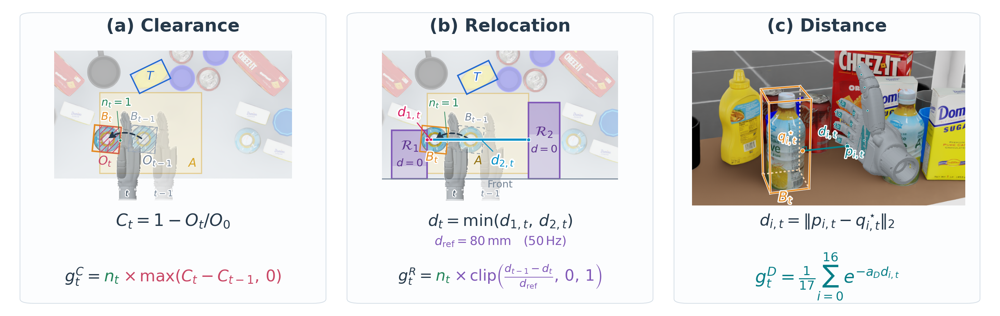

# 독립 비교 학습 3개 — 설정과 실행 명령

기준일: **2026-11-15, Asia/Seoul**. 프로젝트: `contact_manipulation_symmetric`.

세 실험은 같은 기존 UR5e 설정에서 독립적으로 분기한다. 이전 checkpoint를 이어 학습하지 않고
각각 새 학습을 시작한다. 원래 task와 기존 Relocation 함수는 비교 기준으로 보존한다.

## 1. 실험 구성

| 구분 | 학습1 | 학습2 | 학습3 |
|---|---|---|---|
| 배정 컴퓨터 | `server_computer` | `jh_computer` | `base_computer` |
| 변경 목적 | 실거리 진행량으로 Relocation 정규화 | Target 뒤쪽으로 밀어도 가림이 남도록 평가 | 작은 wrench로 탐색 |
| Relocation | 새 거리 감소량·80mm 기준 | 기존 exponential 품질 증가량 | 기존 exponential 품질 증가량 |
| 재배치 목표 영역 | 예약 목적지 **+ 전방 통로** | 기존 예약 목적지 | 기존 예약 목적지 |
| Access region | 기존 | **선반 뒷벽까지 확장** | 기존 |
| Force scale | 기존 10N/raw | 기존 10N/raw | **3축 공통 0.1N/raw** |
| Torque scale | 기존 1N·m/raw | 기존 1N·m/raw | **3축 공통 0.001N·m/raw** |
| Terminal 보상 | 제외 | 제외 | 제외 |
| 실제 종료 조건 | 기존 유지 | 같은 조건을 확장 영역으로 평가 | 기존 유지 |

Terminal 보상 제외는 세 실험의 공통 변경이다. Success·실패·timeout의 실제 종료 조건은 유지한다.
기존 baseline task의 Terminal 보상은 보존한다.
Actor·Critic·관측·PPO·나머지 보상식과 weight·Hand·물리/정책 주기·배치 생성 규칙은 상속한다.
현재 정책은 50Hz, 물리/OSC는 100Hz다. Time curriculum도 기존 설정을 유지한다.
모델 readout은 기존320D를 유지한다. 보류한 attention-only128D 비교는 이번 세 실험에 섞지 않는다.

| 실험 | Gym task ID | 로그 상위 폴더 (`logs/rsl_rl/` 아래) |
|---|---|---|
| 학습1 | `Isaac-Contact-Manipulation-Symmetric-UR5e-RelocationDistance-v0` | `contact_manipulation_symmetric_relocation_distance/` |
| 학습2 | `Isaac-Contact-Manipulation-Symmetric-UR5e-AccessBackWall-v0` | `contact_manipulation_symmetric_access_back_wall/` |
| 학습3 | `Isaac-Contact-Manipulation-Symmetric-UR5e-SmallWrench-v0` | `contact_manipulation_symmetric_small_wrench/` |

각 폴더 안에는 실행 시각별 하위 폴더, `params/env.yaml`, `params/agent.yaml`,
TensorBoard 이벤트와 checkpoint가 저장된다. 별도 PPO 구현이나 학습 루프는 추가하지 않는다.

## 2. 학습1 — 거리 감소량 정규화



$$
d_t=\min_k\operatorname{dist}\left(p_{B,t}^{xy},\mathcal R_k\right),
\qquad
d_{\mathrm{ref}}=4\,\mathrm{m/s}\times\Delta t.
$$

$$
g_t^R=n_t\operatorname{clip}\left(
\frac{d_{t-1}-d_t}{d_{\mathrm{ref}}},\,0,\,1
\right).
$$

| 항목 | 구현 |
|---|---|
| 함수 | `mdp.blocker_relocation_distance_progress` |
| 기준 속도 | `reference_speed=4.0`m/s, [제조사 명세·캡처와 선정 근거](UR5E_RELOCATION_REFERENCE_DISTANCE.md) |
| 기준 거리 | 정책 50Hz에서 80mm. 실제 `env.step_dt`에 비례하여 계산 |
| 접촉 수 $n_t$ | 현재 Blocker 전용 유효 tactile pad 수, 기준 0.01N |
| 영역 $\mathcal R_k$ | 생성 시 실제로 예약한 목적지 사각형과 그 전방 통로의 합집합 |
| 내부·경계 | 거리 0. 안에 머무르기만 하면 진행 보상 0 |
| 정체·악화·무접촉·유효 영역 없음 | 보상 0 |
| Weight | 기존 3.0 유지. Native RewardManager가 weight·정책 dt를 적용 |

영역별 최소 거리를 평가하므로 좌우 영역을 하나의 convex hull로 합쳐 통로 사이를 채우지 않는다.
Blocker 중심이 영역에 들어오면 거리 0이며, 전체 footprint가 들어왔다는 판정은 아니다.
직전 위치는 매 정책 스텝의 기존 상태 이력을 사용하므로 비접촉 중 개선을 재접촉 때 소급 지급하지 않는다.
부분 reset은 해당 환경의 비교 기준만 초기화한다. 초기 영역은 새 공유 장면당 한 번 생성한다.

기존 `blocker_relocation`과 `blocker_relocation_contact_progress`는 보존했다.
새 그림은 학습1의 거리 진행식을 나타내는 별도 파일이며 이전 설계 그림도 보존한다.
그림의 Distance 식은 기하 품질을 나타낸다. 실제 지급 조건은 기존 Target 보호 gate를 유지한다.

## 3. 학습2 — Access region 후방 확장

| 항목 | 구현 |
|---|---|
| 변경 위치 | 최종 reset 데이터의 **평가용** `SceneBatch.access_region` |
| 후방 경계 | 실제 선반 지지면의 후방 X 경계인 `workspace_bounds[:, 0]` |
| 유지 경계 | 기존 정면 X 경계와 좌우 Y 경계 |
| 평가 대상 | 초기 가림 면적, 현재 Clearance, 성공 판정, GUI Access 표시 |
| 보존 입력 | 생성된 sample·공유 template·물체 위치·시점·초기 ray·로봇 IK |

이 환경에서는 +X가 선반 정면이다. 기존 Target 전면에서 끝나던 영역의 최소 X를
선반 후방으로 확장한다. 따라서 Blocker를 Target 뒤로 옮겨도 같은 폭 안에 있으면 가림이 남는다.
기존 배치 규칙을 바꾸거나 Target 뒤쪽 공간을 추가로 비우지 않는다.
학습1의 목표 영역·정규화 수식이나 학습3의 action scale은 적용하지 않는다.

## 4. 학습3 — 공통 wrench scale

```python
# 센서 frame의 Fx, Fy, Fz, Tx, Ty, Tz
wrench_scale = (0.1, 0.1, 0.1, 0.001, 0.001, 0.001)
```

기존 단축 시험에서 가장 민감했던 Fx·Tz에 맞췄다. 해당 SI 명령을 한 자세에서 0.8초 유지하고
0.3초 해제했을 때 최대 팔 관절속도는 각각 0.306·0.463rad/s였다. 모든 자세·복합 입력·접촉에서
과속을 방지하는 값은 아니다. Gaussian raw 출력과 센서 범위의 최종 SI clipping은 기존대로다.

`action_rate`는 clipping한 **raw action 차분**을 평가한다. 따라서 같은 물리 명령 변화에 대한
비용은 기존 대비 힘 10,000배·토크 1,000,000배가 된다. 같은 raw 변화의 비용은 같다.
이번 비교는 기존 보상식·weight를 유지하므로 과속 감소와 조작 위축을 함께 확인한다.
선정·실측 이력은 [TRAINING_LOG.md](TRAINING_LOG.md)의 154–155절을 따른다.

## 5. 컴퓨터별 학습 명령

각 컴퓨터의 저장소 최상위에서 실행한다. 같은 코드 revision·기본 asset·환경을 사용한다.
명령은 모두 새 학습이며 `--resume`을 지정하지 않는다.

### server_computer — 학습1

```bash
./IsaacLab/isaaclab.sh -p src/contact_manipulation_symmetric/scripts/train.py \
  --task Isaac-Contact-Manipulation-Symmetric-UR5e-RelocationDistance-v0 \
  --num_envs 1024 --headless --max_iterations 90000
```

### jh_computer — 학습2

```bash
./IsaacLab/isaaclab.sh -p src/contact_manipulation_symmetric/scripts/train.py \
  --task Isaac-Contact-Manipulation-Symmetric-UR5e-AccessBackWall-v0 \
  --num_envs 1024 --headless --max_iterations 90000
```

### base_computer — 학습3

```bash
./IsaacLab/isaaclab.sh -p src/contact_manipulation_symmetric/scripts/train.py \
  --task Isaac-Contact-Manipulation-Symmetric-UR5e-SmallWrench-v0 \
  --num_envs 1024 --headless --max_iterations 90000
```

## 6. 실험별 play 명령

각 실험의 `play.py`는 해당 task를 선택하고 기존 native play 흐름을 사용한다.
`<run>`과 `<iteration>`을 실제 실행 폴더·checkpoint 번호로 바꾼다.
학습 시 사용한 실험과 같은 진입점을 사용한다.

### 학습1

```bash
./IsaacLab/isaaclab.sh -p \
  src/contact_manipulation_symmetric/contact_manipulation_symmetric/experiments/relocation_distance/play.py \
  --checkpoint "logs/rsl_rl/contact_manipulation_symmetric_relocation_distance/<run>/model_<iteration>.pt" \
  --num_envs 1
```

### 학습2

```bash
./IsaacLab/isaaclab.sh -p \
  src/contact_manipulation_symmetric/contact_manipulation_symmetric/experiments/access_back_wall/play.py \
  --checkpoint "logs/rsl_rl/contact_manipulation_symmetric_access_back_wall/<run>/model_<iteration>.pt" \
  --num_envs 1
```

### 학습3

```bash
./IsaacLab/isaaclab.sh -p \
  src/contact_manipulation_symmetric/contact_manipulation_symmetric/experiments/small_wrench/play.py \
  --checkpoint "logs/rsl_rl/contact_manipulation_symmetric_small_wrench/<run>/model_<iteration>.pt" \
  --num_envs 1
```

GUI의 `Debug Visualization`에서 Access·Relocation 영역, Target/Blocker OBB,
Tactile/F/T 표시를 켜면 해당 실험이 실제 평가하는 영역과 센서를 확인할 수 있다.
영역 표시는 물리 충돌 형상을 추가하지 않는다.

영상 저장은 위 play 명령에 `--video --video_length 600 --headless`를 추가한다.
현재 50Hz에서 600스텝은 시뮬레이션 12초이며,
영상은 해당 checkpoint 폴더의 `videos/play/` 아래에 저장된다.

## 7. 구현 위치와 재검증

| 구현 | 경로 |
|---|---|
| 공통 Terminal 보상 제외 | [experiments/common.py](../src/contact_manipulation_symmetric/contact_manipulation_symmetric/experiments/common.py) |
| 학습1 설정 | [relocation_distance/env_cfg.py](../src/contact_manipulation_symmetric/contact_manipulation_symmetric/experiments/relocation_distance/env_cfg.py) |
| 학습2 설정 | [access_back_wall/env_cfg.py](../src/contact_manipulation_symmetric/contact_manipulation_symmetric/experiments/access_back_wall/env_cfg.py) |
| 학습3 설정 | [small_wrench/env_cfg.py](../src/contact_manipulation_symmetric/contact_manipulation_symmetric/experiments/small_wrench/env_cfg.py) |
| 새 보상 함수 | [mdp/rewards.py](../src/contact_manipulation_symmetric/contact_manipulation_symmetric/mdp/rewards.py) |
| 영역 생성·평가 분리 | [mdp/events.py](../src/contact_manipulation_symmetric/contact_manipulation_symmetric/mdp/events.py) |
| Native reset/step 진단 | [tests/probe_experiments.py](../src/contact_manipulation_symmetric/tests/probe_experiments.py) |

CPU 검증:

```bash
./IsaacLab/isaaclab.sh -p -m unittest discover \
  -s src/contact_manipulation_symmetric/tests -p 'test_experiment_*.py' -v
```

다른 컴퓨터에서 학습 전에 task 하나의 실제 4환경 초기화·부분 reset·장면 교체·짧은 step을
확인하려면 다음 진단을 사용한다. `--task`와 출력 파일명을 실험에 맞게 변경한다.

```bash
./IsaacLab/isaaclab.sh -p src/contact_manipulation_symmetric/tests/probe_experiments.py \
  --task Isaac-Contact-Manipulation-Symmetric-UR5e-RelocationDistance-v0 \
  --num_envs 4 --scenes 2 --steps 6 --headless --device cuda:0 \
  --output logs/diagnostics/experiment_relocation_distance.json
```

진단은 PPO를 실행하지 않는다. 4환경의 짧은 검증은 장기 학습 안정성이나 1,024환경 처리 시간의
측정과 구분한다. 최종 검증 결과와 적용 이력은 [TRAINING_LOG.md](TRAINING_LOG.md)에 기록한다.

### 2026-11-15 검증 결과

| 검증 | 결과 |
|---|---|
| 신규 실험 CPU 검증 | 보상10개·영역8개·설정/CLI7개 통과 |
| 전체 CPU 회귀 | 총643개 중620통과, CUDA/Kit전용23생략 |
| 실제 native 환경 | 세 실험 각각4환경·2공유장면·부분reset2회·12control step 통과 |
| 실험 간 배치 비교 | seed42의 두 장면에서 Target/Blocker·활성ID·위치·yaw·생성 Access·예약 목적지 일치 |
| 평가 기하 | 학습1만 목적지2개+전방통로2개, 학습2만 rear X가−0.9m로 확장 |
| 관측·종료 | Actor/Critic 동일232D·유한값, Terminal 보상 없음, 성공 종료 유지 |
| Play 진입점 | 세 파일의 실제 `--help` 및 CPU CLI 전달 검증 통과 |
| 학습 실행 | 없음 |

Native 원자료·전체 회귀 로그는 `logs/diagnostics/three_experiments_2026-11-15/`에 보존했다.
전체 회귀에서 새 flag가 누락된 테스트 fixture와 기존 비활성 Contact-hold를 활성으로 가정하던
검사 두 곳을 수정했다. 이를 위해 실제 보상 설정을 바꾸지는 않았다.
