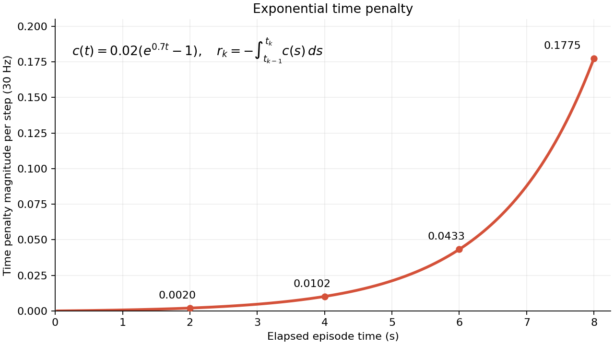

# 연구와 Isaac Lab 개발 맥락

최종 갱신: **2026-10-12, Asia/Seoul**.

밀집 선반에서 Target 접근 공간을 확보하는 비파지 재배치 연구의 목적, 설계가
바뀐 이유, 현재 구현과 검증 결과, 미결 질문을 유지한다. 새 대화와 개발 작업은
이 문서를 먼저 읽고 관련 코드 및 세부 문서로 이어간다.

연구 기준은 Notion의 [연구 맥락 — 생각의 흐름과 현재 설계](https://app.notion.com/p/3f34968094ee81ca8eb6feb1f700e0f9)
이다. 해당 페이지의 연구 기준일은 2026-10-08이며, 2026-10-09에 다시 확인했다.
이 문서는 그 맥락과 이후 이 저장소에서의 개발을 통합한다.

## 1. 현재 위치와 상태 구분

**스폰·센서 위에 학습용 MDP와 모델·PPO를 구현했으며, 시간 입력을 현재·직전
두 sample로 변경했다.**
사용자의 후속 교정에 따라 **mask는 observation 채널에 포함하지 않으며,
모델 호출 전에 observation 정보만으로 생성**한다. 이어 역할 ID 대신
**Target 슬롯 0·Blocker 슬롯 1을 고정**하도록 교정했다. 현재 policy observation은
초기 물체 기하와 두 72D sample을 합친 **544D**다.
장면 확인용 `ManagerBasedEnv`와 학습용 `ManagerBasedRLEnv`를 구분한다. 사용자가
초기에는 최근 16 step 이력을 선택했으나 후속 요청에 따라 **현재 t와 직전 t−1의
센서·로봇 상태·행동 두 sample**로 줄였다. 18D OSC/hand action,
Reward v2·종료 조건, 초기 장면 GNN·역할 조건부 attention·유한 이력 encoder,
공동학습 PPO를 구현했다. 물체 입력은 승인한 초기 RGB-D에서 추정한 기하만
사용한다. 초기 기하를 robot base에 저장하고 매 policy step에 **현재 EEF
좌표계로 재표현**하며 현재 실제 물체 pose를 actor에 넣지 않는다. 제어 기준
좌표계는 `examples`의 sweeping 프로젝트처럼 robot root/base다. 아래의
스폰·센서 GPU 검증을 새 MDP의 학습 성공이나 제어 검증으로 확대하지 않는다.
Reward·제어 수치는 provisional default이며 정책 성능은 아직 입증하지 않았다.
후속 Time 교정은 `T_ref`를 제거하고 초반부터 완만하게 증가하다가 후반에
가팔라지는 지수형 비용을 적용한다. 환경별 episode clock은 reward 내부에 두며
현재 544D observation에는 추가하지 않는다. 자세한 수식과 개형은 4절에 둔다.
Clearance·Rearrangement·Motion은 `exp(−a·x)` 품질 점수로 통일하고,
Rearrangement는 모든 물체의 평균 OBB corner 3D 경로를 누적해 병진·회전을
평가한다. 실제 물체 pose는 privileged reward·검증에만 사용한다.
F/T 측정 모델은 사진의 **ATI Axia80 SI-200-8** 범위·유효 분해능으로 설정하고,
측정 후 자중·관성을 보상해 축별 full scale로 정규화한다. 센서 전체 하중의
범위 초과와 기존 보정 하중의 작업 안전 한계는 구분한다.
코드 구조는 `examples`의 `sweeping_policy`를 따라 공통 환경 설정,
`config/ur5e`의 로봇·학습 설정, `mdp`의 manager 함수, `src`의 장면 지원 구현으로
정리했다. 학습은 `Isaac-Contact-Rearrangement-UR5e-v0`의 등록된 설정으로 실행한다.
다중 환경 학습은 공통 초기 장면을 사용한다. 전체 reset마다 물체 배치·역할·로봇
초기 자세를 새로 정하고 초기 vision을 한 번 승인해 모든 환경에서 재사용한다.
부분 reset은 현재 공통 초기 장면을 복원하며 물리 상태·행동·센서는 환경별로
독립적이다. 카메라는 실제 RGB-D와 비가림 기준 실루엣용 총 2개를 공유하고,
Headless 실행에서는 자동 렌더링을 생략하고 초기 촬영 때만 명시적으로 렌더링한다.
카메라 버퍼는 계속 유지하며 env 0만 시각적으로 렌더링한다. 물리 replica는
Fabric으로 복제한다. PPO는 원래 minibatch의 gradient를 최대 32 sample씩 누적하며,
학습 흐름은 예제의 **Hydra → gym.make → RslRlVecEnvWrapper → OnPolicyRunner → runner.learn**이다.
Rollout storage·GAE·학습 반복·콘솔·TensorBoard·checkpoint는 native RSL-RL이 담당하며
연구 network 공유·정확한 final-observation bootstrap·microbatch·profile 검사만 확장한다.
환경은 SceneCfg와 manager/event 구조를 유지하고 RewardTerm 5개로 항별 로그를 생성한다.
기본 출력 경로는
`logs/rsl_rl/contact_rearrangement/<시작 시각>/`이다.
새 패키지 `src/contact_rearrangement`는 **10종 asset 중 4–10종을 선택하고
전체 선반 밀도에 필요한 수의 instance를 배치**한다. 이전에 4–10종을
active instance 4–10개로 해석한 것은 잘못이며 종류 수와 개수를 분리했다.
`--all_asset_types`는 10종 모두 선택하고 non-target 복사본을 추가할 수 있다.
**Target 종류는 active 장면에 한 번만 등장**하고 Blocker·주변 후보에서 같은
종류의 모든 복사본을 제외한다. 종류마다 최소 한 instance를 선택한 뒤 footprint
면적에 따라 개수를 정한다. 추가 가능한 non-target 종류 중 active 개수가 가장
적은 종류를 고르고 동률은 무작위로 정해 중복 편중을 줄이는 구성으로 변경했다.
Blocker도 해당 종류의 첫 instance로 센다. Target은 항상 하나이며 현재 동일
pool capacity에서는 non-target 종류별 개수 차이가 최대 1이다. 별도 종류별
최대값은 없고 pool의 10-copy·전체 cap 40을 유지한다. 작은 물체 위주 종류
집합은 같은 면적을 채우려면 더 많은 instance가 필요할 수 있다.
기본 instance 최소 4·최대 40은 safety limit이다.
10종 × 10개 복사본의 100-body pool을 유지한다. Pool 전체의 rigid-body
simulation과 native gravity를 켜 두고,
나머지는 높은 격리 위치에 주차해 매 physics substep마다 COM에 `-m*g` 외력을
적용한다. Active 물체에는 추가 힘을 주지 않아 원래 중력과 접촉을 유지한다.
Episode의 Target·Blocker를 먼저 지정하고 **종류 수·집합, 전체 active instance
ID와 개수**를 pose sampling 전에 고정한다. Retry에서는 yaw와 위치만 바꾼다.
Target은 Blocker가 앞에 들어갈 수 있는 전체 X 범위에서 선택한다. 기존 뒤쪽
10 cm 제한과 38 cm cluster·35% tight-rectangle fill 조건은 폐기했다.
현재 구현은 전체 usable shelf 점유율 **35% 이상**, X 2 × Y 3의 **6개 구역
각각 10% 이상**, 4 cm footprint 이웃을 가진 active 비율 **75% 이상**을 hard
acceptance 조건으로 요구한다. X/Y coverage와 병진·평면 pivot·회전 후 이동의
다단계 clearance witness도 검사한다. 사용자는 구현 가능한 범위를 먼저 측정해
밀도를 정하도록 요청했고, 25–45% 비교에서 생성 속도와 성공률을 고려해 35%를
초기 기본값으로 선택했다. 사용자가 직접 정한 최종 연구 난이도 수치는 아니다.
앞쪽 +X camera의 실제 초기 영상에서 Target 가시 비율 **40% 이상**을 요구하기로
했다. 분모는 같은 camera·같은 pose에서 가림 없이 렌더링한 전체 Target
silhouette 픽셀 수다. 현재 앞쪽 RGB-D camera와 실제 silhouette acceptance를
구현하며 **Blocker 전체 가시성**도 함께 요구한다. Target·Blocker 둘 다 전체
bounds가 frame 안에 있어야 한다. 승인한 초기 snapshot은 episode 동안 고정한다.
YCB 003·004·005·006의 초기 회전을 **X축 −90°**로 교정하고, 원본 USD의
수정 전·후 각 8장 렌더에서 라벨·캔 고리·병뚜껑으로 상하를 확인했다.
이전 큰 footprint 우선 복사본 구성의 35% 규칙은 실제 USD 측정 bounds로 일반·all-types 각각 seed 0–19,
**총 40개 기하 sample**을 통과했다. 일반 모드는 4–10종·10–24 instance,
all-types는 10종·14 instance였다. 일반·all-types 각각 **4개 GPU 환경·10초**의
정착·전체/부분 reset 검사도 통과했다. 각 모드의 8개 layout을 각각 5초 진행한
범위이며 기하 benchmark와 물리 검사를 구분한다. 당시 unit test 21개도 통과했다.
이 분포와 통과 결과를 현재 균형 구성의 결과로 사용하지 않는다. 현재 균형
구성은 Blocker 앞 reserve·camera gate 추가 전 기하 sample **40/40개**와
일반 모드 **4개 GPU 환경·151 step·5.03초**의
정착·전체/부분 reset 검사를 통과했다. 당시 unit test **23개**도 통과했으며
현재 구성의 별도 all-types GPU 실행은 완료한 것으로 기록하지 않는다.
**전물체의 2 mm 낙하 여유를 제거**하고 003·004에만 visible mesh를 유지한
**명시적 Cube collision proxy**를 적용해 초기 흔들림을 줄였다. 원본
Nucleus USD·authored mass·contact 속성·physics material·active gravity는 유지한다.
이전 정확히 10개 instance 버전에서는 이 collider로 **4개 GPU 환경·10초**의
정착·전체/부분 reset 검사가 통과했다. 이 결과와 이전 실패·비채택 approximation,
새 종류/instance 분리 benchmark는 8절에서 구분한다.
판단·행동 모델과 PPO 코드는 추가했으며 학습 성능은 아직 확인하지 않았다.
사용자 요청으로 장면 확인 스크립트에 **Target 초록색·Blocker 빨간색 OBB**의
debug draw 표시를 추가했다. 물리·USD asset을 수정하지 않는 확인용 표시이며
2개 CUDA 환경의 headless reset 검사와 1개 GUI 환경의 실제 표시 검사가 통과했다.
2026-10-09에는 사용자가 파일이 지나치게 나뉜 구조를 정리하도록 요청해
구현을 책임별 **6개 모듈**로 통합했다. 당시 `catalog`·`assets`·`env_cfg`·`spawn`·
`sampling`·`visualization` 구조였으며 스폰 규칙·기본값·실행 명령을 유지했다. 통합 후 unit test **23개**와
일반 모드 **4개 GPU 환경·151 step·5.03초** 검사가 통과했으며 초기·자동 reset
뒤 8개 장면 설명이 통합 전과 같았다. 아래 기존 실행 결과와 구분해 기록한다.
사용자는 **Blocker 앞의 충돌 없는 hand 시작 영역 randomization과
elbow-down 금지**를 요청했다. RobotStartRules·실제 USD FK/IK·초기 collision
판정을 구현했고 2026-10-09의 24개 시작·반복 reset·5초 물리 검사와 unit test
**29개**가 통과했다. 당시 손가락/tool은 아래를 향했다. 사용자의 후속 요청에
따라 tool 전방을 **선반 방향인 world −X**로 교정했고 palm normal이 위를
향하던 이 단계의 4개 GPU 환경·151 step·5.03초 검사도 통과했다. 이어
사용자가 tool 기준 Z축으로 hand를 **−90° 회전**하도록 요청해 mount에 roll을
추가한다. 현재 tool 전방은 −X를 유지하고 palm normal은 world −Y를 향한다.
새 hand roll의 4개 GPU 환경·151 step·13개 시작 pose 검사도 통과했다.
앞 단계의 통과 결과와 새 hand roll의 검사를 구분한다. 후속 요청으로 실제
센서·연결부의 공간을 고려해 UR5e 말단과 hand 사이에 **길이 5 cm·직경
5 cm의 원통 연결부**를 추가한다. 연결부는 wrist-3의 compound collider이며
별도 body나 DOF를 만들지 않는다. 연결부 추가 전 검증과 새 조립 검사를 구분한다.
새 연결부의 4개 GPU 환경·151 step·13개 시작 pose 검사도 통과했다.
후속 센서 단계에서는 원통을 25 mm 두 rigid half로 나누고 중앙 fixed joint의
실제 F/T를 읽는다. 앞쪽 camera pose를 무작위로 제안해 Target ≥40%·Blocker
100%(면적 2 pixel 허용)를 실제 렌더로 승인하며 raw F/T와 초기 RGB-D/mask를
`sensors` observation group에 제공한다. 이번 센서 단계의 검증은 별도로 기록한다.
최종 4개 GPU 환경 검사에서 18개 시작 pose의 실제 가시성과 capture 중 native
state 무변경, 초기 snapshot 보존·F/T 유효성·알려진 force/torque 응답이 통과했다.
가시성 proposal을 개선하려고 `reserve_blocker_front=True`로 Blocker 앞의
직선 +X 통로를 주변 물체로부터 비운다. 기존 전체 선반 밀도와 Target A₀는
유지하며 이 통로가 실제 가시성을 보장하는 것으로 취급하지 않는다.
현재 hand의 17개 tactile link 각각에 독립 `ContactSensor`를 붙이고 world net
normal force norm **>0.01 N**을 binary contact로 제공한다. 2개 GPU 환경에서
17개 pad의 실제 contact ON/OFF·부분 reset·render cache 보존 검증도 통과했다.

| 상태 | 의미 |
|---|---|
| 결정 또는 방향 | 사용자가 선택한 연구 방향. 구현 완료나 성능 입증을 뜻하지 않는다. |
| 현재 작업안 | 현재 구체화 기준으로 삼는 설계. 세부 구조와 수치는 더 정해야 한다. |
| 구현 기본값 | 지금 코드 실행을 위한 설정. 연구 전체의 최종 명세로 간주하지 않는다. |
| 제안 및 미채택 | 검토 후보. 사용자의 질문이나 설명 요청을 채택으로 기록하지 않는다. |
| 검증 결과 | 명시한 조건과 검사에서 실제 확인한 결과. 검사 범위 밖으로 확대하지 않는다. |

우선순위는 **최신 사용자 결정 → 현재 연구 맥락 → 과거 설계·발표 자료**다.
코드의 실제 동작은 해당 코드와 실행 결과로 확인한다. 연구 설계와 코드가 다르면
어떤 부분이 구현 전인지, 이전 실험의 설정인지 명시한다.

현재 코드 구조는 사용자의 후속 요청에 따라
`examples/Sweeping-Policy-DRL-Sim-Train/sweeping_policy`를 기준으로 정리했다.
공통 환경 설정, `config/ur5e`의 로봇별 설정·Gym task 등록·agent 설정,
`mdp`의 manager 함수, `src`의 장면 지원 구현을 분리한다. Shared transition은
`mdp/state.py`가 한 번만 갱신하며 물리·관측·reward·18D action 명세를 유지한다.
현재 파일 위치와 task registry 기반 실행은 7절과 패키지 README에 정리한다.

## 2. 연구 목적과 범위

근사적인 초기 물체 기하와 촉각·힘/토크 피드백을 이용해, 명시적 Blocker 종착
pose 없이 Target 접근 공간을 확보하는 신속한 비파지 재배치 정책을 학습한다.

- **Target:** 접근 공간을 확보하려는 물체. 역할은 외부에서 지정한다.
- **Blocker:** 접근을 방해하며 주로 조작할 물체. 역할은 외부에서 지정한다.
- **주변 물체:** 추가 접촉·충돌·차단이 발생할 수 있는 물체.
- **조작:** 선반의 지지를 받으며 밀기·회전으로 재배치한다. 파지해서 들어 옮기는 것을 주된 해법으로 삼지 않는다.
- **정책 역할:** Blocker의 최종 goal pose를 사전에 입력하지 않고 재배치 판단과 로봇 행동을 함께 학습한다.
- **실행 목표:** 접촉 변화에 빠르게 대응하면서 성공·안정성을 유지하고 수행시간을 줄인다. Rapid는 아직 입증되지 않은 연구 목표다.
- **환경과 장비:** 고정 선반, UR5e + RH56E2 hand, wrist F/T, 17개 위치의 binary tactile. 선반 형상은 현재 observation 명세에 포함하지 않는다.

가림과 근사 형상 때문에 유효한 종착 pose를 사전에 안정적으로 특정하기 어려울
수 있다는 문제 설정이다. 상위 모델이 goal pose를 생성할 능력이 없다는 주장은 아니다.
실제 Target 파지·인출까지 학습할지, 여러 Blocker의 조작 순서를 다룰지는 미정이다.
발표용 제목은 **신속한 비파지 재배치를 위한 촉각 및 힘·토크 피드백 기반
판단·행동 통합 심층 강화학습 정책**이었다. 학위논문의 최종 제목 확정과 구분한다.

## 3. 현재 관측과 정책 작업안

### 관측과 시간 구조

최신 방향은 **초기 vision을 사용하고, 이후 robot state·F/T·tactile·행동 이력으로
이번 episode의 환경 변화를 해석하는 것**이다. 지속적인 vision 갱신을 기다리는
의존성을 줄여 촉각·힘 피드백의 빠른 대응을 살리려는 의도다. 초기에는 16-step
window를 구현했으나 사용자가 **previous step까지만 제공**하도록 변경했다.
현재 입력은 **현재 t와 직전 t−1의 두 sample**이며 newest-first로 저장한다.
Policy는 30 Hz, physics는 120 Hz이므로 sample 사이 간격은 약 33 ms다.
Reset 직후 현재 sample만 valid, 직전 sample은 zero/invalid로 두며 그보다 오래된
이력은 제공하지 않는다. Episode를 넘어 유지하는 GRU/LSTM은 도입하지 않았다.

| 입력 | 현재 구현 | 후속 교정 |
|---|---|---|
| 초기 물체 기하 | 물체별 위치 3D + quaternion(wxyz) 4D + OBB extent 3D = 10D, 현재 EEF 기준 | 단일 시점 visible depth의 근사 오차와 실기 detector |
| 물체 역할 | K=40 중 슬롯 0=Target·1=Blocker·2–39=주변 물체. 역할 ID 채널 없이 고정 슬롯과 유효 기하로 mask 생성 | 실기에서의 identity/role association과 초기 정렬 |
| Robot state | Arm 6개·hand 독립 6개 관절의 q/dq 24D + base 기준 EEF pose 7D = 31D | 실제 구동 관절 정규화·동기화 |
| Wrist F/T | SI-200-8 측정 범위·분해능 근사 후 sensor-frame 자중·병진/회전 관성 보상 force/torque 6D, 선택적 residual bias tare | Filtering·실제 질량/관성·가속도 추정과 bias 교정 |
| Tactile | 17D, 0=비접촉·1=접촉·−1=결측. 유효성 mask는 이 값으로 생성 | 0.01 N은 변경 가능한 초기 threshold |
| Previous action | 해당 관측 직전 적용한 normalized action 18D | Policy/control 주기 교정 |

K는 Target·Blocker를 포함한 전체 최대 슬롯 수다. 같은 물체 기하를 역할별로
중복 계산하지 않는다. 모든 가려진 물체를 초기 vision으로 알고 있다는 가정도 하지 않는다.
관절 관측 차원은 URDF의 전체 물리 관절 수와 독립 구동 관절 수를 구분해 구현해야 한다.

초기 기하는 승인한 camera snapshot의 instance mask 안에 있는 visible depth를
back-project하고 PCA OBB로 근사한다. Simulator instance ID는 물체별 분할과
외부 Target/Blocker 역할의 association에 사용하므로 이 부분은 oracle이다.
USD의 전체 bounds나 현재 실제 물체 pose를 geometry feature로 복사하지 않는다.
관측하지 못한 물체는 invalid padding이다. 가림으로 extent가 작게 추정될 수 있으며
완전한 물체 형상을 복원했다고 해석하지 않는다.

Camera extrinsic으로 변환한 초기 geometry의 canonical copy를 robot base에
저장한다. 매 policy step마다 현재 EEF pose의 역변환을 적용해 위치·orientation을
현재 EEF 기준으로 표현하고 extent는 유지한다. 이는 world에 고정한 **초기
추정 장면의 재표현**이다. 조작 후의 실제 물체 이동을 vision으로 갱신하거나
정답으로 대체하지 않는다. 제어·robot EEF pose는 base, 물체 입력은 현재 EEF,
F/T 입력은 sensor frame을 각각 사용한다.

한 history sample은 `31 + 6 + 17 + 18 = 72D`다. Actor flat observation은
`geometry 40×10 + history 2×72`
순서로 **544D**다. 현재 sample에는 해당 관측 직전 적용한 action aₜ₋₁,
직전 sample에는 aₜ₋₂를 포함한다. Reset 첫 현재 sample의 action은 0이다.
관측 생성 단계에서 외부 역할 association으로 Target·Blocker의 기하를 각각
슬롯 0·1에 배치한다. 관측된 주변 물체는 기존 상대 순서대로 슬롯 2부터 채우고
나머지는 0이다. 역할 물체가 미관측이면 예약 슬롯은 0으로 유지하며 다른 물체로
대체하지 않는다. 역할 ID 채널은 observation에서 제거했다.
`build_policy_masks(observation, cfg)`가 observation만으로 물체·역할·history·
tactile mask를 생성한 뒤 `model.act(obs, masks=...)`로 별도 전달한다.
물체 유효성은 finite 기하·양의 extent·0이 아닌 quaternion으로, history 유효성은
finite robot/F/T/action·0이 아닌 EEF quaternion으로 판단한다. 미관측 물체와
reset 직후의 직전 sample 슬롯은 zero padding, 결측 tactile은 −1이므로 추가 내부 정보가
필요하지 않다. Reset 현재 tactile도 −1이다. Boolean mask는 learned feature로
concat하지 않으며 결측 tactile은 encoder에 넣기 전에 0으로 필터링한다.
관절 q/dq는 π·2 rad/s, F/T는 축별 SI-200-8 full scale
`[200,200,360,8,8,8]`(힘 3축 N, 토크 3축 N·m)로 나누고 기존 `[-5,5]` clip을 유지한다.
과거의 scalar 50 N·5 N·m 정규화는 제거했다.
과거 `72 + 11K`의 current-only 입력안은 이력 구조로 대체했다.

Actor가 현재 실제 object pose·velocity를 받기로 한 것은 아니다. 시뮬레이터
정답을 reward·검증·학습 label에 쓰는 것과 actor 실행 입력에 쓰는 것은 구분한다.
History를 외부 상태 추정기로 해석한 뒤 추정 상태를 actor에 넣는 구조는 지양한다.

### 관계 처리와 학습

현재 구현 구조는 다음과 같다.

```text
Observation 기하의 고정 역할 슬롯·zero padding·tactile 결측값
  → 모델 호출 전 물체·역할·history·tactile mask 생성
초기 물체 기하(현재 EEF 재표현)
  → 공유 node encoder / dense GNN 2 rounds
  → Target·Blocker 조건부 masked attention readout
현재 t·직전 t−1의 robot state·F/T·tactile·action
  → 두 sample을 받는 causal convolution
두 encoder feature 결합
  → bounded Gaussian actor의 18D action + shared critic
```

- Target·Blocker 슬롯 0·1은 역할을 나타내므로 고정한다. 주변 물체 슬롯 2 이상은 순서를 바꿔도 같은 장면에 대해 같은 판단을 하도록 집합을 처리한다. 실제 공간 배치는 입력에 남아야 한다.
- GNN edge는 메시지 교환을 허용하는 연결이다. 접촉·방해 관계의 정답 label을 미리 제공하는 것으로 정하지 않았다.
- 로봇에 대한 물체 위치를 판별할 정보가 필요하다. 물체 간 상대 관계만 남기는 구조로 단순화하지 않는다.
- Role mask와 valid mask는 목적이 다르다. Zero padding에서 valid를 만들면 noise·정규화 전에 생성하고 message passing과 attention에서 padding을 제외한다.
- GNN의 같은 forward 내 message-passing 반복과 episode의 시간적 기억은 다르다.
- Node 64D, message passing 2 rounds의 dense valid edge를 사용하며 self/padding edge를 제외한다. Edge feature는 초기 물체 간 상대 위치·extent 차이다. Role-conditioned query는 Target·Blocker embedding에서 만들며 두 attention readout과 role/global feature를 결합한다.
- Node encoder는 기하 10D, history projection은 sample 72D를 입력으로 받는다. Mask는 learned feature로 concat하지 않고 선택·필터링에 사용하며 역할 ID 채널도 없다.
- History encoder는 64D causal convolution이며 기본 1개 layer로 현재·직전 두 sample을 처리한다. Padding을 제외하고 유효 sample만 pooling한다. Fused latent는 128D이며 기본 모델은 247,717개 parameter다. 더 오래된 sample이나 지속 hidden state는 제공하지 않는다.
- Native RSL-RL runner/PPO에 연구 모델 adapter를 연결해 scene/history encoder와 actor/critic을 공동학습한다. Actor와 critic은 같은 544D 입력과 encoder를 공유하며 privileged critic·현재 물체 GT 입력·보조 예측 head/loss는 추가하지 않았다. Rollout·PPO minibatch·timeout 마지막 관측에서 모두 observation만으로 mask를 다시 생성한다.
- Tanh-Gaussian action의 log probability에는 변환 Jacobian을 반영한다. GAE는 실제 terminal state에서 bootstrap하지 않고, timeout에서는 auto-reset 이전 실제 final observation의 value로 bootstrap하며 다음 episode의 advantage를 이어 붙이지 않는다.

이전 16-step 모델은 관측 1960D·286,053 parameter, mask 채널을 포함했던
2-sample 모델은 700D·248,997 parameter, 역할 ID를 사용하던 모델은
584D·247,717 parameter였다. 현재 모델은 고정 슬롯 관측 규약
`observation_layout="fixed_roles_v1"`을 checkpoint에 저장한다. 역할 ID 제거 전후
network weight shape가 같아도 관측 규약을 검증하며 이전 checkpoint를 직접
복원하지 않는다. 아래의 기존 검증 기록은
각 당시 모델의 결과이며 현재 규격의 검증과 구분한다.

### Action과 제어

| 출력 | 차원 | 제어 경로 |
|---|---:|---|
| EEF motion | 6 | 위치·회전 증분 → variable-stiffness OSC |
| Cartesian stiffness | 6 | 병진·회전 각 3축 강성 → OSC |
| Hand configuration | 6 | RH56E2 독립 구동 관절 목표 위치 → position controller |

총 **18D action**이며 arm의 12D 출력은 OSC를 통해 관절 토크로 연결한다.
목표를 이전 명령에 계속 누적하지 않는 방향을 유지한다. 직전 action을 관측하는
것과 목표 누적은 별개다. Examples의 robot-root reference 구현을 따라 증분은
**base 기준**이며 매 policy step의 실제 TCP pose에서 position과 orientation
목표를 새로 만든다. 회전 증분은 base 축 기준으로 현재 quaternion에 left-multiply한다.
기본 scale은 위치 축별 ±15 mm·회전 축별 ±0.08 rad다.
현재 제어는 사용자의 "예제들처럼 controller class 사용" 요청에 따라 native action 두 개로 나뉜다.

- `arm_action`: `ArmOscAction(OperationalSpaceControllerAction)`의 12D.
  `OperationalSpaceController`가 `pose_rel`·`variable_kp`를 받아 토크를 계산한다.
- `hand_action`: `HandPositionAction(JointPositionToLimitsAction)`의 6D.
  Native joint-position action이 PhysX `ImplicitActuator` PD의 목표 위치를 설정한다.

연구 adapter는 normalized input 매핑, workspace/effort 제한, PhysX COM Jacobian과
velocity를 TCP link origin/base 축으로 맞추는 변환만 추가한다. 목표 pose 생성과
spring/damping/관성 분리/중력 보상은 native OSC가 수행한다.
Custom backward-Euler damping, matrix geometric mean, 32회 Newton–Schulz,
별도 damping CUDA graph는 제거했다. 제어에서 실제 TCP velocity를 native OSC에 전달한다.

기본값은 full inertia decoupling·gravity compensation 활성화, damping ratio 1이다.

$$
\Lambda=(J M^{-1}J^T)^{-1},\qquad
\tau=J^T\Lambda\left[K_p e-2\sqrt{K_p}v\right]+G.
$$

병진 gain 100–800·회전 gain 5–40은 **관성 정규화 gain(s⁻²)**이다.
이전 controller의 물리 강성 N/m·N·m/rad와 구별해야 한다. 숫자 범위와 action/observation
채널 순서는 유지하지만 제어 응답이 달라졌으며, 기존 checkpoint와 같은 제어 동역학을
유지하는 변경은 아니다. 이 값은 native controller 실행 검증의 초기 설정이며 학습 성능에
대한 최종 gain 결정은 아니다. F/T 자중·관성 보상은 센서 처리이며 이 제어 변경과 별도로 유지한다.

Arm actuator PD gain은 0이고, hand의 authored mimic constraint는 유지한다.
Hand 6D는 soft limit 안의 원하는 절대 관절 목표다. 실제 PD target은 매 physics substep의
측정 q에서 `min(native velocity limit, target_rate)`×dt만큼 목표 방향으로 제한한다.
기본 `target_rate=1 rad/s`이며 이는 position lead 제한이지 실제 속도 상한의 보장은 아니다.
Native ActionManager가 action을 처리한 뒤 physics substep마다 두 term을 적용한다.
부분 reset은 해당 행의 action/effort/invalid flag만 초기화한다.

## 4. Reward 기준점과 사용자 교정

**Formulation v2를 새 학습 환경에 구현했으며 수치는 초기 실행 기본값이다.**
Transition `s_t → s_{t+1}`에 대해 계산한다. 상위 weight는 비음수, scale과
`Δt`는 양수다. 최종 weight·정규화 scale·종료 허용오차와 학습 충분성은 미정이다.
Native `rewards.{clearance,rearrangement,motion,time,terminal}.weight` 5개는 모두 1이다.
`MdpCfg.w_*`는 해당 설정을 반영하는 diagnostics 값이며 품질 점수별 민감도는 아래에 둔다.
성공 bonus 500·실패 penalty 100이다. Time의 `T_ref`는 제거하고 지수형 비용률의
강도 `a=0.02 reward/s`·증가율 `b=0.7 /s`를 초기값으로 둔다.
Episode timeout 8초는 별도 초기 설정이다.

$$
r_t=w_{\mathrm{clear}}r_t^{\mathrm{clear}}
+w_{\mathrm{rearr}}r_t^{\mathrm{rearr}}
+w_{\mathrm{motion}}r_t^{\mathrm{motion}}
+w_{\mathrm{time}}r_t^{\mathrm{time}}
+r_t^{\mathrm{terminal}}
$$

### 접근성

지정 Blocker의 차단 비율을 줄인다.

$$
r_t^{\mathrm{clear}}
=\exp\left(-a_{\mathrm{clear}}\frac{A_{\mathrm{blocked},t+1}}{A_{\mathrm{blocker},t+1}}\right)
$$

분자는 고정 접근영역 `A_0`와 지정 Blocker footprint의 겹침 면적, 분모는 같은
shelf 평면에 투영한 **Blocker의 전체 footprint 면적**이다. 접근영역 면적으로
나누지 않는다. `A_0`는 초기 Target pose·접근 방향·hand footprint·margin으로
고정해 Target 이동에 따라 성공 영역이 같이 움직이지 않게 한다. 차단 비율이
0이면 1, 1이면 `e^-1`이다. 이 점수만으로 전체 경로 확보를 판정하지 않는다.

### 최소 재배치와 공통 지수 점수

최신 사용자 선택에 따라 Clearance·Rearrangement·Motion의 품질 점수는
**`exp(−a·x)`** 형태로 통일한다. Time은 앞서 선택한 증가형 penalty를 유지하고
Terminal은 별도 종료 사건 보상이다. `x`는 평가 비용이며 `a`는 비용 단위의
역수를 가진 지수 민감도다. 상위 `w`는 항 사이 비중으로 역할이 다르다.

| 품질 점수 | x | a의 초기값 |
|---|---|---:|
| Clearance | Blocker 차단 비율 ρ_b | clearance_decay=1 |
| Rearrangement | 전체 누적 OBB corner 조작량 L (m) | rearrangement_decay=2 m⁻¹ |
| Motion의 관절 항 | 정규화한 관절 가속도 제곱합 | motion_acceleration_decay=1 |
| Motion의 F/T 항 | 정규화한 힘·토크 크기 증가율 제곱합 | motion_wrench_increase_decay=1 |

민감도는 모두 유한한 양수다. 같은 `[0,1]` 범위가 실제 영향의 균형까지 보장하지
않으며 비용 분포와 a·w를 함께 평가해야 한다. Clearance의 비율과 Motion의
기존 정규화 비용은 유지한다. Rearrangement의 `displacement_ref=d_0`는 제거하고
초기 `a_rearr=2 m⁻¹`는 이전 `1/0.5 m`의 민감도를 이어 받는다. 기준거리 표기를
없애도 같은 지수 곡선의 scale 선택이 사라지는 것은 아니다.

Rearrangement의 현재 x는 **직전 pose와 현재 pose에서 대응하는 OBB corner의
이동량을 episode 동안 누적**한 값이다:

$$
\Delta L_k=\sum_{i\in\mathcal O}\frac18\sum_{j=1}^{8}
\|c_{i,j,k+1}-c_{i,j,k}\|_2,\qquad
L_0=0,\quad L_{k+1}=L_k+\Delta L_k,\qquad
r_k^{\mathrm{rearr}}=\exp(-a_{\mathrm{rearr}}L_{k+1})
$$

`O`는 Target·Blocker·처음에 인식되지 않은 물체를 포함한 모든 active 물체이고
padding과 주차한 pool 물체는 제외한다. OBB 8개 corner는 USD 측정 bounds와
고정된 object-local 순서로 만들고 실제 pose로 갱신한다. 고정 environment frame에서
같은 corner끼리 비교해 로봇 EEF 운동을 물체 이동으로 계산하지 않는다.
매 step OBB를 다시 PCA로 추정하거나 가까운 점으로 재대응하지 않는다.

물체별 corner는 평균내고 물체 간·step 간에는 합산한다. 순수 10 cm 병진은
물체당 0.1 m다. 중심 이동 없이 한 변 10 cm인 정육면체를 90° yaw 회전하면
8개 corner가 각각 10 cm 움직여 동일한 0.1 m다. 병진·회전·pivot·왕복·Z 이동을
meter 단위로 평가한다. 실제 mesh 표면을 OBB로 근사하며 회전 비용은 실제
대표점의 이동거리에 따라 크기·형상의 영향을 받는다. 물체 크기나 개수로
정규화하는 것은 아니다. 이 형태는 두 pose에서 동일한 model vertex의 평균
거리를 정의한 [BOP의 ADD 설명(2.2절)](https://arxiv.org/pdf/1808.08319)과 연결된다.
이를 우리 RL reward에 사용하는 성능은 별도 검증 대상이다.

**선택 과정:** 사용자는 모호한 d_0와 XY 위치만의 평가를 지적하고 물체 pose의
병진·회전 평가를 요청했다. 초기–현재 편차 대신 **전체 조작량**을 선택해 왕복도
남긴다. 위치(m)·회전(rad)을 별도로 더하는 안은 단위별 가중치 문제 때문에 OBB
corner의 실제 이동거리로 구체화했다. 그 후 품질 항의 `exp(−a·x)` 공통 형태를
선택했다. 앞서 제안했던 step 조작량의 직접 음수 비용은 현재 채택된 품질 점수가
아니다. 현재 식은 누적량을 매 step 평가하므로 과거 이동이 이후 점수에도 영향을
준다. **최종 조작량이 같아도 이동 시점에 따라 episode return이 달라진다.**

**부분관측 조건:** 사용자는 observation은 초기 vision이고 물체 pose를 갱신하지
않지만, **reward에서는 privileged info로 전체 물체를 사용해도 된다**고 명시했다.
요구는 GT reward 금지가 아니라 observation 정보로 장면 변화의 영향을 어느
정도 인지하도록 유도하는 것이다. Actor의 544D 초기 vision+현재·직전 센서 규약은
유지하고 실제 corner·step 증가량·누적량은 reward와 검증용 extras에만 사용한다.
초기 관측 물체만 평가하거나 손 이동 proxy로 대체하는 것은 선택하지 않았다.
`initial_observed_object_ids`와 원본 `initial_object_valid`는 physical-slot 순서이고
actor 역할 재정렬 mask와 구분해야 한다는 구현 근거는 유지한다.

Reward만으로 숨은 물체 pose를 정확히 인식했다는 보장은 없으며 같은 센서 신호에
여러 장면 변화가 대응하는 모호성과 두 sample 밖의 기억 제한은 남는다.
**명시적인 인식 학습은 미채택 보조 목적 검토안**이다. Shared latent에서 직전
transition의 전체 ΔL 또는 주변 물체 변화 여부를 예측하고 GT는 학습 label로만
사용할 수 있다. `L_PPO+λ_aux L_pred`는 별도 loss이며 예측 정확도를 reward에
더하는 안과 구분한다. 보조 head·label·loss·λ·기억 구조 변경은 아직 채택하지 않았다.
보조 loss만으로 센서가 전달하지 않는 정보가 생기거나 모든 pose가 복원되는 것은 아니다.

`MdpState.previous_corners`는 승인된 scene reset의 실제 corner로 초기화하고
`rearrangement_increment`와 누적 `path_length`를 선택된 환경에만 갱신한다.
기존 timestamp guard가 반복 manager 조회의 중복 누적을 막는다. 종료 전이의
corner·증가량·누적량은 auto-reset 전에 복사하고 extras에 보존한다.
`train.py --validate`는 SDK pose 변환으로 corner를 독립 재구성해 실제 증가량과
지수 점수를 검사한다. Config·checkpoint에 수식·민감도를, metrics에 step 증가량과
최대 누적 조작량을 기록한다.

### 운동과 접촉 안정성

최신 사용자 교정에 따라 **빠른 속도·큰 힘 자체를 비용으로 보지 않고,
급격한 관절 가속도와 힘·토크 크기 증가**를 평가한다. 두 무차원 비용을
지수 점수로 바꾸어 동일 계수로 평균한다.

$$
r_t^{\mathrm{motion}}=\frac12
\left[\exp(-a_{\mathrm{acc}}x_{\mathrm{acc},t})+\exp(-a_{\mathrm{inc}}x_{\mathrm{inc},t})\right]
$$

| 비용 | 현재 계산 의미 |
|---|---|
| `x_acc` | 같은 12관절의 속도 변화 / control dt를 가속도 ref로 정규화·제곱해 합산 |
| `x_inc` | 힘·토크 norm의 증가분만 control dt와 rate ref로 나누고 제곱해 합산 |

두 그룹 사이의 내부 λ는 두지 않는다. 다른 reward와의 비중은 상위 `w_motion`으로
조절한다. Joint 가속도와 하중 증가율은 `Δt`로 차분한다. Acceleration 비용은
`Σ_j(((q̇_j−q̇_previous,j)/dt)/a_ref,j)^2`이며 mimic 관절은 제외한다. Object 수나
순서에 따라 Motion 비용이 바뀌지 않는다. Robot 속도는 실제 rad/s를 사용하고
actor의 정규화 q̇를 비용 입력으로 재사용하지 않는다. Acceleration ref는
arm 5·hand 10 rad/s²다. 증가율은 `max(||F_t||−||F_previous||,0)/dt` 및 torque의
같은 식을 force 200 N/s·torque 10 N·m/s로 정규화해 제곱한다. 사용자가
**크기의 급격한 증가만 비용 부여**를 선택했으므로 감소·동일 크기의 방향 변화는
이 비용에 포함하지 않는다. Sensor 반력의 음수 부호에도 norm 증가를 평가한다.
일정한 높은 q̇·일정한 큰 하중은 두 비용이 0이면 Motion 점수가 1이다.
기존 속도·절대 하중 soft/ref 설정과 두 항은 제거했다. 정규화 ref는 비용 문턱이
아니며 연구 최종 기준이나 hard limit가 아닌 실행 초기값이다. 두 항 평균이므로
기존 네 항 평균에서 한 항이 포화될 때와 Motion 점수 감소 폭이 달라진다.
Reset의 이전 q̇는 해당 환경의 실제
초기 속도로 설정하고 매 완료 전이에서 한 번만 갱신한다. 물체 이동은 최소
재배치 비용, 물체 속도는 안정성·종료 판정에 유지한다. Wrench는 자중·관성·bias 보정
후 같은 좌표축·토크 기준점에서 비교해야 한다. Actor의 sensor-frame 입력과
reward 계산 좌표계를 혼동하지 않는다. Actor에는 움직이는 sensor center의
sensor-frame 보정 wrench를 제공한다. 센서 뒤 33개 링크 각각의
`m(a_COM−g)`와 COM lever arm에 의한 moment, `I_world α + ω×(I_world ω)`를
합산해 raw에서 제거하고 명시적 tare에서 남은 bias만 보정한다. 외력·접촉 반력은
원래 parent→child 부호로 유지한다. Reward에는
이를 world 축으로 회전하고 **episode 시작 sensor center라는 고정 기준점**으로
moment를 옮긴 값을 사용하므로 sensor 회전·이동 자체가 wrench rate로 섞이지 않는다.

### 시간과 종료

$$
c(s)=a\left(e^{bs}-1\right),\qquad
r_t^{\mathrm{time}}=-\int_{t}^{t+\Delta t}c(s)\,ds
=-\frac{a}{b}\left[e^{bt}\left(e^{b\Delta t}-1\right)-b\Delta t\right]
$$

$$
r_t^{\mathrm{terminal}}=
R_{\mathrm{success}}\mathbf1_{\mathrm{success},t}
-R_{\mathrm{failure}}\mathbf1_{\mathrm{failure},t}
$$

앞선 설계는 `−dt/T_ref`였으나, 사용자는 **시간이 지날수록 penalty가 커지고
그 증가폭도 커져야 한다**고 교정했다. 이어 `T_ref`와 무관한 곡선을 요청했고,
초반부터 완만하게 증가하다가 후반에 가팔라지는 **지수형**을 명시적으로 선택했다.
이 선택이 기존 선형 비용과 성공 시에만 완료시간을 평가하는 제안을 대체한다.
구간별 문턱을 둔 제곱형과 누적 제곱 비용의 증분도 최종 식으로 채택하지 않았다.

`time_penalty_scale=a=0.02 reward/s`, `time_penalty_growth_rate=b=0.7 /s`는
개발 초기값이며 사용자가 이 숫자 자체를 지정한 것은 아니다. `a`는 전체 강도,
`b`는 곡선이 가팔라지는 속도다. 비용률은 0에서 시작하고 `c′(t)>0`, `c″(t)>0`다.
매-step reward는 구간 적분이므로 비용의 크기와 증가폭이 모두 점차 커진다.
`expm1`와 작은 `b·dt`의 급수 계산으로 첫 step의 상쇄 오차를 줄인다.
상위 Time weight는 1, terminal의 +500/−100은 유지하며 종료 보상은 한 번 지급한다.

| 경과 시간 | 직전 한 step Time reward, 30 Hz | 할인 전 누적 Time reward |
|---|---:|---:|
| 2초 | −0.002006 | −0.047291 |
| 4초 | −0.010170 | −0.361276 |
| 6초 | −0.043276 | −1.756752 |
| 8초 | −0.177531 | −7.537897 |



첫 step은 약 −0.00000784다. 할인 전 누적 비용은
`−a/b · (exp(bT)−1−bT)`이며 같은 T에서는 control dt를 바꿔도 동일하다.
할인된 합은 이 식과 다르며 gamma·제어 주기에 의존한다. Clock은 승인된 scene
reset 후 0부터 control dt만큼 증가한다. Camera의 render-only warmup이나 같은
step의 반복 reward/termination/observation 조회는 시간을 증가시키지 않는다.
부분 reset은 선택 환경만 초기화하고 종료 전이의 clock·Time reward는 extras에
보존해 PPO 검증에 사용한다. SDK episode counter로 clock을 독립 검증한다.

현재 544D observation에는 경과 시간이 없으며 clock은 reward 내부 상태다.
시간에 따른 행동 변화를 명시적으로 조건화하려면 actor 시간 입력을 별도로
검토해야 한다. 이번 변경에 시간 feature를 추가한 것으로 해석하지 않는다.
기존 품질 항이 양의 점수를 매 step 누적하는 구조와 terminal의 상대 scale는
별도 검증 과제다. 지수형 선택만으로 +500의 영향이나 대기 유인이 해결됐다고
기록하지 않는다.

- 성공은 접근영역의 **전체 non-target 차단 면적**이 허용오차 이하이고 Target 보호·안정 조건을 만족하는 것이다. 지정 Blocker만 치우고 다른 물체가 막은 상태를 성공으로 처리하지 않는다.
- 성공의 초기 기준은 전체 non-target 겹침 합 ≤1e−5 m², Target 이동 ≤2 cm·회전 ≤0.15 rad이며 모든 active 물체가 선속도 ≤0.015 m/s·각속도 ≤0.10 rad/s로 5 policy step 연속 안정한 상태다.
- 실패의 초기 기준은 낙하 6 cm, 지지면에서 4 cm 초과 들어올림, shelf workspace 여유 1.5 cm 이탈, upright 대비 tilt 50° 초과, 보정 force 80 N·torque 4 N·m 초과, raw F/T의 SI-200-8 축별 측정 범위 초과 또는 금지 접촉이다. 성공과 실패를 동시에 검출하면 실패를 우선한다.
- 학습 scene에만 UR arm 7개 body와 원통 2개 half의 ContactSensor **9개**를 둔다. 선반·물체·ground의 각 partner와의 normal force norm **>1 N**을 금지 접촉으로 보는 provisional 기준이다. GPU contact filter는 동적/kinematic body의 자식 mesh가 아닌 RigidBodyAPI prim을 사용한다. 기본 pool 100개와 선반 1개의 **101 rigid-body filter**, rigid body가 없는 static ground의 collision-shape filter를 각각 지정한다. 최근 4 physics substep 중 하나라도 초과하면 실패하며 서로 다른 partner의 반대 방향 force를 합산해 상쇄하지 않는다. Hand 접촉이나 hand–Target 접촉 자체는 이 판정에서 금지하지 않는다. Target 이동/회전은 별도 보호 조건으로 판정한다.
- 8초 time limit는 PPO의 truncation으로 처리하며 성공/실패는 termination이다. 실기에서 초기 vision만으로 성공을 판별하는 방법은 미정이다.

### 구현과 검증에서 남은 문제

양의 매-step 점수는 대기하면서 보상을 누적하는 행동을 유리하게 만들 수 있다.
성공 bonus를 **할인된 누적 대기 return**과 비교해야 한다. 안정성 항이 rapid
동작을 과도하게 막는지, 물체 수에 따른 합산 scale 변화, 평면 면적이 실제 hand/arm
접근 가능성을 충분히 나타내는지도 검증해야 한다.

사용자는 성공 terminal **+500**이 다른 항보다 dominant해질 위험을 지적했다.
이는 검증으로 정한 값이 아닌 구현 초기값이다. 기존 선형 Time을 사용한 당시
30 Hz·8초(240 step)·γ=0.99에서 dense step 최대는 `3−1/300≈2.9967`,
240-step 할인 누적 최대는 **272.808**이었다. 현재 지수형 Time에서는 step
최대가 경과 시간에 따라 달라진다. 8초의 Time 할인 합은 **−1.111502**,
나머지 3항이 매 step 최대일 때 terminal 제외 할인 합은 **271.999912**다.
성공 bonus의 초기 상태 return 기여는 2초 성공 **276.342**,
4초 **151.202**, 8초 **45.267**이다. 따라서 단일 성공 전이에서는 크지만,
모든 성공 시점에서 전체 return을 반드시 지배한다고 해석하지 않는다.
같은 시점에 성공하는 두 경로에서는 terminal 항이 같아 dense 품질 차이는 남는다.

성공을 한 step 미루는 비교에서 즉시 성공은 `r_success+B`, 기다린 뒤 성공은
`r_wait+γ(r_success+B)`다. 기다림이 유리한 조건은
`r_wait>(1−γ)(r_success+B)`다. 매-step dense=2라는 예에서는 B가 **198보다
작으면** 한 step 지연이 유리할 수 있다. Bonus를 낮추기만 하면 양의 지속 reward가
대기/성공 지연을 유도할 수 있으므로 terminal과 dense baseline을 함께 설계해야 한다.

현재 PPO는 advantage만 batch 정규화하고 return/critic target은 정규화하지 않는다.
정규화가 terminal 대 다른 항의 상대적 비중을 제거하지 않으며, 큰 terminal TD
오차는 actor/critic 공유 encoder와 global gradient clipping에 영향을 줄 수 있다.
실제 dominant 학습 여부는 성공/실패별 discounted term return·완료 시간·actor/critic
gradient 크기로 검증해야 한다. 기존 smoke 검증에는 task 성공이 없으므로 이 균형을
입증한 결과로 사용하지 않는다. Quality 항을 zero 기준 비용으로 바꾸고 terminal
비중을 비교하는 것은 **미채택 검토안**이다. Terminal scale 질의만으로 +500·−100을
바꾸지 않았으며 후속 Time 선택에서 시간 수식만 변경했다. 전체 reward를 공통 배율로 나누는 것은 critic의 수치
scale만 바꾸며 상대적 목적 가중치 문제의 해결과 구분한다.

로컬 Isaac Lab [RewardManager](../IsaacLab/source/isaaclab/isaaclab/managers/reward_manager.py)는
각 term에 `weight * dt`를 곱한다. Policy-step 수식을 그대로 옮길 때 시간 벌점의
`Δt`와 one-shot 종료 보상을 포함해 시간 scale을 중복 적용하지 않도록,
구현은 완성한 discrete transition reward를 `dt`로 나눈 값을 manager에 반환한다.
위 reward를 잘 받는다는 사실만으로 내부 상태 이해의 정확성을 인증할 수는 없다.

## 5. 환경 변화 이해와 미채택 제안

사용자가 요구한 것은 초기 장면–행동–sensing–환경 변화의 관계를 정책이 배우도록
유도하는 학습 신호와, 제대로 배웠는지 판별할 근거다. 연산 지연은 구현 후 측정할
문제로 두었으며, 이 논의를 반복해서 latency 구조 논의로 되돌리지 않는다.

같은 초기 장면에서 Blocker를 서로 다른 만큼 밀고 손이 같은 pose로 돌아온
두 episode를 생각한다. 현재 q·dq·F/T·tactile이 같고 밀기 사건이 유한 history
window 밖이라면 기억 없는 정책은 두 상태를 구분하지 못할 수 있다. Reward를
바꾸어도 현재 입력에서 사라진 사건 정보가 생기지는 않는다.

Current-only, 유한 window, 지속 hidden state를 갖는 recurrent policy는 서로
다르다. 가중치는 episode 전반의 일반적인 관계를, hidden state는 이번 episode의
상호작용 정보를 담는다. GNN round 수와 history 길이, hidden state 유지 기간과
학습 sequence 길이도 구분한다. **LSTM/GRU 도입은 아직 승인되지 않았다.**

현재 task reward만 사용하는 finite-window baseline을 먼저 구현했다. 다음은
아직 미채택 후보이며 baseline에 포함하지 않는다.

- 정책의 공유 표현에서 물체 이동·회전·차단비율 등을 예측하는 학습용 head와 `L_train = L_PPO + λ L_pred` 추가. Label·정규화·loss·λ는 미정이며 실행 시 head를 제거할 수 있다는 제안이다.
- GT 상태 label 대신 action-conditioned latent forward dynamics 사용.
- 초기 scene encoder와 recurrent temporal encoder 결합, sensor-conditioned query와 복수 readout.

예측 결과나 simulator 정답을 actor에 직접 주기로 한 것은 아니다. 보조 loss도
사용자가 수용한 상태가 아니다. 예측 정확도를 scalar reward에 더하면 예측하기
쉬운 상태에 머무르는 행동을 선호할 수 있다는 쟁점이 남아 있다.

평가 후보는 고정 분포의 변화 예측 오차, no-change predictor 대비 개선,
history 제거·교란 시 성능 변화, 비슷한 현재 관측과 서로 다른 과거를 가진 조건의
다음 행동 비교다. 모두 확정 실험 계획과 구분한다.

## 6. 설계가 바뀐 흐름과 문헌 교정

| 시점 또는 단계 | 변경과 현재 의미 |
|---|---|
| 초기 BrainStorming | 초기 vision·상위 VLM·pull-forward/lateral sweeping skill 구상. 접근 공간 확보 문제는 유지되지만 두 skill/VLM 구조 전체를 현재 정책으로 채택하지 않았다. |
| Track B | 상위 판단기가 회전·이동 명령을 주고 순차 수행, vision 지속 갱신. 명시적 종착 목표와 고정 단계 순서는 현재 명세로 가져오지 않는다. |
| 2026-09-30 중간발표 | Target 접근성을 목표로 no-blocker-goal-pose 판단·행동 통합, 18D action, variable stiffness, 네 reward 목적을 구체화했다. |
| 2026-10-01∼04 | Planar 관측 후보에서 3D OBB10D·quaternion·단일 카메라·외부 역할 지정·집합 처리로 구체화. Map은 채택 방향에서 제외했다. |
| 2026-10-06 | GNN·mask·EEF 기준 정보 보존을 검토하고 message-passing 반복과 temporal memory를 구분했다. |
| 2026-10-08 | Reward v2, 공통 거리 scale, T_ref 유지. 지속 tracking에서 초기 vision + 상호작용 이력으로 전환하는 방향이 추가됐다. |
| 2026-10-09 초기 구현 | 사용자가 Isaac Lab 구현 시작과 새 환경의 스폰부터 진행하도록 요청. `contact_rearrangement`의 고정 6개 장면·reset 구현과 원본 USD 검증을 완료했다. |
| 2026-10-09 장면 구체화 | 사용자가 장면당 4–6개, 더 밀집한 배치, 같은 종류 중복을 선택했다. YCB visual 폴더의 9개 사용 요청은 실제 `Axis_Aligned_Physics` 폴더의 physics USD 4개 사용으로 대체됐다. 기존 6종과 합친 10종 pool, instance별 역할, geometry 기반 sampling으로 확장했다. |
| 2026-10-09 역할·pool 수명주기 교정 | 사용자가 episode Target·Blocker를 먼저 정한 뒤 배치 retry에서 유지하도록 선택했다. GPU 반복 reset의 simulation flag 전환과 live gravity flag 전환에서 문제가 재현돼 둘 다 폐기했다. Pool topology·native gravity를 유지하고 inactive COM에 countergravity를 주는 `TaskObjectPool`로 변경했다. 8개 환경·16초 반복 reset과 동일 종류 역할 선지정 검증이 통과했다. |
| 2026-10-09 YCB 상하 방향 교정 | 사용자가 006의 뒤집힘 수정 및 다른 YCB 확인을 요청했다. 실제 렌더에서 003·004·005도 뒤집혀 있어 4종 모두 X +90°에서 −90°로 교정했다. 수정 후 양쪽 렌더와 기본 8개 환경 물리·reset 검사가 통과했으며 별도 고정 pair의 5.5 cm drift 실패도 기록한다. 상세 배치 기준은 `SPAWN_RULES.md`에 분리했다. |
| 2026-10-09 선반 전체·Target 유일성·초기 가시성 구체화 | 사용자가 10종 전체 사용 허용, Target 종류 중복 금지, 앞쪽 Target, 선반 전반의 배치와 이동 여유, pivot/회전+밀기 경로를 요청했다. 4–10개·100-body pool·all-types 모드, coverage/국소 밀집도 분리, 다양한 평면 path로 변경한다. Camera의 40% 기준은 전체 비가림 silhouette 대비 실제 픽셀 수로 선택했으며 실제 camera 검사는 후속 구현이다. |
| 2026-10-09 YCB 박스 초기 정착 수정 | 사용자가 스폰 직후 낙하·흔들림 수정을 요청했다. 전물체의 2 mm 여유 제거만으로 003의 흔들림이 남아 003·004에 명시적 AABB Cube collider를 적용했다. 원본 visible mesh·Nucleus USD·mass/contact/material·active gravity는 유지한다. 4개 환경·10종 전체·10초 정착 및 reset 검사가 통과했다. |
| 2026-10-09 종류 수·instance 수와 선반 전체 밀도 교정 | 사용자가 4–10은 종류 선정 기준이었다고 교정했다. 이전 4–10 instance 제한·all-types 정확히 10개를 대체해 종류 4–10, 면적 기반 instance 수·cap 40으로 분리했다. 전체 점유율과 6개 구역 하한을 hard 조건으로 적용하며, 25–45% 생성 비교로 global 35%·구역 10%·이웃 75%를 현재 구현 기본값으로 선택했다. |
| 2026-10-09 역할 OBB 표시 | 사용자가 Target은 초록색, Blocker는 빨간색 OBB로 표시하도록 요청했다. 현재 pose의 debug draw 표시를 스크립트에 추가했고 USD·물리 상태 무변경, headless reset 갱신과 실제 GUI 표시를 제한된 실행에서 확인했다. |
| 2026-10-09 중복 종류 편중 교정 | 사용자가 한 종류가 공간을 과하게 채우는 문제를 지적했다. 큰 footprint 우선 복사본 선택을 폐기하고 선택된 non-target 종류의 최소 active 개수를 우선하는 균형 구성으로 변경했다. 종류·역할·density·clearance 조건을 유지하고 현재 source의 기하 40개와 일반 모드 4개 GPU 환경·5.03초 검사가 통과했다. |
| 2026-10-09 책임별 모듈 통합 | 사용자가 과하게 세분화된 패키지 구조를 정리하도록 요청했다. Metadata·asset 생성·환경 설정·spawn/reset·순수 sampling·visualization의 6개 모듈로 통합하고 기본값·동작을 유지했다. 이전 모듈은 wrapper 없이 제거했다. 통합 후 23개 unit test·simulator 없는 import·CLI와 4개 GPU 환경·5.03초 검사가 통과했다. |
| 2026-10-09 Blocker 앞 hand 시작 randomization | 사용자가 충돌 없는 hand 시작 영역 randomization과 elbow-down 금지를 요청했다. USD FK·SciPy IK·scene collision과 별도 robot seed를 구현했다. 초기 151-step 검사 뒤 callback·실패 시 state 유지·COM cache·arm 이웃 OBB 처리를 보강했고 최종 24개 시작·5초 stress와 29개 unit test가 통과했다. |
| 2026-10-10 Tool 전방 교정 | 사용자가 아래를 향하던 tool을 선반 정면으로 향하게 요청했다. Palm normal을 전방으로 맞췄던 초기 orientation을 교정해 TCP +Y와 wrist-3 +Z가 world −X를 향하게 한다. 시작 영역·elbow-up·15 mm scene 여유는 유지하고 실제 PhysX TCP 회전과 tool 축을 검증한다. |
| 2026-10-10 Tool 기준 hand −90° roll | 사용자가 tool Z축 기준 hand 회전을 요청했다. 기존 vendor adapter `(0,-90,0)` deg에 별도 `mount_tool_roll_deg=-90`을 추가해 physical tool body인 `wrist_3_link`의 +Z축으로 hand 조립 transform을 회전한다. Tool 전방 −X와 기존 시작 조건은 유지하며 TCP 목표는 X→+Z, Y→−X, Z→−Y다. |
| 2026-10-10 말단–hand 원통 연결부 | 사용자가 실제 센서·연결부 공간을 고려해 길이 5 cm 원통을 요청했다. Wrist-3 compound collider로 직경 5 cm의 visible `SensorMount`를 추가하고 hand fixed anchor를 physical tool +Z로 5 cm 옮긴다. Hand roll·TCP 방향·39 body·18 DOF를 유지하며 enabled robot collider는 40개가 된다. 원본 USD·기존 mass/inertia는 유지하고 실제 센서 질량·F/T 구현과 구분한다. |
| 2026-10-10 중앙 F/T·초기 vision | 원통 중앙 fixed-joint F/T와 앞쪽 camera를 추가한다. 원통의 두 25 mm rigid half를 통해 hand load가 중앙 joint를 지나게 하고 raw sensor-frame wrench를 읽는다. 실제 같은 pose의 비가림 silhouette로 Target ≥40%·Blocker 전체 가시성을 승인하고 초기 RGB-D를 보존한다. Nominal mount mass 0.20 kg는 구현값이며 실제 하드웨어 질량으로 확정하지 않는다. |
| 2026-10-10 독립 tactile 17채널 | 기존 URDF tactile link 17개에 독립 ContactSensor를 연결하고 net normal force norm >0.01 N을 binary로 관측한다. Palm·finger pad-2의 원래 CAD slot을 메우던 부모 5개 convex hull을 convex decomposition으로 바꿔 접촉이 pad까지 닿게 한다. Source URDF·visual·mass/inertia·41 body·18 DOF·41 collider prim은 유지한다. 실제 sphere contact로 모든 채널 ON/OFF와 reset/다중 환경 cache 보존을 확인했다. |
| 2026-10-10 시간 입력 축소 | 사용자가 16-step history를 previous step까지만 제공하도록 요청했다. 현재 t·직전 t−1의 두 sample로 줄여 기본 입력을 1960D에서 700D로 변경하고 temporal convolution을 1개 layer로 줄인다. GNN·역할 attention·18D action·좌표계·PPO rollout 길이는 유지한다. 기존 16-step checkpoint와 새 규격의 이어 학습은 호환되지 않는다. |
| 2026-10-10 mask 전달 교정 | 사용자가 mask는 observation이 아니라 모델 입력 전에 별도로 생성하며 observation 정보만으로 만들 수 있어야 한다고 교정했다. Mask feature 채널을 제거하고 역할 ID·zero padding·tactile 결측 −1로부터 Boolean selector를 생성한다. Policy 입력은 584D, 각 sample은 72D, 모델은 247,717 parameter다. 이전 700D checkpoint는 호환되지 않는다. |
| 2026-10-12 역할 슬롯 고정 | 사용자가 역할 ID 대신 Target·Blocker의 observation 위치를 고정하자고 요청했다. Target 슬롯 0·Blocker 슬롯 1·주변 물체 슬롯 2 이상으로 정렬하고 역할 ID 40D를 제거한다. Observation 544D이며 역할 mask는 고정 슬롯과 기하 유효성으로 생성한다. 두 sample·기하 encoder·247,717 parameter를 유지한다. |
| 2026-10-12 F/T 관성 보상 | 자중만 제거하고 운동 관성이 남던 F/T에 관성 보상도 필요하다고 사용자가 요청했다. 센서 손쪽 33개 링크의 COM 병진 가속도·회전 가속도·각속도와 질량·관성으로 Newton–Euler 자체 반력을 계산해 제거한다. Observation·하중 reward·F/T 실패 판정에 공통 적용한다. |
| 2026-10-12 Motion의 robot 기준 교정·tactile 검토 | 사용자가 Motion reward는 물체가 아닌 robot joint 속도 등의 기준이어야 한다고 교정하고 tactile의 역할을 검토하자고 요청했다. Motion의 속도·가속도 비용을 arm 6 + hand 독립 6관절로 바꾸며 F/T load/rate 네 항 구조를 유지한다. Tactile은 기존 observation으로 유지하고 신호 보존·reward 유인 문제를 검토하며 새 tactile reward는 채택하지 않았다. |
| 2026-10-12 Motion의 급격한 변화 기준 교정 | 사용자가 빠른 속도·큰 힘 자체보다 급격한 가속·힘 증가를 억제하는 목적이라고 교정했다. 속도·절대 하중 reward 항과 soft 기준을 제거하고 joint acceleration·F/T norm 증가율 두 항만 평균한다. 후속 선택은 힘·토크 크기의 증가만 비용 부여이며 빠른 감소와 같은 크기의 방향 변화는 제외한다. 하드 안전 한계는 별도 유지한다. |
| 2026-10-12 시간 비용의 지수형 교정 | 사용자가 시간이 지날수록 비용과 증가폭이 커지는 곡선을 요청하고 지수형을 선택했다. T_ref를 제거해 c(t)=a(exp(bt)−1)의 control 구간 적분을 차감한다. 초기 a=0.02 reward/s·b=0.7 /s, 환경별 clock·부분 reset·중복 조회 방지를 구현하며 544D observation과 terminal scale는 유지한다. |
| 2026-10-12 품질 점수의 공통 지수형·pose 조작량 | 사용자가 Clearance·Rearrangement·Motion을 exp(−a·x)로 통일하고 Time은 기존 증가형으로 유지하도록 선택했다. Rearrangement는 모든 물체의 평균 8-corner 3D 이동거리 누적으로 확장하며 d_0를 민감도 a_rearr로 대체한다. 초기 계수는 1·2 m⁻¹·1·1이며 actor 관측과 보조 head 미도입 상태를 유지한다. |
| 2026-10-12 SI-200-8 F/T 측정 모델 | 사용자가 사진의 ATI Axia80 SI-200-8 spec으로 센서를 설정하도록 요청했다. Raw sensor-frame 범위 Fx/Fy200 N·Fz360 N·토크8 N·m, 유효 분해능 힘0.1 N·토크0.005 N·m를 saturation·rounding으로 근사한 뒤 기존 자중·관성을 보상한다. 축별 normalization과 범위 초과 판정, reset/terminal cache·checkpoint profile을 연결하며 544D 관측과 기존 작업 안전·Motion 기준을 유지한다. |

Notion에 정리된 기존 문헌 논의에서 다음 교정을 유지한다. 논문의 성과를 우리
과업의 성공·속도·상태 이해 결과로 기록하지 않는다.

| 문헌 | 유지할 근거와 적용 한계 |
|---|---|
| [Rotating without Seeing](https://arxiv.org/html/2303.10880) | Binary tactile·짧은 history·PPO/task reward로 접촉 이력을 활용한 선례. 별도 이해 보상이 항상 필수라는 주장에는 반례지만, 우리 다물체 과업에서 충분하다는 증거는 아니다. |
| [Enhancing Tactile-based Reinforcement Learning for Robotic Control](https://arxiv.org/html/2510.21609v1) | Forward dynamics 등 보조 목적의 근거. Auxiliary replay buffer와 실행 recurrent memory를 구분하고, FD+확장 buffer의 개선을 loss 단독 효과로 해석하지 않는다. |
| [RoboPack](https://arxiv.org/html/2407.01418) | Dense packing의 초기 vision+tactile 선례. Recurrent GNN 추정·dynamics·지도학습·MPC 구조이며 우리 단일 정책을 검증한 것이 아니다. Box pushing은 push 사이 vision을 갱신한다. |
| [HORA](https://proceedings.mlr.press/v205/qi23a/qi23a.pdf) | Privileged 정책 학습 후 고정하고 history adaptation module을 latent L2 오차로 별도 학습한다. Task reward만으로 history를 해석한 선례로 인용하지 않는다. |
| [ReNN](https://richardrl.github.io/relational-rl/) | 관계 처리와 RL 공동학습의 선례. 명시적 물체 goal/velocity, SAC+HER·curriculum의 stacking 실험이다. GNN 단독 효과나 rapid 실행 성능으로 확대하지 않고 64D·3 rounds 등도 우리 명세로 채택하지 않았다. |

## 7. 현재 Isaac Lab 구현

새 환경의 위치는 [src/contact_rearrangement](../src/contact_rearrangement/README.md)다.
장면 확인용 `ManagerBasedEnv`는 빈 action manager와 PD hold를 사용하며
`sensors` group에서 raw F/T·17채널 tactile/valid·초기 RGB-D·역할 mask·camera
pose를 반환한다. 학습용 `ContactRearrangementRLEnv`는 별도 설정으로 18D
OSC/hand action·Reward v2·종료 조건과 544D `policy` group을 사용한다.
초기 visible-depth 기하·현재 EEF 재표현·현재/직전 두 sample, GNN/attention/temporal
encoder와 shared actor/critic을 native RSL-RL runner에 연결한다. `train.py`는
`--task Isaac-Contact-Rearrangement-UR5e-v0`의 registry에서 환경·agent 설정을
읽으며 `env.py`가 auto-reset 이전 final observation을 PPO에 보존한다.

### 장면과 초기 설정

- UR5e + RH56E2 **오른손**을 fixed joint로 하나의 articulation에 조립한다. 손의 fixed link와 mimic 관계를 유지하고 contact-report API를 활성화한다. 기존 vendor adapter `mount_rotation_deg=(0,-90,0)` deg에 `mount_tool_roll_deg=-90` deg를 추가한다. 추가 roll은 physical tool body인 `wrist_3_link` local +Z축을 기준으로 hand 조립 transform에 적용한다. 같은 tool +Z로 hand anchor를 5 cm 옮기고 길이 5 cm·직경 5 cm 원통을 두 25 mm rigid half로 조립한다. 중앙 fixed joint를 F/T 측정점으로 삼아 hand load가 통과하게 한다. 현재 41 body·18 DOF·41 enabled robot collider이며 nominal 원통 질량 0.20 kg는 실제 센서 질량이 아닌 구현 기본값이다. 원본 asset과 기존 wrist mass/inertia는 유지한다.
- Kinematic speedrack shelf와 **기존 6종 + YCB 4종 = 10종** asset을 사용한다. YCB는 `NVIDIA/Assets/Isaac/5.1/Isaac/Props/YCB/Axis_Aligned_Physics`의 `003_cracker_box`, `004_sugar_box`, `005_tomato_soup_can`, `006_mustard_bottle`이다. 해당 폴더에서 확인한 4개 USD는 rigid body와 collision이 이미 authoring되어 있다.
- 장면당 **4–10종**을 선택하고 종류별 최소 하나씩 사용한다. 요구 면적에 도달할 때까지 추가 가능한 non-target 종류 중 active 개수가 가장 적은 종류에 복사본을 추가하며 동률은 무작위로 정한다. Blocker도 해당 종류의 첫 instance로 센다. 현재 같은 pool capacity에서는 non-target 개수 차이가 최대 1이다. Target은 정확히 1개이며 별도 종류별 고정 최대값을 추가하지 않는다. `all_asset_types=True`는 catalog 10종을 모두 선택하고 같은 균형 원칙으로 중복을 추가한다. Instance 최소 4·cap 40, 종류당 10-copy·환경당 100-body pool은 별도 값이다. 공간 배치는 packing을 위해 큰 footprint부터 진행하며 복사본 종류 선택 순서와 구별한다. Inactive는 `z=4.0/4.4/4.8/5.2 m`에 주차하고 속도를 0으로 설정한다. Parking은 작업층 camera ROI 밖에 두며 USD visibility를 수정해 숨기지 않는다. **Pool의 모든 body는 simulation enabled와 native gravity를 유지**해 topology를 바꾸지 않는다. 후속 actor·reward·종료에는 active mask를 적용한다. Observation K를 100으로 확정하는 뜻은 아니다.
- `TaskObjectPool`은 매 physics write/substep에서 inactive body에만 world force `-m*g`를 추가해 중력을 상쇄한다. PhysX `apply_forces_and_torques_at_position`에 실제 **world COM 위치**를 명시해 asset root pivot과 COM의 차이로 불필요한 토크가 생기지 않도록 한다. Active body의 추가 힘은 0이며 native gravity와 접촉 동역학을 유지한다. Live CPU simulation/gravity flag나 USD visibility를 매 reset마다 바꾸지 않는다.
- `TaskObjectPool.write_object_link_pose_to_sim`은 상위 writer 호출 뒤 `_object_com_pose_w.timestamp=-1.0`으로 COM cache를 무효화한다. Physics step 없이 같은 timestamp에서 연속 reset해도 다음 COM 읽기를 갱신하며 countergravity의 적용점을 최신 COM으로 유지한다. 추가 physics step이나 simulation/native gravity flag 변경은 없다.
- **Target 종류는 active 장면에 정확히 한 번** 등장한다. 해당 종류는 Blocker·주변 물체에서 제외하고, 선택한 다른 종류의 중복은 허용한다. 초기 baseline은 Target 1개와 Blocker 1개이며 episode 시작에 쌍을 먼저 선택한다. 종류 수·집합, 전체 active instance ID와 개수를 pose retry 전에 고정하며 yaw·위치만 다시 뽑는다. Cap·복사본 수 안에서 면적을 충족하지 못하거나 300 layout 시도에서 배치하지 못하면 구성을 교체하거나 조건을 낮추지 않고 실패한다.
- `cfg.target_asset`·`cfg.blocker_asset`과 CLI의 `--target_asset`·`--blocker_asset`으로 역할의 종류를 고정할 수 있다. 기본 `None`은 episode 역할을 처음에 한 번 추출한다. 두 옵션에 같은 종류를 지정하면 Target 유일성에 위배되어 오류다. Blocker 종류만 고정한 경우 Target 후보에서도 그 종류를 제외한다. 이는 외부 역할 지정이며 Blocker의 최종 목표 pose를 제공하는 것이 아니다.
- CLI `--min_asset_types`·`--max_asset_types`는 종류 수, `--min_objects`·`--max_objects`는 instance 최소값·cap이다. `--min_shelf_occupancy`·`--min_region_occupancy`는 global/구역 하한을 지정한다. 종류와 instance 개수를 혼용하지 않는다.
- 로봇 base는 환경 로컬 `(0, 0, 0.79505)`, quaternion `(w,x,y,z)=(0,0,0,1)`, 선반은 `(-0.7,0,0)`에 놓인다. Quaternion 표기는 Isaac Lab 순서다.
- 기존 2×3 고정 배열과 `cup_1` Target/`mug_2` Blocker는 초기 구현 이력이다. 현재는 환경별 seed와 reset 횟수로 episode 역할을 먼저 정하고 그 역할에 맞는 upright yaw·배치를 뽑는다. 선택되지 않은 환경의 reset sequence는 유지한다. 종류·역할별 배치 실패율은 따로 확인하며, 역할을 placement 성공률에 따라 바꿔 분포를 감추지 않는다.
- 물체의 spawned rigid-body local bounds를 읽고 canonical upright rotation을 적용한다. YCB 4종은 local −Y를 world +Z로 옮기는 X축 −90° 회전 후 world Z yaw를 적용한다. 수정 전 양쪽 렌더에서 003·004·005의 라벨과 006의 뚜껑이 모두 아래를 향해 기존 +90°를 교정했다. Root pivot과 bounding center를 구분해 XY를 보정하고, 실제 lower Z bound로 선반 위 높이를 정한다.
- 모든 물체의 root Z는 `shelf_top - lower_z`로 정해 bounds 바닥을 선반 상면에 바로 맞춘다. 기존 2 mm 여유는 제거했다. 003·004만 `FlatBoxUsdCfg`로 visible scanned mesh의 collision을 끄고 동일 body-local AABB 크기·center offset의 invisible Cube collider를 추가한다. 기존 single body를 유지하고 clone spawn 시점에만 적용하며 Nucleus 원본을 수정하지 않는다. Authored mass·원본 contact 속성·physics material을 유지하고 active body의 gravity·simulation을 그대로 사용한다. 자동 fit `boundingCube` approximation은 최종 구현이 아니다.
- 실제 shelf collision에서 support와 상부 panel을 읽는다. 현재 기본 asset의 작업층은 환경 로컬 `x=[-0.9,-0.5]`, `y=[-0.455,0.455]`, 상면 `z=1.05 m`, 위쪽 panel 하단 `z=1.48 m`이며 물체 footprint에 edge margin과 상부 여유를 적용한다. Asset override에서는 해당 geometry를 다시 측정한다.
- 기본 물리 주기는 `1/120 s`, decimation은 4로 환경 step은 `1/30 s`다. 기본 환경 수 1, 간격 2.5 m다.
- 장면 확인용 `spawn_scene.py`는 기본적으로 시뮬레이션 시간 5초마다 전체 환경을 reset해 새 배치를 생성한다. 실제 `env.step_dt`로 간격을 계산하며 현재 설정에서는 150 step이다. `--reset_interval N`으로 step 간격을 지정하고 0이면 자동 reset을 끈다. 이 설정은 실행 스크립트의 확인 주기이며 학습 episode timeout을 확정하는 것은 아니다.
- `RoleObbVisualizer`는 Target 초록색·Blocker 빨간색 OBB를 표시한다. 각 역할의 12개 모서리를 현재 body link pose·local bounds에서 계산해 YCB upright·root offset·합성 scale을 반영하고 매 step과 전체/부분 reset 뒤 갱신한다. Debug draw만 사용하며 USD prim·collider·material·physics state를 쓰지 않는다. GUI·livestream에서 기본 표시하고 `--disable_role_obb`로 끈다. 일반 headless에서는 생략하며 `--headless --validate`에서 viewport 없이 overlay 검사를 실행한다. 제한된 headless·GUI 검사 결과는 8절에 기록한다.
- Reset은 물체 sample 뒤 Blocker 앞의 robot 시작 후보를 찾고 실제 앞쪽 camera 렌더로 초기 가시성을 승인한다. Camera 32개 후보가 실패하면 같은 역할·종류·active ID·개수로 pose를 다시 제안하며 최대 8개 layout을 검사한다. 승인된 pose·A₀·robot 시작 metadata와 initial snapshot을 해당 환경에 저장하고 후보 실패 시 기존 physical pose·metadata로 복구한다. Render는 physics/settling step을 추가하지 않으며 pool의 simulation/native gravity와 inactive parking/countergravity를 유지한다.
- 17개 tactile link에 각각 독립 ContactSensor를 붙인다. 장면 확인 dictionary에는 binary contact·valid를 제공하며, 학습 policy에는 0/1 또는 결측 −1의 17개 측정값만 넣는다. 중앙 fixed-joint raw F/T를 유지하고 학습 actor에는 sensor-frame 자중·관성·선택적 bias 보정값을 제공한다. Filtering·실제 하드웨어 threshold/질량·관성·가속도 추정 교정은 후속 단계다.
- 학습 `UR5eHandLearningSceneCfg`에만 arm/spacer의 9개 금지 접촉 sensor를 추가한다. 설정 factory는 `src/sensors.py`, 최근 4-substep/각 partner >1 N 판정은 `mdp/actions.py`, threshold는 `ContactRearrangementRLEnvCfg.forbidden_contact_threshold`에 둔다. Hand 조작 접촉을 이 판정에 포함하지 않으며 Target의 실제 이동 보호는 MDP가 맡는다. 이 접촉 분류·threshold는 초기 task 기본값이다.

### Blocker 앞의 robot 시작 randomization

`cfg.robot_start`에 `RobotStartRules`를 둔다. 기본 제안 영역은 Blocker의
**회전 footprint +X 최전방보다 12–40 cm 앞**, 동시에 **선반 앞 경계에서
6 cm 이상 밖**, Blocker bounding center의 **Y ±8 cm**, shelf top 위
**20–28 cm**다. 거리 기준은 palm TCP `right_plam_force_sensor`이며 손가락
표면이 아니다. 현재 TCP local +Y인 손가락/tool 전방은 **world −X, 선반 방향**,
local +Z인 palm normal은 **world −Y**, local +X는 world +Z를 향하게 고정한다.
조립된 USD에서 TCP +Y는 UR `wrist_3_link`의 local +Z인 tool 전방과 일치한다.
기존 vendor adapter `(0,-90,0)` deg는 유지하고 tool +Z 기준 **hand −90° roll**을
mount에 추가한다. Arm wrist 관절각만 바꾸는 것이 아니라 hand의 mount 회전과
translation을 함께 변환한다. `tool0` attachment의 축은 physical tool body와
다르므로 `tool0` 자체 local Z를 회전축으로 쓰지 않는다. 구체적인 영역 식과
회전 행렬은 [SPAWN_RULES.md](SPAWN_RULES.md)에 있다.

실제 센서·연결부 공간을 반영하는 길이 5 cm 원통을 wrist-3와 hand 사이에
둔다. Hand fixed anchor는 physical tool +Z로 5 cm 이동하고 현재 −90° roll은
유지한다. 현재 원통은 중앙 F/T joint를 둔 두 rigid half이므로 **41-link FK·
18 DOF**, 외부 scene·arm self 검사에는 **41개** robot collider를 쓴다.
Nominal mass/inertia는 구현값이며 실제 하드웨어 교정과 구분한다.

`assets.py`의 `RobotPoseModel`은 실제 조립 USD의 41-link joint frame·axis·scale로
FK를 구성하고 SciPy bounded IK로 arm 해를 찾는다. Finger q는 기존 열린 손의
기본값을 유지한다. Elbow-up은 관절각 부호로 결정하지 않고 elbow joint center가
shoulder–wrist-1 chord의 가장 가까운 점보다 **world Z로 5 cm 이상 위**인지
검사한다. Elbow-down/낮은 elbow 해는 채택하지 않는다.
현재 실제 pose에서 모델 FK를 대조하므로 default 자세로 선행 reset하지 않는다.
`accept_candidate` callback으로 한 TCP의 IK 해가 scene collision에서 탈락하면
같은 TCP의 다른 seed/branch도 탐색한다. 모든 branch의 완전 탐색을 의미하지 않는다.

모든 enabled arm/hand collision OBB를 모든 active object(역할 포함)·선반 개별
enabled collider·ground와 **15 mm 여유**로 검사한다. UR arm 7개 link의 21쌍 중
두 arm joint 이내의 11쌍은 제외하고 거리 3 이상인 10쌍을 2 mm 여유로 검사한다.
손 자체의 모든 self pair를 검사하지 않으므로 손 전체의 self collision 안전성을
검증했다고 기록하지 않는다.
이 판정은 초기 pose의 보수적인 OBB 조건이며 실제 mesh 거리·접촉·재배치 경로의
도달성이나 swept collision을 보장하지 않는다.

물체 sample을 고정한 뒤 `episode_seed XOR 0x5D2EA91C`의 독립 RNG로 최대
**80개** robot 시작 후보를 찾는다. 실패하면 이유를 포함해 명시적으로 중단하며
elbow-down fallback이나 물체 배치 재선정으로 조건을 완화하지 않는다.
`robot_initial_joint_pos`·`robot_start_tcp_pos_w`·`robot_start_region`·
`robot_start_elbow_height`·`robot_start_attempts`를 기록한다. 부분 reset에서는
선택하지 않은 환경의 state·목표·reset sequence를 유지한다.
선택된 모든 환경의 물체·robot 후보가 CPU에서 성공한 뒤 default reset과
실제 state/PD target·metadata 적용을 진행한다. 후보 실패 시에는 기존 선택
환경의 physical pose·metadata도 유지한다.
`cfg.robot_start.enabled=False`이면 기존 기본 자세를 사용한다. 수치는 후속
제어·학습 분포에 맞춰 조정할 수 있다. Reset 검증은 실제 PhysX TCP의 전체
회전 오차를 **0.01 rad 이하**로 확인하고 wrist-3 local +Z가 world −X인지도
대조한다. 2026-10-09의 24개 시작과 반복 reset·5초 물리 검사는 이전 아래를
향하던 tool 자세의 결과이며 조건·범위는 8절에 기록한다.

### 밀집 배치와 해소 가능성의 초기 조건

좌표·수치·샘플링 순서·계산식은 [상세 배치 기준](SPAWN_RULES.md)에 정리했다.

샘플러는 처음부터 Target 접근을 막되 간단한 재배치 해법이 존재하는 baseline을
만든다. Blocker는 Target의 로봇 쪽인 +X에 두고, 초기 Target과 +X 접근 방향으로
고정한 `A_0`에 대해 Blocker footprint의 30% 이상이 겹치도록 한다. 주변 물체는
초기 `A_0` 밖에 둔다. Footprint는 실제 body bounds에서 얻은 보수적 upright
box의 평면 투영이며 mesh의 실제 점유 면적과 동일하지 않다.

Target X는 Blocker가 앞에 들어갈 수 있는 전체 유효 범위에서 뽑는다.
Blocker의 Y도 ±30 mm로 제한하지 않고 footprint가 A₀와 겹칠 수 있는 범위에서
제안한 뒤 실제 겹침을 검사한다. 이 offset 제안은 부분 가림을 허용하지만 영상
가시성의 40% 조건을 증명하지 않는다.

현재 구현 기본값은 최소 footprint gap **3 mm**, edge margin **15 mm**,
margin을 뺀 shelf 범위 대비 footprint 집합의 **X span 55%·Y span 65% 이상**이다.
별도로 active 물체의 **75% 이상이 4 cm 이내 footprint 이웃**을 갖도록 한다.
전체 footprint 면적 합/전체 usable floor는 **35% 이상**이고, X 2 × Y 3의
각 구역은 footprint 교차 면적 합/구역 면적이 **10% 이상**이어야 한다. 면적
기준이 미달이면 넓은 X/Y span만으로 채택하지 않는다. 35%는 실제 측정 bounds의
25–45% 생성 비교에서 선택한 초기 구현값이며 최종 연구 명세가 아니다. Reserved
path는 점유 면적으로 계산하지 않는다. 정확한 mesh 점유율·동역학 안정성·영상
가시성을 보장하는 수치도 아니다.

**Clearance witness**는 병진·footprint 모서리의 평면 pivot·중심 회전 후 병진·
작은 앞쪽 이동 후 회전/병진 등의 후보에서 하나를 찾는다. Pivot은 고정점 주변의
원호로 검사하고 회전 구간을 최대 5°씩 나눠 arc sagitta로 확장한 보수적 swept
polygon을 사용한다. 전체 경로가 support 안에 있고 Target·주변 물체와 떨어져야
한다. 경로를 예약한 뒤 부족한 6개 구역을 우선 채우는 위치·이웃 proposal을
평가해 주변 물체를 놓는다. Episode 구성은 유지하고 최종 hard threshold를 모두 검사한다.

Witness는 생성·검증용 privileged metadata다. Actor에 Blocker의 최종 goal pose로
입력하는 것이 아니며 정책이 이 병진 해법만 수행하도록 결정한 것도 아니다.
이 조건은 보수적 평면 기하에서 경로 하나가 존재한다는 뜻이다. Bounding corner
pivot은 실제 hand contact point를 인증하는 것이 아니다. UR5e의 접근
가능성, 손의 접촉점과 충돌, OSC로 밀 수 있는지, 마찰·회전·전도를 포함한 동역학,
센서 기반 종료 판정과 실제 재배치 성공은 아직 입증하지 않았다.

### 중앙 fixed-joint F/T와 초기 센서 observation

원통 중앙의 fixed joint에서 PhysX incoming-joint reaction을 직접 읽는다.
측정 frame은 중앙점에 놓인 physical tool XYZ이며 parent→child 방향의
`[Fx,Fy,Fz,Tx,Ty,Tz]`, 단위는 `[N,N,N,N·m,N·m,N·m]`다. 힘·토크에는 중력·
관성·접촉·외력이 포함된다. Raw 관측에 자동 tare나 중력 보정을 적용하지 않는다.
이상적 PhysX 반력은 별도로 보존하고 raw 관측에는 SI-200-8 범위 제한·유효
분해능 rounding을 먼저 적용한다. 이후 학습의 `corrected_wrench`가 자중·관성을
보상한다. 보상 후 잔차가 다시 분해능의 정수배일 필요는 없다.
명시적인 `tare()`는 그 시점의 bias만 저장하며 중력 보정과 다르다. Reset은
선택한 환경의 ideal/raw cache·bias·범위 초과 flag를 비우고 `wrench_valid=False`로 둔다. 다음 완료된
physics step 뒤 timestamp가 증가했을 때 반력을 읽어 valid로 갱신한다.

두 환경의 `cfg.force_torque`는 기본 `SI_200_8_CALIBRATION`이다. 사진과
[ATI Axia80-M20 SI-200-8 공식 사양](https://www.ati-ia.com/products/ft/ft_models.aspx?id=Axia80-M20)을 따라
센서 frame의 `[Fx,Fy,Fz,Tx,Ty,Tz]` 측정 범위는
`±[200,200,360,8,8,8]`(N/N·m), 유효 분해능은
`[0.1,0.1,0.1,0.005,0.005,0.005]`다. 전체 하중을 축별로 saturation하고 rounding한
측정값에서 자중·관성·선택적 residual bias를 제거한다. 유효 분해능에는 noise가
포함된다는 사양이므로 deterministic 양자화는 시뮬레이션 근사이며 정확도·ADC
bit depth·noise 분포와 동일시하지 않는다. 임의 noise·지연·sampling rate 변경을
추가하지 않았다. 기존 원통 조립·질량·41 body/18 DOF/41 collider는 유지한다.

`read()`는 측정 모델을 거친 raw 값이고 `read_ideal()`은 PhysX 반력 보존값이다.
`range_exceeded`는 saturation 전 raw의 축별 범위 초과이며 `valid`는 sample의
freshness다. 두 기준을 섞지 않는다. 범위 초과를 기존 hard-load 실패 channel에
OR하며 보정 하중 norm의 80 N/4 N·m 작업 기준은 별도로 유지한다. Motion ref
200 N/s·10 N·m/s도 측정 범위로 바꾸지 않는다. Auto-reset 전 raw·ideal·범위 초과
flag를 extras에 보존한다. Profile과 axis normalization은 config·checkpoint에
기록하고 이어 학습은 profile이 없거나 다르면 거절해 이전 50 N/5 N·m 관측을
조용히 새 scale로 해석하지 않는다. Native checkpoint에는 관측 규약과 F/T profile을 함께 보존하며 이전 custom trainer 형식은 직접 복원하지 않는다.

`ObservationsCfg.sensors`는 concatenate하지 않는 dictionary다. `wrench` 6D,
`wrench_valid` 1D, `wrench_range_exceeded` bool 6D,
`tactile`·`tactile_valid` 각 bool 17D, RGB `480×640×3`,
depth `480×640×1` m, Target/Blocker 순서의
실제 instance mask `480×640×2`, camera world position+ROS quaternion(wxyz) 7D를
반환한다. RGB/depth/mask/camera pose는 승인한 초기 snapshot의 cache를 읽으며
episode 중 image를 갱신하지 않는다. 비가림 reference·가시성 비율은 reset의
acceptance metadata이며 observation으로 제공하지 않는다. 학습용 `policy` group은
이 초기 snapshot의 visible depth에서 추정한 OBB10과 robot/sensor/action 이력을
별도로 구성한다. Raw sensor dictionary와 actor의 자중·관성·bias 보정 F/T를 구분한다.

### 기존 hand link의 독립 tactile 17채널

Scene에 `contact_` + canonical tactile body name으로 17개 독립 ContactSensor를
둔다. 각각 `{ENV_REGEX_NS}/Robot/ROASRightHand/{body_name}` 한 body만 검사한다.
순서는 **palm 1개 → thumb 1–4 → index 1–3 → middle 1–3 → ring 1–3 → little 1–3**다.
기존 URDF의 palm 이름 `right_plam_force_sensor`는 철자를 그대로 유지한다.
초기 URDF 검사에서 정확한 17개 link와 기존 collision mesh를 확인한다.

`cfg.tactile.force_threshold=0.01 N`은 finite positive 값이어야 한다.
`env.binary_tactile_sensor.net_forces_w`의 world net normal contact force
`[N_env,17,3]`에 대해 norm **> threshold**를 `contacts[N_env,17]` bool로 계산한다.
`valid`도 같은 shape의 bool이다. SDK `ContactSensorCfg.force_threshold`는
사용하지 않는 air/contact-time용 설정이므로 binary threshold로 대신 쓰지 않는다.
각 sensor는 `update_period=0`, `history_length=0`이며 120 Hz physics의 마지막
완료 step, 즉 30 Hz 관측의 마지막 substep 값을 읽는다. 자유 공간의 중력·
관절하중 자체는 normal contact가 아니다. Render/reset의 같은 timestamp에서는
stale report를 다시 읽지 않는다. 선택 reset은 cache를 zero·invalid로 비우고
다음 완료 physics step 뒤 valid로 갱신하며 미선택 환경 cache는 유지한다.

기존 단일 convex hull이 palm·finger pad-2의 CAD slot을 메워 pad collider까지
접촉이 닿지 않는 문제를 교정했다. `assets._preserve_tactile_parent_slots()`는
`right_plam_1`, `right_index_2`, `right_middle_2`, `right_ring_2`, `right_little_2`의
기존 부모 collider 5개만 convex decomposition으로 바꾼다. 기본값은 최대
128 hull·hull당 64 vertex·1M voxel·error 0.5%·shrink wrap·min thickness 0.1 mm다.
17개 pad collider·source URDF·visual·mass/inertia는 유지한다. Robot은
41 body·18 DOF·**41 collider prim**이며 decomposition의 cooked hull 수와
collider prim 수를 구분한다. Sensor 책임은 기존 `sensors.py`에 통합한다.

### 초기 vision의 실제 silhouette 판정

`InitialVisionCfg`는 앞쪽 **+X camera에서 −X를 보는 방향**,
`min_target_visible_fraction=0.40`, `min_blocker_visible_fraction=1.0`을 설정한다.
분모는 같은 camera intrinsics·상대 pose에서 해당 역할 물체만 외부 가림 없이
렌더링한 **전체 silhouette 픽셀 수**다. 실제 장면의 해당 instance mask 픽셀
수를 분자로 사용한다. 다른 물체뿐 아니라 shelf·robot 가림도 포함하며 물체
self-occlusion은 reference silhouette에 자연스럽게 반영한다. 둘 다 전체 bounds가
frame 안에 있어야 하고 reference 최소 32 pixel을 요구한다. Blocker는 전체
reference 면적에서 최대 2 pixel의 손실을 허용하며 contour 경계 band로 빼지 않는다.
가시 비율의 상한은 추가하지 않는다.

`InitialCamera`는 640×480 RGB·image-plane depth·instance segmentation을 읽는다.
카메라 X는 선반 전면보다 0.55–0.95 m 앞, Y는 Blocker 중심 ±0.35 m에서 제안해
±0.50 m로 제한하며 높이는 선반 상면 **+0.18–0.48 m**다. 두 역할 사이를 보되
aim Y ±0.06 m, aim 높이 상면 +0.10±0.03 m, optical-axis roll ±3°를 무작위로
정한다. Pinhole focal length 18 mm·horizontal aperture 24 mm로 수평 시야각은
약 67°다.
두 역할의 전체 bounds를 실제 camera near/far clip `0.02–2.5 m`와 화면 안에서
검사한다. Nonfinite/range 오류·음수 jitter는 거절하며 `camera_side="+X"`,
전체 frame 포함과 같은 pose 비가림 reference 규칙은 필수다.

동일 형상의 10종 visual reference를 physics 시작 전에 작업층 밖의 격리 lane
`z+(20+5×env_id) m, y+5 m×type index`에 만들고 physics API를 제거한다. 환경
사이도 Z로 5 m 분리한다. Reference 물체와
`SilhouetteCamera`를 같은 offset으로 평행 이동해 실제 물체·camera의 상대 pose를
보존한다. Live body의 visibility·physics topology는 바꾸지 않는다.
순서는 **역할/종류/active ID/개수 고정 → pose·elbow-up 제안 → native state 적용 →
camera·실제 mask·동일 pose reference → pixel 승인 → 초기 snapshot·A₀ commit**이다.
최초 5회·이후 2회 `sim.render()`로 texture를 준비하며 physics step은 진행하지
않는다. 따라서 settled pose가 아니라 승인된 reset pose의 가시성을 검사한다.
32개 camera 후보가 실패하면 같은 composition의 pose를 재시도하고 최대 8개
layout에서도 실패하면 기존 state·metadata로 복구해 명시적으로 실패한다.
실패 복구는 물체 COM velocity와 robot state/목표뿐 아니라 모든 초기 image·
camera·Target/Blocker 가시성 buffer도 보존한다.

Camera는 로컬 `InitialCamera` subclass를 쓴다. Isaac Lab 2.3.2의 첫 Fabric pose
조회는 `Camera.reset → _update_poses → XformPrimView`의 stage sync에서 Kit
`app.update()`를 호출하므로 physics가 진행될 수 있다. `_update_poses`·
`set_world_poses`·`camera.update` 동안 `/app/player/playSimulations=False`로
보호하고 `try/finally`로 이전 값을 복구한다. 첫 camera data 읽기 전에 cache를
준비하며 SDK·live body physics flag는 수정하지 않는다.

`SpawnRules.reserve_blocker_front=True`는 rotated Blocker footprint의 가장
큰 X부터 shelf front까지, Y bounds 양쪽에 `gap=3 mm`를 더한 직선 통로를
주변 물체로부터 비운다. Target A₀와 clearance witness는 유지한다. Global
35%·구역 10% 등 density 조건도 그대로 검사한다. 이는 camera proposal의
성공 가능성을 높이는 기하 조건이며 실제 silhouette 판정을 대체하지 않는다.

| 파일 | 역할 |
|---|---|
| [shelf_rearrangement_env_cfg.py](../src/contact_rearrangement/contact_rearrangement/shelf_rearrangement_env_cfg.py) | 공통 scene·camera·MDP manager term과 환경 기본값 |
| [config/ur5e/osc_env_cfg.py](../src/contact_rearrangement/contact_rearrangement/config/ur5e/osc_env_cfg.py) | UR5e/RH56E2 장면 확인·학습 설정, OSC용 actuator |
| [config/ur5e/__init__.py](../src/contact_rearrangement/contact_rearrangement/config/ur5e/__init__.py) | Gym task와 env/agent entry point 등록 |
| [env.py](../src/contact_rearrangement/contact_rearrangement/env.py) | Auto-reset 전 실제 terminal observation 보존 |
| [mdp/actions.py](../src/contact_rearrangement/contact_rearrangement/mdp/actions.py) | Base 기준 18D OSC/hand action과 arm/spacer 금지 접촉 이력 판정 |
| [mdp/state.py](../src/contact_rearrangement/contact_rearrangement/mdp/state.py) | MdpCfg·기하·부분 reset·한 transition에 한 번 갱신하는 이력/누적량 |
| [mdp/observations.py](../src/contact_rearrangement/contact_rearrangement/mdp/observations.py) | 초기 기하의 현재 EEF 재표현·현재/직전 두 sample·sensor-frame F/T 보정 |
| [mdp/rewards.py](../src/contact_rearrangement/contact_rearrangement/mdp/rewards.py) | Reward v2와 dt 보정 |
| [mdp/terminations.py](../src/contact_rearrangement/contact_rearrangement/mdp/terminations.py) | 성공·실패 판정 |
| [mdp/events.py](../src/contact_rearrangement/contact_rearrangement/mdp/events.py) | USD 측정·역할/reset·robot 후보·camera retry·commit/rollback·MDP reset |
| [src/catalog.py](../src/contact_rearrangement/contact_rearrangement/src/catalog.py) | Simulator 없이 읽는 10종 metadata·100개 pool·upright·parking·asset 경로 |
| [src/assets.py](../src/contact_rearrangement/contact_rearrangement/src/assets.py) | 로봇/F/T 조립·raw reader·tactile CAD slot·FK/IK·물체/pool |
| [src/sampling.py](../src/contact_rearrangement/contact_rearrangement/src/sampling.py) | 순수 density·SE(2) 경로·robot 시작 영역/elbow/3D OBB helpers |
| [src/sensors.py](../src/contact_rearrangement/contact_rearrangement/src/sensors.py) | 초기 RGB-D/PCA 기하·raw F/T·17채널 tactile·금지 접촉 sensor factory |
| [src/visualization.py](../src/contact_rearrangement/contact_rearrangement/src/visualization.py) | Target/Blocker OBB debug draw |
| [agents/model.py](../src/contact_rearrangement/contact_rearrangement/config/ur5e/agents/model.py) | 공유 GNN·역할 attention·유한 temporal encoder·actor/critic |
| [agents/ppo.py](../src/contact_rearrangement/contact_rearrangement/config/ur5e/agents/ppo.py) | Native PPO 확장: 공유 모델·final-observation timeout·microbatch·profile 검사 |
| [agents/ppo_cfg.py](../src/contact_rearrangement/contact_rearrangement/config/ur5e/agents/ppo_cfg.py) | Simulator 독립 ModelCfg 차원 |
| [agents/rsl_rl_ppo_cfg.py](../src/contact_rearrangement/contact_rearrangement/config/ur5e/agents/rsl_rl_ppo_cfg.py) | 예제의 RslRlOnPolicyRunnerCfg/RslRlPpoAlgorithmCfg 기본값 |
| [spawn_scene.py](../src/contact_rearrangement/scripts/spawn_scene.py) | 장면 실행·5초 reset·역할 OBB·검증 |
| [train.py](../src/contact_rearrangement/scripts/train.py) | 예제의 Hydra·gym.make·RslRlVecEnvWrapper·OnPolicyRunner·learn 연결 |

구조는 [sweeping_policy](../examples/Sweeping-Policy-DRL-Sim-Train/sweeping_policy)의
공통 `shelf_sweep_env_cfg.py`, `config/ur5e`의 concrete 환경과 등록,
`mdp`의 manager 함수, `config/ur5e/agents`의 runner 설정에 대응한다.
`Isaac-Contact-Rearrangement-UR5e-v0`의 `env_cfg_entry_point`와
`rsl_rl_cfg_entry_point`로 설정을 불러온다. `rsl_rl_ppo_cfg.py`의 native
`ContactRearrangementPPORunnerCfg`에 model·algorithm·iteration·저장 간격을 둔다.
`examples`의 sweeping 설정은 legacy actor/critic 형식이며 설치된 RSL-RL 5.0.1의
actor/critic 모델 인터페이스에 연구 network를 연결한다. 검증 함수는
`tests/check_learning.py`로 옮기고 `--validate`에서만 사용한다.
장면 지원의 asset·sensor·sampling 구현은 각각 하나의 모듈로 유지한다.
이전 flat 모듈을 다시 import하는 wrapper는 만들지 않는다.

스폰 실행은 **catalog·CLI → camera 활성화 AppLauncher → scene/reference/camera
생성 → USD 측정/reset·pixel acceptance → physics step·F/T 갱신·OBB 표시** 순서다.
Metadata와 순수 sampling은 simulator 없이 읽으며 simulator 의존 모듈은
AppLauncher 뒤에 로드한다. `mdp/events.py`는 실제 geometry를 sampler에 전달하고
그 결과를 state로 적용한다. Pool은 매 substep countergravity를 적용한다.
학습에서는 초기 pixel acceptance 후 visible-depth geometry를 저장하고
history/reward 누적량을 reset한 뒤 OSC→physics→센서→transition reward/종료→policy
관측 순서로 진행한다. `mdp/state.py`가 공통 transition을 한 번만 갱신해
manager 호출에 따른 누적량·history 중복 갱신을 막는다. Package tree와 실행·
수정 위치는 [README](../src/contact_rearrangement/README.md)에 있다.

2026-10-09의 6개 모듈 통합 기록과 해당 검사 결과는 8절에 보존한다. 이후
학습 코드가 추가되고 sweeping example 구조로 재배치되었으며 현재 위치는 위
표를 기준으로 읽는다.

Asset 기본 경로는 `omniverse://192.168.0.13`이며
`CONTACT_REARRANGEMENT_*` 환경변수로 override할 수 있다. 손은 저장소의
`RH56E2_R_2025_9_11_relative.urdf`를 사용한다. 세부 명령과 변수는 패키지 README에 둔다.

### 기존 환경에서 참고한 범위

Examples와 `roas_sweeping`에서 shelf·6개 물체 종류와 배치를,
`hand_rl`에서 RH56E2 오른손 조립을, Isaac Lab의
`scripts/tutorials/03_envs/create_cartpole_base_env.py`에서 base environment
생명주기를 참고했다. 새 제어의 기준 frame은 examples의 sweeping 프로젝트에서
`subtract_frame_transforms(root_pose_w, object_or_ee_pose_w)`와 `base_link` source
frame을 사용하는 방식을 참조한다. 구체적인 참조는
[Sweeping observations.py](../examples/Sweeping-Policy-DRL-Sim-Train/sweeping_policy/mdp/observations.py)의
`object_position_in_robot_root_frame`와 EEF pose 변환이다. `sweep_jh`의 기존 goal/reward나 가상 F/T를
새 MDP의 실제 센서로 대체하지 않는다.
기존 환경의 목표 pose·reaching IK·sweep reward·단일 active-object reset을
새 연구 명세로 그대로 사용하지 않는다. 오래된 `docs/hand_rl`의 왼손 설명보다
현재 오른손 코드를 확인해야 한다.

## 8. 개발과 검증 기록

과거 기록의 모듈 이름은 당시 구조다. 현재 위치는 위 모듈 표를 따르며,
통합 전 검사 결과를 통합 후 runtime 검사의 통과로 사용하지 않는다.

### 2026-10-09 초기 고정 6개 장면 스폰과 reset — 이전 버전

**구현:** 독립 패키지 `contact_rearrangement`와 실행 스크립트를 추가했다.
Arm·hand는 초기 PD 목표를 유지하고 물체 6개는 중력과 접촉에 따라 시뮬레이션된다.

**검증 조건:** 이 저장소의 Isaac Lab source 2.3.2, 설치된 Isaac Sim 5.1,
RTX 3090에서 원본 Nucleus UR5e·선반·물체 USD 및 로컬 RH56E2 오른손 URDF를 사용했다.
2개 환경을 headless CUDA로 120 environment step, 4초 실행했다.

**통과한 검사:** 6개 물체 이름·순서, arm/hand 독립 관절과 17개 tactile용 링크,
fixed robot base, finite robot joint position·물체 state, 초기 높이보다 10 cm 이상
낙하하지 않음, XY 이동이 5 cm를 넘지 않음, 전체 reset 및 한 환경만 교란한 뒤
부분 reset의 물체 pose/velocity·robot 관절 위치/목표 복원. 부분 reset에서
다른 환경의 물체 state가 유지되는 것도 확인했다.

이 결과는 초기 장면과 reset의 제한된 smoke 검증이다. 재배치 성공, 센서 신호
품질, OSC 제어 성능, 파지·비파지 판별, 장기 안정성, 정책 학습과 rapid 성능을 입증하지 않는다.

아래는 **이전 고정 6개 버전 검증에 사용한 명령**이다. 같은 경로의 현재 코드가
확장되고 있으므로 지금 실행한 결과를 이전 결과와 동일하게 해석하지 않는다.

```bash
conda activate env_isaaclab
./IsaacLab/isaaclab.sh -p src/contact_rearrangement/scripts/spawn_scene.py \
  --num_envs 2 --headless --device cuda:0 --max_steps 120 --validate
```

이전 버전의 최종 로그는 `outputs/contact_rearrangement/spawn_validation.log`에 있다.
`outputs/`는 Git에서 제외되므로 다른 checkout에 로그가 없을 수 있다.

**유지할 개발 교훈:** 로컬 기본 `reset_scene_to_default`는 rigid-object collection을
복원하지 않아 별도 처리를 추가했다. Collection default state에는 link pose와
COM velocity가 들어가므로 대응 writer인 `write_object_state_to_sim`을 사용한다.
설치된 `isaaclab`이 다른 checkout을 가리켜 실행 스크립트에서 이 저장소의 source를
우선한다. 중간에 Nucleus 인증 만료와 `fast_shutdown=False` 종료 시 충돌이 있었으나,
최종 실행은 원본 asset 연결과 기본 AppLauncher 종료 설정으로 통과했다. 임시
테스트 물체 검증과 최종 원본 USD 검증을 혼동하지 않는다.

### 2026-10-09 물체 종류·중복·밀집도·역할 선지정 확장 — 검증 완료

**사용자 결정:** 장면당 4–6개 active 물체, 더 밀집한 배치, 같은 종류의 중복을
허용한다. Target과 Blocker의 종류가 같아도 서로 다른 instance이면 된다.
초기 YCB visual 폴더의 9개 사용 요청은 실제 `Axis_Aligned_Physics`에 존재하는
authored physics USD 4개를 기존 6종과 함께 사용하는 것으로 대체됐다.
Target·Blocker는 episode 시작에 먼저 지정하고 배치 재시도 동안 유지한다.
옵션으로 종류를 고정해도 같은 종류의 두 역할은 서로 다른 instance를 사용한다.

**구현 변경:** 10종 × 6-copy pool, active mask와 instance별 역할, 환경·reset별
seed, 실제 body/shelf geometry 기반 높이·support 검사, 고정 `A_0`의 초기
차단 조건, 가까운 이웃 배치와 밀집도 threshold, 전체 swept footprint의
lateral clearance witness를 추가했다. 수치와 단일 Blocker 가정은
bootstrap baseline이며 최종 curriculum·최대 K·일반 다중 Blocker 설계와 구분한다.

**중간 GPU 검증과 변경 이유:** 기존 simulation-disable 방식에서 8개 환경의
한 reset cycle은 통과했지만, active 개수를 6으로 고정한 반복 reset의 두 번째
cycle에서 body pose가 다른 환경의 정확한 parking 좌표로 바뀌었다. 보통의
낙하·밀림과 다른 현상이며, `set_disable_simulations` 전환으로 인한 GPU body
index/cache 대응 변화가 원인이라는 추론에 따라 해당 방식을 폐기한다. 엔진
내부 원인을 확정한 것은 아니다.

후속 live gravity flag 방식도 이 direct GPU 실행에서는 동작을 보장하지 못했다.
Inactive getter가 disable-gravity `1`을 반환해도 첫 4개 physics substep 뒤
`vel_z=-0.327 m/s`, `delta_z=-0.006812 m`로 정확히 `9.81 m/s²`의 낙하가
관측됐다. Nucleus asset·로봇 없이 480개 cube body만 사용하는 최소 재현에서도
active→parking 전환 뒤 gravity-disable이 반영되지 않는 현상을 확인했다. 이는
이 환경에서의 API/runtime 관측이며 Isaac Sim 전체의 일반적인 엔진 결함을
입증한 것은 아니다.

따라서 live simulation/gravity flag 전환을 피하고 **모든 pool body의 native
gravity와 simulation을 유지**한다. 당시 `object_pool.py`(이후 `assets.py`에 통합)의 `TaskObjectPool`이
inactive COM에만 매 substep world `-m*g` 외력을 적용한다. 높은 격리 parking으로
작업층과 분리하고 USD visibility는 수정하지 않는다. COM 적용은 pivot 기준
외력이 만드는 torque를 피하기 위한 선택이다.

**당시 최종 검증 (YCB 방향 교정 전):** 이 저장소의 Isaac Lab 2.3.2, Isaac Sim 5.1, RTX 3090 CUDA에서
원본 Nucleus USD와 기본 fast shutdown으로 다음 두 실행이 exit code 0으로 통과했다.

```bash
./IsaacLab/isaaclab.sh -p src/contact_rearrangement/scripts/spawn_scene.py \
  --num_envs 8 --min_objects 6 --max_objects 6 --headless --device cuda:0 \
  --max_steps 480 --reset_interval 120 --validate

./IsaacLab/isaaclab.sh -p src/contact_rearrangement/scripts/spawn_scene.py \
  --num_envs 2 --seed 7 --target_asset ycb_003_cracker_box \
  --blocker_asset ycb_003_cracker_box --headless --device cuda:0 \
  --max_steps 240 --reset_interval 120 --validate
```

첫 실행은 8개 환경에서 6개 active 고정, 4초 간격 reset, 총 16초다. 두 번째는
Target·Blocker를 cracker box의 서로 다른 복사본으로 먼저 지정하고 4–6개를
생성했다. 로그에서 4·5·6개 모두 확인했으며 총 8초를 실행했다. 전체·부분 reset의
PhysX 직접 pose 읽기, quaternion·velocity·PD 목표, unselected 환경의 state·mask·
역할·고정 접근영역·reset 횟수 유지가 통과했다. Physics 후 active 낙하 10 cm 초과,
XY drift 5 cm 초과, 초기 upright 대비 tilt 15° 초과를 검사했고 inactive position·
velocity는 1e-5 허용오차 안에서 정지했다. 초기 배치의 지지·간격·밀집도·차단·
swept clearance와 native gravity/simulation flag 유지도 통과했다.

샘플러 unit test **14개**가 통과했다. 역할 선지정·rejection 뒤 역할 유지,
중복 instance·수 고정·seed 재현, clipping/SAT, 불가능한 배치의 명시적 실패,
끝점이 비어 있어도 중간 경로가 막히는 경우 등을 검사한다. 별도 기하 검사에서
측정된 10종 bounds의 60-slot pool, 6개 고정, 역할을 먼저 정한 500 seed가 모두
생성됐다. 로그는 ignored `outputs/contact_rearrangement/clutter_com_validation.log`와
`clutter_fixed_roles_validation.log`에 있다.

이는 스폰과 제한된 무동작 안정성 검증이다. Settle 이후 모든 기하 threshold의
유지, 손의 실제 접촉·도달성, 센서 신호, 재배치 성공이나 PPO 학습은 입증하지 않았다.

### 2026-10-09 YCB 상하 방향 교정과 배치 기준 문서화

**사용자 요청:** 006 mustard bottle의 뒤집힘을 수정하고 다른 YCB의 상하도
확인한다. 현재 Target·Blocker 중심 배치 기준을 자세히 설명한다.

**확인과 교정:** `Axis_Aligned_Physics` 원본 003·004·005·006을 기존 X축
+90° 상태로 각각 양쪽에서 렌더링했다. 003·004의 라벨, 005의 라벨과 캔 윗면,
006의 병뚜껑이 모두 뒤집혀 있었다. 모든 YCB의 canonical quaternion을
`(w,x,y,z)=(sqrt(0.5),-sqrt(0.5),0,0)`으로 통일해 local −Y를 world +Z로 옮긴다.
복사본도 같은 catalog 값을 사용하고 이후 world Z yaw만 추가한다.
당시 USD의 mass·collision approximation은 변경하지 않았다.

교정 후에도 같은 4종의 양쪽을 8장 렌더링했다. 003·004 라벨, 005 라벨과 여는
고리, 006 뚜껑이 정상 방향임을 직접 확인했다. 렌더는 각 asset을 바닥 위 2 mm에
kinematic으로 두고 640×640 RGB camera 8개로 촬영했다. 이 검사는 실제 라벨과
형상을 통한 상하 확인이며 무동작 물리 안정성 검사와 구분한다.
이미지와 사용한 quaternion·높이 manifest는 ignored
`outputs/contact_rearrangement/ycb_orientation/{before,corrected}/`에 있다.

**교정 후 통과한 물리 검증:** 같은 Isaac Lab 2.3.2·Isaac Sim 5.1·RTX 3090,
기본 seed 0에서 아래 실행이 exit code 0으로 통과했다. 각 환경에 6개 active,
총 8초, 4초마다 전체 reset을 수행했고 마지막 부분 reset도 검사했다. 로그의
active 장면들에 YCB 4종이 모두 포함됐다. 초기 기하·PhysX 직접 pose·quaternion·
velocity·pool flag·COM 주차 정지·관절 목표·제한된 낙하/이동/기울기 검사를 통과했다.

```bash
./IsaacLab/isaaclab.sh -p src/contact_rearrangement/scripts/spawn_scene.py \
  --num_envs 8 --min_objects 6 --max_objects 6 --headless --device cuda:0 \
  --max_steps 240 --reset_interval 120 --validate
```

로그: `outputs/contact_rearrangement/ycb_upright_reference_validation.log`.
기존 sampling unit test 14개도 다시 통과했다.

**별도 고정 pair 검사의 실패:** `--seed 7 --target_asset ycb_006_mustard_bottle
--blocker_asset ycb_003_cracker_box`를 추가한 8개 환경·6개 active 검사에서는
첫 step의 검사를 통과했지만 120 step (4초) 시점의 drift 검사에 실패했다.
Env 3의 Blocker `ycb_003_cracker_box_copy_06`가
`Δx=-0.00868 m`, `Δy=+0.05434 m`, `Δz=-0.00515 m` 움직여 XY 5 cm 기준을
넘었다. Runtime error에 물체 이름·초기/현재 위치·속도를 포함하도록 진단을
보강했다. 해당 결과를 모든 초기 장면이 정적으로 안정하다는 근거로 사용하지 않는다.
로그: `ycb_upright_validation.log`, `ycb_upright_diagnostic.log`.

같은 scene seed `3000016`으로 1개 환경을 재현하고 Blocker의 접촉을 매
physics substep (1/120초) 기록했다. 1초 시점의 기울기는 6.79°, 2초 이후에는
29.91°이며 `Δx=-0.00863 m`, `Δy=+0.05409 m`에서 멈췄다. 처음에는 선반과만
접촉했고, step 175 (1.458초)부터 옆의 `ycb_004_sugar_box_copy_04`와 접촉했다.
480개 substep 동안 Blocker–robot 접촉은 관측되지 않았다. 따라서 이 실패를
로봇이 밀어서 생긴 drift로 설명하지 않는다. 원본 convexHull collider와 바닥의
실제 지지 형상이 기울기에 미치는 영향은 별도로 확인해야 한다. Mass는
0.411 kg이고 local COM 위치는 root와 같았다. 접촉 reporter는 임시 진단 환경의
spawn 시점에만 활성화했으며 본 환경의 asset mass/collision은 바꾸지 않았다.
진단 로그·JSON은 `outputs/contact_rearrangement/ycb_upright_contact_diagnostic.*`다.

**배치 기준:** [SPAWN_RULES.md](SPAWN_RULES.md)에 실제 좌표·role/count 선지정·
회전/pivot·pair gap·고정 A₀·차단 비율의 분모·swept witness·주변 물체 이웃 제안·
cluster 밀집도·retry/seed·inactive pool을 정리했다. 당시 baseline은 주변 물체가
초기 A₀와 한쪽 witness 경로를 비우므로 연쇄 재배치가 필수인 clutter를 생성하지
않는다. 10 cm hand width와 모든 threshold는 구현 기본값이며 손의 실제 형상과
제어·동역학·학습 성공의 보장은 아니다.
실제 측정 geometry와 기본 seed 0·6개 active의 샘플을 이용한 평면 배치도는
`docs/assets/spawn_rules_seed_0.svg`다. 통과한 기본 실행의 env 0과 같은
Target·Blocker·active 종류, Y span 32.3 cm, footprint fill 36.2%를 재현했다.

### 2026-10-09 선반 전체 분포·10종 허용·Target 유일성·회전 경로 확장

이 절은 당시 구현의 이력이다. **4–10종을 active instance 4–10개로 잘못 해석한
설정**은 뒤의 종류/instance 분리 교정으로 대체했다. 당시 all-types의 정확히
10개 검증을 현재 density 산정 개수의 검증으로 읽지 않는다.

**사용자 교정:** 4–6개 제한을 확장해 10종 전체 사용을 허용한다. Target 종류는
한 장면에 하나이며 중복하지 않는다. 앞에 Blocker가 들어갈 수 있으면 Target을
앞쪽에도 놓는다. 좁은 cluster 대신 선반 전체에 분포시키되 해소 공간을 남긴다.
Lateral push 외에 pivoting, 회전 후 밀기와 복합 동작을 고려한다.
초기 vision은 선반 앞 +X camera에서 Target의 40% 이상이 보여야 한다.
사용자는 분모를 **같은 pose의 가림 없는 전체 silhouette 픽셀 면적**으로 선택했다.

**구현:** 기본 4–10개·100-body pool, 10종 각각 하나씩 사용하는 all-types 옵션,
Target 종류 전체의 중복 배제, 전체 pair-feasible X와 넓은 Blocker Y 제안,
coverage/국소 근접 판정, 실제 고정점 pivot 원호와 회전/병진 다단계 witness를
추가했다. 기본 X coverage 55%·Y coverage 65%, 4 cm 이웃 비율 50%는 이번
요구를 구현하기 위한 수치이며 사용자가 정한 최종 난이도 명세는 아니다.
기존 38 cm cluster 최대 폭·tight rectangle fill 35% 하한을 제거했다.
당시 YCB upright 회전·authored mass/collider·active native gravity를 유지했다.

`InitialVisionCfg`와 reset metadata에 40% 요구와 **미검증 상태**를 기록했다.
실제 camera·segmentation·reference와 settle 이후 acceptance/rejection은
구현 전이다. 이 후속 단계에서 역할/개수를 유지하고 승인한 초기 pose와 A₀를
일치시켜야 한다. 현재 geometric reset을 camera gate의 통과로 해석하지 않는다.

**기하와 unit 검사:** unit test **20개**가 통과했다. Target 종류 유일성·10종
전체 사용·앞쪽 Target·역할/개수 retry 유지·true polygon 거리·중간 pivot
충돌·회전 구간 내부 corner의 보수적 envelope 포함 등을 검사한다.
기존 실제 측정 USD bounds로 일반 seed 0–99·all-types seed 0–29를 확인했고
모두 생성됐다. 일반 모드의 active 개수는 4–10 모두 나왔고, 경로는 병진 15개·
회전/병진 36개·pivot 49개였다. All-types는 병진 6개·회전/병진 8개·pivot 16개였다.
이 경로 분포는 이 seed 집합의 결과이며 균등 분포나 실제 로봇 성공률을 뜻하지 않는다.

**GPU pool/reset 검사 — 통과:** Isaac Lab 2.3.2·Isaac Sim 5.1·RTX 3090에서
아래 두 실행이 exit code 0으로 통과했다. 각각 4개 환경·24 env step·0.8초다.
매 step reset하므로 각 layout은 1/30초만 진행한다. 이는 100-body pool의 상태
쓰기·gravity/주차·직접 PhysX readback·전체/부분 reset과 기하 metadata 검사다.
장시간 settle 안정성을 검증한 것으로 기록하지 않는다.

```bash
./IsaacLab/isaaclab.sh -p src/contact_rearrangement/scripts/spawn_scene.py \
  --num_envs 4 --all_asset_types --headless --device cuda:0 \
  --max_steps 24 --reset_interval 1 --validate

./IsaacLab/isaaclab.sh -p src/contact_rearrangement/scripts/spawn_scene.py \
  --num_envs 4 --headless --device cuda:0 \
  --max_steps 24 --reset_interval 1 --validate
```

로그는 `outputs/contact_rearrangement/full_shelf_pool_reset_validation.log`와
`full_shelf_mixed_reset_validation.log`다. 각 로그에서 초기+24회 reset의 100개
장면을 기술했고, 마지막 부분 reset도 통과했다. 일반 모드에서는 active 4–10,
Target 종류 1회 등장, 다른 종류 중복을 확인했다. All-types 모드에서는 매번
10종 각각 하나씩 사용했고, 경로 종류는 병진 15·회전/병진 35·pivot 50개였다.

**별도 settle 검사 — 실패 유지:** 같은 기본 seed 0·4개 환경·all-types에서
`--max_steps 240 --reset_interval 120 --validate`를 실행했다. 초기 규칙과 첫 step
검사는 통과했지만 120 step (4초) 시점에 env 0의 003이 XY 약 11.2 cm,
env 3의 003이 약 13.8 cm 움직여 실패했다. 로그는
`outputs/contact_rearrangement/full_shelf_all_types_validation.log`다.
당시 버전에는 003의 자연 정착 문제가 남았다. 그 실행에서는 collider/mass를
바꾸거나 검사의 5 cm·15° 기준을 완화해 통과시키지 않았다. 이후 사용자의
흔들림 수정 요청에 따라 collider를 바꾸는 현 구현과 구분한다.

**배치도:** `docs/assets/full_shelf_clearance_examples.svg`는 실제 측정 geometry의
10종 전체 seed 0·2·10으로 병진·pivot 후 이동·회전 후 이동을 보여준다.
이는 생성 기하와 경로 예약의 설명이며 실제 camera visibility나 조작 실행 결과는 아니다.

### 2026-10-09 실행 스크립트의 5초 자동 reset

사용자 요청으로 `spawn_scene.py`의 기본 동작을 시뮬레이션 시간 5초마다 전체
환경을 reset하도록 변경했다. `ceil(5 / env.step_dt)`로 계산하며 현재 150 step이다.
기존 `--reset_interval N`의 step 단위 지정과 0의 비활성 동작을 유지한다.

Headless CUDA 환경 1개를 `--max_steps 151`로 실행해 exit code 0으로 종료했다.
150 step·5.00초에서 reset하고 seed 0의 4개 장면이 seed 97409의 6개 장면으로
바뀌는 것을 확인했다. 로그는 `outputs/contact_rearrangement/five_second_reset_validation.log`다.
이 실행은 자동 reset 주기 확인이며 `--validate`를 사용한 settle 안정성 검사는 아니다.
스크립트 문법 검사와 `git diff --check`도 통과했다.

### 2026-10-09 YCB 박스의 초기 낙하·흔들림 수정 — 제한된 GPU 정착·reset 검증 통과

**사용자 요청:** 스폰 직후 YCB 박스가 낙하하며 흔들리는 현상을 해결한다.
먼저 모든 종류의 2 mm 낙하 여유를 제거해 `root_z=shelf_top-lower_z`로 바꿨다.
높이를 바꾸는 것만으로 원본 scanned mesh collider의 접촉면이 평평해지는 것은
아니므로 collision 형상을 별도로 비교했다.

| 중간 시험 | 확인한 결과와 상태 |
|---|---|
| 여유 0·원본 collider, 4개 환경·10종 전체·5초 | 003 최대 기울기 66.96°·XY 이동 11.3 cm, 004 최대 3.80°·XY 5.79 mm. 높이 수정만으로 안정화하지 못했다. |
| 원본 mesh의 `boundingCube` fitted approximation | 0.83°·XY 1.54 mm의 움직임이 남아 최종 방식으로 사용하지 않았다. |
| 명시적 body-local AABB Cube proxy의 초기 진단 | 4개 환경·10종 전체·5초 동안 박스 8개를 120 Hz로 기록. 최대 XY 이동 0.007894 mm, 계산 정밀도 내 거의 직립. |

**구현:** 당시 `object_spawner.py`(현재 `assets.py`에 통합)의 `FlatBoxUsdCfg`는 003·004의 visible scanned
mesh를 보존하고 원본 collider를 disabled로 바꾸며, 기존 single rigid body 아래에
같은 unscaled body-local AABB 크기·offset의 invisible `UsdGeom.Cube`를 추가한다.
Cube size 1·extent ±0.5를 명시하고 body·ancestor scale을 상속하며 spawn/clone
시점에만 override한다. 원본
Nucleus USD는 무수정이고 body의 authored mass는 유지한다. 원본 collider의
authored `physxCollision:*` contact 속성을 가져오고 실제 `UsdPhysics.MaterialAPI`가
있는 physics material binding만 proxy에 적용한다. Visual material을 physics
material로 오인하지 않도록 guard한다. Active native gravity·simulation과 inactive
COM countergravity도 유지한다.
003·004의 접촉 형상을 평평한 box로 근사하는 변경이며 원본 mesh collision과
동일하다고 표현하지 않는다. 005·006과 기존 6종은 원본 collider를 사용한다.

**Unit 검사:** 새 높이 0에 맞춰 fixture를 수정한 20개 sampling test가 통과했다.
이는 placement·역할·경로 명세 검사이며 새 collision의 물리 정착 성공을 증명하지
않는다. 실행 시간은 2.934초였고 `py_compile`·`git diff --check`도 통과했다.

**초기 정량 진단:** 4개 GPU 환경·10종 전체 장면을 5초 유지하면서 박스 8개를
매 physics substep (120 Hz) 기록했다. 최대 XY 이동은 **0.007894 mm**였다.
Float32 `acos` 기울기 값은 계산 정밀도 내 0이었으므로 **거의 직립**으로
기록하고 수학적으로 정확한 0° 보장으로 취급하지 않는다. 003 mass 0.411 kg,
004 mass 0.514 kg를 유지했고 진단한 박스 8개 각각에서 rigid body 1개·enabled Cube
collider 1개, 원본 mesh collision disabled를 확인했다. 로그·JSON은
`outputs/contact_rearrangement/box_supported_proxy_diagnostic.{log,json}`다.

**최종 공식 실행:** Cube extent·physics material guard를 보강한 버전에서
아래 명령이 exit code 0으로 통과했다. Isaac Lab 2.3.2·Isaac Sim 5.1·RTX 3090,
기본 seed 0, 환경당 100-body pool에서 10종 각각 하나씩 active다.

```bash
./IsaacLab/isaaclab.sh -p src/contact_rearrangement/scripts/spawn_scene.py \
  --all_asset_types --num_envs 4 --headless --device cuda:0 --max_steps 300 --validate
```

총 300 environment step·10.00초다. Reset interval을 생략해 기본 150 step을
사용했고 150·300 step에서 전체 reset, 끝에서 부분 reset을 확인했다.
최초 4개 환경의 layout과 첫 reset 뒤 4개 layout, **총 8개 layout을 각각
5초** 진행했다. 300 step에서 새로 생성한 장면에는 물리 step을 진행하지
않았으므로 추가 정착 검증으로 세지 않는다. 5 cm drift·15° tilt 기준은
완화하지 않았다. 전체/부분 reset과 bounded settle 검사가 통과한 범위이며,
다른 seed·모든 배치·실제 robot push·camera visibility의 검증으로 확대하지 않는다.
로그는 `outputs/contact_rearrangement/box_stable_reset_validation.log`다.

### 2026-10-09 종류·instance 분리와 전체 선반 밀도 — 이전 면적 우선 구성의 검사

아래 수치·실행·배치도는 큰 footprint부터 복사본을 고르던 **이전 구성**의
기록이다. 현재 균형 구성의 instance 분포·생성 성능·정착 결과로 사용하지 않는다.

사용자가 **4–10은 종류 선정 기준**이라고 교정했고 선반 전체의 density를
충족하도록 요청했다. 이전 active 4–10개·all-types 정확히 10개 해석을 폐기했다.
당시는 종류 4–10개를 고른 뒤 선택한 non-target 종류의 큰 footprint 복사본부터 더해 요구 면적을
충족한다. Target 종류는 한 번만 사용하며 instance 최소 4·cap 40,
10종 × 10-copy pool을 유지한다. 역할·종류 집합·전체 instance ID·N은 배치
재시도 전에 고정한다. 구성에 필요한 면적 하한은
`max(min_shelf_occupancy, min_region_occupancy) × usable_area`다.
Global 면적과 X 2 × Y 3의 6개 구역 면적 하한을 모두 실제 배치에서 검사한다.

**기하 benchmark와 수치 선택:** 실제 USD 측정 bounds와 현재 clearance 조건으로
global 25–45%를 비교했다. 아래는 일반·all-types 두 모드의 고유 sample 수다.

| Global 요구 | Seed·표본 | 생성 통과 |
|---|---|---|
| 25% | 각 모드 seed 0–4, 총 10개 | 10/10 |
| 30% | 각 모드 seed 0–4, 총 10개 | 10/10 |
| 35% | 각 모드 seed 0–19, 총 40개 | 40/40 |
| 40% | 각 모드 seed 0–4·10–19, 총 30개 | 30/30 |
| 45% | 각 모드 seed 0–4, 총 10개 | 3/10 — 일반 1/5, all-types 2/5 |

35%·40%의 공통 seed 집합에서 평균 생성 시간은 각각 약 0.206초와
0.99–1.00초였다. 45% 실패는 일반 모드의 capacity 1개·packing 3개,
all-types의 packing 3개였다. 생성 성공률과 약 5배의 시간 차이를 고려해
**global 35%·각 구역 10%·4 cm 이웃 비율 75%**를 초기 구현 기본값으로 선택했다.
사용자가 직접 선택한 최종 연구 난이도 수치는 아니다.

35%의 일반 모드는 4–10종·10–24 instance, all-types는 10종·14 instance였다.
실제 global 점유율은 각각 35.39–38.68%·36.32–37.36%였고, 장면별 최소
구역 점유율은 전체 sample에서 12.98–35.22%였다. 자료는
`outputs/contact_rearrangement/density_calibration.json`의 초기 비교·독립
확인·확장 기본값 확인에 저장했다. 같은 seed의 중복 검사를 표본 수에 합산하지
않는다. 이는 geometry 생성 검사이며 물리 정착·camera·robot push 검사는 아니다.

**당시 GPU 검사:** 다음 두 실행이 모두 exit code 0으로 통과했다.

```bash
./IsaacLab/isaaclab.sh -p src/contact_rearrangement/scripts/spawn_scene.py \
  --num_envs 4 --headless --device cuda:0 --max_steps 300 --validate
./IsaacLab/isaaclab.sh -p src/contact_rearrangement/scripts/spawn_scene.py \
  --all_asset_types --num_envs 4 --headless --device cuda:0 --max_steps 300 --validate
```

각 실행은 기본 35%·seed 0·4개 GPU 환경·300 step·10.00초다. 기본 150-step
간격으로 150·300 step의 전체 reset과 끝부분의 partial reset을 확인했다.
각 모드에서 초기 4개·첫 reset 뒤 4개, **8개 layout을 각각 5초** 진행했고
5 cm drift·15° tilt 기준을 완화하지 않았다. 마지막 reset에서 생성한 장면은
추가 물리 step이 없어 정착 표본으로 세지 않는다. 로그는
`outputs/contact_rearrangement/dense_shelf_default_validation.log`와
`outputs/contact_rearrangement/dense_shelf_all_types_validation.log`다.
미검사 seed·실제 로봇 밀기·camera visibility의 성공으로 확대하지 않는다.

**당시 단위 검사:** 21개가 18.219초에 통과했고 `py_compile`·`git diff --check`도
통과했다. Region 요구가 global보다 큰 경우의 composition 면적 하한 검사도
포함하며 기본 35%/10% 동작은 같다.

**당시 배치도:** 실제 측정 geometry의 4종·10개, 4종·24개, 10종·14개를
비교했다. 해당 파일은 이후 아래의 현재 균형 구성 예시로 교체됐으며 이전
개수의 그림을 현재 배치도로 연결하지 않는다.

### 2026-10-09 Target·Blocker의 현재 OBB 표시

사용자 요청에 따라 `visualization.py`의 `RoleObbVisualizer`를 장면 확인
스크립트에 연결했다. Target은 초록색, Blocker는 빨간색으로 각 12개 edge를
debug draw한다. 현재 body link pose와 upright frame bounds를 사용해 YCB 방향,
중심과 다른 root 위치, 합성 scale을 반영하며 전체·부분 reset의 역할 ID도 갱신한다.
USD prim·API·collider·material·physics state를 추가하거나 변경하지 않는다.
GUI·livestream에서는 기본 표시하고 `--disable_role_obb`로 끈다. 일반 headless는
생략하고 `--headless --validate`는 viewport 없이 같은 debug draw 경로를 검사한다.

**제한된 실행 검사:** YCB 003 Target·006 Blocker를 지정한 2개 CUDA 환경에서
151 step·5.03초의 headless `--validate`가 exit code 0으로 통과했다. 총 48개
line과 draw 전후 USD prim/API 집합·PhysX pose/velocity·native flag 유지,
150-step 자동 reset과 마지막 전체·부분 reset 갱신을 확인했다. 별도의 1개 GUI
환경·45 step·1.5초 `--validate`도 exit code 0이었다. 실제 RTX viewport 렌더
`outputs/contact_rearrangement/role_obb_preview.png`에서 초록 cracker box·빨간
mustard bottle의 OBB가 물체를 감싸는 것을 확인했다. 이 검사는 역할 표시와
무변경 동작의 범위이며 task camera의 Target 40% 가시성이나 로봇 조작 검사가 아니다.

**독립 수치 검사:** 별도의 CPU 행렬 기준과 비교해 legacy·YCB upright, yaw/tilt,
scaled/noncentered bounds, 두 환경의 world offset, 이동·기울어진 pose와 부분
역할 교체를 확인했다. 48개 edge의 연결·초록/빨강 색상·3 px 두께, redraw/cleanup과
body pose의 정확한 유지도 통과했다. 검사 스크립트는
`/tmp/contact_rearrangement_obb_numerical_review.py`이며 `py_compile`과
`git diff --check`도 통과했다.

### 2026-10-09 non-target 복사본의 종류별 개수 균형

사용자가 한 asset의 복사본이 공간을 지나치게 채우는 문제를 지적했다.
이전 큰 footprint 우선 복사본 선택은 채울 면적에 필요한 instance 수를 줄이는
대신 큰 종류에 중복을 집중시켰다. 현재는 추가 가능한 non-target 종류 중
**active 개수가 가장 적은 종류**를 고르고 동률만 무작위로 정한다. 지정
Blocker도 해당 종류의 첫 instance로 세며 모든 종류의 개수가 같아지면
다음 회차를 시작한다. Target 종류는 항상 하나다.

현재 같은 pool capacity에서는 non-target 종류별 개수 차이가 최대 1이다.
종류별 새 고정 최대값은 두지 않고 기존 종류당 10-copy·전체 cap 40을 유지한다.
작은 종류 위주 집합은 같은 global 점유율에 더 많은 instance가 필요할 수 있다.
종류 4–10개, 역할·종류 집합·전체 instance ID·N의 retry 전 고정,
global 35%·6개 구역 각 10%·이웃 75%와 clearance 조건은 유지한다.
공간 배치는 packing을 위해 큰 footprint부터 진행하므로 **종류 선택과 위치
배치의 순서는 별개**다. 이전 calibration·instance 분포·배치도를 현재 결과로
사용하지 않으며 다음은 최종 source에서 별도로 확인한 결과다.

**현재 기하 검사:** 실제 USD bounds로 일반·all-types 각각 seed 0–19,
**40/40개**가 통과했다. 모든 장면에서 non-target 종류별 개수 차이가 최대 1이었다.
일반 모드는 12–25 instance·global 35.05–38.48%·검사 전체의 최소 구역 22.86%,
all-types는 15–18 instance·global 35.14–38.71%·최소 구역 24.75%였다.
Source SHA를 포함한 자료는
`outputs/contact_rearrangement/balanced_composition_benchmark.json`에 있다.
이는 geometry 생성 검사이며 camera·robot push 검사와 구분한다.

**현재 GPU 검사:** 다음 일반 모드 실행이 exit code 0으로 통과했다.

```bash
./IsaacLab/isaaclab.sh -p src/contact_rearrangement/scripts/spawn_scene.py \
  --num_envs 4 --headless --device cuda:0 --max_steps 151 --validate
```

4개 CUDA 환경·151 step·5.03초에서 150-step 자동 reset과 마지막 전체·부분
reset, 기존 정착 guard를 확인했다. 총 96개 역할 OBB line과 draw 전후 USD·
PhysX 상태 유지도 검사했다. Reset sample 중 10종 장면이 있었지만 현재 구성의
별도 `--all_asset_types` GPU 실행을 완료한 것으로 해석하지 않는다. 로그는
`outputs/contact_rearrangement/balanced_composition_gpu_validation.log`다.
미검사 seed·실제 로봇 밀기·camera visibility의 성공으로 확대하지 않는다.
당시 unit test **23개**가 24.384초에 통과했으며 균형 선정·복사본 재고 소진
회귀 검사를 포함한다.

**현재 배치도:** [균형 구성 예시](assets/dense_shelf_examples.svg)는 일반 seed 0의
4종·12개, 일반 seed 2의 4종·25개, all-types seed 1의 10종·17개를 보여준다.
Target은 하나이며 non-target 종류별 개수는 각각 3/4/4, 8/8/8,
1/1/2/2/2/2/2/2/2다. Console의 `[SPAWN]`에도 반복 목록 대신 종류별
`asset_counts`를 출력해 편중을 확인할 수 있다.

### 2026-10-09 책임별 6개 모듈 통합 — 동작 유지 검사 통과

과하게 세분화된 파일을 `catalog.py`·`assets.py`·`env_cfg.py`·`spawn.py`·
`sampling.py`·`visualization.py`로 통합하고 빈 `__init__.py`를 유지했다.
이전 모듈·`mdp/`는 wrapper 없이 제거했다. 실행 진입점과 CLI, 스폰 규칙·
기본값은 유지했으며 새 시뮬레이션·camera 기능을 추가하지 않았다.

모든 모듈의 문법 검사가 통과했고 `catalog`·`sampling`을 simulator 없이
import해 `isaaclab`·`isaacsim`·`pxr`·`torch`가 로드되지 않는 것을 확인했다.
CLI `--help`는 exit code 0이었다. Unit test **23개**가 24.552초에 통과했다.
6개 모듈의 의존관계에는 cycle이 없고 상대 Markdown 링크도 유효했다.

일반 모드의 `--num_envs 4 --headless --device cuda:0 --max_steps 151 --validate`가
exit code 0으로 통과했다. 4개 CUDA 환경·5.03초에서 150-step 자동 reset과
마지막 전체/부분 reset, 역할 OBB 96개 line·draw 전후 USD/PhysX 상태 유지를
검사했다. 물리 guard를 완화하지 않았다. 초기·150-step reset 뒤의 **8개 장면
설명**은 이전 `balanced_composition_gpu_validation.log` 실행과 정확히 같았다.
로봇·물체 18개 정의, USD 측정/reset 정의와 scene/env 설정의 AST도 통합 전과
일치했다. 이 결과를 새 camera 가시성·로봇 조작의 검증으로 확대하지 않는다.
로그는 `outputs/contact_rearrangement/refactor_cli_help.log`,
`refactor_unit_tests.log`, `refactor_gpu_validation.log`에 남겼다.

### 2026-10-09 Blocker 앞 hand 시작과 elbow-down 금지 — 이전 tool 방향의 검증

사용자 요청으로 기존 고정 robot 시작 pose를 episode별 Blocker 앞 영역의
collision-checked elbow-up 시작으로 확장했다. 6개 모듈 구조를 유지하고
`assets.py`가 USD FK/IK·collision geometry, `sampling.py`가 순수 영역/elbow/OBB
계산, `spawn.py`가 독립 seed·후보 승인·state/PD target·metadata를 담당한다.
물체 선정·배치 RNG를 유지하고 추가 physics step 없이 선택한 환경에만 적용한다.
거리·높이·여유·80번 cap은 현재 구현 기본값이며 후속 제어·학습 분포에 맞춰
조정할 수 있다.

이 절의 수치와 렌더는 tool 전방이 world −Z였던 당시 orientation의 검사다.
2026-10-10의 선반 방향 교정 결과로 사용하지 않는다.

초기 구현은 4개 GPU 환경·151 step·5.03초의 검사에서 150-step·5초 자동 reset과
마지막 전체/부분 reset, 선택하지 않은 환경의 q/velocity/PD target과 robot metadata
유지를 통과했다. Robot collider 39개·shelf collider 17개와 모델 FK 대 실제 link
position 오차 5.13e−7 m도 확인했다. 이후 solver에 같은 TCP의 다른 IK branch를
scene 조건까지 검사하는 callback을 넣고 물체·robot 후보 모두 성공한 뒤
reset/state를 적용하도록 보강했다. 초기 검사와 아래의 최종 변경본 검사를 구분한다.

후속 stress에서 **4개 환경 × 6회 reset의 24개 robot 시작 pose**는 실제 PhysX
조건을 통과했다. `min_elbow_height=2 m`·1회 시도로 실패를 강제해 joint q·object
pose·PD target·reset count·역할·robot metadata 유지도 확인했다. 다만 physics 없이
6번 reset한 뒤 150 step에서 parked body angular velocity가 32–71 rad/s로 증가했다.
해당 경로의 상위 `RigidObjectCollection.write_object_link_pose_to_sim`이 별도 COM
pose cache를 무효화하지 않아 같은 timestamp의 이전 COM을 읽는 것을 확인했다.
Pool의 writer에서 그 cache를 무효화하도록 수정했다. 이후 UR arm의 가까운
joint housing OBB가 충돌로 잡히는 false positive도 수정했다. 직렬 7-link arm의
21쌍에서 두 arm joint 이내의 11쌍을 제외하고 거리 3 이상인 10쌍만 self 검사한다.
전체 39개 robot collider 대 물체·17개 shelf collider·ground의 **15 mm 기준은
완화하지 않았다.**

**최종 변경본 검사:** 4개 GPU 환경 × 6회 reset의 **24개 초기 pose**가 실제
PhysX 조건을 통과했고 8개는 10종 전체 장면이었다. 같은 timestamp에서 physics
없이 6번 reset한 뒤 **150 step·5초**의 parked 안정성, 전체/부분 reset도 통과했다.
`min_elbow_height=2 m`·1회 시도로 실패를 강제했을 때도 physical joint q·object
pose·PD target·reset count·역할·TCP metadata가 유지됐다. 최종 FK position 오차는
**2.8458e−7 m**, elbow chord 높이는 **11.49–16.07 cm**, 후보 시도는 **1–3회**였다.
현재 10종의 enabled collider mesh points·primitive OBB가 측정한 물체 bounds 안에
포함되는 것도 확인해 초기 scene obstacle OBB의 보수적인 형상을 대조했다.
최종 unit test **29개**(기존 23개 + 영역/SAT/elbow 6개)가 **24.673초**에 통과했다.
로그는 `outputs/contact_rearrangement/robot_randomization_unit_tests.log`다. Stress 자료는
`outputs/contact_rearrangement/robot_randomization_benchmark.{json,log}`다.

4환경 reset batch의 wall time은 물체 배치를 포함해 **1.420–7.601초**였다.
현재 CPU 후보 계산 비용은 환경 수를 확대할 때 batch/vectorization 검토가 필요한
한계다.

**GUI 검사:** 45 step·1.5초의 실제 GUI 실행과 전체/부분 reset, COM cache를
미리 읽은 뒤 reset하는 검사, OBB draw 전후 USD/PhysX 불변 조건도 통과했다.
실제 렌더에서 손이 Blocker 앞 공간에 있고 elbow가 높게 위치한 것을 확인했다.
당시 palm normal은 선반을 향했지만 tool 전방은 아래를 향했다. 자료는
`outputs/contact_rearrangement/robot_start_preview.{png,log}`다.
Elbow 높이 계산은 `assets.py`의 FK와 `sampling.elbow_above_chord`를 공유한다.

**최종 자동 reset 검사:** 현재 변경본의 일반 모드
`--num_envs 4 --headless --device cuda:0 --max_steps 151 --validate`도 exit code 0으로
통과했다. 151 step·5.03초에서 150 step·5.00초의 자동 reset, 부분 reset의
미선택 환경 보존, COM cache를 미리 읽고 pose write 뒤 새로 읽는 검사,
역할 OBB draw 전후 USD/PhysX 상태 유지를 확인했다. 로그는
`outputs/contact_rearrangement/robot_randomization_gpu.log`다.
위 통과를 손 전체 self collision·재배치 제어 성공·task camera 가시성의 보장으로
확대하지 않는다.

### 2026-10-10 Tool 전방을 선반 방향으로 교정 — hand roll 추가 전 검증

사용자가 시작 자세에서 tool이 바닥을 향한다고 지적하고 정면인 선반 방향으로
수정하도록 요청했다. 이전 목표 회전은 palm normal인 TCP +Z를 world −X로
맞춰 실제 tool 전방인 TCP +Y·wrist-3 +Z를 world −Z로 향하게 했다.
`sampling.ROBOT_START_TCP_ROTATION`을 TCP +X→world +Y, +Y→world −X,
+Z→world +Z로 교정했다. 손 mount·시작 영역·elbow-up·15 mm 외부 충돌 여유와
물체 배치 규칙은 유지한다. Reset 검증에 실제 PhysX TCP 전체 회전과 wrist-3
tool 축 검사를 추가했다.

**선반 방향 GPU 검사:** 일반 모드 4개 GPU 환경·151 step·5.03초의
`--validate` 실행이 exit code 0으로 통과했다. 초기 4개·5초 자동 reset 4개·
부분 reset 1개·마지막 전체 reset 4개, **총 13개 시작 pose**에서 실제 PhysX
TCP 회전 오차 ≤0.01001 rad와 wrist-3 tool 전방의 world −X 축 검사를 통과했다.
Elbow-up·초기 scene 충돌 여유·부분 reset의 미선택 환경 유지·COM cache 갱신·
OBB 표시 전후 물리 상태 불변도 확인했다. 로그는
`outputs/contact_rearrangement/tool_forward_gpu_validation.log`다.
이번 수정에서 순수 helper는 바꾸지 않았으므로 앞의 29개 unit test를 새 결과로
기록하지 않는다.

**선반 방향 GUI 검사:** 1개 환경·45 step·1.50초의 실제 GUI 실행과 전체/부분
reset, OBB 표시 전후 물리 상태 불변 검사가 exit code 0으로 통과했다. 렌더에서
tool·손가락이 선반 정면을 향하는 것을 확인했다. 45-step GUI 실행 중 캡처
시점의 PD 유지 pose에서
wrist-3 tool 전방은 world `(-0.99947666,-0.0005177,-0.03234399)`이며 정확한
world −X와의 각도는 **0.03235 rad, 약 1.85°**였다. 초기 reset의 0.01 rad 조건과
구분해 캡처 시점의 유지 pose는 별도 0.05 rad 검사를 통과했으며, 물리 진행 내내 정확한
수평 회전이 유지된다는 의미는 아니다. 자료는
`outputs/contact_rearrangement/tool_forward_preview.{png,log}`다. 이전
`robot_start_preview` 렌더는 과거 orientation의 자료로 남긴다.

### 2026-10-10 Tool +Z축 기준 hand −90° roll — 원통 연결부 추가 전 검증

사용자가 tool 기준 Z축으로 hand를 −90° 회전하도록 요청했다.
`Ur5eHandSpawnerCfg.mount_tool_roll_deg=-90.0`을 추가하고 기존 vendor adapter
`mount_rotation_deg=(0,-90,0)` deg는 유지한다. 실제 조립에서는 `tool0` attachment
frame과 physical tool body `wrist_3_link`의 축이 서로 달라, 두 frame 사이의
transform을 반영한 뒤 physical tool +Z를 기준으로 hand mount를 회전한다.
Hand의 상대 회전뿐 아니라 상대 translation도 함께 회전하며 UR wrist 관절의
기본값만 바꾸는 방식으로 처리하지 않는다.

TCP 목표는 X→world +Z, Y→world −X, Z→world −Y로 바꾼다. 손가락/tool 전방
−X, 시작 영역, elbow-up, 15 mm 외부 충돌 여유와 물체 생성 규칙은 유지한다.
앞 절의 `tool_forward_*` 검사·렌더는 hand roll 추가 전의 결과로 남긴다.

**Hand roll GPU 검사:** 일반 모드 **4개 GPU 환경·151 step·5.03초**의
`--validate`가 exit code 0으로 통과했다. 초기 4개·5초 자동 reset 4개·부분 reset
1개·마지막 전체 reset 4개, **총 13개 시작 pose**에서 실제 PhysX TCP의 새
회전과 wrist-3 tool 전방 −X, elbow-up·15 mm scene 여유를 확인했다. 미선택
환경 유지·COM cache·pool flag 유지·역할 OBB 표시의 물리 상태 불변도 통과했다.
로그는 `outputs/contact_rearrangement/hand_tool_roll_gpu_validation.log`다.

**Hand roll 조립·GUI 검사:** 첫 reset의 실제 PhysX pose에서 physical tool body
기준 새 hand 상대 회전이 **`R_new = Rz(-90°) @ R_old`**임을 확인했다. 회전
오차는 **3.23141e−7 rad**였고 TCP 상대 translation에도 같은 회전이 적용된
것을 1e−5 m 허용 오차로 확인했다. 기존 tool 정면 목표에 대한 전체 world
회전 오차는 **1.15236e−5 rad**였다. 이로써 hand mount의 roll과 tool 전방
유지를 실제 조립된 body pose로 대조했다.
1개 GUI 환경·45 step·1.50초와 마지막 전체/부분 reset·역할 OBB 불변 검사도
exit code 0으로 통과했다. 렌더는 실행 중 약 20번째 step의 캡처이며 앞의
상대 transform 수치는 첫 update의 초기 pose에서 측정했다. 자료는
`outputs/contact_rearrangement/hand_tool_roll_preview.{png,log}`다. 순수 helper를
바꾸지 않았고 이번 수정에서 새 unit test 실행 결과를 추가하지 않는다.

### 2026-10-10 UR5e 말단과 hand 사이 5 cm 원통 연결부 — 중앙 F/T 추가 전 검증

사용자가 실제 센서·연결부를 고려해 UR5e 말단과 hand 사이에 길이 5 cm의
원통을 요청했다. `Ur5eHandSpawnerCfg.sensor_mount_length=0.05 m`,
`sensor_mount_radius=0.025 m`로 설정한다. 직경 50 mm는 실제 hand
`base_link.STL`의 mount X/Y bounds ±25 mm를 기준으로 선택한 구현 기본값이다.
Wrist-3 아래 visible collision Cylinder `SensorMount`를 추가하며 physical tool
+Z 방향 z=0–50 mm, 중심 z=25 mm에 둔다. World rigid rotation을 반영해 원본
asset scale과 무관하게 실제 치수를 적용한다.

Hand fixed-joint anchor를 같은 tool +Z 방향으로 50 mm 옮기고 −90° hand roll과
TCP 목표 회전은 유지한다. 원통은 wrist-3 compound collider이므로 별도 rigid
body나 DOF를 추가하지 않는다. FK body 39개·DOF 18개는 유지하며 robot collider는
39개에서 **40개**로 늘어난다. 원통도 기존 15 mm scene 여유와 arm self
collision 판정에 포함한다. 원본 USD를 수정하지 않고 기존 wrist mass/inertia를
유지한다. 실제 센서 질량 보정·F/T 센서 출력은 아직 구현되지 않았다.
위 `hand_tool_roll_*` 결과는 원통 추가 전 검증이며 새 조립 검사는 별도로 기록한다.

**연결부 GPU 검사:** 일반 모드 **4개 GPU 환경·151 step·5.03초**의
`--validate`가 exit code 0으로 통과했다. 초기 4개·5초 자동 reset 4개·부분 reset
1개·마지막 전체 reset 4개, **총 13개 시작 pose**에서 실제 PhysX TCP 회전·tool
전방 −X·elbow-up·15 mm scene 여유를 확인했다. Robot collider **40개**·shelf
collider 17개, 실제 link 대 FK position 오차 **5.15e−7 m**였다. 미선택 환경
유지·parking COM cache·pool flag·역할 OBB 표시의 물리 상태 불변도 통과했다.
로그는 `outputs/contact_rearrangement/sensor_mount_gpu_validation.log`다.

**연결부 조립·GUI 검사:** 첫 reset의 실제 PhysX pose에서 wrist-3→hand base
offset은 tool body local `[0,0,0.05] m`, gap은 **0.049999997 m**였다. 원통의
near/far end가 wrist와 hand base origin에 각각 1e−5 m 이내로 일치했고 길이
50 mm·반지름 25 mm를 확인했다. 기존 −90° 상대 hand roll의 오차는
**4.51901e−7 rad**였으며 TCP 상대 offset도 원통 추가 전 값에 `[0,0,0.05] m`를
더한 값과 일치했다. 39 body·18 DOF·40 collider를 유지한 실제 조립을 대조했다.
1개 GUI 환경·45 step·1.50초와 마지막 전체/부분 reset·역할 OBB 상태 불변
검사도 exit code 0으로 통과했다. 실행 중 약 20번째 step의 넓은 시야 렌더와
약 32번째 step의 연결부 근접 렌더에서 원통 공간을 확인했다. 자료는
`outputs/contact_rearrangement/sensor_mount_preview.{png,log}`와
`sensor_mount_detail.png`다. 위 상대 transform 수치는 첫 reset에서 측정했으며
이번 수정에서 새 unit test 실행 결과를 추가하지 않는다.

### 2026-10-10 원통 중앙 F/T와 initial vision acceptance

사용자가 원통 중앙의 articulation fixed-joint F/T와 앞쪽 초기 vision camera를
요청했다. 원통을 두 25 mm rigid half로 분리하고 중앙 fixed joint를 통해 hand
load를 전달한다. Nominal 질량 합 0.20 kg와 원통 inertia를 명시하며 원본 wrist
질량은 유지한다. Body·collider는 각각 41개, DOF는 18개다. Sensor frame의 raw
반력을 읽고 reset 직후 stale sample은 valid=False로 제외한다. 자동 tare·중력
보정·filtering은 추가하지 않는다.

실제 같은 pose의 비가림 reference로 Target ≥40%·Blocker 전체(2 pixel tolerance)
가시성을 검사한다. 앞쪽 camera 위치·aim·roll을 무작위로 정하고 승인한 RGB-D와
실제 role mask를 초기 snapshot으로 보존한다. Physics step 없이 camera/layout
retry를 진행하며 역할·종류·active ID·개수는 유지한다. `sensors.py` 한 모듈에
render·snapshot·F/T observation 연결을 모으고 script는 camera를 자동 활성화한다.
검증 결과는 이전 원통 geometry 검사와 구분해 기록한다.

Blocker 앞 reserve 통로와 환경별 reference lane 분리를 추가했다. 변경 후
순수 sampling 검사 **32개**가 **27.993초**에 통과했다. 이 결과는 렌더 가시성·
F/T 정확도·GPU reset 검사의 통과가 아니며 실제 센서 실행 결과는 별도로 기록한다.

낮은 camera 후보에서는 실제 robot arm·hand가 역할 물체를 가리는 것을 확인해
기본 camera 높이를 상면 +0.18–0.48 m로 넓혔다. 1개 환경의 진단에서는 같은
composition의 layout을 한 번 재시도한 뒤 높은 camera 후보가 Target **56.370%**·
Blocker **100%**로 2번째 camera 시도에 승인됐다. 이는 한 진단 장면의 결과이며
다중 환경 GPU 검증이나 전체 생성 성공률로 해석하지 않는다.

Reset의 native physics counter 추적에서 첫 camera pose의 SDK Fabric sync가
Kit update를 통해 physics를 진행시키는 경로를 확인했다. 로컬 `InitialCamera`와
camera update guard로 이 경로를 보호한다. 이 수정의 reset/render/time/native
counter 검증은 아래 최종 GPU 실행에서 통과했다.

**최종 센서 GPU 검사:** `outputs/contact_rearrangement/initial_sensors_gpu_validation.log`
실행이 exit code 0으로 통과했다. 4개 환경의 public script **151 env step·
5.03초**, 추가 2 env step과 F/T bench 7 physics step을 검사했다. 전체 reset
6회 중 2회는 부분 reset이며 **18개 승인 시작 pose**였다. Successful capture
call은 **6회**, failed layout은 **2개**, render는 두 warmup call을 포함해
**464회**였다. Capture 중 object/robot native pose·velocity·joint q/v·PD target·
physics time/step은 정확히 유지됐으며 추가 physics step이 없었다. SDK 초기화의
별도 physics step 2회는 env step·reset/capture 검사와 분리해 센다.

18개 시작의 Target fraction은 **47.1253–100%**였다. Blocker는 17개가 정확히
100%, 1개가 **99.97586%**로 정확히 **2 pixel** 손실을 허용한 경우였다. 승인한
camera 후보 시도는 1–30회였다. Native robot은 **41 body·18 DOF·41 collider**다.
Reset 직후 선택된 F/T는 zero·invalid였고 다음 physics step 뒤 valid·finite로
갱신됐다. 미선택 F/T·snapshot cache를 보존했으며 153 env step 동안 승인한
initial snapshot은 고정됐다.

F/T bench는 distal link에 sensor XYZ별 **3 N force**와 **0.10 N·m torque**를
독립 적용해 baseline 및 Newton–Euler의 중력·관성 항과 대조했다. Downstream은
33개 body·질량 합 **0.876663 kg**였다. 최대 vector norm 오차는 force
**0.0206053 N**, torque **0.00132915 N·m**로 기준 0.10 N·0.015 N·m보다 작았다.
중앙 측정점·sensor frame·parent→child 부호·성분 순서를 실제 물리 반력으로
확인했다. 이는 해당 제한된 초기 장면과 bench의 검증이며 모든 seed·실제
재배치 성공·실제 하드웨어 교정·보정 F/T observation의 입증은 아니다.

**센서 GUI·실패 복구 검사:** 1개 GUI 환경·45 env step·1.50초가 exit code 0으로
통과했다. Target `ycb_003_cracker_box`는 **7724/9286 pixel, 83.178979%**, Blocker
`ycb_006_mustard_bottle`은 **3608/3608 pixel, 100%**, camera 후보 3회였다.
실제 원통은 25 mm half 두 개, 중앙점 wrist +25 mm·hand anchor +50 mm와
41 body·18 DOF·41 collider를 확인했다. Capture 실패와 중간 commit 오류를
강제한 이동 상태에서도 물체 COM velocity·robot root pose/velocity·q/qd·
position/velocity target·camera pose·모든 초기 snapshot/역할/seed/count/sample·
F/T raw/valid/tare·clock/step 복구가 통과했다. Authoritative root·DOF state는
정확히 복구됐으며 derived robot link velocity는 kinematic 재계산 전 solver
출력과 최대 **4.47e−5** 차이가 있어 exact 복구로 기록하지 않는다.
자료는 `outputs/contact_rearrangement/initial_sensors_preview.log`,
실제 초기 camera `initial_camera_preview.{png,json}`, GUI overview
`initial_sensors_preview.png`, 연결부 확대 `initial_sensors_detail.png`다.
Camera/F/T·전체/부분 reset의 재사용 검증 진입점은
[check_sensors.py](../src/contact_rearrangement/tests/check_sensors.py)이며
실행 명령은 [README](../src/contact_rearrangement/README.md)에 기록한다.

**Repository 진입점 재현:** `check_sensors.py --num_envs 1`도 exit code 0으로
통과했다. 151+2 env step·bench 7 physics step, reset/capture 각 6회(부분 reset
0회), render 179회였다. 승인 6개의 Target **41.0632–100%**·Blocker 전부 100%,
reset/capture의 physics step 증가 0·snapshot 보존·41 body/18 DOF/41 collider를
확인했다. 6축 bench의 최대 norm 오차는 **0.0122181 N·0.000850297 N·m**였다.
로그는 `outputs/contact_rearrangement/initial_sensors_reusable_check.log`다.
기존 4환경·GUI 결과와 별도 실행이며 `compileall`·`git diff --check`도 통과했다.

### 2026-10-10 Tactile 17채널 실제 접촉·reset 검증

[check_tactile.py](../src/contact_rearrangement/tests/check_tactile.py) `--num_envs 2`
GPU 실행이 exit code 0으로 통과했다. Public 151 env step·5.03초, reset 6회
(부분 2회), render 116회에서 tactile cache와 physics time/step의 보존을 확인했다.
반지름 3 mm의 test-only sphere로 모든 17개 pad의 해당 채널 ON, 분리 뒤
4 physics step에서 모두 OFF를 확인했다. Probe penetration은 16개 pad 1 mm·
`right_little_force_sensor_3`만 2 mm, 측정력은 0.108537–31.0263 N이었다. 이는
binary 실제 접촉 검증이며 하중 교정으로 해석하지 않는다. 중력·PD hold만으로
모두 OFF, 둘째 환경 palm ON을 유지한 env0 부분 reset의 contacts/valid/raw cache
보존과 reset zero/invalid·다음 완료 step valid를 확인했다. Native 독립 body·
reporter 17개, 41 body·18 DOF·41 collider prim, dense/역할/robot elbow-up·support·
camera visibility·OBB 무변경도 통과했으며 FK 오차는 4.96e−7 m였다. 로그는
`outputs/contact_rearrangement/tactile_gpu_validation.log`다. Probe는 검증 스크립트에만
있으며 기본 task geometry에는 추가하지 않는다. Compile·diff check도 통과했다.

### 2026-10-10 학습용 MDP·초기 장면/16-step 모델·PPO

이 절은 현재/직전 두 sample로 변경하기 전의 구현·검증 기록이다.

사용자가 설계했던 MDP/모델 구현을 요청했고 최근 16 step 이력부터 시작하도록
선택했다. 기준 frame은 examples를 참조하고 물체 기하는 현재 EEF 기준으로
입력한다. 초기 geometry의 base copy와 현재 EEF pose로 재표현하며 현재 object
GT를 actor에 제공하지 않는다. Initial RGB-D의 visible point cloud PCA OBB,
valid/role mask, sensor-frame 보정 F/T, 18D OSC/hand action과 Reward v2·성공/실패,
true-final-observation timeout bootstrap을 구현했다. GRU·privileged critic·
보조 prediction loss는 도입하지 않는다. Model/PPO의 **14개 CPU 검사**에서
슬롯 순열 불변성, NaN padding/all-invalid, 16-step 전체 반영, bounded/saturated
action log-probability, 양 encoder gradient, terminal/timeout GAE 분리와 inference-mode
rollout update, model/optimizer checkpoint 복원이 통과했다.

**통합 검증:** 전체 CPU 검사 **89개**(sampling 32, action/contact/implicit control 22,
MDP 21, model/PPO 14)와 compile/diff 검사가 통과했다. 실제 GPU에서
`train.py --headless --num_envs 2 --iterations 2 --rollout_steps 16
--episode_length_s 0.8 --validate`가 exit code 0으로 완료했다.
열린 손의 unloaded OSC hold 16 step에서 EEF 위치 drift는 최대 **0.0914 mm**,
orientation drift는 최대 **0.00195 rad**, 보정 F/T norm peak는 **0.0108 N /
0.00138 N·m**였다. 실제 Blocker를 proximal cylinder와 겹치게 만든 검증 fixture에서
filtered arm/spacer contact failure가 ON임을 확인했다. 이 fixture는 검증 옵션에서만
실행하며 학습 시작 전에 장면을 다시 reset한다.

학습 rollout은 **64 transition**, PPO optimizer update **2회**를 완료했다.
첫 rollout에서 양 환경의 history 16개가 모두 유효했고 다음 rollout에서는
timeout **2회**의 실제 final observation을 auto-reset 이전에 보존했다.
학습 rollout의 failure는 0회, 보정 wrench peak는 **1.407 N / 0.1885 N·m**였다.
Geometry가 episode 동안 고정된 canonical 초기 값임을 확인하고, 현재 EEF 입력을
SDK frame transform으로 다시 base에 옮겨 원본 초기 기하와 일치함을 검사했다.
Terminal reward의 dt 적용, reset history/action 분리, native arm/mimic PD 비활성,
finite effort, 실제 parameter update 및 GPU checkpoint 복원도 통과했다.
로그는 `outputs/contact_rearrangement/learning_gpu_validation.log`, checkpoint는
`outputs/contact_rearrangement/learning_smoke/model_latest.pt`다. 0.8초 time limit는
reset 검증용이며 기본 학습 limit는 8초다. 이 검증은 구현 연결과 짧은 제어 안정성을
보여주며 재배치 task 성공·정책 수렴·실기 성능을 입증하지 않는다.

초기 진단에서는 SDK unit-mass explicit damping이 손을 열린 채 유지해도 팔을
진동시켰다. Native damping mode의 `dt×eigenvalue`가 최대 **51.78**이었다.
Hard-load 기준을 높이지 않고 coupled mass-aware damping과 backward-Euler 계산으로
수정했다. 또한 GPU에서 child collision mesh filter가 지원되지 않아 rigid-body
partner 경로로 교체했고, manager 초기화 시 이름이 겹치는 hand base 90 g을 포함해
F/T 중력 보상 대상 **33개 body**를 정확히 선택했다. 이 진단의 실패 결과를 위의
최종 통합 검증과 혼합하지 않는다. 기본 학습 출력은
`outputs/contact_rearrangement/learning/<시작 시각>/`에 저장한다.

### 2026-10-10 sweeping_policy 기준 코드 구조 정리

이 절의 학습 검증은 당시 16-step 모델을 사용했다.

사용자가 `examples`의 `sweeping_policy` 구조를 참고하도록 요청했다.
공통 scene·MDP 설정은 `shelf_rearrangement_env_cfg.py`, 로봇별 설정과 Gym
등록은 `config/ur5e`, 모델·PPO·runner 설정은 `config/ur5e/agents`, manager
함수와 공통 transition 상태는 `mdp`, 장면 지원 구현은 `src`로 옮겼다.
장면·센서·샘플러를 작은 helper 파일로 추가 분해하지 않으며 이전 flat 경로의
wrapper도 남기지 않는다. `train.py`는 등록된 task의 환경·agent 설정을 읽는다.
물체의 현재 EEF 기준 재표현, F/T sensor frame, 최근 16-step 이력, 18D action과
Reward v2 명세는 유지한다. 이전 통합 검증 수치를 이번 구조 변경의 검증 결과로
사용하지 않는다.

**구조 변경 후 실제 검증:** Isaac Lab 2.3.2·Isaac Sim 5.1·RTX 3090·기존
Nucleus asset에서 CPU 검사 **92개**가 **33.203초**에 통과했다. Sampling 32,
action/contact/control 22, MDP 21, model 9, PPO/runner 6, Gym registration 2다.
새 Gym ID의 env/agent entry point를 실제로 읽어 환경을 생성하고 이전
`learning_smoke/model_latest.pt`를 이어서 학습했다. **2환경·64 transition·추가
PPO update 2회(누적 4회)**, failure 0회·timeout 2회, 16-step history·부분 reset,
EEF 초기 기하의 SDK transform 대조, 실제 arm/spacer 접촉 실패 판정,
reward dt·native actuator 설정·parameter 갱신·GPU checkpoint 복원이 통과했다.
Hold drift 최대 **0.0914 mm**, 학습 중 보정 wrench peak는
**1.3860 N / 0.1841 N·m**였다. 실행 옵션은
`train.py --task Isaac-Contact-Rearrangement-UR5e-v0 --headless --num_envs 2
--iterations 2 --rollout_steps 16 --episode_length_s 0.8
--resume outputs/contact_rearrangement/learning_smoke/model_latest.pt
--log_dir outputs/contact_rearrangement/structure_learning_smoke --validate`이며
로그는 `outputs/contact_rearrangement/structure_learning_validation.log`다.

장면 확인 환경도 `spawn_scene.py --headless --num_envs 2 --max_steps 151
--validate`로 exit code 0을 확인했다. **151 step·5.03초** 동안 150-step 자동
reset과 정착, 역할·밀도·elbow-up 시작, 전체/부분 reset, raw F/T·17채널 tactile
observation, OBB 표시의 USD/PhysX 불변 검사를 통과했다. 로그는
`outputs/contact_rearrangement/structure_spawn_validation.log`다. 이 구조 변경
검증을 재배치 정책의 수렴이나 task 성공률로 해석하지 않는다.

### 2026-10-10 시간 입력을 현재·직전 관측으로 축소 — mask 전달 교정 전 기록

사용자가 previous step 정보까지만 제공하도록 요청해 관측 window를
**현재 t와 직전 t−1의 두 sample**로 변경했다. `MdpCfg.history_length`와
당시 `ModelCfg.history_steps`는 2, actor/critic 입력은 **700D**, 기본 모델은
**248,997 parameter**다. Temporal convolution은 두 sample에 맞춰 1개 layer로
구성하며 초기 장면 GNN·역할 attention·18D action·Reward v2·좌표계를 유지한다.
Reset 직후 현재 sample만 valid이고 직전 sample·현재 action은 0이다.
현재 sample은 그 관측 직전 적용한 aₜ₋₁, 직전 sample은 aₜ₋₂를 담는다.
기존 16-step checkpoint는 새 모델로 이어 학습하지 않으며 새 checkpoint를 쓴다.

**검증:** CPU 검사 **97개**가 **33.587초**에 통과했다. Sampling 32,
action/contact/control 22, MDP 25, model 10, PPO/runner 6, registration 2다.
이력의 오래된 sample 제거·반복 manager 조회·행동 정렬·전체/부분 reset과
이전 episode padding 차단을 검사했다. Isaac Lab 2.3.2·Isaac Sim 5.1·RTX 3090의
실제 GPU 실행은 **2환경·64 transition·PPO update 2회**, failure 0회·timeout
2회로 exit code 0을 확인했다. 매 전이에서 마지막 두 sample의 현재 action과
직전 관측을 대조하고, timeout의 true final observation·reset previous invalid,
initial geometry의 EEF/SDK transform, 실제 금지 접촉, actuator·reward dt,
parameter 갱신·GPU checkpoint 복원을 확인했다. Rollout history는 두 환경
모두 **2개**였고 보정 wrench peak는 **1.4059 N / 0.1883 N·m**였다.

실행은 `train.py --task Isaac-Contact-Rearrangement-UR5e-v0 --headless
--num_envs 2 --iterations 2 --rollout_steps 16 --episode_length_s 0.8
--log_dir outputs/contact_rearrangement/previous_step_learning_smoke --validate`다.
`rollout_steps`는 PPO batch 수집 길이를 정한다. 로그는
`outputs/contact_rearrangement/previous_step_learning_validation.log`, checkpoint는
`outputs/contact_rearrangement/previous_step_learning_smoke/model_latest.pt`다.
짧은 통합 검증이며 정책 수렴이나 task 성공률을 입증하지 않는다.

### 2026-10-10 observation만으로 모델 입력 전 mask 생성 — 역할 슬롯 고정 전 기록

사용자가 mask를 observation에 포함한 구현을 교정하고 **observation 정보만으로
생성해야 함**을 명시했다. Actor 관측은 초기 기하 400D·categorical 역할 ID
40D·현재/직전 sample 각 72D를 합친 **584D**로 변경했다. 물체·history valid,
one-hot 역할 mask, tactile valid의 별도 feature 채널을 제거했다.

물체 zero padding의 extent·quaternion, history zero padding의 EEF quaternion,
tactile 0/1과 결측 −1, 외부 역할 ID로 모든 policy mask를 생성한다.
`build_policy_masks`는 simulator나 env를 인자로 받지 않는다. 내부 perception
유효성과 `MdpState.history_valid`는 observation producer의 padding·reset 관리에
사용하며 policy 호출의 mask는 packed observation에서 다시 계산한다.
Reset 직후 현재 sample은 유효하고 이전 sample은 0, 현재 tactile은 −1이다.
Model에 mask를 별도 keyword로 전달하며 node encoder는 기하 10D,
history encoder는 측정 72D만 projection한다. 새 모델은 **247,717 parameter**다.
PPO rollout·minibatch·timeout 마지막 관측 모두 같은 전처리를 사용한다.
이전 700D·1960D checkpoint는 새 규격과 호환되지 않는다.

**검증:** CPU **110개**가 **32.977초**에 통과했다. Sampling 32,
action/contact/control 22, MDP 27, model 20, PPO/runner 7, registration 2다.
Observation만으로 mask 생성, 접촉 OFF와 결측 구분, zero/NaN padding,
reset 이력과 역할 선택, GNN 10D·history 72D projection, 순열 불변성·gradient,
새 checkpoint 복원과 이전 89D sample checkpoint 거부를 검사했다.

Isaac Lab 2.3.2·Isaac Sim 5.1·RTX 3090의 실제 GPU에서 **2환경·64 transition·
PPO update 2회**, failure 0회·timeout 2회로 exit code 0을 확인했다.
매 전이의 packed observation으로 생성한 mask를 내부 producer 기록과
검증용으로 대조했다. 모델 호출은 같은 observation에서 생성한 mask만 받는다.
Reset 뒤 이전 sample 제거·현재 tactile 결측, timeout 전 마지막 관측의
history mask와 value bootstrap, EEF 좌표계·보상·실제 금지 접촉·parameter
갱신·GPU checkpoint 복원이 통과했다. Rollout wrench peak는 **1.4037 N /
0.1879 N·m**였다.

실행은 `train.py --task Isaac-Contact-Rearrangement-UR5e-v0 --headless
--num_envs 2 --iterations 2 --rollout_steps 16 --episode_length_s 0.8
--log_dir outputs/contact_rearrangement/observation_mask_learning_smoke --validate`다.
로그는 `outputs/contact_rearrangement/observation_mask_learning_validation.log`,
checkpoint는 `outputs/contact_rearrangement/observation_mask_learning_smoke/model_latest.pt`다.
이 결과는 짧은 통합 검증이며 정책 수렴이나 재배치 성공률을 입증하지 않는다.

### 2026-10-12 역할 ID를 제거하고 Target·Blocker 슬롯 고정

사용자가 물체 역할 ID를 관측에 넣는 대신 Target·Blocker의 관측 위치를
고정하자고 요청했다. Policy 관측에서 Target은 슬롯 0, Blocker는 슬롯 1,
관측된 주변 물체는 슬롯 2부터 기존 상대 순서대로 배치한다. 남는 슬롯과
관측되지 않은 역할 물체의 예약 슬롯은 0으로 채운다. 슬롯 0·1을 주변 물체로
채우거나 missing role을 다른 물체로 대체하지 않는다.

기하는 여전히 승인한 초기 RGB-D의 visible depth로 추정한 EEF-frame OBB이며
현재 물체 GT로 대체하지 않는다. 외부 역할 association은 관측 정렬에 사용하고
정책에는 별도 역할 ID를 전달하지 않는다. 초기 기하 400D와 두 72D sample의
합인 **544D**로 줄인다. `build_policy_masks`는 고정 슬롯과 기하 유효성만으로
Target·Blocker mask를 만들며, 모든 mask는 모델 호출 전에 observation만으로
생성한다. 물체·history padding과 tactile 결측 −1 규칙을 유지한다.

GNN node 입력 10D·시간 입력 72D·18D action·Reward v2·좌표계와
**247,717 parameter**를 유지한다. Policy의 순열 불변성은 역할 슬롯을 고정한
상태에서 주변 물체 슬롯의 순서에 적용한다. Network weight shape가 같아도
서로 다른 관측 규약을 혼동하지 않도록 ModelCfg와 checkpoint에
`observation_layout="fixed_roles_v1"`을 기록하고 이전 규약의 직접 복원을 거부한다.

**검증:** CPU **122개**가 **32.329초**에 통과했다. Sampling 32,
action/contact/control 22, MDP 34, model 23, PPO/runner 9, registration 2다.
환경마다 다른 원본 role 위치의 고정 슬롯 정렬, 입력 메타데이터 무변경,
미관측 역할 슬롯 유지, 주변 물체 순열 불변성, Target·Blocker 교체의 의미 변화,
관측만으로 mask 생성, 새 checkpoint·optimizer 복원과 이전 규약 거부를 확인했다.

Isaac Lab 2.3.2·Isaac Sim 5.1·RTX 3090의 실제 GPU에서 **2환경·64 transition·
PPO update 2회**, failure 0회·timeout 2회로 exit code 0을 확인했다.
기존 canonical 초기 기하와 역할 기록에서 독립적으로 정렬한 base-frame 기준을
만들어 packed 관측의 slot·mask 및 EEF→base SDK 변환을 매 전이에서 대조했다.
Reset 결측·현재/직전 action 정렬, timeout의 true final observation,
실제 금지 접촉·보상·parameter 갱신·GPU checkpoint 복원이 통과했다.
Rollout wrench peak는 **1.4038 N / 0.1879 N·m**였다.

실행은 `train.py --task Isaac-Contact-Rearrangement-UR5e-v0 --headless
--num_envs 2 --iterations 2 --rollout_steps 16 --episode_length_s 0.8
--log_dir outputs/contact_rearrangement/fixed_role_slots_learning_smoke --validate`다.
로그는 `outputs/contact_rearrangement/fixed_role_slots_learning_validation.log`,
checkpoint는 `outputs/contact_rearrangement/fixed_role_slots_learning_smoke/model_latest.pt`다.
이 검증은 학습 코드 연결과 관측 규약의 확인이며 정책 성능 입증은 아니다.

### 2026-10-12 F/T 자중과 운동 관성 보상

사용자가 F/T의 자중·관성 보상 여부를 확인한 뒤 관성도 제거하도록 요청했다.
기존 policy F/T는 자중만 제거하고 운동 관성을 남겼다. 이제 센서 손쪽 원통
절반과 hand를 포함한 **33개 body**에 대해 자체 Newton–Euler 반력을 계산한다.
링크별 질량 `m_i`, world COM 가속도 `a_i`, 각가속도 `α_i`, 각속도 `ω_i`,
센서 중앙에서 COM까지의 world 벡터 `r_i`로 다음을 계산한다.

$$
F_{self}=\sum_i m_i(a_i-g),\qquad
\tau_{self}=\sum_i\left[r_i\times m_i(a_i-g)
    + I_i^w\alpha_i + \omega_i\times(I_i^w\omega_i)\right].
$$

World에서 합산한 힘·토크를 현재 sensor frame으로 변환해 raw에서 빼고
선택적으로 residual bias를 제거한다. 이로써 무접촉 운동의 자중·관성은 제거하고
외력·접촉의 반력을 raw parent→child 부호로 유지한다. 원통 distal 링크의
actor origin인 센서 중앙을 torque 기준점으로 삼으며 센서 COM과 구분한다.

PhysX `get_inertias()`는 COM 기준 actor/link-frame tensor를 column-major로
반환하므로 reshape·transpose해 저장하고 **link quaternion**으로 회전한다.
COM principal-axis quaternion으로 다시 회전하지 않는다. Native
`body_com_acc_w`와 `body_com_ang_vel_w`는 raw 반력과 동일한 마지막 완료
physics step의 world COM 운동을 읽는다. 손가락의 독립 운동과 COM 구심 가속도도
포함하며 policy 30 Hz 속도 차분으로 근사하지 않는다.

Invalid/reset F/T는 motion을 평가하지 않고 0을 반환한다. 관성용 temporal cache를
추가하지 않아 부분 reset의 이전 운동이 이어지지 않는다. `tare_compensated_wrench`
는 전체 자체 반력을 제거한 뒤의 residual만 기록하며 자동 tare는 하지 않는다.
Raw sensor·물리 force·contact·544D observation 구조·센서 좌표계는 유지한다.
보상·F/T 실패 판정에도 같은 `corrected_wrench`를 사용한다.
시뮬레이션에서는 native 질량·관성·가속도를 사용하며 실기는 calibrated 동역학
모델과 관절/IMU 기반 운동 추정·동기화가 필요하다.

**검증:** 현재 소스로 전체 CPU **129개**가 **32.058초**에 통과했다.
Sampling 32, action/contact/control 22, MDP 41, model 23, PPO/runner 9,
registration 2다. 신규 7개 회귀 검사에서 병진 관성과 센서-center lever moment,
비등방 회전 관성, 일정 각속도의 gyro, 독립적으로 움직이는 링크와 COM
principal-axis/actor-frame 구분, reset stale NaN·부분 reset 격리·residual tare를 확인했다.

별도 실제 GPU 센서 검사는 **2환경·151 environment step + 2 environment step +
19 bench physics step**으로 완료했다. Wrist ±0.02 rad와 index +0.03 rad의
무접촉 운동에서 자중만 제거한 피크 **1.2007 N / 0.140091 N·m**가 전체 보상 후
**4.44494e−6 N / 0.000312104 N·m**로 줄었다. 알려진 각 축 3 N 힘·0.10 N·m
토크의 외력 반력 보존 오차는 최대 **0.012221 N / 0.000850212 N·m**였다.
독립 SciPy Newton–Euler raw 반력 대조와 반복 읽기의 물리 상태 무변경,
초기 vision snapshot 보존·전체/부분 reset도 통과했다. 임시 bench의 force·joint
target·MDP 상태·sensor cache를 복구하고 최종 정상 reset을 확인했다.
로그는 `outputs/contact_rearrangement/inertia_sensor_validation.log`이며
`check_sensors.py --num_envs 2 --seed 0`으로 실행했다.

학습 환경 GPU에서는 **2환경·64 transition·PPO update 2회**, failure 0회·timeout
2회로 exit code 0과 `LEARNING_VALIDATED`를 확인했다. Observation은 **544D**,
모델은 **247,717 parameter**를 유지했다. Hold·실제 spacer 금지 접촉,
정렬된 EEF 물체 기하·두 sample 정렬·reset·timeout 마지막 관측·reward 일관성,
parameter 갱신과 GPU checkpoint 복원이 통과했다. Rollout의 보상된 wrench 피크는
**4.90412e−6 N / 0.00239641 N·m**였다. 마지막 자세·속도/가속도와 physics-step
평균 반력을 사용하는 이산화 차이 등의 작은 torque 잔차는 남는다.
실행은 `train.py --task Isaac-Contact-Rearrangement-UR5e-v0 --headless
--num_envs 2 --iterations 2 --rollout_steps 16 --episode_length_s 0.8
--log_dir outputs/contact_rearrangement/inertia_learning_smoke --validate`다.
로그는 `outputs/contact_rearrangement/inertia_learning_validation.log`, checkpoint는
`outputs/contact_rearrangement/inertia_learning_smoke/model_latest.pt`다.
이는 시뮬레이션 보상·학습 연결 검증이며 실기 보상 정확도나 정책 성능의 입증은 아니다.

### 2026-10-12 Motion reward의 로봇 관절 기준 교정 — 속도·절대 하중 항 제거 전 기록

사용자가 Motion 항은 물체 운동보다 로봇 joint 운동을 평가해야 한다고 교정했다.
`reward_components`의 velocity/acceleration 입력을 object velocity에서 native
**UR5e 6 + hand 독립 6관절의 q̇**로 바꿨다. 물체가 정지해도 로봇이 움직이면
Motion 비용이 발생할 수 있으며, 로봇이 정지한 채 물체가 움직이면 이 비용이
바뀌지 않는다. 물체의 누적 XY 이동은 Rearrangement, 물체의 정착 속도는
성공/안정성 판정에서 계속 평가한다. Mimic 관절은 중복 비용에 포함하지 않는다.

Velocity 비용은 각 joint의 속도 절댓값에서 soft 기준을 뺀 양수 부분을 ref로
정규화·제곱한 12관절 합이다. Acceleration 비용은 직전 q̇와 현재 q̇를 control
dt로 차분한 값을 ref로 정규화·제곱한 합이다. 초기 soft/ref는 arm·hand 모두
**0.5/1 rad/s**, acceleration ref는 **arm 5·hand 10 rad/s²**다.
기존 자중·관성 보상 F/T load/rate 및 `mean(exp(−costs))`의 네 항을 유지한다.
선택 reset에서만 `previous_joint_velocity`를 실제 초기 q̇로 초기화해 이전
episode의 움직임을 acceleration 비용으로 이어 붙이지 않는다.

`extras.motion_costs`는 검증·진단용이며 policy observation에 추가하지 않는다.
Auto-reset된 전이에서도 reset 전 값을 보존한다. GPU 검증은 마지막 관측과
직전 관측의 q̇를 rad/s로 복원해 속도·가속도 비용을 독립 계산하고
`mean(exp(−costs))` 및 native continuing joint velocity를 대조한다.

**검증:** CPU **136개**가 **32.501초**에 통과했다. Sampling 32,
action/contact/control 22, MDP 48, model 23, PPO/runner 9, registration 2다.
신규 검사는 로봇 운동/물체 정지와 로봇 정지/물체 이동의 비용 분리,
관절 부호·arm/hand scale, control dt에 따른 acceleration 제곱 비용,
mimic 제외·반복 manager 조회·부분 reset의 실제 초기 q̇를 포함한다.

실제 GPU의 **2환경·64 transition·PPO update 2회**, failure 0회·timeout 2회가
exit code 0과 `LEARNING_VALIDATED`로 통과했다. 매 전이의 native q̇와 관측 이력을
비교하고, auto-reset 전 속도·가속도 비용과 Motion 점수를 독립 복원했다.
544D observation·247,717 parameter·관성 보상 F/T·단계별 action/geometry,
hold·실제 금지 접촉·terminal bootstrap·checkpoint 복원도 통과했다.
Rollout별 평균 `[velocity,acceleration,load,rate]` 비용은 각각
`[0.006463,11.19205,0,0.00001095]`,
`[0.001345,13.84008,0,0.00001990]`였다. 이 무작위 초기 정책에서는 가속도 비용이
큰 편이며 현재 ref의 최종 적합성이나 학습 성능을 입증하지 않는다.

실행은 `train.py --task Isaac-Contact-Rearrangement-UR5e-v0 --headless
--num_envs 2 --iterations 2 --rollout_steps 16 --episode_length_s 0.8
--log_dir outputs/contact_rearrangement/joint_motion_learning_smoke --validate`다.
로그는 `outputs/contact_rearrangement/joint_motion_learning_validation.log`,
checkpoint는 `outputs/contact_rearrangement/joint_motion_learning_smoke/model_latest.pt`다.

### Tactile의 역할과 후속 검토 — 새 동작은 미채택

사용자는 tactile에 대해 고민하자고 요청했다. 현재 **17개 binary pad**는
observation으로 유지하며 tactile reward·새 observation 채널·sampling 규칙을
추가한 것으로 기록하지 않는다. 각 pad의 실제 net normal force norm >0.01 N을
접촉으로 판단하고 미측정은 −1로 구분한다. F/T는 손 전체의 합력·합모멘트,
tactile은 어느 손 부위가 닿았는지를 알려준다. 서로 다른 pad의 접촉 힘이
상쇄돼 F/T가 작아져도 tactile의 공간 패턴은 남을 수 있다. 한 pad 안의 여러
접촉이 net force에서 상쇄되면 binary 자체가 OFF가 될 수 있으므로 접촉 개수를
정확히 센다고 해석하지 않는다.

Binary tactile만으로 압력 크기·마찰·slip 또는 접촉 상대가 Blocker/Target/선반인지
판별할 수 없다. 현재·직전 sample에서 접촉 발생·해제·손가락별 패턴 변화는
유도할 수 있으며 별도 16-step history가 필요하다고 결정하지 않는다.
Current HistoryEncoder는 고정 pad 순서의 17채널을 입력으로 받으므로 pad identity를
이미 보존한다. 별도 tactile branch/공간 encoder는 실험 후보이지 현재 필수 변경이 아니다.

먼저 검토할 것은 **측정한 접촉을 정책이 놓치지 않는가**다. ContactSensor는
120 Hz이고 `history_length=0`, policy는 30 Hz로 마지막 substep만 읽는다.
앞의 세 substep에서 발생했다가 해제된 짧은 접촉은 현재/직전 관측 모두에서
사라질 수 있다. 실제 밀기·pivoting 로그에서 누락과 threshold 경계 ON/OFF를
측정한 뒤 구간 OR, onset/해제 event 보존 또는 hysteresis를 선택할 수 있다.
구간 OR는 ‘현재 접촉’에서 ‘지난 control 구간에 접촉했음’으로 의미가 바뀌며
관측 규약·reset·mask·학습에 같은 기준을 적용해야 한다. 아직 구현/채택하지 않았다.

접촉 수·새 접촉·접촉 유지 자체의 reward는 현재 연구 목표의 대리 지표로
단정하지 않는다. 많거나 잦은 접촉을 보상하면 불필요한 파지·주변 물체/선반
접촉·반복 접촉을 유도할 수 있다. 항상 동일 접촉을 유지하도록 하거나 접촉
변화에 벌점을 주면 필요한 pivoting·접촉점 전환을 방해할 수 있다. 우선 접근
공간 확보·재배치 최소화·robot 가감속·F/T 증가 안정성을 reward로 두고 tactile을
상호작용 피드백으로 활용하는 것을 권장한다. 새 tactile shaping은 실제 실패
유형과 task progress를 확인해 구체화할 미결 사항이다.

### 2026-10-12 급가감속과 F/T 크기 증가만 평가하는 Motion

사용자가 “빠른 속도·큰 힘을 막으려는 것이 아니라 급격한 가속·힘 증가를
막고 싶다”고 교정했다. 앞선 velocity/load 항은 목적과 달라 제거했으며,
속도 0.5 rad/s soft 문턱·velocity ref·force/torque soft와 절대 크기 ref도 삭제했다.
로봇 12개 독립 관절의 acceleration과 F/T 증가율만 비용으로 계산하고
`(exp(−C_acc)+exp(−C_inc))/2`로 평균한다. 삭제한 항을 비용 0으로 남겨 네 항의
평균을 취하지 않는다. Observation 544D·action 18D·모델·tactile은 유지한다.

힘을 빠르게 빼는 경우의 처리에 대해 사용자는 **힘·토크 크기의 급격한 증가만
비용 부여**를 선택했다. 증가율은 signed component 차이가 아니라
`max(||F_t||−||F_previous||,0)/dt`와 같은 torque 식이다. 음수 반력의 크기 증가도
비용에 포함하고 감소·동일 크기의 방향 변화는 제외한다. Frame·torque 기준점은
기존 world 축·episode 시작 sensor center를 유지한다. Acceleration은 관절 속도
차분이며 급가속과 급감속 모두 평가한다. Jerk를 추가한 것으로 해석하지 않는다.

일정한 높은 속도·일정한 큰 하중에서는 Motion 비용이 0일 수 있다. 80 N·4 N·m
F/T 실패와 actuator 제한·물체 안정 종료 기준은 별도의 물리/안전 조건으로 유지한다.
비용 정규화 scale은 arm acceleration 5·hand 10 rad/s², force 증가율 200 N/s,
torque 증가율 10 N·m/s의 기존 초기값이다. 정규화 scale은 soft 문턱이 아니다.

`motion_costs`는 `[joint_acceleration,wrench_increase_rate]`의 **2D** 진단값이며
policy 입력에 넣지 않는다. 비용 순서를 config·metrics에 함께 저장한다.
Reset 전 `reward_wrench`를 진단 extras로 보존하고 직전 world wrench와 비교해
timeout 자동 reset 후에도 해당 전이의 force/torque 증가 비용을 재검증한다.
기존 544D checkpoint의 network 구조는 호환되지만 critic의 학습 reward는
이전 규약일 수 있으므로 새 run의 reward metadata와 구분한다.

**검증:** CPU **141개**가 **32.031초**에 통과했다. Sampling 32,
action/contact/control 22, MDP 53, model 23, PPO/runner 9, registration 2다.
일정한 고속·큰 하중에서 Motion 비용 0, 관절 가속도·힘/토크 증가율의 dt²
스케일링, 음수 반력의 norm 증가, 빠른 하중 감소·같은 크기의 방향 변화 제외,
두 항 평균·삭제된 soft/ref 설정·별도 하드 하중 실패와 reset 격리를 검사했다.

실제 GPU의 **2환경·64 transition·PPO update 2회**, failure 0회·timeout 2회가
exit code 0과 `LEARNING_VALIDATED`로 완료했다. 두 비용을 매 전이에서
이전 joint 관측·이전 world wrench·reset 전 진단값으로 독립 재계산했으며,
timeout에서도 phase가 섞이지 않는 것을 확인했다. Hold·실제 금지 접촉·EEF
기하/역할/이력·reward·parameter 갱신·GPU checkpoint 복원이 통과했다.
Observation 544D·action 18D·247,717 parameter를 유지한다.
평균 `[joint_acceleration,wrench_increase_rate]` 비용은 rollout별로
`[11.19205,0.0000032374]`, `[13.84075,0.0000031699]`였다.
정규화 ref의 적합성과 정책 수렴은 이 짧은 검증에서 입증하지 않는다.

실행은 `train.py --task Isaac-Contact-Rearrangement-UR5e-v0 --headless
--num_envs 2 --iterations 2 --rollout_steps 16 --episode_length_s 0.8
--log_dir outputs/contact_rearrangement/smooth_motion_learning_smoke --validate`다.
로그는 `outputs/contact_rearrangement/smooth_motion_learning_validation.log`,
checkpoint는 `outputs/contact_rearrangement/smooth_motion_learning_smoke/model_latest.pt`다.

### 2026-10-12 지수형 시간 비용과 환경별 clock

사용자가 Time을 기존 선형 비용에서 **시간이 지날수록 penalty와 증가폭이
함께 커지는 형태**로 바꾸도록 교정했다. `T_ref`와 무관한 함수 개형을 요청하고,
지수형과 초반 일정 비용 이후의 구간 제곱형 중 **지수형을 명시적으로 선택**했다.
최종 식은 `c(t)=a(exp(bt)−1)`의 해당 control 구간 적분을 차감하는 것이다.
4절의 수식·개형·수치는 이 구현을 가리킨다. `a=0.02 reward/s`, `b=0.7 /s`는
조절 가능한 개발 초기값이며 사용자가 정한 숫자는 아니다.

`MdpCfg.time_ref`를 제거하고 `time_penalty_scale`, `time_penalty_growth_rate`를
추가했다. Scale은 비음수이고 growth rate는 양수이며 둘 다 유한해야 한다.
Scale 0은 시간 비용을 끈다. Float64 `MdpState.elapsed_time`은 완료된 control
transition마다 한 번 증가하고 선택된 환경 reset 시에만 0으로 돌아간다.
기존 timestamp guard가 여러 manager의 반복 조회를 막는다. `reward_components`
는 transition 직전 경과 시간을 keyword 인자로 받으며 다른 reward 수식은 유지한다.

환경의 `episode_elapsed_time` extras는 종료 직전 clock을 보존한다. Training의
`--validate`는 step 전 SDK episode counter로 완료 시각을 독립 계산하고 Time
적분과 continuing/reset clock을 매 전이에서 검사한다. Config·checkpoint에
수식과 두 파라미터를 기록하고 metrics에 평균 Time component·최대 경과 시간을
남긴다. 시간은 actor·mask 입력으로 전달하지 않는다. Network 구조는 호환되지만
이전 checkpoint의 critic reward 규약과 새 run의 metadata를 구분한다.

**검증:** CPU **151개**가 **33.297초**에 통과했다. Sampling 32,
action/contact/control 22, MDP 63, model 23, PPO/runner 9, registration 2다.
수치 적분과의 일치, 초반의 작은 비용·후반의 증가폭, 작은 dt의 수치 안정성,
15/30/60 Hz에서 8초 누적 비용 **−7.537897**의 일치, zero scale,
부분 reset·혼합 timestamp·중복 manager 조회·simulator time gap을 검사했다.

실제 GPU의 **2환경·160 transition·PPO update 2회**가 exit code 0과
`LEARNING_VALIDATED`로 완료했다. 학습 rollout의 failure 0회·timeout 2회,
최대 episode 경과 시간 **2.4초**였다. 평균 Time component는 rollout별로
**−0.000435456**, **−0.001496055**였다. Hold·실제 금지 접촉 fixture,
EEF 기하·역할·이력·reward 검증, parameter 갱신과 checkpoint 복원도 통과했다.
기존 544D observation·18D action·247,717 parameter·terminal +500/−100을 유지한다.
짧은 smoke는 8초까지의 실제 정책 실행이나 reward 균형·정책 성능을 입증한 것은 아니다.

실행은 `train.py --task Isaac-Contact-Rearrangement-UR5e-v0 --headless
--num_envs 2 --iterations 2 --rollout_steps 40 --episode_length_s 2.4
--log_dir outputs/contact_rearrangement/exponential_time_learning_smoke --validate`다.
로그는 `outputs/contact_rearrangement/exponential_time_learning_smoke/validation.log`,
checkpoint는 같은 디렉터리의 `model_latest.pt`, 개형은
[time_penalty.png](figures/time_penalty.png)다. `py_compile`도 통과했다.

### 2026-10-12 공통 지수형 품질 점수와 OBB 조작량

사용자가 Clearance·Rearrangement·Motion에 `exp(−a·x)` 공통 형태를 적용하고
Time은 앞서 선택한 증가형 penalty를 유지하도록 명시적으로 선택했다.
`clearance_decay=1`, `rearrangement_decay=2 m⁻¹`,
`motion_acceleration_decay=1`, `motion_wrench_increase_decay=1`을 추가했다.
`displacement_ref`를 제거했으며 Rearrangement의 초기 민감도는 이전 `1/0.5 m`와
같다. 다른 항과의 상위 weight 4개는 모두 1이다. 이 초기값의 학습 적합성을
공통 함수 형태만으로 검증한 것은 아니다.

Rearrangement의 x는 매 step 모든 active 물체의 **평균 8-corner 3D 이동거리**를
episode 동안 합산한 값이다. Target·Blocker·초기 미인식 물체를 포함하고 물체 간
평균이나 크기 정규화는 하지 않는다. Fixed USD bounds·corner 순서·environment
frame을 유지하며 병진·회전·pivot·왕복·Z 이동을 평가한다. 승인된 reset pose로
`previous_corners`를 초기화하고 선택된 환경만 누적량을 초기화한다.
`rearrangement_increment`, `path_length`, `previous_corners`를 같은 completed
transition에서 한 번 갱신한다. 현재 reward는 **누적 조작량의 품질 점수**라 과거
이동이 이후 step의 점수에도 영향을 준다. 앞선 직접 음수 증분 비용은 채택하지 않았다.

환경 extras에 종료 전이의 corner·step 증가량·누적량을 보존한다. Train 검증은
native pose와 SDK quaternion 변환으로 corner를 독립 재구성하고 증가량·누적량·
지수 점수와 reset 이후 기준점을 비교한다. 해당 GT는 모델 입력이나 mask 생성에
사용하지 않는다. Config·checkpoint에 공통 수식과 민감도, metrics에 평균 step
조작량과 최대 누적 조작량을 저장한다. Observation 544D·action 18D·247,717
parameter·기존 Time·terminal +500/−100을 유지한다. 보조 인식 head는 미도입이다.

**검증:** CPU **161개**가 **33.162초**에 통과했다. Sampling 32,
action/contact/control 22, MDP 73, model 23, PPO/runner 9, registration 2다.
민감도별 지수 계산·invalid 계수, 순수 병진·제자리 회전·회전 왕복·quaternion
부호·SciPy 변환을 이용한 pivot 교차 검증·Z 이동·미인식 물체 포함·비활성 slot
제외·부분 reset·반복 manager 조회를 검사했다.

실제 GPU **2환경·160 transition·PPO update 2회**가 exit code 0과
`LEARNING_VALIDATED`로 완료했다. 학습 rollout의 failure 0회·timeout 2회였다.
평균 step 조작량은 rollout별 **0.000201431 m**, **0.000134409 m**이며 최대
누적 조작량은 **0.00896450 m**, **0.00984458 m**였다. 매 전이의 corner·누적량·
Motion 비용·Time·reward 검증, hold·실제 금지 접촉 fixture·parameter 갱신과
checkpoint 복원이 통과했다. 이 짧은 검증은 reward 균형·정책 재배치 성공·숨은
물체 변화 인식 성능을 입증한 결과가 아니다.

실행은 `train.py --task Isaac-Contact-Rearrangement-UR5e-v0 --headless
--num_envs 2 --iterations 2 --rollout_steps 40 --episode_length_s 2.4
--log_dir outputs/contact_rearrangement/common_exp_obb_learning_smoke --validate`다.
로그는 `outputs/contact_rearrangement/common_exp_obb_learning_smoke/validation.log`,
checkpoint는 같은 디렉터리의 `model_latest.pt`다. `py_compile`도 통과했다.

### 2026-10-12 SI-200-8 측정 범위·분해능과 보상 경로

사진의 calibration SI-200-8과 ATI 공식 사양을 확인해 범위·유효 분해능을
`ForceTorqueCalibration`에 설정했다. Simulator-independent profile을 기존
`src/catalog.py`에 두고 측정 reader·센서 생성·두 환경 설정에 연결한다.
생산 코드 모듈을 새로 세분화하지 않는다. ToolForceTorqueSensor는 이상적인
PhysX 반력을 보존하고 별도의 raw 측정 cache에 saturation·rounding을 적용한다.
Hardware axis range는 gravity/inertia 보상 전 전체 하중에 적용한다.

정책은 보상한 wrench를 `[200,200,360,8,8,8]`로 축별 정규화한다. 기존 scalar
50 N/5 N·m 설정은 제거하고 544D/72D sample·frame·tactile/mask 규약은 유지한다.
Fresh sample의 raw range 초과를 hard-load 실패에 추가하고 기존 compensated
norm80 N/4 N·m 및 Motion 증가율 ref200 N/s/10 N·m/s는 유지한다.
종료 이전 raw·ideal·range flag·보상값을 보존해 reset과 섞이지 않게 한다.
Checkpoint의 F/T profile 누락·불일치 시 training resume를 거절한다.

**CPU 검증:** **179개**가 **33.089초**에 통과했다. Sampling32,
action/contact/control22, MDP79, model23, PPO/runner12, registration2,
calibration9다. Axis별 범위·분해능·경계·invalid profile, Fz360 N 정규화,
quantization 후 compensation 순서, raw 범위 초과가 보상으로 숨지 않는 판정,
invalid cache 무시, 기존 exact Newton–Euler 보상 수학과 profile 호환성을 검사했다.

**GPU 센서 검증:** 실제 **2환경·151 public step + 2 env step + 19 bench physics
step**, reset6회·partial reset2회·capture6회·render98회가 exit code0과
`SENSOR AUDIT: PASS`로 완료했다. 33개 downstream link·0.876663 kg를 유지하며
실제 force3 N·torque0.10 N·m를 각 축에 적용했다. Ideal load balance 오차는
최대 **0.0122202 N/0.000850184 N·m**, 측정·보상 후 external 오차는
**0.0787559 N/0.00359748 N·m**였다. 양자화 오차를 분리한 보상 오차는
**0.012222 N/0.000850259 N·m**다. Axis별 최대 양자화 오차는 힘
**0.0471473/0.0484791/0.0490457 N**, 토크
**0.00247812/0.00243416/0.00240188 N·m**로 각각 half-resolution 이하였다.
무접촉 운동의 gravity-only peak **1.17404 N/0.14016 N·m**는 full compensation
후 **0.0787559 N/0.00359748 N·m**였다. 이전 이상적 sensor의 약1e−6 N 잔차와
비교할 때 새 유효 분해능 근사에 따른 잔차를 구분한다. Controlled GPU tensor
fixture로 per-axis saturation·range flag·tare·partial reset도 검사했다. 큰 물리
과부하를 실제 articulation에 가한 시험으로 기록하지 않는다.

**GPU 학습 검증:** **2환경·160 transition·PPO update2회**, failure0·timeout2회가
exit code0과 `LEARNING_VALIDATED`로 완료했다. 매 전이 axis별 raw 측정·범위
flag·보상값의 policy normalization, 기존 reward·OBB·Time·reset과 새 profile
checkpoint 복원을 검사했다. Rollout의 range-exceeded counts는 모두0이었다.
Compensated wrench peak는 rollout별 **0.0736205 N/0.00434070 N·m**,
**0.0748436 N/0.00485677 N·m**였다. 센서 측정 근사와 데이터 경로의 검증이며
실제 하드웨어 정확도·sampling bandwidth·정책 성공률을 입증한 결과는 아니다.

센서 명령은 `tests/check_sensors.py --num_envs 2 --seed 0`, 로그는
`outputs/contact_rearrangement/si2008_sensor_validation.log`다. 학습 명령은
`scripts/train.py --task Isaac-Contact-Rearrangement-UR5e-v0 --headless --num_envs 2
--iterations 2 --rollout_steps 40 --episode_length_s 2.4
--log_dir outputs/contact_rearrangement/si2008_learning_smoke --validate`이며 로그와
checkpoint는 같은 디렉터리의 `validation.log`·`model_latest.pt`다.
`py_compile`도 통과했다.

### 2026-10-13 예제 기준 native 학습·환경 흐름 정리

사용자는 학습·환경 생성 전반을 Isaac Lab과 `examples`의 예제 흐름으로 따르고,
그 안에 연구에 필요한 수정만 두도록 요청했다. `train.py`의 직접 rollout 수집,
GAE와 학습 반복을 제거하고 native `OnPolicyRunner.learn`에 위임했다.
등록은 `rsl_rl_cfg_entry_point`, 설정은 `RslRlOnPolicyRunnerCfg`와
`RslRlPpoAlgorithmCfg`를 사용하며 YAML·TensorBoard·`model_<iteration>.pt`를 저장한다.
Native value loss 계수 0.25는 이전 구현의 0.5×0.5 영향력을 유지한다.
Shared GNN 모델·현재/직전 관측·observation에서 mask 생성·18D tanh Gaussian은 그대로다.
Native PPO 확장은 shared parameter의 단일 등록, 실제 final observation timeout 값,
32-sample gradient accumulation 및 checkpoint 관측/F/T profile 검사로 한정한다.
Native storage와 GAE는 재구현하지 않는다. 기존 custom trainer checkpoint는 새
native 포맷으로 직접 읽지 않는다.

환경은 기존 SceneCfg→robot별 EnvCfg→ManagerBasedRLEnv→manager/reset event 흐름을
보존하고 보상을 5개 기본 RewardTerm으로 연결한다. Term weight가 권위 설정이며
MDP diagnostics는 이를 반영한다. 센서의 동적 class/globals 등록과 빈 manager config는
제거한다. Hydra가 수정할 parameter 설정은 mutable로 두고 실제 F/T calibration은
immutable 객체로 변환해 검증한다. 로봇·물체·스폰·카메라·F/T·tactile 조건은 유지한다.

검증은 CPU **194개**와 실제 GPU **2환경·160 transition·2 PPO update**가 통과했다.
Hold·실제 금지 접촉·EEF/frame·SI-200-8·history·reward 합·timeout·native checkpoint 복원을
확인했다. 로그는 `outputs/contact_rearrangement/native_flow_validation.log`,
checkpoint는 `outputs/contact_rearrangement/native_flow_validation/model_1.pt`다.
이는 학습 연결 검사이며 수렴/성공률을 입증하지 않는다. 이전 확장 실행에서는
128개 장면 구성의 높은 host RAM이 남아 메모리 guard로 중단했다. **1024개 이상
환경 지원은 미완료**이며 이번 구조 변경의 통과와 구분한다.

## 9. 다음 구체화와 구현에서 정할 사항

아래는 미결 사항이며 다음 작업의 순서가 확정된 것은 아니다.

1. 실제 학습 분포 구체화. 종류별 채택률·실패율, settle 이후 기하 조건 유지, 밀집도 수치와 sampler bias, 로봇의 실제 접촉·접근 가능성을 확인한다.
2. 구현한 tactile 17채널과 raw F/T의 실기 threshold·filtering·동기화 교정, F/T 자중·관성·bias 보상에 필요한 질량·관성·가속도 추정 교정.
   Tactile의 짧은 substep 접촉 누락·event 보존·hysteresis와 직접 reward의 행동 유인도 별도로 검토한다. 모두 미채택이며 17채널 binary 관측 명세를 바꾼 것으로 해석하지 않는다.
3. Base 기준 18D OSC/hand 제어의 gain·workspace·effort limit와 접촉 안정성 검증, 실기 제어 경로.
4. Visible-depth 초기 PCA OBB의 가림·부분 형상 오차, oracle instance-ID association을 대체할 실기 perception, 현재/직전 두 sample에 남지 않는 정보 손실 평가.
5. 구현한 전체 차단·Target 보호·비파지 조건·성공/실패·timeout과 arm/spacer 금지 접촉 기본값의 task 적합성.
6. Reward v2의 초기 수치 조정, 대기 보상 악용과 안정성/속도 trade-off 검증.
7. 구현한 GNN·attention·finite temporal encoder·shared actor/critic·PPO의 학습 수렴과 일반화, 필요 시 구조 변경.
8. 환경 변화 이해를 무엇으로 평가할지와 task reward만의 baseline, 추가 reward/보조 loss 비교의 채택 여부.

연구 논의를 이어갈 핵심 사례는 같은 초기 OBB와 같은 명령에 대해 마찰·접촉
차이로 Blocker 이동량이 달라진 두 episode다. 이력에 어떤 차이가 남는지,
그 차이가 다음 행동을 바꿔야 하는지, 이를 기억·평가 label·reward/loss 중
무엇이 담당하는지 구체화한다. 모든 숨은 상태의 정확한 복원이 목표로 확정된 것은 아니다.

## 10. 이 맥락을 갱신하는 방법

개발 진행, 중요한 연구 결정·사용자 교정·검증 결과가 생기면 이 문서에 반영한다.
대화 전문을 누적하거나 질문마다 별도 보고서로 분리하지 않는다.

- **현재 상태부터 수정:** 1절과 해당 설계·구현 절을 먼저 갱신한다. 과거 문장을 그대로 두고 로그만 추가하지 않는다.
- **이유와 이전 상태 보존:** 무엇을 선택했고 왜 바꿨는지, 이전 선택이 폐기·대체·보류 중 무엇인지 간결하게 남긴다.
- **제안의 상태 유지:** 승인 전에는 미채택으로 두고 사용자 확인 질문을 도입 승인으로 승격하지 않는다.
- **검증 근거 기록:** 날짜, 코드/명령, 버전·환경·asset, 검사 범위와 결과를 남긴다. 미실행 계획을 성공 결과로 기록하지 않는다.
- **주기와 상태 일관성 확인:** Scene, action/observation, reward, termination, reset 간 전제를 확인한다. 복제 환경의 부분 reset과 actor 입력의 GT 유출도 해당 구현에서 확인한다.
- **세부 문서 연결:** 실행·asset 설정은 패키지 README, 큰 MDP/실험 명세는 관련 세부 문서로 연결하고 여기에는 현재 판단을 복원할 핵심을 유지한다.
- **출처 충돌 처리:** 나중의 명시적 사용자 변경을 우선하고 연구 작업안·실제 코드·과거 자료의 차이를 적는다. Notion과 로컬 문서의 동기화는 별도 요청 범위에 따라 수행한다.

## 11. 기준 자료

- [Road to 졸업](https://app.notion.com/p/39e4968094ee8088b12af2849757fa73): 프로젝트 상위 페이지.
- [연구 맥락 — 생각의 흐름과 현재 설계](https://app.notion.com/p/3f34968094ee81ca8eb6feb1f700e0f9): 설계 변경 이유·사용자 교정·미채택 제안의 기준.
- [학습 정리](https://app.notion.com/p/3f24968094ee80c6a0d4f15c94c5e081): Framework·Observation·Reward v2·Action 정리. 초기 vision/history 전환 이전 문구는 최신 맥락으로 읽는다.
- [Reward 설계 근거](https://app.notion.com/p/3f24968094ee819fb1a4df6ff4bdc9a1): 원문 수식·우리 적용·선택 이유·대안. Potential-based shaping은 미채택 대안이다.
- [Track B](https://app.notion.com/p/3da4968094ee804d8f5afeeb17ba5279), [Task BrainStorming](https://app.notion.com/p/3d14968094ee80448d6fe2f3189b8b17): 이전 구상의 역사 자료.
- [새 환경 README](../src/contact_rearrangement/README.md): 현재 실행·asset 경로·구현 위치.

Notion에 언급된 이전 대화 전체·발표 원본·`docs/연구논의/` 등 모든 자료가
이 checkout에 존재하거나 이번 작업에서 직접 확인된 것은 아니다. 필요하면 원문을
확인하고, 이 문서에 보존된 요약을 전체 transcript 확인으로 확대하지 않는다.

### 2026-10-13 새 프로젝트: 렌더링 없는 초기 기하 관측

대상은 `src/contact_manipulation`이다. 기존 `src/contact_rearrangement`는 변경하지 않는다.
사용자는 카메라·렌더링 메모리 비용을 없애고, 각 reset 시점에 보일 것으로 예상되는 정보만
초기 observation으로 구성하는 방향을 제안했다. 기존 카메라는 reset마다 생성한 것이 아니라
고정된 tiled pool을 재사용했지만, 실제 측정에서 첫 렌더 초기화의 메모리 증가가 컸다.

새 프로젝트의 camera/render product/annotator/실루엣 참조 객체를 제거하고, Isaac Lab
RayCaster와 같은 Warp mesh query 방식으로 대체했다. 사용자는 컵 손잡이·빈 공간을 반영하고
보이는 표면에서만 observation을 추정하는 **실제 메시 기반 ray casting**을 선택해 확정했다.
물체 종류별·로봇 링크별·
선반의 표면 BVH를 공유하고 각 환경의 현재 pose만 적용한다. 매 episode의 독립 배치,
Target/Blocker 선정과 앞쪽 시점·방향 randomization은 유지한다.

- 기본 격자 320×240, 동시에 처리하는 가상 시점 상한 8. 환경 수만큼 카메라나 메시를 만들지 않는다.
- Target ≥40%, Blocker ≥95% 조건은 같은 자세의 비가림 실루엣에 대한 **광선 표본 비율**로 계산한다.
  넓힌 2배 격자의 고립 실루엣을 분모로 쓰고 시야 밖으로 잘린 role 물체는 거절한다.
- 물체·로봇·선반 중 가장 가까운 표면만 보인다. 보이지 않는 물체는 observation에서 제외하며,
  물체 전체 pose/크기를 직접 제공하지 않는다. 보이는 교차점의 PCA·extrema로 upright OBB를 추정한다.
- 기하 추정은 tensor scatter로 처리한다. 초기 OBB를 episode 동안 고정하고 EEF frame으로
  재표현하는 기존 544D observation, 고정 Target/Blocker 슬롯, mask 생성 규약은 유지한다.
- 광학적 렌더링과 동일하지 않다. 불투명 표면·이상적 물체 association을 가정하며 투명/반사 재질,
  조명, 검출 실패와 depth noise를 재현하지 않는다. 해상도 및 primitive tessellation 오차도 남는다.
- Headless 학습은 카메라 기능을 강제로 켜지 않으며 reset render 호출은 0이다. GUI/video는
  사용자가 요청한 표시/녹화용 렌더링을 별도로 사용한다.

실제 32개 환경에서 초기 reset은 21.86→9.34초, 16개 부분 reset은 9.73→2.35초였다.
프로세스 최고 RSS는 39,223→20,309 MiB, GPU 전체 사용량은 8,363→3,990 MiB였다.
이는 각각 1회 통합 측정이며 JIT·IK 준비·재시도까지 포함한다. 부분 reset의 미선택 상태와
physics 시간 보존, 새 초기 관측 및 가시율 조건을 통과했다. 장면·물리 복제 메모리는 여전히
남으므로 이를 1,024개 실제 물리 환경의 생성/학습 검증으로 해석하지 않는다.

### 2026-10-13 새 프로젝트: 장면 복제 메모리와 UR5e 표시 수정

사용자가 1,024개 headless 실행의 종료와 4개 GUI 환경에서 UR5e가 하나만 보이는 현상을
보고했다. 커널 OOM 기록상 15:02:12에 해당 Python이 host RAM 부족으로 종료됐으며,
anonymous RSS는 40,233,996 KiB(약 38.37 GiB)였다. 초기 reset 이전 장면 복제 단계로,
함께 출력된 Replicator semantic-label 경고가 종료 원인은 아니었다.

`src/contact_manipulation`의 scene 마지막 spawner가 완성된 rigid body subtree를
임시 USD에 저장하고 instance로 공유하도록 했다. 기존 nested geometry instance는
flatten 전에 펼치며 외부 재질 binding도 함께 보존한다. 환경별 물리 body·관절·pose는
독립적으로 유지하고 원본 에셋은 수정하지 않는다. Native USD cloner와 physics replication을
사용하며 `clone_in_fabric=False`로 모든 환경을 Stage tree에서도 확인할 수 있다.
필요 없는 semantic label 작성은 제거했다. ManagerBasedRLEnv·학습 runner는 그대로 사용한다.

실제 32개 환경의 최고 RSS는 20,309→5,002 MiB로 감소했고 초기 가시율 결과가 기존과
일치했다. 128개 환경은 최고 RSS 5,342 MiB, GPU 전체 사용량 4,340 MiB였다.
32/128개에서 4 control step 및 절반 환경 reset 시 미선택 환경 보존이 통과했다.
4개 환경의 실제 렌더에서 UR5e·hand가 모두 표시되며 각 환경의 로봇 메시 78개,
총 articulation 4개를 확인했다. Native USD 검사 2개로 메시·재질·충돌체 보존과
geometry 공유, body pose 독립성을 검증했다.

1,024개 환경 생성은 통과했으나 초기 가시성 검사에서 기존 layout 8회 한도로는
2개 환경이 남았다. 실패한 환경만 최대 32개 layout까지 재시도하도록 한도를 늘렸다.
Target·Blocker·물체 구성 고정과 Target 40% / Blocker 95% 가시성 조건은 유지한다.

수정 후 실제 1,024개 환경에서 기본 rollout 32, PPO 4 epochs·4 minibatches로
native 학습 1 iteration을 완료했다(exit code 0). 초기 reset은 최대 17개 layout 제안으로
모든 환경이 승인됐고, 학습 중 개별 auto-reset·32,768 transition 수집·PPO 갱신·
TensorBoard와 checkpoint 저장까지 확인했다. 프로세스 최고 RSS 8,658 MiB(8.45 GiB),
5초 간격 GPU 전체 사용량 관측 최댓값 7,732 MiB였다. Scene 생성 13.78초,
학습 iteration 45.21초(수집 23.79초·갱신 21.42초), 초기화·초기 reset·종료 포함
전체 실행 3분 56초였다. CPU 검사 156개와 별도 native USD 검사 2개가 통과했다.
이로써 이전의 “1,024개 실제 환경 미검증” 상태를 해소했지만 장시간 학습·여러 seed는
아직 검증하지 않았다. 새 production 파일이나 별도 Env/runner 클래스는 추가하지 않았다.

### 2026-10-13 새 프로젝트: raw current/previous 입력과 초기 IK 교정

사용자는 current/previous observation의 별도 encoder 도입을 확정한 적 없음을 지적했고,
우선 scene encoder 결과에 두 sample을 직접 concat하여 최종 MLP에서 처리하도록 결정했다.
이에 `HistoryEncoder`의 causal convolution과 `temporal_dim` 설정을 제거했다.
Scene 320D + 현재 72D + 직전 72D = 464D를 MLP 256→128에 입력한다.
GNN·역할 조건부 attention, actor/critic 공유, 544D observation 및 외부 mask 규약은 유지한다.
Mask는 결측만 0으로 처리하며 feature로 붙이지 않는다. 파라미터 수는 234,789개다.
이전 temporal encoder checkpoint는 새 구조와 호환되지 않으며 metadata 검사에서 거절한다.

초기 자세 문제의 최종 사용자 설명은 “hand는 선반을 향하지만 elbow가 선반 쪽으로 나와
꼬인 듯한 자세”였다. 기존 elbow-up 검사만으로는 높은 팔꿈치 앞에서 전완이 뒤로 접히는
branch를 막지 못했고, 자기 충돌 검사는 arm끼리만 검사하여 hand–arm 겹침을 빠뜨렸다.
수정 후 손목 관절 중심이 팔꿈치보다 선반 방향(-X)으로 최소 5 cm 앞에 있어야 한다.
기존 elbow 높이 ≥5 cm·Blocker 앞 random TCP·hand 방향·scene 여유 15 mm도 유지한다.

모든 hand collider와 arm 사이의 OBB 여유 2 mm를 배치 GPU SAT에 추가했다.
고정 장착 관계인 hand–wrist_3/센서와 열린 hand 내부는 제외한다. Arm끼리의 두 관절 이내
기계적 하우징 예외는 유지한다. 쌍 목록은 한 번 캐시해 CPU 검증과 GPU 검증이 공유한다.
이는 초기 reset 후보의 검사이며 runtime PhysX self-collision 활성화 변경은 아니다.
실패한 후보는 채택하지 않고 기존 독립 배치 재시도 경로로 처리한다.

실제 USD 기하에서 독립 배치 128개로 비교했다. 기존 IK의 승인 127개 중 26개가 새 전완 방향
조건을 위반했고, 10개가 hand–arm OBB 여유를 위반했다(두 집합은 중복 가능).
수정 후 같은 배치 128개 중 승인된 125개는 모두 두 조건을 통과했고 최소 전완 전진 거리
5.17 cm였다. 3개는 IK 한도 내에 해를 찾지 못해 거절됐다. 이 측정에는 시점 가시성 검사는
포함하지 않는다. 4개 실제 환경의 초기 reset과 렌더 확인도 완료했다.

최종 CPU 검사 158개와 native USD 검사 2개가 통과했다. 새 모델·IK 검사로 실제
1,024개 환경에서 기본 rollout 32·PPO 4 epochs의 학습 1 iteration도 완료했다(exit code 0).
TensorBoard·checkpoint 저장까지 확인했으며 최고 RSS 8,228 MiB(8.04 GiB),
iteration 41.16초, 초기화·종료 포함 전체 실행 3분 41초였다. 새 production 파일은 없다.

### 2026-10-13 새 프로젝트: iteration 처리량 개선

사용자는 약 30초/iteration에서 90,000 iteration이 너무 오래 걸린다고 지적했다.
실제 사용자 TensorBoard 로그에서 collection 약 9–13초, learning 약 17–18초를 확인했다.
환경 수·rollout 32·PPO 4 epochs·4 minibatches·모델 설계를 유지하는 최적화를 적용했다.

- GNN message MLP의 두 번째 affine map을 edge 평균 이후로 옮겼다.
  `mean(Wx+b)=W mean(x)+b`를 사용하며, 이웃이 없는 node에서는 bias를 0으로 차단한다.
  기존 dense 식의 출력·입력/파라미터 gradient 및 고립 node의 bias gradient 검사가 통과했다.
- 추론 chunk 기본값 128→512, 학습 microbatch 128→1,024로 변경했다.
  각 PPO minibatch 안의 gradient 누적 횟수만 줄이며 전체 sample·optimizer step 수는 유지한다.
  모델 파라미터·state dict·metadata는 같아서 기존 raw current/previous checkpoint도 호환된다.
- 합성 native runner(1,024환경·rollout 32·epochs 4·minibatches 4)에서 기존 chunk 128의
  18.34초가 최적화 후 chunk 1,024에서 3.97초로 감소했다. PyTorch allocated peak는
  약 1,893 MiB이며 이는 시뮬레이터 제외 측정이다.
- 실제 1,024환경·3 iteration에서 learning 3.40/3.32/3.33초,
  collection 23.42/12.78/13.48초, iteration 26.82/16.10/16.81초를 확인했다.
  CPU 검사 159개가 통과했고 기존 사용자 checkpoint의 metadata·전체 모델 weight를
  strict load로 확인했다. Native runner와 production reset logging은 변경하지 않았다.

남은 큰 비용은 환경 실행과 독립 reset이다. 임시 계측에서 3 iteration reset 준비 합계
26.37초 중 layout 8.87초·IK 3.79초·vision 13.20초였다. 이는 host wall time이며
긴 학습에서 timeout reset이 늘어난 구간의 평균은 아직 확인하지 않았다.
90,000 iteration은 현재 설정에서 2,949,120,000 transition이므로 30초일 때 31.25일,
16–17초일 때도 약 16.7–17.7일이다. 이번 작업에서 epoch·rollout·환경 수를 줄이거나
학습을 90,000회 실행하지는 않았다. 새 production 파일은 추가하지 않았다.

### 2026-10-13 새 프로젝트: ReLU baseline과 attention/fusion 명확화

사용자는 SiLU 대신 ReLU를 선택했다. GNN node/message/update MLP와 concat 이후 최종
MLP의 SiLU를 모두 ReLU로 변경했다. Activation은 weight가 없으므로 tensor shape만으로
checkpoint 호환성을 판별할 수 없다. `ModelCfg.activation="relu"`를 metadata에 포함하여
이전 SiLU checkpoint를 동일 모델처럼 resume하는 것을 막는다. 위 처리량 수치는 ReLU 전환
전 SiLU 모델에서 측정한 결과다.

역할 조건부 attention은 제거되지 않았으며 `SceneGraphEncoder.forward()`에서 Target/Blocker
embedding으로 두 query를 만들고 전체 관측 node의 key/value와 masked softmax를 계산한다.
`fusion`의 `nn.Sequential`은 concat 후 최종 MLP의 layer container다. 시간 인코더가 아니며
`Linear(464,256) → ReLU → Linear(256,128) → ReLU`를 순서대로 실행한다.

### 2026-10-13 초기 ray perception의 중복 연산 축소

Ray casting은 CPU가 아니라 환경의 CUDA device에서 Warp mesh BVH query로 실행한다.
CPU에는 시점 난수 생성과 후보 재시도 제어가 남는다. ReLU/SiLU 교체와 별개로
reset의 초기 관측 생성이 큰 비용임을 확인하고 기존 sensors.py 안에서 최적화했다.

- 시야 밖의 고립 실루엣 광선은 전체 body 목록을 순회하지 않고 두 role mesh를 직접 조회한다.
- Target/Blocker 가시성 검사를 통과한 후보만 visible point cloud와 OBB를 계산한다.
- 실제 메시, 320×240 해상도, 40%/95% 가시율, 독립 episode seed와 재시도 규칙은 유지한다.

32환경 native 검사에서 16환경 부분 reset의 capture_batch 합계는 1.196→1.026초,
부분 reset 전체는 2.187→2.046초였다. 최초 reset은 7.770→7.794초로 유의한 개선이
없었다(초기 컴파일/준비 비용 포함). 단일 비교이며 1,024환경 전체 iteration의 개선율로
일반화하지 않는다. CPU 테스트 160개 실행 중 159개 통과, native 전용 1개 skip.

추가로 같은 GPU 실제 장면에서 기존/신규 capture를 11 batch 비교했다. Role mask,
가시율, pixel count, 승인 여부, 선택 시점의 attempt가 일치했다. Depth/OBB/시점 pose는
float32 연산 오차를 고려한 rtol=1e-4, atol=1e-5로 일치했다. 최초 준비 batch를 제외한
동일 입력 비교에서도 초기 관측 생성 시간이 감소했으며, 장시간 1,024환경 학습은
이번 변경 후 다시 측정하지 않았다.

### 2026-10-13 1,024환경 iteration 병목 실측

사용자는 512환경도 느려 중단했으며, 분석 기준을 1,024환경으로 지정했다.
학습 알고리즘·관측·보상·가시율·해상도·timeout을 변경하지 않고 native runner의
10 iteration을 임시 wrapper로 계측했다. 새 production 파일은 추가하지 않았다.

기존 장시간 실행 `logs/rsl_rl/contact_manipulation/2026-10-13_17-25-25`의
마지막 100 iteration은 collection 평균 37.563초, learning 평균 3.394초였다.
약 92%가 rollout 쪽이다. 초기 몇 iteration만 측정하면 reset 부담을 과소평가한다.

이번 계측은 `/tmp/contact_hotspots_train.py`, 결과는 `/tmp/contact_hotspots_1024.json`,
native 로그는 `/tmp/logs/rsl_rl/contact_manipulation/2026-10-13_19-36-13`에 있다.
초기화 비용은 제외했다. 10 iteration 전체 학습 시간은 284.07초였다.

8번째 iteration(index 7)의 collection 123.24초 + learning 3.45초를 분해하면:

| 구간 | 시간 | 비고 |
| --- | ---: | --- |
| CPU 배치 생성 `sample_scene` | 59.38초 | 1,323회 호출; reset 대상별 순차 실행 |
| 초기 vision 전체 | 51.86초 | 1,091장면 요청, 8,910시점 후보 |
| IK 초기 자세 검색 | 3.83초 | 이미 CUDA graph를 사용하는 batch IK |
| 나머지 reset | 0.88초 | reset 전체 115.94초에서 위 세 항을 제외 |
| reset 제외 env.step | 6.90초 | 물리·제어·상태 갱신 등 |
| PPO/return 계산 | 3.45초 | native logger learning_time |
| 나머지 rollout | 0.40초 | policy 추론·rollout bookkeeping 등 |

이 iteration의 reset 대상은 924개였다. 위 시간은 중첩 구간을 제외한 분해다.
별도 CUDA event에서 vision 내부 `_trace`는 41.94초, OBB fit은 0.99초였다.
GPU 시간은 vision 시간에 포함되므로 표에 다시 더하면 안 된다.
계측 wrapper와 GPU 동기화/CPU 대기 때문에 미세한 비용 귀속 오차가 있으며,
동일 seed라도 GPU 수치 오차와 학습 경로에 따라 기존 실행과 reset 대상 수는 달라질 수 있다.

Reset이 적은 index 1–6은 reset 제외 env.step 평균 6.61초, PPO update 평균 3.34초였다.
현재 구현에서 reset을 완전히 제거한다고 가정해도 약 10초 수준의 기본 비용이 남는다.
이는 하드웨어의 절대 하한이 아니라 이번 구현에서 측정한 기준이다.

원인과 다음 최적화 우선순위:

1. `events._build_episode_batch`가 Python `for row in pending` 안에서 전체 layout을
   순차 탐색한다. 일부 SAT/영역 계산만 Numba이며 경로 sweep·convex hull은 Python이다.
   실제 catalog를 재사용한 별도 CPU profile(50회)에서는 `sample_scene` 누적 2.244초 중
   `_path_sweeps` 0.871초, 그 내부 `_convex_hull` 0.764초였다(중첩 수치).
   성공 경로 sweep의 재계산을 줄이고 이 기하 루프를 컴파일/배치화하는 것이 우선이다.
   독립 seed를 유지하면서 환경별 준비를 병렬화할 여지도 크다.
2. Ray query 자체는 Warp CUDA다. 현재 이미지 내 광선은 모든 활성 object/robot/shelf
   mesh를 순회하고, 가시성에 실패한 시점에서도 이 전체 작업을 수행한다.
   실제 메시 기반 role-only 판정으로 필수 조건을 먼저 검사하고, 통과 후보만 전체 장면을
   조회하는 단계화와 보수적인 광선/메시 후보 제거가 다음 대상이다.
   Role-only 가시율은 다른 가림을 추가하기 전의 상한이므로 이미 기준 미달이면
   전체 장면 조회 없이 안전하게 거절할 수 있다. 최종 승인에는 전체 메시 판정이 필요하다.
3. Episode 8초 / control dt 1/30초 = 240step, rollout 32step이므로 동시에 시작한
   episode의 첫 timeout이 8번째 iteration에 몰린다. 부하 분산은 최대 지연을 줄이지만
   reset 총량을 없애지는 않는다. Native timeout counter만 무작위화하면 elapsed time,
   initial vision/history와 episode 의미가 어긋나므로 그 방식은 적용하지 않는다.
4. 그다음은 기본 물리/제어 비용이다. 이번 보통 iteration에서 physics_step 약 2.8초,
   apply_actions 약 1.3초, scene.update 약 0.62초였다(호스트 측 구간이며 CUDA 대기 포함).
   OBB fit, activation 교체, policy 추론은 현재 우선순위가 낮다.

이번 턴은 원인 분석이며 위 구조 변경의 속도 향상을 구현/보장한 것은 아니다.
모든 환경의 독립 장면과 실제 메시 가시성 조건을 유지하는 방향으로 후속 최적화를 진행한다.

### 2026-10-13 배치 생성 최적화 1단계: 동일 proposal stream + GPU SAT

사용자가 생성 규칙/배치 결과를 유지하는 첫 최적화를 승인했고, 가능한 연산의 GPU 사용을
선호했다. Ray casting 변경은 다음 논의로 남겼다. 이번 변경은 기존 events.py와 tests,
README/이 문서에만 있으며 production 파일을 추가하지 않았다.

- Scalar sample_scene의 내부를 proposal generator로 추출하고, sample_scenes가 환경별
  generator를 SAT 요청 지점에서 모은다. 난수 순서, 180개 위치 후보, 첫 6개 채점,
  큰 물체 우선 배치, 300회/32회 재시도와 처음 성공한 경로 선택은 같다.
- 최대 512개 환경 요청을 묶어 Warp CUDA에서 물체 위치 후보의 SAT를 계산한다.
  장애물별 축/projection은 한 번 계산해 같은 물체의 모든 후보에 공유한다.
  Float64, fuse_fp=False로 CPU gap/EPS 연산을 보존한다. 판정 결과는 묶음마다 반환한다.
  64개 미만의 요청은 Numba CPU 경로를 사용한다. 실측에서 8–16개 GPU 묶음은
  전송/동기화 비용으로 느렸고, 64개 이상 SAT 묶음은 CPU 대비 이득이 있었다.
- 회전 구간의 두 convex hull을 Numba 안에서 계산한다. 5도 이하 회전 구간과 padding,
  EPS 기준을 유지한다. Near-collinear 입력에서 꼭짓점을 과소 할당하지 않도록
  모든 확장 입력점(최대 32개)을 담을 공간을 사용한다.
- 성공한 경로의 sweep을 재계산하지 않고 사용한다. 불변 catalog 면적/종류 정보를 캐시한다.
- 환경별 CPU 난수 생성, 후보 제안/채점은 남아 있다. 배치 생성 전체가 GPU인 것은 아니다.

실제 catalog와 episode seed 1,024개, 초기 컴파일/CUDA 준비 제외 비교:
기존 28.442초 → 최적화 CPU 24.236초 → GPU 혼합 경로 25.374초.
기존 대비 혼합 경로 약 10.8% 단축이며, 현재는 CPU 전용 최적화보다 약 4.7% 느리다.
GPU SAT 일부의 개선을 전체 배치 생성의 추가 개선으로 해석하지 않는다.
전체 batch 처리에는 전송 및 generator 간 전환 비용이 남는다.
비교 스크립트 `/tmp/contact_layout_compare.py`, 결과 `/tmp/contact_layout_compare1024_final.log`.
1,024개 모두 물체 구성·역할·위치·yaw·clearance 경로 및 최종 random.Random state가
기존 구현과 정확히 일치했다. CPU/GPU 회귀 테스트는 총 163개 중 162개 통과,
native 전용 1개 skip. Ragged 다각형, gap/EPS 경계, 회전 sweep, 환경 순서 및 batch 크기
변경을 포함한다. GPU 시험은 실제 RTX 3090에서 실행했다.

Isaac Sim은 standalone Warp 1.15와 다른 Warp 1.8.2를 포함한다. 커널 옵션을 공통
`wp.set_module_options` API로 설정하여 양쪽을 지원한다. 내장 1.8.2의 실제 CUDA에서도
배치 관련 12개 테스트가 통과했고, 공통 옵션으로 바꾼 후 전체 CPU 검사 163개도 재통과했다.

최종 native 검증: 1,024환경 headless 8 iteration이 첫 대량 timeout까지 정상 완료했다.
임시 계측 스크립트 `/tmp/contact_layout_native_profile.py`, 결과
`/tmp/contact_hotspots_layout_1024.json`, 로그 `/tmp/contact_layout_native_1024.log`.
8번째 iteration에서 reset 대상 924개로 이전 계측과 같았으며, 배치 생성 구간은
59.38→42.10초(약 29.1% 감소), reset 전체는 115.94→101.15초였다.
Vision은 51.86→53.90초, 후보 수는 8,910→8,979개로 달라졌다. 학습/물리 궤적은
완전히 같은 실행이 아니므로 29.1%를 동일 입력의 엄밀한 속도 향상으로 취급하지 않는다.
정확히 같은 입력의 비교는 위 1,024배치 실험(28.44→25.37초)이다.
이번 작업에서 ray casting 구현이나 가시성 조건은 수정하지 않았다.

### 2026-10-13 배치 재시도 원인 집계와 다음 설계 검토

사용자는 위 개선 폭이 부족하며 조건 실패 시 전체 배치를 다시 만드는 구조를 지적했다.
다음 방법을 검토하기 위해 실제 저장된 catalog/rules와 독립 episode seed 1,024개로
현재 sampler의 분기 횟수를 집계했다. 학습 실행이나 IK/vision을 포함한 계측이 아니며,
분기 횟수를 시간 비율로 해석하지 않는다. Production sampler는 변경하지 않았다.
임시 도구 `/tmp/contact_layout_rejections.py`, 결과 `/tmp/contact_layout_rejections_1024.json`.
계측 유무에 따른 16개 배치 및 RNG state의 일치를 확인했다.

- 승인된 1,024개 배치를 만드는 데 위치/yaw 시도 6,706회(평균 6.55회)가 필요했다.
- Blocker footprint의 접근 영역 차단율 부족 2,121회, 주변 물체 배치 실패 3,561회였다.
  이는 탈락한 위치/yaw 시도의 각각 37.3%, 62.7%다. 후보가 없다는 것은 현재 yaw와
  유한한 위치 후보에서 찾지 못했다는 뜻이며, 기하학적으로 배치 불가능하다는 증명은 아니다.
- 배치 실패 때 버린 이미 배치된 주변 물체는 총 34,972개, 실패당 평균 9.82개였다.
  남은 물체가 3개 이하인 실패도 1,396회였다.
- 이 표본에서는 최종 구역 밀집도, 전체 점유율, 퍼짐, 이웃 비율, clearance 경로 검사로
  탈락한 시도가 없었다. 이후 reset이나 다른 seed/config에도 없다고 일반화하지 않는다.
- 위치 생성 이전의 물체 구성 실패도 별도로 187회 있었다. 전체 호출은 1,211회였으며
  위 위치/yaw 시도 횟수와 구분한다.

검토 중인 다음 방향(아직 구현/성능 검증하지 않음): 실패한 물체의 위치/yaw만 재제안하고,
막히면 충돌에 관여한 소수 주변 물체를 되돌려 부분 수정한다. 역할과 승인된 clearance 경로는
가능한 한 유지하되, 부분 수정 예산을 소진하면 경로/역할 pose 재탐색으로 단계적으로 확대한다.
Blocker Y는 footprint 차단율을 만족할 수 있는 구간에서 제안해 조기 탈락을 줄인다.
이는 카메라 가시율을 보장하지 않으며 실제 메시 가시성 검사는 그대로 필요하다.
GPU에서는 위치/yaw/활성 mask/구역별 면적/후보 점수를 유지하고 환경×후보 축으로 계산하여,
현재의 CPU generator와 SAT 결과 왕복을 줄이는 방향이다. 물체 간 순차 의존성은 남는다.
정확히 같은 과거 seed 결과보다 연구 조건과 분포 다양성을 검증해야 하는 알고리즘 변경이며,
구현 시 재시도 횟수·평균/p95/p99 생성 시간·배치 분포·독립 geometric validator로 평가한다.
Ray casting 최적화는 별도 후속 논의로 남긴다.

사용자는 다음 설계에서 조건 검사 자체를 가능한 한 줄일 것을 추가로 요구했다.
부분 재배치만 도입하여 같은 검사를 반복하는 것으로는 충분하지 않다. 불변 catalog/높이
조건은 설정 준비 시, 전체 점유율은 물체 구성 확정 시 처리하고, 위치는 해당 yaw에서
허용된 중심 영역 안에서 생성하는 방향이다. 비싼 충돌 판정은 공간상 관련된 장애물과
변경된 물체에 한정하고, 구역별 면적·이웃 관계·범위는 누적 갱신 결과를 재사용한다.
구역별 면적은 이미 누적되고 있으므로 새 최적화로 중복 주장하지 않는다. 구성만으로
보장하지 못한 전역 조건의 최종 scalar 판정과 필요한 정확한 충돌 판정은 유지한다.
허용 영역 생성도 비용이 있으므로 후보마다 재구축하지 않고 유효한 동안 재사용해야 한다.
현재 전체 validate_sample 재검사는 이미 학습 경로에서 제외되어 있다. 다음 최적화는
검사 함수 삭제 자체보다 후보 수·정밀 기하 판정 수·전체 재탐색 횟수 감소로 평가한다.
위 항목은 설계 요구이며 이 문서 갱신에서 생성 알고리즘을 변경하지 않았다.

### 2026-10-13 배치 생성 최적화 2단계: 조건부 생성과 GPU 부분 재배치

사용자가 위 개선안의 적용을 승인했다. 기존 events.py에서 생성기를 교체했고,
새 production 파일을 만들지 않았다. Ray casting·IK·MDP·policy 구현은 변경하지 않았다.

- 물체 구성의 점유율과 높이는 구성 확정 시 처리한다. Blocker footprint와 접근 영역의
  겹침 면적은 Y 이동에 대해 구간별 이차식이므로 경계와 근을 계산해 허용 Y 구간을 구한다.
  그 안에서 샘플링하며, 차단율 미달 때문에 역할 pose 전체를 버리는 단계를 없앴다.
- CPU는 역할·물체 구성·clearance witness를 준비한다. 주변 물체 배치는 Warp device에
  위치/yaw·배치 mask·구역 면적·이웃 관계를 유지하며 실행한다. 후보마다 CPU로 돌아오지 않는다.
  한 물체의 위치/yaw 후보 64개를 환경과 후보 축으로 병렬 처리한다. 선반 내 중심 범위에서
  직접 생성하고, 미달 구역 및 가까운 이웃을 고려해 선택한다. 이전의 yaw 고정/180개 위치
  후보/첫 6개 채점 방식과 달라졌으며, 과거 버전과 동일 좌표/RNG state 보존은 하지 않는다.
- 두 번 후보를 찾지 못하면 후보를 가장 많이 막은 주변 물체 하나를 빼고 현재 물체를
  먼저 넣는다. 이후 빠진 물체를 다시 채운다. Target·Blocker와 조작 경로는 유지한다.
  최대 16회 부분 수정 및 제한된 진행 단계 이후에도 실패하면 해당 역할 pose/경로만 다시
  제안한다. 성공 환경은 유지하며, 기존 composition/outer reset 재시도 상한도 유지한다.
- AABB broad phase로 정밀 SAT 대상만 남긴다. SAT의 축별 gap 조건을 유지하도록
  broad phase에 sqrt(2)×gap을 사용한다. 예약 다각형의 축·투영값은 한 번 계산하고,
  구역 면적·이웃 관계는 삽입/제거한 물체만 갱신한다. 최종 조건은 누적 결과로 확인한다.
  Float64/fuse_fp=False이며 CPU도 같은 Warp 구현을 사용한다. 16개 진행 단계마다 완료
  여부만 확인하고, 최대 512개 장면을 묶어 임시 메모리를 제한한다.

실제 catalog와 동일 역할·seed 1,024개로 초기 준비를 제외한 반복 비교:

| 방식 | 1회 | 2회 | 평균 |
| --- | ---: | ---: | ---: |
| 직전 1단계 GPU 혼합 생성기 | 23.949초 | 23.716초 | 23.833초 |
| 새 GPU 생성기 | 3.161초 | 3.126초 | 3.144초 |

배치 생성 시간 약 86.8% 감소(약 7.6배 처리 속도)다. 학습 iteration 전체의 개선율이 아니다.
스크립트 `/tmp/contact_layout_stage2_compare.py`, 결과 `/tmp/contact_layout_stage2_comparison.json`.
두 번 모두 1,346개 역할/경로 plan 중 1,024개를 승인했고, 부분 수정 8,048회였다.
64후보 진행 단계는 총 45,818회였다. 기존 재시도 방식 대신 일부 물체만 다시 배치한 결과다.
두 방식의 모든 결과를 독립 validate_sample로 검사했다. 1,024개 모두 역할/물체 구성은
같았고 각 방식 안에서 1,024개 장면이 서로 달랐다. 개수 범위 11–23개, 평균 16.39개,
평균 전체 점유율 36.25%였다. 위치 분포는 동일하지 않다. Target 평균 X가
-0.7276→-0.7503m로 약 2.27cm 뒤로 이동했으며, 전체 위치 범위는 계속 사용했다.
따라서 속도 개선을 기존과 같은 학습 데이터 분포의 보장으로 해석하지 않는다.

CPU 전체 검사 165개 중 164개 통과/native 전용 1개 skip. Isaac Sim 내장 Warp 1.8.2의
CPU/CUDA 배치 관련 14개 검사도 통과했다. 새 GPU 기하 함수의 독립 scalar oracle 비교,
gap 경계, Blocker 허용 구간, 부분 수정 후 전체 조건, 고정 구성, 2개 물체 설정,
환경 순서/batch 크기에 대한 device별 재현성을 포함한다. CPU/GPU 사이의 동일 좌표는
보장하지 않는다. 길이가 EPS 이하인 경로 edge는 기존 scalar SAT처럼 분리 축에서 제외하며,
중복/아주 짧은 edge를 추가해도 배치가 바뀌지 않는 검사도 포함한다.

실제 1,024환경 headless 학습은 첫 대량 timeout을 포함한 8 iteration을 정상 완료했다.
스크립트 `/tmp/contact_layout_stage2_native.py`, 계측 결과
`/tmp/contact_hotspots_layout_stage2_1024.json`, 로그 `/tmp/contact_layout_stage2_native_1024.log`.
8번째 iteration의 reset 대상 917개, layout 6.324초, vision 46.811초, reset 전체 57.515초,
env.step 64.299초, native iteration 68.08초였다. GPU trace 37.70초는 vision 시간에 포함된다.
직전 1단계 실행은 reset 924개, layout 42.10초, reset 전체 101.15초, iteration 112.17초였다.
배치 분포와 학습/물리 궤적, vision 후보 수(8,979→8,014)가 달라 같은 작업량의 엄밀한
속도 비교는 아니다. 같은 입력의 배치 생성 비교는 위 표를 사용한다. 새 실행의 8 iteration
전체 학습 시간은 181.21초였으며 초기 장면 생성 시간은 제외했다. 장시간 학습의 평균 또는
p95/p99 iteration 시간은 이번 짧은 검증으로 확정하지 않는다. 검증 실행은 종료했다.

### 2026-10-13 초기 ray perception의 다음 최적화 설계 검토

사용자는 ray casting을 어떻게 줄일지 물었다. sensors.py를 다시 확인했으며, 이번에는
구현을 변경하지 않았다. 현재 GPU와 종류별 공유 mesh BVH는 이미 사용한다. 시점 후보마다
640×480 광선 위치를 처리하며 중앙 320×240은 모든 활성 물체/robot link/shelf를 순회하고,
나머지는 두 역할의 고립 실루엣만 조회한다. OBB fit은 이미 가시성 통과 후에만 실행한다.

다음 설계의 핵심은 역할 가시성 검증과 전체 관측용 depth/label 생성을 분리하는 것이다.
각 역할의 실제 메시를 완전히 감싸는 투영 범위 안에서 고립 실루엣/깊이를 구한다. 두 역할만
고려한 가시율은 다른 물체를 추가하기 전의 상한이므로 기준 미달 시 바로 탈락시킬 수 있다.
상한을 통과한 시점은 역할 실루엣 픽셀에 대해서만 다른 메시의 앞쪽 가림을 검사하고,
실제 가시율까지 통과한 시점에 전체 depth/label과 visible-surface OBB를 계산한다.
분모는 같은 pose의 역할 단독 실루엣이며 Target 40%/Blocker 95%, 경계/최소 픽셀 조건을
유지한다. Bounding box는 메시 조회 범위를 줄이는 용도이며 관측 geometry를 대체하지 않는다.

정밀 query 전에는 보수적인 투영 tile 목록 또는 ray–bounds 검사로 교차 가능 메시만
남긴다. 카메라 근평면을 가로지르는 bound는 안전하게 처리하며, 애매한 경우 원래 조회로
돌려 실제 교차를 누락하지 않는다. 물체 inverse pose와 시점별 local ray origin도 공유한다.
8개 장면 묶음에서 마지막 어려운 시점을 기다리는 현재 방식은 완료 슬롯에 다음 독립 장면을
채우는 큐로 바꿀 수 있다. 요청별 seed/시도 순서는 보존한다. 기대 개선율은 아직 측정하지
않았으며, 동일 장면/시점의 실루엣 픽셀·가시율·승인 여부·최종 OBB와 1,024환경 비용으로
검증해야 한다. 최종 관측 해상도나 실제 메시 기준을 낮추는 설계는 제안하지 않았다.

### 2026-10-13 물체만의 가림 계산과 낮은 ray 해상도 검토

사용자는 robot/shelf를 ray 검사에서 제외하고 픽셀 해상도를 낮추는 방향을 제안했다.
위의 해상도 유지 설계보다 먼저 검토할 단순화다. 아직 sensors.py 구현이나 기본값은
변경하지 않았다. 다음 단계의 제안은 활성 물체만의 실제 메시 가림 계산과 160×120이다.

- Robot/shelf는 ray용 메시 등록과 body pose 수집에서 제외한다. Target/Blocker뿐 아니라
  모든 활성 물체를 포함하며, 비활성 pool slot은 활성 ID 목록으로 압축해 순회 비용도 줄인다.
  물리 시뮬레이션 및 초기 로봇 자세의 충돌 검사는 그대로 필요하다. 관측 좌표 변환에 쓰는
  robot root pose도 계속 사용한다.
- 관측 의미는 물체 간 가림으로 제한된다. 실제로 robot/shelf에 가려진 물체 표면이 관측에
  포함될 수 있으므로 원래 전체 장면 카메라와 동등한 최적화로 해석하지 않는다.
- 320×240→160×120이면 중앙 광선 위치는 76,800→19,200개이고 역할의 단독 실루엣을
  계산하는 확장 격자도 640×480→320×240으로 줄어든다. 각각 1/4이며 전체 실행 시간이
  반드시 1/4이 된다는 뜻은 아니다. 같은 종횡비와 FOV를 유지하도록 intrinsics도 축소한다.
  추가 비교 후보는 128×96(기존 광선 위치 수의 16%)이다.
- Target 40%/Blocker 95%와 단독 실루엣 대비 가시 면적의 정의는 유지한다. 픽셀 수가
  줄면 경계 근처 판정과 작은 물체의 검출이 달라질 수 있다. 현재 최소 실루엣 32픽셀,
  최소 관측 16점은 가시율과 별도의 조건이므로 재검토하되, OBB 안정성을 확인하지 않고
  단순히 1/4로 낮추지는 않는다. 관측은 계속 실제 보이는 표면에서만 추정한다.
- 같은 장면/시점으로 전체 메시 320×240, 물체만 320×240, 물체만 160×120을 비교해
  가림 대상 제외의 영향과 해상도 축소의 영향을 분리한다. 관측 누락, 역할 가시율/승인 여부,
  OBB 변화, 시점 재시도 수와 1,024환경 vision/reset/iteration 시간을 확인한다.
  더 복잡한 역할 우선 검사나 선택적 고해상도 재검사는 이 결과로 필요성을 판단한다.

### 2026-10-13 초기 관측의 반복 조건 검사 점검

사용자는 반복문으로 조건을 검사하는 과정도 검토하도록 요청했다. 센서/episode builder의
실행 경로와 기존 1,024환경 계측을 대조했다. 이번에도 실행 코드는 변경하지 않았다.

- `sensors.py:capture_batch`는 기본 8개 요청을 순차 처리한다. `_capture_pool`은 미통과
  환경마다 시점을 하나씩 제안하고 `_trace`로 전체 depth/label과 실루엣을 다시 계산한다.
  시점 재시도 상한은 32회이고, 각 회차 `accepted.tolist()`로 GPU 결과를 CPU에서 읽는다.
  성공한 환경은 pending에서 제외하지만 그 빈자리에 다음 요청을 채우지는 않는다.
- `events.py:_build_episode_batch`의 바깥 재시도 상한도 32회다. 시점 검색을 모두 실패한
  환경은 배치 생성→IK→물리 상태 기록/FK 확인→시점 검색을 반복한다. 이미 성공한 환경은
  반복하지 않으며, 실패 환경도 역할/한 번 정한 물체 구성을 유지하고 pose를 다시 제안한다.
  이론적으로 매 배치가 IK까지 통과하고 시점만 실패하면 한 episode 준비에서 최대
  32×32개 시점을 검사할 수 있다. 이는 상한이며 일반적인 시도 횟수가 아니다.
- `_initial_surface_rays`의 body 순회는 Python CPU 루프가 아니라 광선별 GPU 루프다.
  화면 내부는 전체 슬롯의 enabled 여부를 확인하고 활성 메시를 조회한다. 동일 물체의
  inverse pose 및 시점의 body-local origin도 광선마다 다시 계산한다. 화면 바깥 영역은
  이미 Target/Blocker 두 메시만 직접 조회한다.
- `_trace`가 확인한 역할별 `visible >= min_depth_pixels`는 `fit_visible_obbs`의
  `valid = counts >= min_points`와 같은 labels/임계값을 사용한다. 이후 역할 valid를
  `decisions.tolist()`로 다시 읽는 승인은 현재 구현에서 중복 최소 점 수 검사다.
  이 두 번째 승인은 유한한 OBB인지 등 별도 품질을 검사하지 않는다. 비역할 물체의
  valid mask 계산은 계속 필요하다.

기존 `/tmp/contact_hotspots_layout_stage2_1024.json`의 마지막 iteration은 reset 917개,
vision 요청 1,048개, 시점 후보 8,014개, `_trace` 호출 3,485회였다. 요청당 약 7.65개
시점이며 한 호출당 평균 약 2.30개 시점이다. 이는 최종 성공 장면당 평균이 아니며,
작은 묶음 자체가 GPU 이용률 저하를 증명하지는 않는다. Vision 46.81초 중 GPU trace
37.70초이며, Python 반복/동기화만 제거해 전체 문제가 해결된다고 해석하지 않는다.

앞서 제안한 활성 물체만 검사/160×120과 함께 고려할 수정:

1. 중복 역할 최소 점 수 승인과 GPU→CPU 읽기를 제거하고 결과 전송을 묶는다.
2. 소수(예: 4개) 시점 후보를 환경별로 묶어 GPU에서 평가하고 첫 통과 후보를 선택한다.
   한 후보씩 CPU에 반환하는 횟수는 줄지만, 일찍 성공할 때 불필요한 광선을 더 계산할 수
   있으므로 후보 수는 실측으로 정한다. OBB는 선택된 후보만 계산한다.
3. 완료 슬롯을 다음 요청으로 채워 작은 잔여 묶음의 반복 호출을 줄이고, 물체 inverse pose와
   시점별 local origin은 광선 밖에서 공유한다. 활성 ID만 순회하도록 준비한다.
4. Robot을 가림 대상에서 제외하면 vision은 로봇 관절 자세와 독립적이므로, 생성한 물체
   pose를 raycaster에 전달해 배치→vision→IK 순서로 바꾸는 방안을 검토한다. 이렇게 하면
   vision에서 탈락할 배치에 IK/물리 기록을 먼저 수행하는 낭비를 줄일 수 있다. 이후 IK가
   실패하는 비용도 있으므로 전체 reset 시간으로 판단한다. 관측의 robot base/EEF 좌표계와
   최종 물리 자세 검증은 계속 유지해야 한다.

### 2026-10-13 GPU tensor 기반 초기 관측 최적화 구현

사용자가 반복 조건 검사를 최소화하는 수정을 요청했고, CPU 연산을 줄이고 tensor 처리를
우선하도록 강조했다. 기존 `mdp/sensors.py` 안에서 구현했으며 새 프로젝트 파일은 없다.

- Ray 메시 등록과 pose 수집에서 robot/shelf를 제외했다. 공유 BVH는 물체 종류별로
  유지하고 활성 object ID만 압축해 순회한다. 초기 로봇 충돌 검사와 물리 설정은 변경하지
  않았다. 관측 의미는 물체 간 가림만 반영하는 것으로 바뀐다.
- 기본 해상도 160×120, 같은 FOV, 확장 실루엣 격자 320×240이다. Target 40%, Blocker 95%,
  최소 실루엣 32픽셀과 최소 관측 16점, 시점 후보 상한 32회는 유지했다.
- 시점 난수/위치/ROS 카메라 quaternion을 Warp CUDA 커널에서 한 번에 생성한다.
  `[요청, 후보, 위치/회전]` tensor를 사용하며 episode seed와 후보 번호가 RNG를 정한다.
  CPU에서 pose를 읽어 Python random으로 시점을 하나씩 만들던 경로를 제거했다.
  같은 seed라도 이전 Python 난수열과는 다른 시점을 생성한다. 요청 순서·묶음 크기에
  따른 후보/첫 통과 선택의 재현성은 유지한다.
- 기본 `ray_batch_size=32`개 요청에 `ray_candidates_per_env=4`개 후보씩, 최대 128개
  시점을 묶어 검사한다. 가시성 mask와 첫 통과 index는 GPU tensor reduction으로 계산한다.
  성공/소진 슬롯은 다음 요청으로 채운다. 후보 묶음당 작은 선택 index만 한 번 CPU로 읽으며,
  가시율/픽셀 통계는 전체 큐 완료 후 한 번 전송한다. 요청 포장, 완료 큐와 결과 객체 조립은
  여전히 CPU이며 완전한 GPU reset 파이프라인은 아니다.
- 물체·시점별 camera→body 변환을 GPU에서 먼저 계산해 픽셀마다 inverse pose/local origin을
  반복하지 않는다. 화면 밖에서는 두 역할만 검사한다. OBB는 첫 통과 시점만 tensor scatter로
  계산하고, 같은 역할 최소 점 수를 다시 검사하던 `decisions.tolist()`는 제거했다.
  관측은 계속 보이는 교차 표면만으로 추정하며 초기 vision 고정/EEF 재표현/544D 규약을 유지한다.
- Episode 바깥의 배치→IK→물리 자세 확인→vision 순서는 이번에 바꾸지 않았다. 실패 환경의
  배치 재시도 상한도 유지한다. GPU 묶음은 먼저 통과한 후보 뒤의 일부 후보까지 계산할 수
  있으므로 실제 광선 수와 호출 수를 모두 측정했다.

동일한 실제 128개 장면·512개 시점으로 비교했다. 워밍업 후 두 번의 평균이며
`/tmp/contact_ray_compare_native.py`, `/tmp/contact_ray_controlled_comparison.json`에 기록했다.

| 검사 구성 | ray/가시율 처리 시간 | 승인 시점 |
| --- | ---: | ---: |
| 기존 전체 메시, 320×240 | 1.0233초 | 195/512 |
| 새 구현 물체만, 320×240 | 0.4731초 | 373/512 |
| 새 구현 물체만, 160×120 | 0.1997초 | 375/512 |

같은 시점의 ray 처리 속도는 최종 구성에서 약 5.1배였다. 전체 메시 slot은 82개였고,
새 등록 목록은 물체 pool 40개이며 실제 query는 활성 ID만 순회한다. 같은 320×240에서
기존 커널의 robot/shelf만 비활성화한 기준과 새 커널을 비교하면 label 일치율
99.999982%, 역할 실루엣 픽셀 수 차이 최대 1, 승인 판정 차이 0이었다.
부동소수점 변환 결합 순서에 따른 메시 경계의 작은 차이는 존재한다.

Robot/shelf 제외로 178/512개 시점의 승인이 달라졌다. 이는 관측 모델 변경의 효과다.
물체만의 320×240→160×120 비교에서는 4/512개 승인 판정이 달라졌으며,
역할 가시율 절대 차이 평균은 Target 0.01278, Blocker 0.000224였다.
유효 물체 관측은 7,486→7,079개(407개, 약 5.4% 감소)였다. 작은 가시 영역이
최소 16점에 못 미칠 수 있다. 두 해상도에서 모두 관측된 물체의 OBB 중심 차이는
평균 4.07mm/p95 13.13mm, 축 교환을 제거한 정렬 크기의 최대 성분 차이는
평균 7.80mm/p95 24.04mm였다. 낮은 해상도를 동일한 관측 품질로 해석하지 않는다.

실제 1,024환경 headless 학습은 대량 timeout을 포함한 8 iteration을 완료하고 정상 종료했다.
스크립트 `/tmp/contact_ray_native.py`, 로그 `/tmp/contact_ray_native_1024.log`, 계측 결과
`/tmp/contact_hotspots_ray_opt_1024.json`. 비교 기준은 직전 layout 최적화 완료 실행이다.

| 대량 reset이 발생한 8번째 iteration | 직전 | 이번 |
| --- | ---: | ---: |
| Reset 환경 수 | 917 | 915 |
| Vision 요청 / 평가 시점 수 | 1,048 / 8,014 | 978 / 6,256 |
| `_trace` 호출 수 | 3,485 | 160 |
| 초기 관측 생성 | 46.811초 | 2.500초 |
| GPU trace (관측 시간에 포함) | 37.701초 | 2.272초 |
| 배치 생성 | 6.324초 | 5.760초 |
| IK 초기 자세 | 3.499초 | 2.930초 |
| Reset 전체 | 57.515초 | 11.989초 |
| Native iteration | 68.08초 | 22.45초 |

관측 의미·난수열·학습 궤적이 바뀌어 작업량이 완전히 동일하지 않다. 같은 입력의
비교는 위 512개 시점 결과를 사용한다. 새 실행의 8 iteration 학습 시간은 113.14초
(초기 환경 생성/별도 비교 제외)였다. 장시간 평균이나 최종 학습 성능을 확정하는 검증은 아니다.
검증 중 확인한 GPU 프로세스 메모리는 약 10.4GiB였으며 별도 비교의 이전 메시/버퍼도
만든 실행이다. 정밀한 peak 메모리 측정으로 해석하지 않는다.

전체 검사 168개 중 166개 통과, CUDA/native USD용 2개 skip. 별도 실제 GPU 실행에서
Isaac Sim 내장 Warp 1.8.2의 관측 검사 11개가 모두 통과했다. CPU/CUDA ray·시점 결과 일치,
GPU 시점 생성 중 host tensor 읽기 부재, 첫 통과 선택/큐 보충/시도 상한(4의 배수가 아닌 경우),
요청 재정렬·후보 묶음 크기에 대한 재현성, 가려진 물체 및 시야 밖 역할 처리를 포함한다.

### 2026-10-13 수정 후 이슈와 남은 최적화 검토

사용자는 수정으로 발생한 이슈와 추가 최적화 가능성을 검토하도록 요청했다.
실행 코드는 변경하지 않고 현재 코드, 직전 native 로그와 계측을 점검했다.
기존 8 iteration 로그에서 Traceback/NaN/CUDA 오류는 확인되지 않았으며, 이 결과를 장시간
학습이나 관측 모델의 실물 정확도 보장으로 해석하지 않는다.

확인한 이슈/제약:

- Checkpoint의 `research_metadata`는 model_cfg와 F/T profile만 포함한다
  (`agents/ppo.py:construct_algorithm/save/load`). 따라서 같은 모델·F/T 설정이면
  전체 메시/320×240/Python 시점 RNG로 만든 이전 checkpoint와 물체만/160×120/GPU RNG의
  현재 관측 모델 차이를 checkpoint 호환성 검사에서 구분하지 못한다. Run의 env 설정과
  별도로 perception 버전·가림 대상·해상도·RNG 방식 등을 checkpoint에 기록할 필요가 있다.
  이전 모델의 의도적인 fine-tuning까지 무조건 막아야 한다는 뜻은 아니다.
- 물체만의 가림 모델과 낮은 해상도는 의도한 근사다. 앞선 비교의 관측 5.4% 감소,
  OBB 중심 p95 13.13mm/정렬 크기 최대 성분 p95 24.04mm 변화와 승인 판정 변화는
  관측 품질의 실질적인 차이이며, 임계 픽셀 수를 무조건 낮춰 해결하지 않는다.
  이전 seed와 같은 장면/시점/학습 궤적도 보장하지 않는다.
- 조건 재시도가 전부 제거된 것은 아니다. 시점 실패 시 배치/IK부터 재시도하는 바깥
  episode 루프와 CPU 역할/Blocker 경로 탐색이 남는다. 고정 4개 시점은 첫 후보가
  통과해도 나머지 3개까지 검사할 수 있다. 단일/소수 환경 reset에서 1·2·4개 후보의
  비용을 같은 후보열로 비교할 여지가 있다.

추가로 실제 catalog의 1,024개 배치만 생성해 Python CPU 경로를 계측했다.
`/tmp/contact_layout_review_profile.py`, `/tmp/contact_layout_review_profile.json`,
`/tmp/contact_layout_review_cprofile.txt`. Isaac Sim 내장 Warp 1.8.2를 사용했으며
1,024개 모두 생성됐다. cProfile과 CUDA event 삽입이 있어 아래 시간은 이전 무계측
3.14초 또는 native 5.76초와 직접 비교하는 성능 수치가 아니다. 함수 호출 위치/빈도가 목적이다.

- 계측 전체 5.706초. `_scene_proposals` 누적 2.931초(역할/경로 준비 및 결과 조립),
  `_pack_layouts` 누적 2.755초(CPU 포장·GPU 실행·대기 포함).
- `_clearance_candidates` 1,344회/누적 1.542초, `_path_supported_clear` 4,455회/1.023초.
  `polygons_separated`는 두 경로 등을 합쳐 59,750회/누적 1.272초 호출됐다.
  이 시간들은 서로 포함되므로 합산하지 않는다.
- GPU layout kernel 호출 2,304회, CUDA event로 감싼 launch 구간 합 약 0.863초.
  Tensor.cpu 호출 88회/호스트 소요 0.443초(전송뿐 아니라 GPU 완료 대기 포함).
  CPU/GPU 시간은 중첩되며 GPU 구간 합을 전체 시간에서 빼서 순수 CPU 시간을 계산하지 않는다.

다음 우선순위는 다음과 같다.

1. Blocker의 translation/pivot/rotate-translate 경로 후보와 swept geometry를
   `[환경, 후보, 구간, vertex/axis]` 형태로 묶어 준비하고 GPU에서 조건을 함께 판정한다.
   물체 종류별 고정 footprint/회전 envelope를 재사용하고, 자세에 따라 달라지는 변환만
   갱신한다. 기존 지지/충돌/경로 보장과 독립 scalar 검증을 유지한다.
2. 생성 결과를 `_pack_layouts` GPU→NumPy→SceneSample dict→`pack_episode_states` GPU로
   왕복시키는 연결을 tensor로 유지한다. IK도 NumPy 난수/충돌 box 준비와 최종 CPU 변환 후
   재업로드가 남는다. Episode batch를 tensor로 계속 전달하고 debug 출력만 CPU로 가져온다.
   짧은 layout kernel들의 반복 launch 및 임시 버퍼도 재사용/고정 크기 묶음을 검토한다.
3. 대량 reset 이외의 step/PPO를 별도로 최적화한다. 직전 1024환경의 iteration 1–6은
   평균 12.325초였다. 8번째 iteration은 배치 5.760초, IK 2.930초, vision 2.500초,
   reset 제외 env.step 6.771초, PPO update 3.283초였다. Physics 3.051초와 action 적용
   1.282초는 env.step 안에 포함되므로 다시 합산하지 않는다. Vision만 비용 0으로 만들어도
   해당 22.45초 iteration에서 직접 줄일 수 있는 시간은 약 2.50초(11.1%)다.
   Epoch 수·물리 dt 등 실험 정의 변경에 앞서 기존 tensor 연산의 할당/launch와 PPO
   microbatch 크기를 확인한다. IK solve는 이미 CUDA graph를 사용하므로 그 재도입을
   새 최적화로 제안하지 않는다.

Vision→IK 순서 변경, 시점 후보 묶음 크기 변경, 추가 ray ROI/버퍼 최적화는 후순위다.
실패 이유별 비용을 먼저 비교해야 하며, 앞 단계에서 다른 단계가 실패할 후보를 더 계산하는
역효과도 있을 수 있다. 해상도를 더 낮추는 것은 현재 우선순위가 아니다.

### 2026-10-14 저장된 정책 재생

추가 최적화에 앞서 학습된 checkpoint를 확인할 수 있도록
`src/contact_manipulation/scripts/play.py`를 추가했다. 새 파일은 이 진입점 하나다.
Isaac Lab play 예제의 AppLauncher/Hydra → gym.make → RslRlVecEnvWrapper →
OnPolicyRunner.load → get_inference_policy → env.step 흐름을 사용한다.
공유 GNN/attention 모델의 기존 actor가 observation으로 mask를 만들고
`tanh(mean)`을 출력한다. 별도의 정책 구현이나 자동 JIT/ONNX export는 추가하지 않았다.

- `--checkpoint`는 파일 경로이며 생략하면 native get_checkpoint_path로 최신 run/model을
  선택한다. `--load_run`, `--num_envs`, `--seed`, `--device`, Hydra override를 지원한다.
- `--real-time`은 제어 주기에 맞춰 대기한다. `--max_steps`는 종료할 제어 step 수다.
  Episode 종료 후 새 장면/관측 생성은 환경의 기존 auto-reset을 그대로 사용한다.
- `--video --video_length N`은 checkpoint 옆 videos/play에 영상을 저장한다.
  렌더링은 영상 저장/GUI용이며 정책의 초기 관측은 GPU ray casting을 유지한다.
- Runner는 log_dir=None으로 생성하고 optimizer state는 불러오지 않는다.
  모델/F/T metadata와 state dict의 strict 검사를 유지하며 checkpoint를 수정하지 않는다.
  현재 환경 설정으로 재생하므로 이전 환경/관측 생성 방식의 완전한 복원은 아니다.

기존 tests/test_learning.py에 optimizer 없이 checkpoint를 불러오는 play 경로를 검증했다.
원본 정책과 출력 일치, 반복 추론의 결정성, 비어 있는 optimizer state, iteration 복원을
확인했고 관련 checkpoint/metadata/inference 테스트 3개가 통과했다.
실제 GPU에서 `2026-10-13_23-18-25/model_2050.pt`를 환경 4개로 260 control step
headless 재생하여 정상 종료(exit 0)를 확인했다. 실행 명령은 패키지 README에 기록했다.
이전 `2026-10-13_17-25-25/model_150.pt`도 환경 1개에서 영상 저장·실시간 pacing을 켜고
12 control step 재생하여 정상 종료했다. 첫 녹화 프레임이 검게 나오는 문제는 RGB annotator를
render-only 3회로 먼저 초기화해 수정했고, 저장 MP4의 첫 프레임과 장면 렌더링을 확인했다.

### 2026-10-14 CPU 경로 검사·GNN/PPO·제어 실행 최적화

사용자가 앞서 제안한 추가 최적화를 진행하도록 요청했다. 기존 파일 안에서 구현했으며
배치 조건, 관측/보상/action, GNN·attention의 파라미터 구조, PPO epoch/minibatch,
물리 120 Hz·제어 30 Hz는 유지했다. Ray casting 방식·해상도도 변경하지 않았다.

구현:

- `events.py`: 경로 후보의 A₀ 이탈 여부는 동일한 rectangle SAT 식을 Numba로 묶어 계산한다.
  이동·회전·pivot 후보의 endpoint/전체 sweep 지지·Target 충돌 검사는 환경×후보의 Warp
  kernel로 처리한다. 회전마다 최대 5° 간격, endpoint hull와 arc 오차 padding, 기존 EPS를
  유지하고 후보 순서상 첫 유효 경로를 선택한다. 선택한 경로만 CPU에서 예약 sweep으로 만든다.
  예약 다각형 SAT 축·투영 구간·AABB도 GPU에서 한 번에 계산한다.
- 생성된 XY/yaw tensor를 SceneSample에 보존하고 IK용 active OBB, 물리 pose 생성까지
  재사용한다. 전체 catalog가 아닌 각 batch의 최대 active 수까지 OBB를 모아 collision
  scratch 크기를 유지한다. IK 관절값/TCP/시작 영역은 tensor로 물리 쓰기와 FK 검사에 전달한다.
  독립 검증/debug용 CPU pose 사본, 역할·구성/ID metadata와 NumPy IK 난수 생성은 남는다.
  전체 reset 경로가 GPU-only가 되었다는 뜻은 아니다.
- `model.py`: CUDA FP32에서 edge add/ReLU/mask/reduction을 Triton kernel로 융합한다.
  Backward는 node 입력에서 ReLU 부호를 재계산하여 receiver/sender gradient를 모은다.
  `[B,40,40,64]` pair activation/gradient를 저장하지 않는다. CPU/다른 dtype은 기존 Torch 식이다.
  Node projection·role attention·최종 MLP, state_dict와 model_cfg는 동일하다.
- `rsl_rl_ppo_cfg.py`: 추론 chunk 512→1024, 학습 microbatch 1024→4096.
  1024 env×32 step, 4 epoch×4 minibatch에서 microbatch backward는 128→32회로 줄지만,
  원래 minibatch당 optimizer update 1회(총 16회), sample 가중 gradient 합산은 유지한다.
- `actions.py`: Newton–Schulz 제곱근의 기존 32회 연산을 CUDA graph로 재실행한다.
  순수 tensor 계산만 capture하며 PhysX/OSC 호출 순서·제어식·수렴 판정은 유지한다.
  반환 tensor는 clone하여 다음 replay가 이전 결과를 덮어쓰지 않는다.
  CPU/gradient 필요 입력은 기존 경로다. torch.compile 방식도 별도 측정했으나 근특이 자세의
  제어 출력 차이 때문에 채택하지 않았다. CUDA graph는 TF32 켜짐/꺼짐, broadcast identity,
  변경된 입력에서 유한 값과 invalid/NaN 위치가 기존과 정확히 일치했다.

검증 중 GPU hull의 초기 unique=0일 때 음수 scratch 인덱스에 접근하는 문제를 발견했다.
첫 정점을 미리 포함하고 두 번째 정점부터 처리하도록 수정한 뒤 CPU 및 Isaac Sim 내장
Warp 1.8.2 CUDA 검증과 1024환경 native 실행이 통과했다. 해결 전 커널은 최종 경로에 없다.

계측(RTX 3090, 동일한 장비):

| 구간 | 이전 | 최종 |
|---|---:|---:|
| 독립 배치 1024개, 같은 seed, warm 2회 평균 | 3.327 s | 2.254 s |
| 모델 FP32 forward/backward, batch 1024 | 22.18 ms | 8.50 ms |
| 위 모델의 추가 peak allocated memory | 1705 MiB | 250 MiB |
| Native PPO update, iteration 1–7 평균 | 3.301 s | 1.030 s |
| Native 학습 8 iteration 전체 | 113.14 s | 91.10 s |
| 8 iteration 기준 평균 | 14.143 s | 11.388 s |

독립 모델 비교는 TF32를 끈 FP32이며 물리/센서 메모리를 포함하지 않는다.
개선 모델의 batch 2048/4096 forward+backward는 16.42/31.35 ms,
추가 peak 500/999 MiB였다. Native 학습은 기존처럼 TF32를 켜서 실행했다.

최종 native iteration 시간은 14.39, 10.64, 9.96, 9.90, 9.32, 9.84, 8.58, 18.22초였다.
초기화 이후 iteration 1–6 평균은 9.707초(이전 12.325초)다. 마지막 iteration에서
918개 reset, layout 4.051초, IK 2.786초, vision 2.608초, reset 전체 10.318초,
reset 제외 env.step 6.672초, PPO 1.018초였다. Physics 3.188초와 action 적용 1.019초는
env.step 안에 포함되므로 합산하지 않는다. Damping 부분은 약 0.402→0.106초였다.

8 iteration 전체 시간은 약 19.5% 감소했다. 두 실행의 전체 reset 수는 1164/1166,
마지막 iteration은 915/918로 조금 다르며 부동소수 합산 순서와 물리/학습 궤적의 차이가 있다.
초기화 시간을 제외한 단기 비교이며 장기 처리량 보장은 아니다. 이 평균을 단순 적용하면
90000 iteration은 약 285시간(11.9일)로, 직전 추정 354시간보다 약 69시간 짧다.
남은 큰 비용은 물리 step, reset의 역할/구성 준비·packing과 IK이며 모든 CPU 작업을 제거한 것은 아니다.

CPU 전체 172개 검사 중 168개 통과, CUDA/native USD용 4개 skip.
별도 실제 GPU 실행에서는 Isaac Sim 내장 Warp 1.8.2를 사용한 관련 검사 6개가 모두 통과했다.
기존 파일의 검사에 GPU fused GNN의 출력/gradient, 빈 이웃·ReLU=0·비연속 upstream gradient,
경로 전체의 scalar oracle(중간 pivot 충돌 포함), device pose→충돌/물리 상태 일치 및 host
pose 읽기 부재, CUDA graph 제어의 결과/수명 검사를 추가했다.
실제 1024환경×8 iteration은 정상 종료(exit 0)했고 native logging/checkpoint를 유지했다.

재현 자료는 `/tmp/contact_gnn_opt_bench.{py,json,log}`, `/tmp/contact_layout_opt_bench.{py,json,log}`,
`/tmp/contact_compute_opt_final_native_1024.log`, `/tmp/contact_hotspots_compute_opt_final_1024.json`,
`/tmp/contact_opt_final_cpu_tests.log`, `/tmp/contact_opt_final_gpu_tests.log`에 있다.

### 2026-10-14 센서 동기화·reset·IK·step 연산 추가 최적화

사용자는 1024환경에서 iteration당 1–2초를 목표로, 앞서 검토한 GPU 연산 최적화를
적용하도록 요청했다. 새 파일 없이 기존 `contact_manipulation` 파일 안에서 수정했다.
Native manager/runner/logging, rollout 32, PPO 4 epochs×4 minibatches, 물리 120 Hz·제어
30 Hz, GNN·attention과 current/previous 직접 concat 구조, MDP와 배치 승인 조건은 유지했다.

반영 내용:

- `sensors.py`: 17 tactile·9 forbidden contact sensor가 매 physics tick 전체 환경을
  갱신한다는 조건에서, 갱신할 행을 찾는 native `nonzero()` 동기화를 생략한다.
  Native contact force/history 및 partner별 접촉 판정을 그대로 사용하고, 다른 sensor
  설정은 native 경로로 돌아간다. 부분 reset은 완료된 비선택 행의 history를 보존하고
  reset 행에 이전 PhysX 접촉을 다시 읽어 넣지 않는다.
- `scene.py`: 비활성 물체의 중력 상쇄 force·COM을 reset에서 갱신하고 PhysX에 넘기는
  GPU 메모리를 재사용한다. 매 substep의 COM 조회·force 재계산·reshape 복사를 제거했다.
  물체의 native gravity와 simulation flag는 유지한다. 비활성 물체의 물리 비용 전체가
  제거된 것은 아니다.
- `events.py`: 배치 pose를 GPU에 유지하고 CPU 위치/yaw dictionary는 debug 요청 때만
  생성한다. 정적 지지 높이는 pose 다운로드 없이 사용한다. 이동·회전·pivot 경로 후보는
  Numba 배열로 생성해 Python 객체/중첩 loop를 줄이고, 선택한 후보만 경로 객체로 만든다.
  후보 내용·shuffle 순서·후속 RNG 상태가 기존 scalar 경로와 같은지 검사했다.
  GPU 배치 kernel의 인자는 `record_cmd=True`로 batch마다 한 번 준비해 재사용한다.
  64개 위치 후보, 16단계마다 완료 확인, 실패 시 부분 재배치/재시도 조건은 유지했다.
- `scene.py/events.py`: FP32 CUDA IK의 FK·Jacobian·damped 6×6 solve를 후보별 Warp kernel로
  묶었다. 최대 48회이며 위치 오차 1e−6 m·회전 오차 1e−5 rad 안에서 조기 종료한다.
  기존 승인 오차 5e−4 m·0.01 rad와 elbow/전완 방향/hand–arm 충돌 검사는 유지한다.
  초기 자세 후보 난수도 GPU에서 생성한다. 이전 NumPy 방식과 같은 seed의 시작 자세는
  달라질 수 있다. CPU tensor 식은 검증 기준으로 유지한다.
- `events.py/sensors.py`: 제안한 물체 pose로 초기 가시성을 먼저 확인한 다음 통과한
  장면만 IK와 실제 물리 쓰기/FK 검사를 수행한다. Ray 관측이 물체만 검사하므로 가능한
  순서 변경이다. 관측 pose는 실제 writer와 같은 좌표 변환을 사용한다.
- `sensors.py`: 공유 메시 bounds를 시점에 투영하여 물체를 통과할 수 없는 ray의
  mesh query를 건너뛴다. Bounds가 eye plane을 가로지르면 생략하지 않는다.
  일반 물체는 현재 가장 가까운 hit까지만 검사하고, Target/Blocker의 고립 실루엣은
  기존 far 범위를 유지한다. 보이는 표면 OBB 추정은 배경 ray에 대한 atomic 연산을
  제거했다. 160×120 해상도, 실제 메시, 40%/95% 가시율, 관측된 표면만의 PCA는 유지한다.
- `events.py/actions.py`: 활성 물체의 투영 hull·clipping·면적을 하나의 Warp kernel로
  계산한다. 매 step의 기하 변환·F/T 보상·동적 sample, 전체 implicit damping solve를
  각각 CUDA graph로 재실행한다. PhysX 읽기/쓰기와 OSC 호출은 graph 밖에 둔다.
  결과는 clone하여 다음 replay가 이전 결과를 덮어쓰지 않게 한다.
- `rsl_rl_ppo_cfg.py`: 학습 microbatch 4096→8192. 1024환경의 기본 설정에서 backward
  chunk는 32→16회가 되며, rollout sample·epoch·minibatch·optimizer step 수는 같다.

검증 중 force buffer를 reset마다 교체하던 구현으로 한 번 CUDA 719 오류가 발생했다.
Force/position buffer를 고정 메모리에 복사하는 방식으로 수정했다. 오류의 단일 원인이
이것이었다고 확정하지 않으며, 이후 동일 1024환경의 16 iteration 정상 종료를 반복 확인했다.
초기화 시 모든 물체의 중력을 끄고 활성 물체에만 중력을 적용하는 대안도 별도 `/tmp`
복사본에서 시험했다. 물리 호출 시간은 약 2% 줄었으나 전체 8 iteration 평균은
9.24→9.75초로 늘어 채택하지 않았다. 이 대안은 저장소 코드에 포함하지 않았다.

전체 CPU 검사 181개 중 174개 통과, CUDA/native USD용 7개 skip.
별도 RTX 3090에서는 Isaac Sim 내장 Warp 1.8.2로 관련 검사 37개가 모두 통과했다.
제어 graph의 TF32 on/off·근특이 입력·결과 수명, F/T/기하 graph의 측정값 변경 및 부분 reset,
IK 목표 도달/불가능한 목표 거절, 가림 query 생략 전후 일치, 관측 표면 PCA와 CPU 비교,
배치 경로 scalar oracle·후보 순서·센서 history·고정 force buffer를 포함한다.

CPU 역할/구성 선정, 선택된 경로의 sweep 생성, reset/시점 후보 큐와 일부 완료 상태
GPU→CPU 읽기는 남는다. 전체 실행이 GPU-only이거나 모든 조건 재시도가 제거된 것은 아니다.

최종 native 검증은 RTX 3090에서 1024환경·seed 0·16 iteration으로 정상 종료(exit 0)했다.
이번 수정 전 코드를 별도 복사한 baseline도 같은 장비·설정으로 8 iteration 실행했다.
아래 iteration 평균은 native logger의 collection+learning 합이며 초기 환경 생성은 제외한다.

| 구간 | 이번 수정 전 | 최종 |
|---|---:|---:|
| 첫 8 iteration 평균 | 11.147 s | 9.065 s |
| Iteration 1–7 PPO 평균 | 1.027 s | 0.914 s |
| Iteration 1–7 MDP 상태 갱신 평균 | 0.237 s | 0.101 s |
| Iteration 1–7 기하·센서 읽기/변환 평균 | 0.805 s | 0.675 s |
| Iteration 1–7 IK 준비 전체 평균 | 0.854 s | 0.427 s |
| Iteration 1–7 배치 생성 평균 | 1.065 s | 0.970 s |
| Iteration 1–7 vision 전체 평균 | 0.588 s | 0.650 s |

첫 8 iteration 시간은 약 18.7% 감소했다. Vision 전체 시간은 이 짧은 실행에서 개선이
확인되지 않았다. 각 구간은 host wall time이며 GPU 완료 대기·후보 재시도와 결과 조립을
포함한다. 서로 포함된 구간이 있으므로 표를 합산하지 않는다. 같은 seed라도 GPU IK 난수와
수치 계산 차이로 승인 자세·접촉·reset·학습 궤적이 바뀌므로 동일 작업량의 microbenchmark는 아니다.

최종 16 iteration 평균은 **9.534초**(범위 7.356–14.006초)이며, logging/checkpoint를
포함한 전체 학습 시간은 153.08초였다. **1–2초 목표는 달성하지 못했다.**
최초 iteration을 제외한 15회에서 물리 step 호출은 평균 2.916초(128회/iteration),
action 적용 0.988초, reset 전체 3.121초, PPO 0.910초였다.
마지막 iteration은 reset 제외 env.step이 약 5.234초로, ray casting만 제거해도 목표에
도달할 수 있는 상태가 아니다. 물리 비용과 CPU reset 준비·시점 큐 처리의 추가 개선이 필요하다.

학습 종료 후 비활성 물체 최대 위치 오차는 2.38e−7 m, 6D 속도 norm 최대는 9.73e−6이었다.
PyTorch peak allocated/reserved는 약 2.30/2.79 GiB이며 PhysX·Isaac Sim 메모리는 포함하지 않는다.
16 iteration 검증은 장시간 학습 안정성이나 최종 정책 성능 검증을 대신하지 않는다.

재현 자료: `/tmp/contact_baseline_1024.{json,log}`, `/tmp/contact_release_1024.{json,log}`,
`/tmp/contact_perf_verified.py`, `/tmp/contact_release_cpu.log`, `/tmp/contact_release_gpu.log`.

### 2026-10-14 events.py의 Python 데이터 반복 처리 축소

사용자는 `events.py`의 많은 반복문을 tensor/적절한 자료형으로 정리할 필요를 지적하고,
USD에 physics 속성이 있는데 별도 convex hull 계산이 필요한 이유를 질문했다.
기존 파일 안에서 아래 변경을 추가했다. 환경별 독립 배치·밀집도·경로 여유·물리/학습 설정은 유지한다.

- 선택된 경로의 회전 구간별 pose·네 꼭짓점 생성은 `_motion_envelopes` Numba 함수로
  묶었다. 결과는 `_SweepPolygons(vertices, counts)` 배열로 `_pack_layouts`까지 전달한다.
  이전의 구간/꼭짓점별 Python tuple 생성→NumPy→tuple→NumPy 변환을 학습 경로에서 제거했다.
  경로 후보 검사 자체는 기존 GPU kernel을 사용한다. 이 변경이 sweep 준비까지 GPU로
  옮겼다는 뜻은 아니다. 작은 가변 길이 sweep 준비는 컴파일된 CPU 배열 연산이다.
- `_pack_layouts`는 물체별 half extent 조회를 catalog 배열의 일괄 인덱싱으로 바꾸고,
  예약 sweep을 polygon별 변환 없이 배열 블록으로 복사한다. Scalar/debug용 임의 다각형
  입력은 유지한다. 축·충돌·점유율과 후보 진행/부분 재배치는 기존 device kernel을 사용한다.
- `_episode_proposals`는 환경×물체의 `(row, id)` Python tuple 목록 대신 평탄화한 ID와
  길이/offset 배열을 사용한다. 정적 지지 높이는 catalog당 한 번 계산하여 GPU에 캐시하고
  인덱싱한다. 높이를 float32로 먼저 빼면 원래 Python double 식을 마지막에 cast할 때와
  약 1.2e−7 m 차이가 생겨, 기존 순서대로 한 번 계산한 후 캐시하도록 했다.
- 로봇 시작 영역은 blocker pose·half extent의 GPU tensor에서 회전된 box의 앞 경계를
  직접 계산한다. 공통 규칙 검사는 환경별 반복 대신 batch당 한 번 한다. 빈 시작 영역과
  비정상 수치는 계속 거절하며, IK·elbow/전완·hand–arm 충돌 승인 조건은 유지한다.
  FP32 tensor로 범위를 계산하므로 이전 double 계산 후 cast와 작은 반올림 차이는 가능하다.

Convex hull의 용도:

1. 배치 중 이동/pivot 경로가 지나가는 영역을 확보한다. 직선 이동은 두 끝 footprint의
   hull, 회전은 최대 5° 구간의 끝 footprint hull과 corner arc 오차 여유를 사용한다.
   시작/끝 pose만 겹치지 않더라도 회전 중 다른 물체에 닿는 경우를 제외하기 위한 계산이다.
2. Reward의 clearance 계산에서는 기울어진 3D OBB의 XY 투영 외곽과 A₀ 교차 면적을 구한다.
   기울어진 box의 평면 투영은 항상 네 꼭짓점 사각형이 아니므로 전체 투영 hull이 필요하다.
3. USD의 collider는 실제 PhysX 접촉/동역학 계산에 사용된다. 위 코드가 물리 collision
   mesh를 매 reset 다시 cooking하는 것은 아니다. USD physics 속성이 선반 점유율이나
   재배치 경로의 여유를 자동으로 정의하지 않는다. 현재 배치용 box/sweep은 실제 collider의
   보수적인 근사이며, 가용 공간을 실제보다 좁게 판단할 수 있고 조작의 물리적 성공 보장은 아니다.

Python의 환경별 generator/역할·구성 선정, 후보 완료 큐와 `.cpu()`/`.tolist()` 승인 확인은
아직 남아 있다. Warp의 GPU thread 내부 반복, Numba의 컴파일된 CPU 반복, 제어 시간축의
substep 반복은 Python으로 개별 물체 데이터를 반복 처리하는 비용과 구분해야 한다.
남은 generator/queue를 공통 batch state와 mask로 전환하는 것은 추가 구조 개선 지점이다.

CPU 전체 검사 184개 중 177개 통과, CUDA/native USD용 7개 skip.
Isaac Sim 내장 Warp 1.8.2 GPU 관련 검사 40개가 모두 통과했다. 새 검사는 이동·pivot·
다단계 sweep과 scalar hull의 일치, 배열/tuple 경로의 동일 packing, device pose의 host
읽기 없이 캐시 높이 사용, 회전 box의 GPU 시작 영역과 scalar footprint 범위의 일치를 포함한다.

RTX 3090·Warp 1.8.2에서 실제 catalog의 동일 seed 1024개 배치를 비교했다. 모든 역할·
active ID·생성 XY/yaw가 변경 전과 정확히 일치했다. JIT warm-up 후 다른 검증 작업 없이
실행 순서를 번갈아 3회씩 측정한 배치 생성 시간은 평균 **1.721→1.567초(약 9% 감소)**였다.
별도 cProfile에서 Python 수준 호출 수는 약 215만→163만 회로 줄었다. 이 수치는 배치 생성만의
비교이며 전체 iteration의 개선율이 아니다.

실제 1024환경·8 iteration도 exit 0으로 종료했다. Native collection+learning 평균은
**9.184초**, logging/checkpoint 포함 학습 시간은 74.03초였다. 직전 코드의 첫 8 iteration
평균 9.065초와 비슷하며, 이번 변경으로 전체 iteration 시간이 개선됐다고 결론내리지 않는다.
FP32 시작 영역 계산과 물리/학습 궤적 차이, 실행별 변동이 있는 단기 측정이다.
비활성 물체 위치 오차 최대 2.38e−7 m, 6D 속도 norm 최대 9.77e−6도 확인했다.
연구 조건·물리 주기·epoch를 완화하지 않았고, 1–2초/iteration 목표는 아직 달성하지 못했다.

재현 자료: `/tmp/contact_array_bench.py`, `/tmp/contact_array_bench_final.log`,
`/tmp/contact_array_bench.json`, `/tmp/contact_arrays_cpu.log`, `/tmp/contact_arrays_gpu.log`,
`/tmp/contact_arrays_native_1024.{json,log}`. 비교 원본은 `/tmp/contact_events_before_arrays.py`다.

### 2026-10-14 — Isaac Lab controller/action class로 제어 경로 통일

사용자가 UR5e는 OSC, hand는 joint position controller를 사용하고 예제의 controller
class를 따라야 한다고 명시했다. `ActionsCfg`를 `arm_action` 12D와 `hand_action` 6D로
분리했다. `ArmOscAction`은 native `OperationalSpaceControllerAction`을 상속하고,
`HandPositionAction`은 native `JointPositionAction`을 상속한다. 두 클래스 모두 부모의
`apply_actions()`를 호출한다. OSC 수식은 복제하지 않고, native 클래스가 실제 TCP 속도·
Jacobian·mass matrix·gravity를 이용해 계산한다. 커스텀 implicit damping과 32회
Newton–Schulz 계산은 삭제했다. 새 파일 없이 `mdp/actions.py`는 207줄로 정리했다.

Native OSC 예제처럼 full inertia decoupling을 사용한다. 이에 따라 기존 숫자 범위의
stiffness 채널은 물리 강성이 아닌 관성 정규화 gain이 된다. 현재 제어 규약은 위
"Action과 제어" 절을 따른다. 이전 custom controller 기록은 당시 실험 이력으로 남긴다.
관측의 관절 순서·18D action 순서와 F/T 보상은 유지한다. MDP는 native ActionManager의
전체 action tensor와 두 term의 환경별 invalid flag를 사용한다.

검증:

- CPU 검사 178개 중 171개 통과, native/CUDA 의존 검사 7개 skip.
- Isaac Sim에서 native OSC의 상대 목표 latch·관성/감쇠 계산과 부분 reset 후
  transition CUDA graph 일치 검사를 통과했다.
- 64개 독립 초기 자세에 최소·중간·최대 gain을 분배하여 목표를 고정하고 120 Hz에서
  240 step(2초)을 실행했다. 최대 위치 오차 0.0477 mm, 회전 오차 0.003323 rad(0.190°),
  최대 arm 관절 속도 0.009463 rad/s였다. 초기 workspace clipping·torque saturation·
  invalid control은 없었다. Native OSC 출력과 적용 토크 일치 및 선택 reset도 검사했다.
- RTX 3090에서 1024환경·8 iteration(seed 0) 학습을 exit 0으로 완료했다.
  collection+learning은 평균 7.621초/iteration(6.496–12.482초), 총 학습 61.31초였다.
  직전 9.184초와 비교하면 이번 실행의 전체 시간은 줄었지만 제어 응답과 reset 빈도도
  바뀌었으므로 동일 궤적의 연산 최적화 결과로 해석하지 않는다. 첫 iteration을 제외한
  action 적용 시간은 arm+hand 약 1.080초/iteration으로 직전 약 0.990초보다 짧지 않았다.
  Native inverse 등 제어 계산이 없어지는 변경은 아니다. 1–2초 목표는 아직 미달이다.

이는 짧은 실행 및 비접촉 hold 검증이며 장기 접촉 안정성·학습 수렴을 검증한 것은 아니다.
재현 자료: `/tmp/contact_native_controller_check.{py,json,log}`,
`/tmp/contact_native_action_unit.{py,log}`, `/tmp/contact_native_actions_cpu.log`,
`/tmp/contact_native_actions_profile.py`, `/tmp/contact_native_actions_1024.{json,log}`.

### 2026-10-14 — Native 기능 재사용 점검과 불필요한 재구현 제거

사용자가 controller 외에도 직접 만든 부분을 점검하고, 공식 예제의 흐름과 Isaac Lab
기능을 최대한 사용하도록 요청했다. 앞으로 일반 기능은 설치된 checkout의 public
class/config 및 예제를 먼저 확인하고, 연구 요구나 검증된 병목이 있는 부분만 확장한다.
검토 표와 구체적인 공식 소스 링크는 `src/contact_manipulation/README.md`의
"Native 기능과 연구 확장의 경계"에 기록했다. 기존 프로젝트와 새 파일 수는 건드리지 않았다.

이번 변경:

1. Hand의 수동 soft-limit affine mapping을 제거했다. 공식 in-hand 예제가 사용하는
   `JointPositionToLimitsAction`이 입력 clipping·관절 한계 변환·position target 적용을 맡는다.
   연구 adapter에는 nonfinite 처리·측정 q 기준 position lead 제한·선택 reset만 남긴다.
2. 관측·기하·F/T 보상에서 사용하는 tensor quaternion 곱/회전/켤레는
   `isaaclab.utils.math`를 호출한다. Native 함수의 동일-shape 요구를 맞추는 broadcasting만
   adapter로 남긴다. CPU 검사도 수식 복사본 대신 checkout의 실제 math 모듈을 로드한다.
3. `FrameTransformerCfg`가 native `FrameTransformer`를 직접 생성한다.
   현재 `clone_in_fabric=False`의 USD cloning에서는 `_ReplicaSensorBase`와
   `TaskFrameTransformer`가 필요 없어 삭제했다. `ContactSensor`는 native 초기화·force/history를
   사용하고, 측정된 hot path의 전체 행 update 최적화와 금지 접촉 필터 구성만 유지한다.
4. 비활성 물체의 중력 상쇄는 `permanent_wrench_composer.set_forces_and_torques()`에
   등록한다. 직접 PhysX force를 제출하던 `write_data_to_sim()` 재구현과 COM/force/index
   캐시를 제거했다. Force 적용과 instantaneous wrench 합성은 native collection에 맡긴다.
   Permanent composer는 주차용으로 예약한다. 같은 timestamp에서 pose를 다시 쓰면 composer의
   frame cache도 reset한다. SDK의 별도 COM-pose cache 무효화 누락에 대한 작은 보정은 유지한다.
5. Minibatch가 상한 이내이면 `super().update()`로 native RSL-RL PPO를 실행한다.
   기본 1024환경 × 32 step ÷ 4 minibatches = 8192이므로 native 경로다.
   상한을 넘을 때만 기존 microbatch gradient accumulation을 쓴다. 공유 GNN/attention,
   bounded tanh-Gaussian, reset 직전 상태의 timeout bootstrap은 연구 adapter로 남긴다.
6. Warp mesh 생성도 공식 `convert_to_warp_mesh()`를 사용한다.

대조 후 유지한 연구 코드:

- 배치/초기 자세: 기본 uniform reset 및 DifferentialIKController는 FK를 포함한 후보 탐색,
  Target·Blocker 조건, elbow·충돌·재배치 경로를 정의하지 않는다. 물리 scene에 후보를 쓰지
  않고 검증하는 GPU FK/IK·배치 sampler를 유지한다.
- Vision: 기본 RayCaster는 정적 단일 mesh 제약이 있지만 **MultiMeshRayCasterCamera와
  raycast_dynamic_meshes는 동적 mesh를 지원한다.** Custom 유지 이유를 동적 mesh 미지원으로
  설명하면 안 된다. 후보 pose 입력, 무가림 role 실루엣 분모, object-only projected culling,
  ray별 depth/label 일관성과 visible-surface OBB라는 차이 때문에 현재 fused 구현을 유지한다.
  Native dynamic kernel의 atomic depth와 label 쓰기 관련 FIXME도 확인했다.
- History: native CircularBuffer/ObservationManager는 첫 sample을 과거에도 반복한다.
  우리 규약의 previous=0, newest-first와 reset 이전 terminal observation 보존을 위해
  두 sample을 TaskState에서 관리한다. 보상/종료 시 공유하는 누적 상태도 연구 전용이다.
- F/T: 원시 반력은 native articulation에서 읽고 SI-200-8 측정 모델과 Newton–Euler 보상은
  연구 코드로 유지한다. GNN/attention과 연구 reward/termination 수식도 동일하다.

Native 전환 중 확인한 차이:

- Native PPO는 기존 별도 update의 추가 loss 지표 대신 value/surrogate/entropy를 기록한다.
  SDK 내부 minibatch별 `.item()`과 선형대수 동기화까지 제거한 구현이라고 주장하지 않는다.
- Native permanent wrench는 world force를 local axes로 바꿔 저장한다. 최초 1024환경
  8 iteration 학습은 완료했지만, 격리된 주차 물체의 최대 이동 0.2685 mm가 예전 임시
  profiler의 0.1 mm 기준을 넘어 후속 assertion이 실패했다. 이를 숨기지 않고 별도 진단했다.
  4환경·960 physics step(8초)에서 추가 torque·각속도는 0, 최대 이동 0.1335 mm,
  선속도 약 4.03e−5 m/s, 회전된 force의 차이는 약 1e−6 N 이하였다. FP32 local/world
  force 변환을 포함한 native 경로의 수치 오차로 판단한다. 검증 기준을 비활성 주차 물체에
  한해 위치 1 mm·속도 1e−3로 명시했다. 물체 간 주차 간격 0.32 m보다 충분히 작으며,
  각 episode reset에서 pose/속도가 다시 초기화된다. Active 물체의 중력이나 접촉 조건은
  완화하지 않았다. 이 미세 오차가 완전히 사라졌다고 주장하지 않는다.

최종 검증: CPU 검사 180개 중 172개 통과·native/CUDA 8개 skip. Isaac Sim 내에서
native OSC, hand limit mapping/lead/reset, transition CUDA graph, contact update 및
parking composer 위임 검사 5개 통과. Native FrameTransformer의 1024행 출력도 검사했다.
1024환경·8 iteration에서 microbatch fallback을 호출하면 실패하도록 계측하여 기본 PPO가
실제로 native update를 사용하는 것을 확인했고, 실행은 exit 0으로 완료했다.
평균 7.628초/iteration, 총 학습 61.35초였다. 기존 7.621초 수준과
유사하며 이번 구조 정리를 학습 속도의 획기적 개선으로 주장하지 않는다.
주차 물체 최대 이동 0.2685 mm·속도 norm 7.014e−5로 명시한 검증 범위 안이었다.

자료: `/tmp/contact_native_reuse_cpu.log`, `/tmp/contact_native_reuse_profile.py`,
`/tmp/contact_native_reuse_1024.{json,log}`, `/tmp/contact_native_parking_diagnostic.{py,log}`.
최초 주차 assertion 실패 기록은 `/tmp/contact_native_reuse_first_1024.{json,log}`에 보존했다.

### 2026-10-14 Sweeping-Policy 예제와 실행 주기 일치

사용자가 예제와 같은 주기를 요청하여 새 프로젝트의 `ur5e_env_cfg.py`를
`sim.dt=0.01`, `decimation=2`, `render_interval=2`로 변경했다.
물리 및 OSC/hand 적용은 100 Hz, 정책은 50 Hz다. 이전 120 Hz/30 Hz 설정을 대체한다.
금지 접촉 sensor의 history_length도 2로 맞춰 현재 정책 step의 모든 물리 substep만 검사한다.
Hand 목표 제한은 physics dt, MDP 시간·차분 및 play pacing은 env.step_dt를 사용한다.
Episode timeout은 기존 8초(이제 400 policy step), rollout은 기존 32 step(0.64초)이다.
제어 방식·solver·reward 계수·PPO 설정은 이번 주기 변경의 대상이 아니다.

두 Sweeping-Policy 예제의 dt/decimation/render_interval과 실제 설정 메서드의 결과를 비교했다.
기존 reward·state·sensor runtime·native adapter CPU 검사 35개가 통과했고 diff 공백 검사도 통과했다.
새 주기로 Isaac Sim 실행 및 처리량은 아직 측정하지 않았다. 앞선 7.628초/iteration 기록은
120 Hz/30 Hz 실행의 결과이며 새 설정의 성능으로 인용하지 않는다.

### 2026-10-14 물체 pool 및 관측 슬롯 30개로 축소

물리 step 비용을 줄이기 위한 사용자 요청에 따라 새 프로젝트의 물리 pool을
10종×4개=40개에서 10종×3개=30개로 축소했다. 1024환경에서 물체 rigid body는
40,960개에서 30,720개로 줄어든다. Target 종류의 중복 금지는 유지하므로 실제 선반의
active 물체 상한은 28개다. 매 episode를 정확히 30개로 채우는 설정은 아니다.

MDP·spawn rules·reset 버퍼·초기 vision·GNN의 기본 관측 슬롯을 모두 30개로 맞췄다.
Observation은 30×10+2×72=444D이며 Target/Blocker 슬롯 0/1과 action 18D는 유지한다.
기존 40-slot checkpoint와 model_cfg가 달라 기본 resume/play는 호환되지 않는다.
선반 전체 점유율 35%·지역 점유율 10%, 역할·가시성 조건은 변경하지 않았다.

검증: 기존 CPU 검사 180개 중 172개 통과, Isaac Sim/CUDA 필요 검사 8개 skip.
기존에 실제 USD에서 추출해 저장한 catalog의 네 번째 복제본을 제외한 30개 형상으로
seed 0–15의 배치 생성 및 validate_sample을 확인했다. 16/16개 배치가 통과했고
active 수는 15–18개, 최소 전체 점유율은 35.07%였다. 작성된 catalog도 10종×3개임을 확인했다.
실제 Isaac Sim의 새 pool 생성·학습 처리량은 아직 측정하지 않았다.
CPU 결과는 `/tmp/contact_30_objects_cpu.log`에 기록했다.
