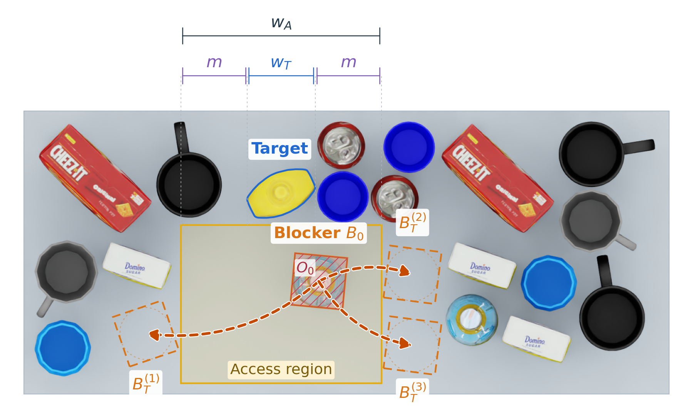
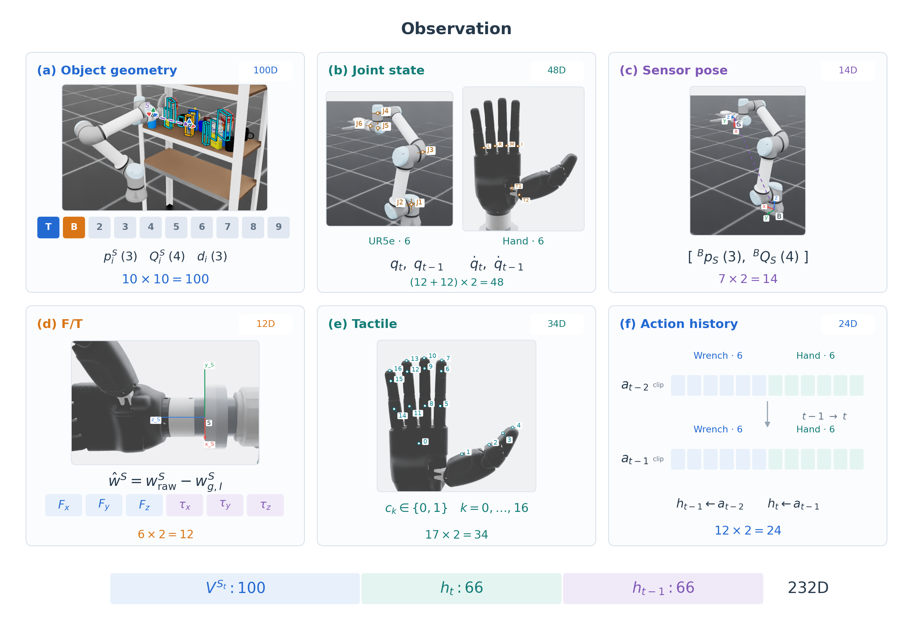
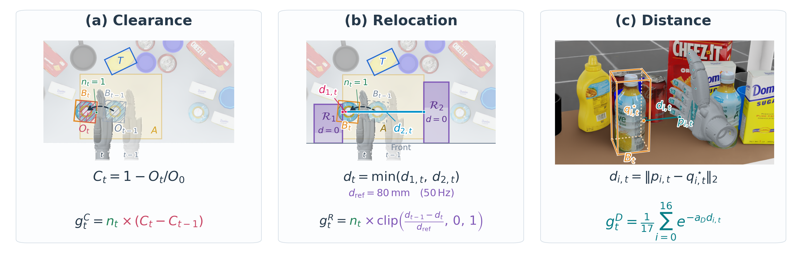

# 학습 방향 정리

## Task goal

- 상위 의사결정 모듈이 지정한 Blocker를 접근 영역(access region) 밖으로 재배치하여 Target의 접근 공간을 확보한다.
- Blocker의 목표 위치와 자세는 명시적으로 제공하지 않는다. 정책은 재배치 방향과 접촉 기반 조작 전략을 함께 학습한다.

## Assumptions

- 상위 의사결정 모듈은 부분적으로 관측되는 Target과 해당 Target의 접근을 방해하는 Blocker를 지정한다.
- 주어진 장면에는 지정된 Blocker의 조작을 통해 Target의 접근성을 개선할 수 있는 해가 존재한다.
- 복수의 물체가 Target의 접근을 방해할 수 있으며, 상위 의사결정 모듈은 조작 대상 Blocker를 순차적으로 지정한다. 학습 환경 구성 시 복수의 방해 물체가 존재하는 장면을 고려한다.
- 접근 영역은 선반 정면에서 Target 전면까지 연속된 평면 통로로 정의한다.
- 접근 영역의 폭은 Target 정면 폭의 양측에 Hand 최대 가로 폭의 절반을 각각 추가하여 정의한다.

## Observation

| 관측 요소 | 입력 차원 | 설명 |
|---|---:|---|
| (a) 물체 OBB | 10×10 = **100** | 초기 인식된 물체의 중심·자세·크기. Target·Blocker를 포함한 최대 10개를 현재 센서 frame으로 표현한다. |
| (b) 관절 위치 | 12×2 = **24** | UR5e 6관절과 Hand 독립 구동 6관절의 회전각. |
| (b) 관절 속도 | 12×2 = **24** | 같은 12관절의 회전 속도. |
| (c) 센서 pose | 7×2 = **14** | UR5e base frame 기준 F/T 센서의 위치·자세. |
| (d) F/T | 6×2 = **12** | 센서 frame 기준 3축 힘·3축 토크. Hand의 자중·관성 성분을 보상한다. |
| (e) Tactile | 17×2 = **34** | Palm·손가락의 17개 pad 접촉 여부. 접촉 1, 비접촉 0. |
| (f) 적용 action 이력 | 12×2 = **24** | clipping 후 적용된 Arm wrench 6D·Hand 6D 명령의 이력. |
| **합계** | **232** | 물체 기하 100D + 현재 표본 66D + 직전 표본 66D. Actor·Critic에 동일하게 입력한다. |

## Reward

Relocation은 학습 1의 거리 감소량 정규화 방식을 사용한다.
실험 설정과 실행 명령은 [비교 실험 문서](COMPARISON_EXPERIMENTS_2026-11-15.md)에 정리한다.

### 기존 버전 — 접촉·변화량 기반

#### Task-related terms

| 항 | 항별 값 $g_t$ | 기준 |
|---|---|---|
| Clearance | $n_t(C_t-C_{t-1})$ | Blocker 접촉 pad 수로 가중. 겹침 감소는 양수, 증가는 음수. |
| Blocker relocation | $n_t\operatorname{clip}\!\left(\frac{d_{t-1}-d_t}{d_{\mathrm{ref}}},0,1\right)$ | 재배치 목적지와 전방 통로까지의 거리 감소량을 정규화하고 현재 접촉 pad 수를 곱한다. 정체·악화·무접촉 시 0. |
| Blocker distance | $\frac{1}{17}\sum_{i=0}^{16}e^{-a_Dd_{i,t}}$ | 17개 pad에서 OBB 면까지의 현재 거리 점수 평균. |
| Time | $-\mathbf{1}_{\mathrm{alive}\,\land\,\neg\mathrm{success}}$ | 성공 상태가 아닌 생존 step에 시간 비용. |

$d_t$는 Blocker 중심에서 재배치 목적지와 전방 통로의 합집합까지의 최소 XY 거리이며, 영역 내부에서는 0이다.
기준 거리는 [제조사 공식 TCP 최대속도](UR5E_RELOCATION_REFERENCE_DISTANCE.md)에 따라
$d_{\mathrm{ref}}=4\,\mathrm{m/s}\times\Delta t$로 정한다. 정책 50Hz에서는 **80mm**다.
거리 감소량의 정규화 값은 0–1이며, 접촉 pad 수 $n_t$를 곱한 항별 값은 1을 초과할 수 있다.

#### Motion and constraint terms

| 항 | 항별 값 $g_t$ | 기준 |
|---|---|---|
| Action rate | $-\|\bar{\mathbf a}_t-\bar{\mathbf a}_{t-1}\|_2^2$ | clipping 후 Arm·Hand action 변화량. |
| Joint velocity | $-\sum_j\dot q_{j,t}^{\,2}$ | UR5e 6관절·Hand 독립 구동 6관절의 속도. |
| 선반 움직임 | $-M_{\mathrm{shelf},t}$ | 초기 pose 대비 변위·회전 또는 현재 속도가 허용 기준을 넘으면 −1, 그 외 0. |
| Target 움직임 | $-M_{\mathrm{Target},t}$ | 선반과 같은 방식으로 Target 평가. |
| 주변 물체 움직임 | $-\sum_{j\in\mathcal N}\frac{1}{8}\sum_{k=1}^{8}\|\mathbf v_{j,k,t}\|$ | Target·Blocker를 제외한 물체의 OBB 코너 속도. 병진·회전 모두 반영. |
| Blocker 기울기 | $e^{-a_\theta\max(\theta_t-\theta_{\mathrm{allow}},0)}-1$ | 선반 법선 대비 허용 기울기 초과분. |

## Termination

| 항 | 조건 | 구분 |
|---|---|---|
| Success | $O_t\leq10^{-5}\,\mathrm{m}^2$, Target 보호, 배치된 모든 물체의 선반 잔류·지지 및 미전도, 실패 조건 없음. | 성공 종료 |
| 지지면 이탈 | 물체의 지지 대표점과 선반 지지면 사이 거리가 3 cm 이상으로 0.1초 지속. | 실패 종료 |
| 물체 전도 | 수직 방향에서 80° 이상 기울어진 상태가 0.2초 지속. | 실패 종료 |
| 선반 변위 | 초기 위치에서 1 cm 초과 이동 또는 2° 초과 회전. | 실패 종료 |
| Target 변위 | 초기 위치에서 2 cm 초과 이동 또는 0.15 rad 초과 회전. | 실패 종료 |
| 관절 과속 | UR5e 6관절 중 하나라도 속도 절댓값이 1 rad/s 초과. | 실패 종료 |
| 특이점 | 정규화 Jacobian의 margin이 0.005 이하이거나 비유한 값. | 실패 종료 |
| Invalid state | 로봇·물체·F/T·action 등의 비유한 값 또는 유효하지 않은 상태. | 실패 종료 |
| Timeout | 에피소드 8초 경과 또는 공통 장면 교체 시점 도달. | 시간 종료 |
