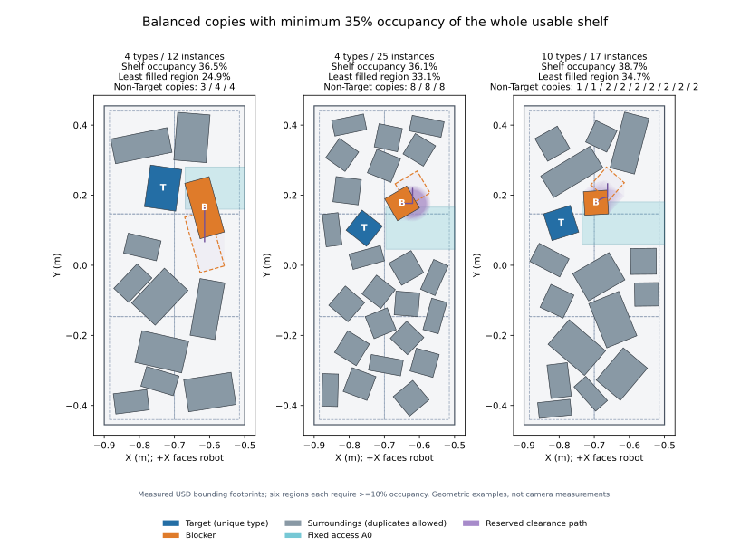

# Contact Rearrangement의 현재 스폰 기준

최종 갱신: **2026-10-09, Asia/Seoul**.

현재 샘플러는 **episode의 Target·Blocker를 먼저 정한 뒤, 선반 전체의 가용
영역에 4–10종을 선택하고 선반 점유율에 필요한 수의 instance를 배치하는 초기
장면**을 만든다. **종류 수와 물체 개수는 별개**다. Target 종류는 장면에 정확히
한 번만 등장한다. 나머지 선택된 종류는 밀도를 충족하기 위해 중복할 수 있고,
별도 옵션으로 10종을 모두 선택할 수 있다. 해소 경로는
병진·회전·모서리 pivot 및 여러 단계의 조합을 고려한다.

이전 구현은 사용자의 4–10종 기준을 active instance 4–10개로 잘못 해석했다.
현재는 전체 선반과 각 구역의 점유율을 반드시 만족하도록 개수를 산정한다.
25–45% global 요구를 비교해 **global 35%·각 구역 10%**를 초기 구현 기본값으로
선택했다. 이후 같은 종류의 중복이 편중되는 문제를 수정해 **선택한 non-target
종류의 active 개수를 균형 있게 늘리는 구성 방식**으로 변경했다. 이전 면적
우선 구성의 검사 결과를 새 구성의 성공률·instance 분포로 사용하지 않는다.
현재 균형 구성의 기하 sample 40개와 일반 모드 4개 GPU 환경·151 step 검사가
통과했다. 연구의 최종 난이도 수치는 별도이며 검증 범위는 11절에 기록한다.
책임별 6개 모듈로 통합한 뒤에도 아래 규칙과 기본값을 유지했다. 통합 후
23개 unit test와 일반 모드 4개 GPU 환경·151 step 검사가 통과했으며
기존 균형 구성 실행의 초기·reset 뒤 8개 장면 설명과 정확히 같았다.

앞쪽 카메라에서 Target이 40% 이상 보이게 한다는 요구도 설정에 기록했다.
**아직 task 카메라와 pixel visibility 판정은 구현하지 않았다.** 현재 스폰은
기하 조건을 검사하며 가시성을 검증했다고 표시하지 않는다. 현재 Blocker 앞의
충돌 없는 elbow-up hand 시작을 randomize한다. 최종 24개 시작 pose와 반복
reset·5초 물리 검사도 통과했다. 로봇은 episode에 선택한 관절 목표를 유지한다.
아래 길이·비율은 스폰 구현 기본값이며 연구의 최종 난이도
명세나 물리 제어 성공의 보장이 아니다.

연구 배경과 변경 이유는 [CONTEXT.md](CONTEXT.md), 실행 방법은
[환경 README](../src/contact_rearrangement/README.md)에 있다. 이 문서는 현재
[sampling.py](../src/contact_rearrangement/contact_rearrangement/sampling.py),
[spawn.py](../src/contact_rearrangement/contact_rearrangement/spawn.py)의 USD 측정·reset,
[assets.py](../src/contact_rearrangement/contact_rearrangement/assets.py)의 pool 처리를 바탕으로
판정과 제안 분포를 구체적으로 설명한다.



그림은 **현재 균형 구성**으로 만든 일반 seed 0의 **4종·12개**, 일반 seed 2의
**4종·25개**, all-types seed 1의 **10종·17개** 초기 장면이다. Target은 하나이며
non-target 종류별 개수는 각각 **3/4/4**, **8/8/8**, **1/1/2/2/2/2/2/2/2**다.
세 장면 모두 현재 전체·구역 점유율과 clearance 조건을 통과했다.
파랑은 Target, 주황은 Blocker, 회색은 주변 물체, 하늘색은 A₀다.
보라 영역은 예약한 경로이며 주황 점선은 검증용 마지막 footprint다.
로봇이 경로를 실제 실행한 결과나 가시성 40%가 확인된 장면은 아니다.
[이전 전체 선반 경로 예시](assets/full_shelf_clearance_examples.svg)는
종류·instance 분리와 hard occupancy를 추가하기 전의 이력이다.

이전 [seed 0 배치도](assets/spawn_rules_seed_0.svg)는 4–6개를 좁은 cluster에
놓던 baseline의 이력이다. 현재 전체 선반 분포·회전 경로의 예시로 사용하지 않는다.

## 1. 물체 종류, instance, 역할

Catalog에는 기존 shelf 물체 6종과 YCB physics 물체 4종, 총 **10종**이 있다.

| 구분 | Asset 종류 이름 |
|---|---|
| 기존 물체 | `bottle_1`, `cup_1`, `cup_2`, `mug_1`, `mug_2`, `can_1` |
| YCB | `ycb_003_cracker_box`, `ycb_004_sugar_box`, `ycb_005_tomato_soup_can`, `ycb_006_mustard_bottle` |

YCB는 `NVIDIA/Assets/Isaac/5.1/Isaac/Props/YCB/Axis_Aligned_Physics`의
authored rigid-body·collision USD를 사용한다. Visual-only 폴더의 다른 종류가
자동으로 포함되는 것은 아니다. 현재 003 cracker box와 004 sugar box에는
스폰 시점의 flat-box collision override를 적용한다. 원본 파일은 수정하지 않으며
구체적인 처리와 검증 상태는 3절에 설명한다.

각 종류를 10번 복제해 **환경당 100개의 rigid-body pool**을 미리 로드한다.
첫 복사본은 종류 이름, 이후 복사본은 `_copy_02`부터 `_copy_10`까지의 이름을
갖는다. 선택하는 **종류 수는 기본 4–10종**이며 active instance 개수는 그 종류들의
footprint와 요구하는 선반 점유율로 산정한다. Instance 최소값은 4, 현재 safety
cap은 40이다. `MAX_ACTIVE_OBJECTS=40`이 종류당 복사본 수를 40으로 늘리는 뜻은
아니며 pool은 계속 10종 × 10-copy다.
**Target의 asset 종류는 active 장면에 정확히 한 번만 등장**하며, 같은 종류의
다른 복사본을 Blocker나 주변 물체로 사용하지 않는다. Target 이외의 종류는
중복 가능하다. 역할은 개별 active instance ID에 지정한다.

환경 reset event가 Target instance를 먼저 선택하고 그 **종류 전체를 제외한**
후 Blocker instance를 선택한다. `cfg.target_asset`·`cfg.blocker_asset`, 또는
CLI `--target_asset`·`--blocker_asset`에 종류 이름을 주면 해당 종류의 복사본 중에서
선택한다. 두 옵션에 같은 종류를 지정하면 Target 종류의 유일성 조건과 충돌하므로
오류다. 기본 `None`이면 유효 후보에서 episode마다 처음에 한 번 선택한다.
Target 종류를 전체 학습 동안 하나로 고정하려면 `--target_asset`을 사용한다.
존재하지 않는 종류도 오류로 처리한다.

역할을 먼저 정한 다음 `min_asset_types=4`, `max_asset_types=10` 범위에서 종류 수를
한 번 뽑고, 두 역할의 종류를 포함한 종류 집합을 선택한다. 선택한 모든 종류를
최소 한 번씩 사용하도록 instance를 정한다. 그 다음 Target 종류를 제외한 선택
종류의 복사본을 추가해 footprint 면적 합이 전체 선반의 요구 면적에 도달하도록
한다. **추가 가능한 non-target 종류 중 active 개수가 가장 적은 종류**를 먼저
고르고 동률은 무작위로 결정한다. 지정 Blocker도 해당 종류의 첫 instance로
센다. 모든 non-target 종류가 같은 개수에 도달하면 다음 회차를 시작한다.
현재 catalog는 종류별 pool capacity가 같으므로 선택된 non-target 종류의
active 개수 차이는 최대 1이다. Target 종류는 항상 1개다.

종류별 별도 고정 최대 개수를 새로 두지는 않는다. Pool의 종류당 10-copy와
전체 safety cap 40이 한계이며 작은 물체 위주 종류 집합은 같은 점유율에 더 많은
instance가 필요할 수 있다. 이전의 **큰 footprint 우선 복사본 선택**은 중복을
한 종류에 집중시키므로 폐기했다. 배치 단계에서는 packing을 위해 큰 footprint
instance부터 위치를 찾는다. **중복 종류 선택 순서와 공간 배치 순서는 별개**다.

```text
usable_area = (shelf_width_x - 2*edge_margin) * (shelf_width_y - 2*edge_margin)
required_occupancy = max(min_shelf_occupancy, min_region_occupancy)
required_area = required_occupancy * usable_area
Σ upright footprint area >= required_area 이고 N >= min_objects가 될 때까지 추가
```

각 구역의 최소 점유율이 global 요구보다 높아도 그 하한을 전체 면적 합에
반영한다. 기본 35%/10%에서는 요구 면적이 전체 usable 면적의 35%다.
Footprint 면적은 yaw로 바뀌지 않으므로 배치 전에 종류와 개수를 정할 수 있다.
복사본이 부족하거나 40개 cap 안에서 면적 요구를 충족하지 못하면 배치 시도 전
명시적으로 실패한다. 지역별 점유율·충돌·경로·이웃 조건은 실제 위치를 정한 후
별도로 검사한다. 면적 합만으로 적절한 배치가 존재한다고 확정하지 않는다.

**Target·Blocker 쌍, 종류 수·집합, active instance ID 전체와 N은 layout retry
전에 고정한다.** Retry에서는 모든 active yaw와 위치만 바꾼다. 역할을 바꾸거나
다른 종류·instance를 뽑아 난이도를 낮추거나 N을 줄이는 fallback은 없다.

`SpawnRules.all_asset_types=True`, CLI `--all_asset_types`이면 **catalog 10종을
모두 선택**한다. Target은 하나이고 나머지 종류는 점유율에 필요한 만큼 중복한다.
**10종 선택은 정확히 10개 instance를 뜻하지 않는다.** CLI는 종류 범위를 10으로
고정하며 instance cap은 최소 10 이상이어야 한다. 일반 모드와 동일하게 density로
N을 산정하며 기본 cap 40을 유지한다.

저장소 루트에서 실행하는 두 옵션의 예시는 다음과 같다.

```bash
# 10종을 모두 선택하고 density에 필요한 복사본을 함께 배치
./IsaacLab/isaaclab.sh -p src/contact_rearrangement/scripts/spawn_scene.py --all_asset_types
# 정확히 6종을 선택하고 density에 필요한 instance 수를 산정
./IsaacLab/isaaclab.sh -p src/contact_rearrangement/scripts/spawn_scene.py --min_asset_types 6 --max_asset_types 6
```

## 2. 좌표계와 실제 선반 범위

모든 sampling 좌표는 개별 environment의 로컬 좌표다. 물리 상태를 쓸 때
각 환경의 `env_origins`를 더한다. 로봇은 선반의 +X 쪽에 있고 초기 접근 방향은
**−X**, 즉 Target에서 로봇 쪽을 향하는 접근영역의 길이 방향은 **+X**다.
X가 더 작으면 선반 뒤쪽, 더 크면 로봇 쪽이다.

선반에 아래 숫자를 무조건 하드코딩해 사용하는 대신, spawn 후 실제 collision
panel과 기둥의 bounds를 읽어 작업층을 정한다. 현재 기본 speedrack의 측정값은
다음과 같다.

| 항목 | 현재 기본 asset의 환경 로컬 범위 |
|---|---|
| Support X | `[-0.900, -0.500] m` |
| Support Y | `[-0.455, +0.455] m` |
| 작업층 상면 | `z = 1.050 m` |
| 바로 위 panel의 하단 | `z = 1.480 m` |
| 초기 footprint의 edge margin | 사방 **15 mm** |

따라서 footprint의 모든 꼭짓점이 들어가야 할 영역은 현재 기본값에서
`X=[-0.885,-0.515]`, `Y=[-0.440,+0.440] m`이다. 물체 중심만 선반 안에 있다고
통과시키지 않는다. 회전된 footprint 전체가 이 안에 있어야 한다.

`spawn.py`는 X 폭 25 cm 초과·Y 폭 50 cm 초과·두께 6 cm 미만인 collision
부분을 수평 panel 후보로 보고, 설정한 작업층 높이에 가장 가까운 상면을 고른다.
그 위의 겹치는 panel 중 가장 낮은 하단을 ceiling으로 쓴다. Y 범위는 작업층과
겹치는 가는 수직 기둥의 안쪽 경계로 줄인다. 해당 기둥을 찾지 못한 custom shelf는
그쪽 panel 경계에서 5 cm 안쪽을 사용한다. 적절한 panel이나 양의 지지 영역이
없으면 오류다.

`SpawnRules` 클래스의 X·ceiling 초기값과 spawn 후 측정값은 구별해야 한다.
Runtime에서는 측정한 shelf support와 ceiling이 해당 항목을 대체한다.

## 3. 물체 크기, 방향, pivot 보정

Spawn된 각 asset에 dynamic rigid body가 정확히 하나 있고, 그 아래에 enabled
collision shape가 있는지 검사한다. 크기는 body subtree의 USD bounds를 읽는다.
이때 body와 ancestor에 적용된 **scale을 포함**하고 world translation·rotation을
제외한 다음, catalog의 upright 회전을 적용한다. 양수인 finite extent가 없는
asset은 사용하지 않는다.

Bounds는 default/render/proxy geometry를 포함한 보수적인 box다. 실제 mesh의
빈 공간, 컵 내부, 손잡이 사이를 통과하는 경로까지 정확히 판정하는 collision
mesh 검사는 아니다. 작게 만든 asset을 원본 크기로 판정하거나, root pivot을
물체 중심으로 취급하지 않도록 scale과 offset을 함께 다룬다.

Upright 상태에서 bounds를 `(lower, upper)`라고 하면:

```text
hx = (upper.x - lower.x) / 2
hy = (upper.y - lower.y) / 2
cx = (upper.x + lower.x) / 2
cy = (upper.y + lower.y) / 2
root_z = shelf_top - lower.z
```

마지막 식은 물체의 가장 낮은 bound를 **선반 상면에 바로 맞춘다.** 이전의
2 mm 낙하 여유는 모든 종류에서 제거했다. Root Z를 모든 물체에 일괄 `1.05 m`로
지정하지 않는다. 또한
`root_z + upper.z <= ceiling - 0.003`이어야 하므로 위 panel과 최소 3 mm의
높이 여유를 두고, 높이가 맞지 않으면 해당 배치 시도를 버린다.

### YCB 003·004의 flat-box collision

두 scanned box의 초기 낙하·흔들림을 줄이기 위해
[assets.py](../src/contact_rearrangement/contact_rearrangement/assets.py)의
`FlatBoxUsdCfg`를 **003 cracker box와 004 sugar box에만** 사용한다. 기존의
visible scanned mesh는 유지하고 그 mesh의 collision을 끈 다음, 같은 single
rigid body 아래에 invisible `UsdGeom.Cube` collider를 추가한다.

Cube는 원본의 **unscaled body-local AABB와 같은 크기·중심 offset**으로 만든다.
Unit Cube의 size는 1, extent는 `[-0.5,+0.5]`로 명시한다.
Body와 ancestor의 scale은 상속하고 runtime geometry 검사에서 upright 회전과
함께 한 번 적용한다. 따라서 sampling footprint의 bounding 규모를 바꾸는
것이 아니라 박스 바닥의 실제 접촉면을 평평하게 만드는 override다. 이것은
원본 scanned mesh와 정확히 같은 collision 형상은 아니며, 두 박스의 동역학을
box proxy로 근사하는 선택이다.

처리는 `@clone` spawn 시점에만 수행해 PhysX view를 만들기 전에 모든 복제
환경에 동일하게 적용한다. 원본 Nucleus USD를 저장하거나 수정하지 않는다.
Body의 authored mass·관성 등 설정은 그대로 두고 원본 collider의 authored
`physxCollision:*` contact 속성을 가져오고, `UsdPhysics.MaterialAPI`를 가진
실제 physics material이 있을 때 그 binding을 proxy에 적용한다. Visual material을
physics material로 잘못 재사용하지 않는다.
Active body의 native gravity·simulation도 유지한다. 원본 mesh에
`boundingCube` approximation을 지정해 자동 fit하는 방식은 최종 구현으로
사용하지 않는다.

**현재 검증 상태:** 2 mm 여유만 제거하고 원본 collider를 유지한 4개 환경·
10종 전체·5초 진단에서 003은 최대 **66.96°·XY 11.3 cm**, 004는 최대
**3.80°·XY 5.79 mm**를 보였다. `boundingCube` fitted approximation 시험에도
**0.83°·XY 1.54 mm**의 움직임이 남아 최종 collider로 채택하지 않았다.
명시적 Cube proxy의 초기 GPU 진단은 4개 환경·10종 전체·5초 동안 8개 박스를
매 physics substep (120 Hz) 기록했다. 최대 XY 이동은 **0.007894 mm**였고,
float32 `acos` 계산 정밀도 안에서 거의 직립했다. 이를 수학적으로 정확한
0° 기울기 보장으로 읽지 않는다. 003 mass는 0.411 kg, 004는 0.514 kg이며,
진단한 박스 8개 각각에서 rigid body 1개·enabled Cube collider 1개와 원본 mesh collider off를
확인했다. 로그는 `outputs/contact_rearrangement/box_supported_proxy_diagnostic.{json,log}`다.

종류/instance 분리 전 Cube extent와 physics material guard를 보강한 뒤 공식 `spawn_scene.py` 실행도
**4개 환경·10종 전체·10초**에서 통과했다. 기본 150-step reset으로 8개 layout을
각각 5초 유지하고 전체/부분 reset을 검사했다. 5 cm drift·15° tilt guard는
완화하지 않았다. 마지막 300-step reset 뒤 생성한 새 layout은 물리 진행 시간이
0초이므로 추가 5초 정착 검증으로 세지 않는다. 새 높이 fixture를 적용한 unit
test 20개도 통과했다. 상세 명령과 조건은 [CONTEXT.md](CONTEXT.md)에 있으며,
이 결과를 다른 seed·실제 로봇 밀기·camera 가시성 검증으로 확대하지 않는다.

각 layout 시도에서 모든 active 물체의 yaw를 `uniform(-π,+π)`로 뽑는다.
Roll/pitch를 무작위로 기울이는 것은 아니며 upright 회전 뒤 world Z yaw를
적용한다. Quaternion은 `(w,x,y,z)`이고 최종 회전은 `yaw_Z * upright`다.

| 종류 | Upright 회전과 현재 확인 상태 |
|---|---|
| 기존 6종 | Catalog의 identity upright 회전, 이후 world Z yaw |
| YCB 003·004·005·006 | 4종 모두 X축 **−90°**. Local **−Y → world +Z**가 되며 이후 world Z yaw를 적용. 각 물체의 양쪽 렌더로 올바른 상하 방향을 확인 |

수정 전 X축 +90° 스폰을 양쪽에서 촬영한 8장의 실제 렌더를 확인한 결과,
YCB 003·004·005·006 모두 상하가 뒤집혀 있었다. 상자·캔의 라벨 방향과
머스터드 병의 뚜껑이 아래를 향한 것이 확인되어 4종 모두 −90°로 바꿨다.
형상 bounds가 수직이라는 사실만으로 의미적 상하 방향을 확인할 수는 없다.
수정 후에도 같은 원본 USD를 양쪽에서 8장 렌더링해 003·004의 라벨,
005의 라벨과 여는 고리, 006의 뚜껑이 정상 방향임을 확인했다. 이미지와 quaternion
manifest는 `outputs/contact_rearrangement/ycb_orientation/{before,corrected}/`에 있다.
현재 회전값은 [catalog.py](../src/contact_rearrangement/contact_rearrangement/catalog.py)에 있다.

Sampler의 XY 위치는 **회전된 footprint 중심**이다. 이를 root pose로 쓸 때는
회전된 local bounding center를 빼서 보정한다.

```text
root_x = center_x - cos(yaw)*cx + sin(yaw)*cy
root_y = center_y - sin(yaw)*cx - cos(yaw)*cy
```

## 4. Blocker가 앞에 들어갈 수 있는 전체 Target 범위

Upright box를 yaw로 회전한 polygon이 실제 판정 footprint다. 위치를 제안할
때는 그 회전된 polygon을 감싸는 world XY AABB의 half extent를 쓴다.
Upright half extent가 `(hx,hy)`, yaw가 `θ`라면:

```text
HX = |cos θ|*hx + |sin θ|*hy
HY = |sin θ|*hx + |cos θ|*hy
```

Target과 Blocker 사이의 X 방향 AABB gap은 **5–15 mm**에서 뽑는다.
Target 중심을 놓을 수 있는 범위는 두 물체가 모두 선반 안에 들어가도록 계산한다.

```text
target_x_min = shelf_x_min + 0.015 + target_HX
target_x_max = shelf_x_max - 0.015 - target_HX - 2*blocker_HX - pair_gap
target_x ~ Uniform(target_x_min, target_x_max)
blocker_x = target_x + target_HX + blocker_HX + pair_gap
```

Target은 앞에 Blocker가 들어갈 수 있는 **전체 유효 X 범위**에 제안한다.
뒤쪽 첫 10 cm 제한은 제거했다. 앞쪽 끝은 선반의 15 mm margin, Target·Blocker의
회전된 크기와 pair gap으로 정하며, 이 조건이 허용하는 만큼 앞으로 올 수 있다.
유효한 범위가 없으면 배치를 다시 시도한다. 제안이 uniform이어도 이후 coverage·
경로·충돌 rejection으로 채택된 위치 분포는 달라질 수 있다.

Target Y는 Target footprint와 접근영역 폭이 선반 안에 드는 범위에서 뽑는다.
Blocker Y의 ±30 mm 제한도 제거했다. 회전된 Blocker가 support 안에 있으면서
초기 접근영역의 Y 구간과 겹칠 수 있는 전체 범위에서 제안한다.

```text
blocker_y_min = max(shelf_y_min + 0.015 + blocker_HY,
                    target_y - 0.06 - blocker_HY)
blocker_y_max = min(shelf_y_max - 0.015 - blocker_HY,
                    target_y + 0.06 + blocker_HY)
blocker_y ~ Uniform(blocker_y_min, blocker_y_max)
```

구간의 단순 겹침만으로 채택하지 않고 아래의 실제 footprint 30% 차단 판정을
적용한다. 앞·뒤 관계는 최종적으로
`min_x(Blocker footprint) >= max_x(Target footprint) + 3 mm`인지 검사한다.

5–15 mm는 회전 후 AABB로 제안한 간격이며 두 mesh 표면 사이의 실제 최소
거리라고 단정하지 않는다. 모든 active footprint 쌍은 별도로 SAT 검사를 통과해야
하며, 적어도 한 normalized edge axis의 projection에서 **3 mm 이상의 gap**을
요구한다. 이는 mesh 간격의 정확한 계산이 아니라 보수적인 box 분리 판정이다.

## 5. 고정 접근영역 A₀와 초기 차단

현재 `hand_width=0.10 m`, `approach_margin=0.01 m`를 사용한다.
**10 cm hand width는 임시 설정값이며 RH56E2의 실제 형상에서 측정한 값이 아니다.**
고정 접근영역 `A₀`는 초기 Target footprint의 앞쪽과 중심 Y로 만든 직사각형이다.

```text
A₀.x_min = max_x(initial Target footprint) + 0.01
A₀.x_max = measured shelf_x_max = -0.50
A₀.y_min = initial Target center_y - 0.06
A₀.y_max = initial Target center_y + 0.06
```

따라서 기본 폭은 **12 cm**다. Target 앞에서 1 cm 떨어진 지점부터 선반 앞
경계까지 뻗는다. 접근영역 X 끝은 물체의 15 mm edge margin을 적용한 `-0.515`가
아니라 측정 support의 앞 경계 `-0.500 m`다. X 길이가 양수가 아니면 거부한다.
Episode 초기값을 저장하므로 Target이 나중에 움직였다는 이유로 영역이 같이
따라 움직이는 구조가 아니다.

초기에 지정 Blocker가 실제로 이 영역을 막도록 다음 조건을 요구한다.

```text
Area(Blocker footprint ∩ A₀) / Area(Blocker footprint) >= 0.30
```

분모는 **Blocker 전체 footprint 면적**이다. A₀ 면적이나 선반 면적으로 나누지
않는다. Convex polygon clipping으로 겹침을 구한다. 주변 물체는 처음부터 A₀
밖에 있고 SAT 기준으로 3 mm 이상 떨어져 있어야 한다. 초기부터 여러 물체가
접근영역을 함께 막는 장면을 허용하는 baseline은 아니다.

## 6. 병진·회전·pivot 조합을 허용하는 재배치 공간

Sampler는 초기 Blocker pose에서 A₀ 밖까지 이어지는 **평면 경로 하나**를
찾고 그 공간을 남긴다. 경로 후보의 순서를 무작위로 섞은 뒤 지원 가능한 경로를
선택한다. 다음 종류를 포함한다.

- ±Y lateral translation.
- Bounding center에서 ±45° 또는 ±90° 회전, 필요하면 이어서 lateral translation.
- 초기 footprint의 네 모서리 중 하나를 고정한 ±45° 또는 ±90° **실제 pivot arc**,
  필요하면 이어서 lateral translation.
- +X로 15 mm 또는 30 mm 병진한 뒤 ±90° 회전하고 lateral translation하는 다단계 경로.

Pivot은 yaw만 바꾸는 center rotation과 다르다. 고정 world XY pivot을 중심으로
footprint 중심도 원호를 따라 움직인다. 이 후보들은 가능한 모든 조작을 탐색하는
완전한 planner가 아니며, 채택 경로 종류가 균등하게 나온다고 보장하지 않는다.

각 경로는 연속된 `PlanarMotion(start, end, pivot)` 배열로 저장한다. Start/end는
footprint 중심 X·Y와 yaw의 `PlanarPose`다. `pivot=None`이면 중심 병진과 yaw가
선형 보간되고, pivot이 있으면 그 고정점을 중심으로 회전한다. 최종 pose와 초기
pose의 연결, 각 segment의 연속성과 pivot arc의 끝점을 함께 검사한다.

**끝점만 비어 있어서는 통과하지 않는다.** 회전 없는 병진은 두 endpoint footprint의
convex hull로 전체 swept footprint를 정확히 표현한다. 회전은 최대 5°씩 구분한
endpoint hull을 만들고, 모서리 원호가 chord 밖으로 나갈 수 있는 거리
`R*(1-cos(Δθ/2))` 이상을 사각형으로 확장한다. `R`은 pivot 경로에서는 pivot부터
가장 먼 모서리까지, 일반 회전에서는 bounding center부터 가장 먼 모서리까지의
거리다. 이렇게 회전 중간의 footprint를 보수적으로 포함한다.

모든 segment의 swept envelope는 15 mm margin 안에서 지지되고 Target·모든
주변 footprint와 SAT 기준 3 mm 이상 분리되어야 한다. 마지막 footprint는 A₀와
3 mm 이상 분리되어야 한다. Lateral endpoint 제안은 회전 후 half extent를 써서
A₀의 Y 경계로부터 4 mm 여유를 둔다. 주변 물체도 선택된 경로의 모든 envelope
밖에 배치하므로 전체 선반 분포와 재배치 여유를 함께 검사한다.

`SceneSample.clearance_path`와 `clearance_kind`는 생성 검증용 metadata다.
`clearance_witness`는 마지막 중심 XY를 보존한다. 이 경로를 actor의 final goal
pose나 명령으로 제공하지 않는다. 경로가 있다는 것은 보수적 평면 기하에서
여유가 있다는 뜻이며, 접촉을 통해 실제 pivot을 수행할 수 있다는 보장은 아니다.

## 7. 전체 선반과 각 구역의 hard occupancy, coverage와 국소 이웃

현재는 전체 가용 support를 분모로 하는 **global 점유율 하한**과, X 2분할 ×
Y 3분할의 **6개 구역 모두의 점유율 하한**을 acceptance 조건으로 요구한다.
양쪽에 작은 물체 몇 개를 두어 전체 span만 넓어지는 장면은 충분하지 않다.
이전 38 cm cluster·tight rectangle fill 조건과 점유율을 보고만 하던 방식은
현재 조건에서 제외한다.

```text
usable_x = shelf_x_max - shelf_x_min - 2*edge_margin
usable_y = shelf_y_max - shelf_y_min - 2*edge_margin
usable_area = usable_x * usable_y
shelf_occupancy = Σ Area(active footprint) / usable_area
region_occupancy[j] = Σ Area(active footprint ∩ region[j]) / Area(region[j])
```

기본 선반의 usable 크기는 **37 cm × 88 cm**, 면적은 **0.3256 m²**다.
각 구역은 18.5 cm × 약 29.33 cm이다. 물체 중심이 구역에 들어왔는지로 세지
않고 oriented footprint와 각 구역의 실제 교차 면적을 합한다. 한 물체가 경계를
넘으면 해당 면적만큼 여러 구역에 기여한다. 모든 footprint가 분리되어 있으므로
면적을 중복 계산하지 않는다. Target·Blocker·주변 물체 모두 포함하며 inactive
pool과 reserved 재배치 경로 면적은 포함하지 않는다.

| 판정 | 현재 구현 상태 |
|---|---|
| Global footprint occupancy | `>= min_shelf_occupancy` — 현재 초기 기본값 **0.35** |
| 각 구역의 footprint occupancy | 6개 모두 `>= min_region_occupancy` — 현재 초기 기본값 **0.10** |
| 전체 가용 X 범위 대비 footprint span | `x_coverage >= 0.55` |
| 전체 가용 Y 범위 대비 footprint span | `y_coverage >= 0.65` |
| 4 cm 이내 polygon 경계 이웃이 있는 물체 비율 | `local_neighbor_fraction >= 0.75` |

Global 35%와 옛 tight-rectangle fill 35%는 분모와 의미가 다르다. 전자는
**전체 usable shelf** 면적, 후자는 물체를 감싼 작은 rectangle 면적이었다.
Region 조건은 전체 평균을 맞추면서 특정 구역을 비우는 배치를 막는다.
Coverage는 footprint 꼭짓점의 X/Y span을 usable X/Y로 나눈 값으로 별도 검사한다.
4 cm 이웃 판정은 polygon 경계의 Euclidean 거리이며 N으로 나눈 비율이다.

**이전 면적 우선 구성의 측정으로 35%/10%를 초기 기본값으로 선택했다.** 사용자는 먼저 구현 가능한
범위를 측정하도록 요청했다. 35%는 고유 기하 sample 40/40개, 40%는 30/30개가
생성됐지만 공통 seed 비교에서 40% 생성 시간이 약 5배 길었다. 45%는 초기
10개 중 3개만 생성됐다. 이를 근거로 35%를 선택했으며 사용자에게 직접
확정받은 최종 연구 난이도로 기록하지 않는다. 이 비교의 생성 시간·성공률·개수
분포는 균형 구성으로 변경한 현재 버전에 그대로 적용하지 않는다. 조건·표본은 11절과
[CONTEXT.md](CONTEXT.md)에 정리했다.
모든 occupancy는 보수적인 upright box footprint 기준이며 실제 scanned mesh의
점유율이나 카메라 가시성 percentage가 아니다.

### 부족한 구역을 채우는 placement proposal

현재 코드에서는 주변 instance를 큰 footprint부터 배치한다. 지금까지의 구역별
점유 면적을 누적하고 하한보다 부족한 구역을 우선 후보로 고른다. 모두 하한에
도달했다면 점유 면적이 최소값 근처인 구역을 고른다.

Proposal의 60%는 선택 구역 안의 유효 중심 위치를 uniform으로 뽑는다. 나머지
40%는 그 구역에 가까운 기존 물체를 anchor로 택해 X/Y 이웃 위치를 제안한다.
Neighbor gap은 yaw-expanded AABB half extent 합에 **4–28 mm**를 더한 값이며
정확한 mesh 표면 간격은 아니다. 모든 proposal은 footprint support·3 mm 물체
간격·초기 A₀ 외부·reserved 경로 외부 조건을 통과해야 한다.

현재 proposal score는 부족한 구역의 면적을 얼마나 채우는지, 4 cm 이내 이웃을
만드는지, 구역 점유 균형을 개선하는지를 조합한다. 유효 후보를 최대 6개 모아
가장 높은 score를 택한다. 이 점수는 proposal 선택에 쓰는 값이고 최종 hard
threshold를 대체하지 않는다. 배치 후 global·6개 구역·coverage·이웃을 모두
검사하며 하나라도 부족하면 layout을 다시 시도한다. 이 proposal 구성은 현재
성능 측정과 함께 바뀔 수 있는 구현 방식이다.

## 8. 시도 횟수, 실패, 재현성

각 주변 물체의 placement proposal은 한 layout 안에서 최대 **180번** 시도한다.
하나라도 놓지 못하거나 전체 coverage·국소 근접 등 최종 조건이 맞지 않으면 새 layout을
시도한다. 전체 layout은 최대 **300번**이다.

전체 retry 동안 Target·Blocker instance 쌍, 종류 수·집합, **전체 active instance
ID 조합과 개수**는 고정이다. 모든 active yaw와 Target·Blocker·주변 위치만 다시
뽑는다. 300번 뒤에도 맞는 장면이 없으면 `RuntimeError`를 낸다. 역할을 바꾸거나
gap·밀집도를 자동 완화한 fallback은 없다. 종류·역할 조합별 성공률과 retry 수를
보고 sampler의 어려운 조합을 확인해야 하며, 모든 가능한 조합이 균등하게
성공한다고 가정하지 않는다.

각 환경의 reset seed는 다음과 같다.

```text
episode_seed = cfg.seed + 1_000_003*env_id + 97_409*reset_count[env_id]
```

`reset_count`는 첫 episode에서 0이며 해당 환경이 성공적으로 reset될 때
증가한다. 부분 reset은 선택한 환경의 count만 바꾸므로 다른 환경의 다음
장면 sequence를 진행시키지 않는다. 같은 catalog geometry·설정·seed와 동일
reset 순서는 동일 sampling을 재현한다.

Event는 선택된 모든 환경의 물체 sample·robot 시작 후보를 CPU에서 승인한 뒤
default reset과 sampled object state·robot 관절 state/PD 목표 적용을 진행한다.
후보 생성 중 실패하면 기존 선택 환경의 physical pose·metadata도 유지한다.
Object velocity와 robot joint velocity를 0으로 설정하고,
active ID/mask·Target/Blocker ID·초기 state·A₀·sample metadata를 저장한다.
유효 ID 배열은 현재 safety cap인 최대 40개이며 사용하지 않는 항목은 `-1`이다.

### Blocker 앞의 hand 시작 영역과 elbow-up 조건

사용자는 Blocker 앞쪽 영역에서 다른 물체와 충돌 없이 hand 시작을 무작위로
정하고 elbow-down은 허용하지 않도록 요청했다. 구현 설정은
`env_cfg.robot_start`의 `RobotStartRules`이며 기본 `enabled=True`다.
다음 수치는 현재 구현 기본값이며 이후 제어·학습 분포에 맞춰 조정할 수 있다.

| 기준 | 현재 값 |
|---|---|
| Blocker 회전 footprint의 가장 큰 X에서 TCP까지의 앞쪽 거리 | 0.12–0.40 m |
| 선반 앞쪽 X 경계에서 TCP까지의 최소 거리 | 0.06 m 밖 |
| Blocker bounding center Y 대비 TCP | ±0.08 m |
| 선반 상면 대비 TCP 높이 | +0.20–0.28 m |
| Shoulder–wrist chord 대비 elbow 높이 | 최소 +0.05 m |
| Robot 대 scene/ground OBB 여유 | 0.015 m |
| Arm joint 거리 3 이상인 UR arm 10쌍의 self collision 여유 | 0.002 m |
| Robot 시작 후보 시도 | 최대 80번 |

이 거리의 기준은 **palm TCP**이며 가장 가까운 손가락 표면이 아니다. 로봇을
나타내는 환경 로컬 영역은 다음과 같다.

```text
blocker_front_x = max_X(rotated_Blocker_footprint)
xmin = max(blocker_front_x + 0.12, shelf_xmax + 0.06)
xmax = blocker_front_x + 0.40
y = Blocker_center_y ± 0.08
z = shelf_top + [0.20, 0.28]
```

영역 안 TCP의 X/Y/Z를 uniform으로 제안한다. 두 X 조건의 교집합이 비면
명시적으로 실패하며 Blocker를 옮기거나 거리 조건을 완화하지 않는다.
TCP body는 **`right_plam_force_sensor`**다. 손가락의 local +Y가 world −Z,
palm normal인 local +Z가 world −X를 향하는 orientation을 고정한다.

`assets.py`의 `RobotPoseModel`은 실제 조립 USD의 joint frame·axis·scale과
39개 link의 fixed/revolute 연결을 읽어 FK를 구성하고 SciPy의 bounded IK로
UR arm 해를 찾는다. Finger q는 기존 열린 손의 기본값을 유지한다. Elbow-up은
관절각 부호로 분류하지 않는다. Shoulder-lift·elbow·wrist-1 joint center를 S/E/W로
삼고 E에서 S–W 선분의 가장 가까운 점 P를 구해 **`E.z - P.z >= 0.05 m`**를
요구한다. Elbow-down/낮은 elbow 해는 채택하지 않는다.

`RobotPoseModel.from_env`는 현재 실제 관절/link pose에서 FK를 대조한다. 이
측정을 위해 robot을 default 자세로 먼저 reset하지 않는다. Solver의
`accept_candidate` callback은 IK가 만족해도 TCP 영역·충돌 조건을 거절할 수 있다.
한 seed/branch가 충돌하면 같은 TCP의 다른 IK seed/branch를 계속 탐색한다.
이는 여러 seed의 탐색이며 가능한 모든 IK branch의 완전 탐색을 증명하지 않는다.

IK 후 전체 arm/hand의 enabled collision OBB를 **모든 active 물체**(Target·
Blocker 포함), 선반의 개별 enabled collider OBB, ground와 검사한다. OBB는
보수적인 bounds이며 정확한 mesh 거리 판정은 아니다. UR arm 7개 link의
21쌍 중 **두 arm joint 이내의 11쌍**(direct parent·grandparent)은 제외하고
거리 3 이상인 10쌍을 2 mm margin으로 검사한다. 가까운 joint housing을 감싼
OBB의 false positive를 피하는 처리이며 전체 39개 robot collider 대 외부 물체·
17개 shelf collider·ground의 15 mm 판정은 유지한다.
**손 전체 self collision 안전성을 확인했다고 기록하지 않는다.**

물체 sample을 먼저 고정하고 `episode_seed XOR 0x5D2EA91C`의 별도 RNG로
robot 후보를 제안하므로 기존 물체 배치 RNG sequence를 소비하지 않는다.
최대 80번 안에 영역·IK·elbow·충돌 조건을 만족하지 못하면 실패 이유별 개수를
담은 `RuntimeError`를 낸다. Elbow-down fallback은 없다.

채택하면 선택한 환경의 joint position·zero joint velocity와 동일한 PD target을
쓴다. `robot_initial_joint_pos`, `robot_start_tcp_pos_w`, `robot_start_region`,
`robot_start_elbow_height`, `robot_start_attempts`를 기록하며 다른 환경의 state는
유지한다. Candidate 평가·reset에 settling이나 추가 physics step을 넣지 않는다.
`cfg.robot_start.enabled=False`로 끄면 기존 기본 robot 자세를 사용한다.
초기 구현은 4개 GPU 환경·151 step·5.03초에서 150-step 자동 reset과 마지막
전체/부분 reset, 선택하지 않은 환경의 q/velocity/PD target/robot metadata 유지
검사를 통과했다. 기본 USD의 robot collider 39개·shelf collider 17개,
FK 대 실제 link position 오차 5.13e−7 m도 확인했다. 이후 callback·후보 승인 후
state 적용·COM cache·arm 이웃 OBB 처리를 보강한 **최종 4환경 × 6회, 24개
시작 pose**도 통과했다. 8개는 10종 전체 장면이었다. Physics 없는 6회 reset 뒤
150 step·5초의 parking 안정성과 전체/부분 reset, 불가능한 elbow 조건으로
강제 실패한 경우의 state·metadata 유지도 통과했다. 최종 FK 오차는 2.8458e−7 m,
elbow chord 높이는 11.49–16.07 cm, 후보 시도는 1–3회였다.
최종 unit test 29개도 24.673초에 통과했다. Stress 자료는
`outputs/contact_rearrangement/robot_randomization_benchmark.{json,log}`다.
현재 변경본의 일반 모드 4환경·151 step·5.03초 자동/부분 reset·COM cache·
OBB 불변 검사도 exit code 0으로 통과했다. 로그는
`outputs/contact_rearrangement/robot_randomization_gpu.log`다.
GUI 45-step·1.5초의 실제 표시·전체/부분 reset 검사도 통과했다.
상세 변경 이력과 GUI 검사 결과는 [CONTEXT.md](CONTEXT.md)에 기록한다.

## 9. 앞쪽 카메라와 Target 40% 가시성의 후속 판정

`InitialVisionCfg`에 다음 요구를 기록했다.

| 항목 | 설정과 의미 |
|---|---|
| Camera side | 선반 앞쪽인 `+X` |
| 최소 Target visible fraction | `0.40` |
| 분모 reference | 같은 Target pose·같은 카메라에서의 **가림 없는 전체 Target silhouette** |
| 화면 포함 | Reference의 전체 Target이 화면 안에 들어와야 함 |

구현할 판정은 `실제 Target instance mask의 visible pixels / reference silhouette
pixels >= 0.40`이다. 화면 밖에 잘린 물체로 비율을 높이지 않도록 전체 Target이
frustum 안에 들어오는 조건도 함께 둔다. 실제 카메라 위치·높이·intrinsics·해상도는
카메라 추가 시 정해야 한다.

**현재는 카메라 spawn·RGB·instance segmentation·reference render·settle 후
pixel rejection loop가 없다.** 초기 A₀의 30% Blocker overlap은 평면 접근 차단
조건이며 Target 40% 가시성의 대체 측정이 아니다. 현재 환경 metadata는
`target_visibility_validated=False`, `target_visible_fraction=NaN`으로 기록한다.

후속 camera gate는 물체 settle 뒤 실제 RGB·Target mask와 같은 pose의 reference를
사용해야 한다. 40% 미만이면 해당 episode의 역할·종류 집합·instance 조합·개수를 유지한
채 배치를 다시 제안한다. Camera gate까지 통과한 초기 Target pose를 기준으로
A₀를 확정하고 이후에는 고정한다. 현재 A₀는 카메라 gate가 없는 geometric reset의
초기 pose로 만들어지므로, 위 과정은 아직 구현하지 않은 후속 요구다.

## 10. 선택하지 않은 pool body의 처리

Inactive instance는 작업층 밖의 격리 parking으로 옮긴다. Pool index를 `i`라
하면 현재 parking 좌표는 다음과 같고 마지막에 environment origin을 더한다.

```text
x = -0.64 + 0.32*(i % 5)
y = -0.64 + 0.32*((i // 5) % 5)
z = 4.0 + 0.4*(i // 25)
```

높은 layer에 분리하고 시작 속도를 0으로 설정한다. All-body simulation과
native gravity는 유지하며 live disable-simulation/disable-gravity flag를
전환하지 않는다. USD visibility를 수정해 숨기는 방식도 사용하지 않는다.
현재 작업층 camera ROI 밖에 두는 공간 분리와 active mask가 역할을 구분한다.

[TaskObjectPool](../src/contact_rearrangement/contact_rearrangement/assets.py)이
매 physics write/substep에서 inactive body의 실제 world COM에 `-m*g` 힘을
적용해 중력을 상쇄한다. Root pivot에 힘을 가해 불필요한 torque가 생기지 않도록
COM 위치를 명시한다. Active body에는 이 추가 힘이 0이므로 native gravity와
원래의 접촉 동역학을 사용한다. Link pose write 뒤 `_object_com_pose_w` cache의
timestamp를 `-1.0`으로 무효화해 같은 timestamp에서 여러 reset을 해도 다음
world COM을 새로 읽는다. 추가 physics step·simulation/gravity flag 전환은 없다.
연속 reset에서 드러난 회귀와 수정 후 통과 결과는 [CONTEXT.md](CONTEXT.md)에 기록한다.
Task·향후 actor 관측·reward·종료 계산은 inactive
instance를 active mask로 제외해야 한다. 학습 observation은 아직 구현 전이다.

## 11. 현재 생성되는 과업의 범위와 검증

**현재 균형 구성의 기하 검사:** 최종 source의 실제 USD bounds로 일반·all-types
각각 seed 0–19를 생성해 **40/40개**가 통과했다. 모든 장면에서 non-target
종류별 active 개수 차이가 최대 1이었다. 일반 모드는 12–25 instance,
global 35.05–38.48%, 검사 전체의 최소 구역 점유율 22.86%였다.
All-types는 15–18 instance, global 35.14–38.71%, 최소 구역 24.75%였다.
Source SHA를 포함한 자료는
`outputs/contact_rearrangement/balanced_composition_benchmark.json`에 있다.
이 수치와 이전 면적 우선 구성의 calibration을 구분한다.

**현재 균형 구성의 GPU 검사:** 일반 모드를
`--num_envs 4 --headless --device cuda:0 --max_steps 151 --validate`로 실행해
exit code 0으로 통과했다. 5.03초 동안 기본 150-step 자동 reset과 마지막
전체·부분 reset, 기존 정착 guard를 검사했다. 역할 OBB 총 96개 line과 draw 전후
USD·PhysX 상태 유지도 확인했다. Reset sample 중 10종 장면도 포함됐지만
현재 구성의 별도 `--all_asset_types` GPU 실행을 완료한 것으로 기록하지 않는다.
로그는 `outputs/contact_rearrangement/balanced_composition_gpu_validation.log`다.
단위 검사 **23개**가 24.384초에 통과했고 균형 선정·복사본 재고 소진 회귀를
포함한다. 미검사 seed·robot push·camera visibility의 성공으로 확대하지 않는다.

**이전 면적 우선 구성의 기하 검사:** 실제 USD 측정 bounds에서 35% 요구는 일반·
all-types 각각 seed 0–19, **고유 40개 sample 모두** 통과했다. 일반 모드는
4–10종·10–24 instance, all-types는 10종·14 instance였다. Global 점유율은
각각 35.39–38.68%·36.32–37.36%였고, 장면별 최소 구역 점유율은 전체 sample에서
12.98–35.22%였다. 25%·30%는 초기 각 10/10개, 40%는 고유 30/30개,
45%는 초기 3/10개가 통과했다. 35%와 40%의 공통 seed 집합에서 평균 생성 시간은
약 0.206초와 0.99–1.00초였다. 초기·독립·확장 검사의 중복 seed를 합산하지 않는다.
자료는 `outputs/contact_rearrangement/density_calibration.json`에 있다.
이는 geometry 생성 검사이며 물리 정착·robot push·camera 검사는 아니다.

**이전 면적 우선 구성의 GPU 검사:** 기본 35%의 일반 모드와 `--all_asset_types` 모드를 각각
`--num_envs 4 --headless --device cuda:0 --max_steps 300 --validate`로 실행해
둘 다 exit code 0으로 통과했다. 각 실행은 10초이며 기본 150-step 간격의
전체 reset과 마지막 부분 reset을 검사했다. 각 모드의 초기 4개와 첫 reset 뒤
4개, **8개 layout을 각각 5초** 진행했다. 마지막 전체 reset 뒤 생성한 장면은
추가 물리 step이 없어 정착 표본으로 세지 않는다. 기존 5 cm drift·15° tilt
기준을 완화하지 않았다. 로그는
`outputs/contact_rearrangement/dense_shelf_default_validation.log`와
`outputs/contact_rearrangement/dense_shelf_all_types_validation.log`다.
단위 검사 **21개**가 18.219초에 통과했고 `py_compile`·`git diff --check`도
통과했다. 지역 요구가 global보다 큰 경우의 composition 면적 산정도 검사한다.
이 결과를 미검사 seed·실제 robot push·camera 가시성으로 확대하지 않는다.
현재 균형 구성은 density·지역·이웃·clearance 조건을 유지하면서 복사본 선정만
바꿨다. 위 이전 기하·GPU 결과와 21개 단위 검사 기록을 현재 구성의 통과
결과로 승격하지 않으며 현재 결과는 이 절 앞에 별도로 기록했다.

**Flat-box 적용 전 전체 선반 규칙의 검사:** unit test 20개와 실제 USD 측정 bounds의 일반 100 seed·
10종 전체 30 seed가 통과했다. 새 100-body pool의 4개 환경·10종 전체 장면은
매 step reset하는 24 step 실행과 마지막 부분 reset을 통과했다. 이 실행은
총 0.8초이고 각 layout을 1/30초만 진행시켜 pool 수명주기를 확인한 것이다.
같은 조건의 일반 4–10개 모드에서도 모든 개수·중복·Target 유일성과 reset을 검사했다.
같은 10종 전체 장면을 4초간 유지한 검사는 env 0·3의 003이 5 cm 이상 움직여
실패했다. 초기 기하 조건과 reset의 통과를 장시간 settle 안정성으로 확대하지 않는다.
자세한 명령과 로그는 [CONTEXT.md](CONTEXT.md)에 기록한다.

종류·instance 분리 및 hard occupancy 추가 전 버전은 전물체의 2 mm 여유를 제거하고 003·004의 collision을 명시적 Cube proxy로
바꿨다. 별도 4개 환경·10종 전체·10초 실행에서 8개 layout의 각 5초 정착과
전체/부분 reset을 통과했다. 당시 all-types는 정확히 10개 instance였으며 현재의
density 산정 instance 수와 다른 분포다. 이를 새 density 버전의 검증 결과로
승격하지 않는다. 이후 면적 우선 4–10종/hard occupancy 구성의 결과는 위 별도
검사로 기록하며 현재 균형 구성의 검증과 구분한다.

현재는 **단일 지정 Blocker와 주변 물체가 있는 밀집 baseline**이다. 주변 물체는
초기 A₀와 Blocker의 witness 경로를 비우므로, 주변 물체를 먼저 연쇄적으로
재배치해야만 Target 접근을 확보할 수 있는 장면을 요구하지 않는다. 밀집도
조건과 단일 free path의 존재를 동시에 만족시키도록 장면을 단순화하고 있다.
경로는 lateral translation에 한정하지 않으며 실제 모서리 pivot·회전·병진 조합을
포함한다. 복수 Blocker 조작 순서를 결정하는 과업은 아직 구현하지 않았다.

Robot 시작 판정은 해당 초기 pose의 IK·scene collision·elbow 조건을
검사한다. 재배치 경로 전체의 joint reachability·hand/arm swept collision, 실제
접촉점, friction으로 밀 수 있는지, OSC 추종·전도·낙하의 동역학 조건은 없다.
수평 footprint 경로가 있다는 사실과 로봇이 수행할 수 있다는 사실은 구별한다.
또한 A₀의 10 cm hand width, margin, 30% 차단, 전체/구역 occupancy·coverage·국소 근접은 변경할
수 있는 구현값이다. 이후 실제 hand geometry와 제어·센서 검증에 맞춰 구체화해야
한다. Spawn criteria의 충족을 재배치 정책의 성공 판정이나 연구 성능의 증명으로
사용하지 않는다.

**이전 4–6개 baseline의 검증 기록:** YCB 방향 교정 후 기본 seed 0·8개 환경·
6개 active·8초 반복 reset 검사는
통과했지만, seed 7·006 Target/003 Blocker 고정 검사에서는 한 장면의 003이
약 30° 기울어지고 XY 약 5.5 cm 움직여 실패했다. 해당 장면을 1/120초 접촉
기록으로 재현했을 때 선반에만 닿은 상태에서 먼저 기울었고, 1.46초부터 옆의
004에 닿았다. Blocker–robot 접촉은 없었다. 따라서 현재 planar spawn 판정만으로
settle 이후 물체의 자세·위치 안정성을 보장할 수 없다. 상세 조건과 로그는
[CONTEXT.md의 검증 기록](CONTEXT.md)에 남긴다. 이 이전 실행을 새 100-body pool·
전체 선반·pivot 경로 규칙의 검증 완료로 해석하지 않는다.

## 12. 관련 구현 위치

| 파일 | 이 문서와 연결되는 역할 |
|---|---|
| [catalog.py](../src/contact_rearrangement/contact_rearrangement/catalog.py) | Simulator 없이 읽는 10종 catalog, upright 회전, 10-copy pool, parking 위치 |
| [assets.py](../src/contact_rearrangement/contact_rearrangement/assets.py) | 로봇 조립·RobotPoseModel USD FK/IK, 물체 생성·countergravity·Cube collider |
| [env_cfg.py](../src/contact_rearrangement/contact_rearrangement/env_cfg.py) | Scene·ManagerBased, SpawnRules·RobotStartRules·InitialVisionCfg·seed·주기 |
| [spawn.py](../src/contact_rearrangement/contact_rearrangement/spawn.py) | USD bounds, 역할·전체/부분 reset·robot 후보 승인/충돌 검사·pose/metadata 적용 |
| [sampling.py](../src/contact_rearrangement/contact_rearrangement/sampling.py) | 순수 장면 샘플링·SAT·SE(2) 경로, robot 영역/elbow/3D OBB helpers |
| [visualization.py](../src/contact_rearrangement/contact_rearrangement/visualization.py) | 현재 pose의 역할 OBB debug draw |
| [spawn_scene.py](../src/contact_rearrangement/scripts/spawn_scene.py) | CLI와 실제 스폰·settle·전체/부분 reset 검증 |

`catalog.py`의 metadata와 순수 `sampling.py`를 바탕으로 AppLauncher 이후
`env_cfg.py`·`assets.py`가 scene을 만든다. Reset에서는 `spawn.py`가 측정 geometry를
sampler에 전달해 state를 적용하고, step에서는 pool countergravity와 OBB 표시를
갱신한다. 밀도·선정·clearance 수치는 `SpawnRules`/`sampling.py`, 실제 geometry
처리는 `spawn.py`에서 찾는다. 이전 `layout.py`, `scene_cfg.py`, `geometry.py`,
`object_pool.py`, `object_spawner.py`, `mdp/events.py`는 위 책임으로 통합하고
compatibility wrapper 없이 제거했다. 모든 모듈의 문법·CLI help 검사,
simulator 없는 catalog/sampling import, 23개 unit test와 4개 GPU 환경·5.03초의
전체/부분 reset·OBB 불변 검사도 통과했다. 물리 guard는 유지했다. 11절의
이전 결과와 통합 후 검사 조건·로그는 [CONTEXT.md](CONTEXT.md)에서 구분한다.
