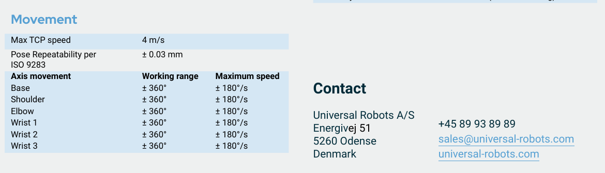
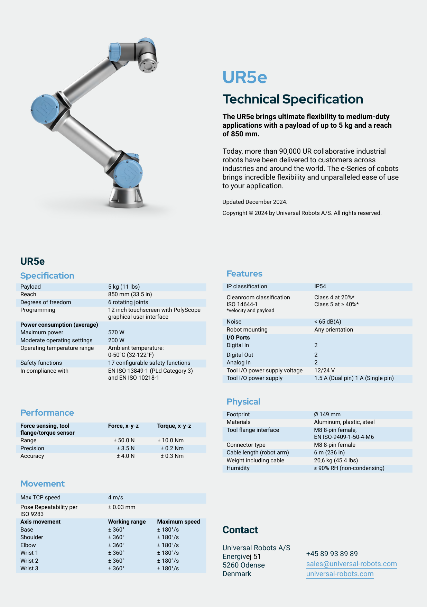

# UR5e Relocation 보상의 기준 거리와 운동학적 상한

기준일: **2026-11-15, Asia/Seoul**.

학습1의 기준 거리는 **제조사 공식 TCP 최대속도 4m/s**를 사용해 정한다.
정책 주기 50Hz에서는 **$d_{\mathrm{ref}}=0.08\,\mathrm{m}$, 즉 80mm**다.
관절속도와 링크 기하만으로 계산한 123mm는 비교를 위한 참고 상한으로 보존한다.

## 1. 채택한 정규화 기준

| 항목 | 값 | 근거 |
|---|---:|---|
| 기준 속도 $v_{\mathrm{ref}}$ | 4m/s | UR5e 공식 명세의 `Max TCP speed` |
| 정책 주파수 $f$ | 50Hz | 학습1의 비교 기준 |
| 정책 간격 $\Delta t$ | 0.02s | $1/f$ |
| 기준 거리 $d_{\mathrm{ref}}$ | **0.08m = 80mm** | $v_{\mathrm{ref}}\Delta t$ |

$$
d_{\mathrm{ref}}=v_{\mathrm{ref}}\Delta t
=4\times0.02=0.08\,\mathrm{m}.
$$

학습1의 새 Relocation 항은 다음과 같이 설정한다.

$$
g_t^R=n_t\operatorname{clip}\left(
\frac{d_{t-1}-d_t}{v_{\mathrm{ref}}\Delta t},\,0,\,1
\right).
$$

| 기호 | 의미 |
|---|---|
| $d_t$ | Blocker 중심에서 예약 목적지와 그 전방 통로의 합집합까지의 최소 XY 거리 |
| $n_t$ | 현재 Blocker에 접촉한 유효 tactile pad 수 |
| $d_{t-1}-d_t$ | 직전 정책 스텝보다 목표 영역에 가까워진 거리 |

영역 내부에서는 $d_t=0$이다. 거리 감소분만 0–1로 제한하고, 접촉 pad 수는 기존대로 곱한다.
따라서 최종 raw 항의 최대값은 1이 아니라 pad 수에 따른다.
Isaac Lab RewardManager의 weight·dt 적용은 이 함수의 출력과 구분한다.

정책 주기가 바뀌면 `d_ref = 4.0 * env.step_dt`로 다시 계산한다. 예를 들어 100Hz에서는
40mm다. 물리 substep 간격이 아니라 **정책 간격**을 사용한다.

80mm는 공식 TCP 성능값을 채택한 **보상 정규화 척도**다. 현재 OSC의 달성 변위나
Blocker의 이동량을 실측한 값이 아니며, 시뮬레이터에 TCP 속도 제한을 추가하는 설정도 아니다.

## 2. 제조사 공식 문서와 캡처

출처는 Universal Robots 공식 도메인에서 제공하는 **UR5e Technical Specification**이다.
문서 본문에는 `Updated December 2024`와 Universal Robots A/S의 저작권이 표기되어 있다.
확인일은 2026-11-15이며, PDF 1페이지의 `Movement` 표에서 **`Max TCP speed 4 m/s`**를 확인했다.

[제조사 공식 PDF](https://www.universal-robots.com/media/1807465/ur5e_e-series_datasheets_web.pdf)
· [저장한 원본 PDF](figures/ur5e_official_spec/ur5e_e_series_datasheet.pdf)

문서명·제조사 저작권·속도 표기가 함께 보이는 캡처

[전체 페이지 캡처](figures/ur5e_official_spec/ur5e_datasheet_full_page.png)
· [원본 SHA-256·출처·캡처 범위](figures/ur5e_official_spec/source.json)

캡처는 원본 PDF를 150dpi로 렌더링하고 직사각형 범위만 잘랐다. 문서의 수치·문구·색상은
수정하지 않았다. 위 캡처에는 최대속도와 함께 제조사명·공식 도메인이 표시된다.

## 3. 참고 계산에 사용한 기구학 모델

제조사 관절속도 한계는 6축 모두 $180^\circ/\mathrm{s}=\pi\,\mathrm{rad/s}$다.
링크 치수와 관절축은 [UR 공식 DH 표의 UR5e/UR7e 항목](https://www.universal-robots.com/articles/ur/application-installation/dh-parameters-for-calculations-of-kinematics-and-dynamics/)을 사용했다.

| 관절 | $a_j$ (m) | $d_j$ (m) | $\alpha_j$ |
|---|---:|---:|---|
| Base | 0 | 0.1625 | $\pi/2$ |
| Shoulder | −0.425 | 0 | 0 |
| Elbow | −0.3922 | 0 | 0 |
| Wrist 1 | 0 | 0.1333 | $\pi/2$ |
| Wrist 2 | 0 | 0.0997 | $-\pi/2$ |
| Wrist 3 | 0 | 0.0996 | 0 |

각 관절의 DH 변환을 연결해 자세 $q$에서 플랜지의 위치와 방향을 계산했다.
계산 지점은 현재 제어 기준인 `ToolForceTorqueLink`의 센서 원점이다.
[센서 장착부 설정](../src/contact_manipulation_symmetric/contact_manipulation_symmetric/config/ur5e/scene.py)에 따라
플랜지에서 센서 원점까지 축 방향 오프셋을 다음과 같이 추가했다.

$$
\delta=\frac{0.050+0.0254}{2}=0.0377\,\mathrm{m}.
$$

여기서 50mm는 장착부 전체 길이와 관련된 값이며, 센서 원점까지의 거리 자체는 37.7mm다.
개별 실물 로봇의 보정 DH 값은 포함하지 않는다.

## 4. Jacobian으로 센서 원점의 XY 속도 계산

관절 $j$의 원점을 $o_j$, 회전축 단위벡터를 $z_j$, 센서 원점을 $p$라 두면
그 관절의 회전이 만드는 선속도는 다음과 같다. 모든 벡터는 같은 base frame에서 표현한다.

$$
v_j=\left[z_j\times(p-o_j)\right]\dot q_j.
$$

각 관절의 기여 벡터 $z_j\times(p-o_j)$를 열로 모아 위치 Jacobian $J(q)$를 구성한다.
여섯 관절이 만드는 선속도의 합은 다음과 같다.

$$
v=\sum_{j=1}^{6}v_j=J(q)\dot q,
\qquad
v_{xy}=J_{xy}(q)\dot q.
$$

XY는 수직으로 고정된 base의 수평면, 즉 선반 평면 방향이다. 손이나 센서의 로컬 XY가 아니다.
같은 관절속도라도 관절 자세에 따라 회전 반경과 각 관절의 속도 기여 방향이 달라진다.

## 5. 자세와 관절속도 조합의 최대화

관절속도와 링크 기하만으로 다음 문제의 상한을 구했다.

$$
V_* = \max_q\;\max_{|\dot q_j|\le\pi}
\left\|J_{xy}(q)\dot q\right\|_2.
$$

### 5.1. 관절속도 조합 축소

고정 자세에서는 선형 변환된 속도의 norm이 볼록함수이므로, 속도 box의 꼭짓점 중에
최대값을 만드는 조합이 존재한다. 따라서 관절별 최대 양·음 속도 조합을 평가하면 된다.

다음 대칭을 적용해 속도 방향 조합을 16개로 줄였다.

- Base 각도는 XY 속도 벡터의 방향만 바꾸므로 norm의 최대값에 영향을 주지 않는다.
- 센서 원점이 Wrist 3 축 위에 있어 Wrist 3 자체 회전의 병진 기여는 0이다.
- 전체 관절속도의 부호를 동시에 바꿔도 속도 norm은 같다.

이는 센서 **원점**의 병진에 관한 성질이다. Wrist 3이 손끝의 이동이나 손의 방향에
영향을 주지 않는다는 의미는 아니다.

### 5.2. 자세 변수의 해석적 최대화와 격자 평가

XY 속도를 임의의 수평 단위벡터 방향으로 투영하면 다음 관계가 성립한다.

$$
\|v_{xy}\|_2
=\max_\eta
\begin{bmatrix}\cos\eta&\sin\eta\end{bmatrix}v_{xy}.
$$

각도 변수를 $u=q_2$, $v=q_2+q_3$, $t=q_2+q_3+q_4$로 바꾸면 세 변수의 기여를
각각 사인·코사인의 합으로 분리할 수 있다. 다음 식으로 세 변수의 최대값을 직접 계산했다.

$$
\max_\theta\left(A\cos\theta+B\sin\theta\right)=\sqrt{A^2+B^2}.
$$

남은 두 각도는 투영 방향 $\eta$와 Wrist 2 각도 $q_5$다.
각각 전체 주기를 2,048개로 나눠 16개 속도 부호 조합을 평가했다.
전체 6관절 자세를 이 간격으로 무작정 나열한 계산은 아니다.

### 5.3. 격자 사이의 누락 가능성을 상한에 반영

관절별 속도 한계를 우선 $1\,\mathrm{rad/s}$로 정규화했다.
각도 변화에 따른 최대 변화율의 상한을 $L_\eta$, $L_w$라 두면,
최근접 격자점과의 각도 차이는 각각 $\pi/N$ 이하이므로 다음 여유를 더할 수 있다.

$$
\varepsilon=(L_\eta+L_w)\frac{\pi}{N},
\qquad N=2048.
$$

$$
L_\eta=2.853421355,
\qquad L_w=0.571480723,
\qquad\varepsilon=0.005253734.
$$

따라서 격자 최대값을 그대로 전역 최대라고 간주하지 않고 다음 상계를 사용했다.

$$
V_{*,\,1\mathrm{rad/s}}
\le1.936905434+0.005253734
=1.942159168\,\mathrm{m/s}.
$$

제조사 관절속도 한계 $\pi\,\mathrm{rad/s}$에서는 선속도도 비례한다.

$$
V_*\le\pi\times1.942159168
=6.101472974\,\mathrm{m/s}.
$$

이 값은 격자 여유를 포함한 상계이며 정확한 최대값 자체는 아니다.
배정밀도 부동소수점 계산을 사용했고 interval arithmetic에 의한 수치 인증까지 수행한 것은 아니다.

## 6. 20ms 변위로 환산한 참고 결과

전체 구간에서 관절속도 제약이 유지되면 다음 부등식이 성립한다.

$$
\|p_{xy}(t+\Delta t)-p_{xy}(t)\|_2
\le\int_t^{t+\Delta t}\|v_{xy}(\tau)\|_2\,d\tau
\le V_*\Delta t.
$$

따라서 모든 자세에 적용되는 속도 상계를 20ms에 곱하면 유한 구간 변위의 상계가 된다.

| 조건 | 속도 기준 및 참고 상계 | 20ms 거리 기준 및 참고 상계 | 용도 |
|---|---:|---:|---|
| 제조사 6축 속도 한계 $\pi\,\mathrm{rad/s}$만 적용 | 6.101473m/s | 122.029mm | 관절 기하 참고 계산 |
| 6축 속도가 모두 $1\,\mathrm{rad/s}$ 이하 | 1.942159m/s | 38.843mm | 현재 과속 판정값과 비교 |
| 공식 TCP 성능값 4m/s를 기준 속도로 채택 | 4m/s | **80mm** | **학습1의 정규화 기준** |

위 기구학 계산은 관절 위치 범위·자체 충돌·선반 충돌·토크·가속도·초기 속도와
별도 TCP 속도 제약을 완화했다. 6.101473m/s는 실물이나 현재 OSC에서 달성한 속도가 아니다.
123mm는 첫 번째 행을 상향 반올림한 값이며 **채택한 기준 거리가 아니다**.

현재 1rad/s 조건은 속도 clamp가 아니라 초과 시 종료하는 판정이다.
따라서 38.843mm는 속도가 구간 내내 그 이하인 경우의 계산이며 초과 발생 스텝까지 보장하지 않는다.
또한 센서 원점의 XY 변위와 물체의 회전·관성 운동에 따른 목표 거리 감소량은 서로 다르다.

## 7. 검증 및 적용 상태

- 계산은 CPU 기구학 연산만 수행했다. 시뮬레이션·OSC 구동·학습은 실행하지 않았다.
- 별도 64표본 검산에서 Jacobian과 FK 중앙차분의 최대 차이는 $1.35\times10^{-10}$이었다.
- 해석적으로 최대화한 투영속도와 DH Jacobian으로 재계산한 값의 최대 차이는
  $4.44\times10^{-16}$이었다.
- **학습1의 구현값은 $v_{\mathrm{ref}}=4\,\mathrm{m/s}$,
  $d_{\mathrm{ref}}=80\,\mathrm{mm}$다.** 기존 baseline의 exponential 증분 함수는 보존하고,
  새 `blocker_relocation_distance_progress`와 독립 `RelocationDistanceEnvCfg`에 연결했다.
  현재 구현·실행 명령과 검증은 [비교 실험 문서](COMPARISON_EXPERIMENTS_2026-11-15.md)를 따른다.

결정 이력은 [TRAINING_LOG.md의 151–153절](TRAINING_LOG.md), 구현·검증은 같은 문서156절을 따른다.
