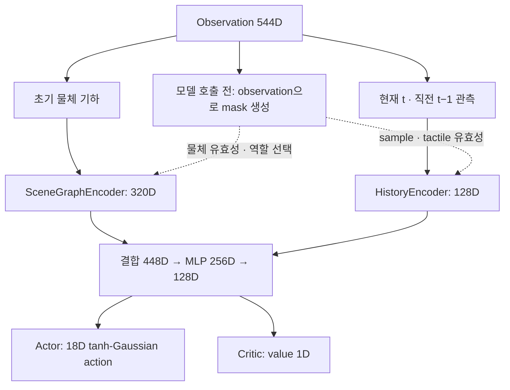

# Contact Rearrangement

밀집 선반에서 **Blocker를 비파지 방식으로 재배치해 Target 접근 공간을 확보**하는
Isaac Lab 환경이다. 초기 RGB-D의 물체 기하와 현재·직전 step의 로봇·센서 정보를
사용하는 정책을 PPO로 학습한다.

| 항목 | 현재 설정 |
|---|---|
| 로봇 | UR5e + RH56E2 오른손 |
| 센서 | 연결부 중앙 F/T, 손의 binary tactile 17채널, 초기 RGB-D camera |
| 학습 환경 | `Isaac-Contact-Rearrangement-UR5e-v0` |
| 관측 / 행동 | 544D / 18D |
| 시간 입력 | 현재 `t`와 직전 `t−1`의 두 sample |
| 제어 주기 | Policy 30 Hz, physics 120 Hz |

## 모델 구조

구현: [model.py](contact_rearrangement/config/ur5e/agents/model.py).
모델 차원: [ppo_cfg.py](contact_rearrangement/config/ur5e/agents/ppo_cfg.py).
학습 기본값: [rsl_rl_ppo_cfg.py](contact_rearrangement/config/ur5e/agents/rsl_rl_ppo_cfg.py).



| 구성 | 처리 방식 |
|---|---|
| 물체 node encoder | 물체 기하 10D → 64D |
| GNN | 유효 물체 사이 dense message passing 2회. Edge는 상대 위치·extent 차이 6D |
| 역할 attention | Target·Blocker embedding으로 query를 만들고 주변 물체 정보를 집계 |
| 장면 feature | Target 64D + Blocker 64D + attention 128D + 전체 평균 64D = 320D |
| 시간 encoder | 각 sample 72D → 64D. Causal convolution 1층 후 최신 feature와 유효 sample 평균을 결합해 128D |
| Actor / critic | 같은 encoder와 128D latent를 공유. Actor의 평균·학습 가능한 표준편차로 행동을 샘플링한 뒤 tanh 적용 |

기본 모델은 **247,717개 parameter**를 갖는다. Target·Blocker의 슬롯을 고정하고
주변 물체 슬롯 순서에 대한 순열 불변성을 유지한다. Invalid 물체와 reset padding은
message passing·attention·
시간 encoder에서 제외한다. 시간 encoder는 현재·직전 두 sample만 사용하고
별도의 recurrent hidden state를 유지하지 않는다. Actor와 critic은 같은 관측을 받는다.
Native RSL-RL의 actor/critic adapter가 이 모델을 연결하며 공유 parameter는
optimizer에 한 번만 등록한다.

## MDP

### Observation

구현: [observations.py](contact_rearrangement/mdp/observations.py).
학습 입력 `obs["policy"]`는 아래 순서의 **544D** 벡터다. Mask는 이 벡터에
포함하지 않고, 모델 호출 전에 observation 값으로 생성해 별도 인자로 전달한다.

| 입력 | 차원 | 내용 / 좌표계 |
|---|---:|---|
| 초기 물체 기하 | 40 × 10 = 400 | 위치 3D + quaternion `(w,x,y,z)` 4D + OBB extent 3D. **현재 EEF 기준**. Slot 0=Target, 1=Blocker, 2–39=주변 물체 |
| 현재·직전 sample | 2 × 72 = 144 | 아래의 로봇·센서·행동 정보, 최신 순서 |

각 72D sample의 구성은 다음과 같다.

| 항목 | 차원 | 내용 |
|---|---:|---|
| 관절 상태 | 24 | Arm 6개 + hand 독립 6개 관절의 `q`, `dq` |
| EEF pose | 7 | Robot **base 기준** 위치·quaternion |
| F/T | 6 | 물리 **sensor frame 기준** 자중·관성 보상 force·torque, 선택적 residual bias 보정 |
| Tactile | 17 | 각 손 sensor link의 접촉 여부. `0=OFF`, `1=ON`, `−1=측정 없음` |
| 직전 적용 행동 | 18 | 이 관측을 생성한 normalized action |

**물체 기하:** Episode 시작에 승인한 RGB-D의 visible depth에서 PCA OBB를 추정한다.
초기 기하를 base에 고정해 저장하고, 매 step의 측정 EEF pose로 좌표계만 변환한다.
물체가 움직여도 actor 기하를 현재 simulator pose로 갱신하지 않는다. Instance
segmentation과 Target·Blocker association에는 simulator ID를 사용한다.
40은 최대 슬롯 수이며, 초기 영상에서 충분히 관측하지 못한 물체는 invalid다.
관측을 구성할 때 Target·Blocker를 각각 슬롯 0·1에 배치하고, 관측된 주변 물체를
슬롯 2부터 기존 상대 순서대로 채운다. 나머지는 zero padding이다. Target이나
Blocker를 관측하지 못하면 해당 예약 슬롯을 0으로 유지한다. 역할 association은
이 정렬 단계에 사용하며 observation에 별도 역할 ID를 넣지 않는다.

**Mask 생성:** [build_policy_masks](contact_rearrangement/config/ur5e/agents/model.py)는
오직 observation을 입력으로 받는다. 고정 슬롯 규약과 관측 기하에서 역할을
선택한다. Mask는 feature로 concat하지 않고 선택·필터링에 사용한다.

| Mask | Observation에서 생성하는 기준 |
|---|---|
| 물체 valid | 기하가 finite, extent가 모두 양수, quaternion이 0이 아닌 슬롯. 미관측 기하는 zero padding |
| Target / Blocker | 슬롯 0 / 1이 각각 유효한 경우. 예약 슬롯의 zero padding은 역할 선택에서 제외 |
| History valid | Robot·F/T·action 값이 finite이고 EEF quaternion이 0이 아닌 sample |
| Tactile valid | 유효 sample의 tactile 값이 0 또는 1. 결측 `−1`은 encoder 입력 전에 0으로 필터링 |

Rollout, PPO minibatch, timeout의 마지막 관측에서 모두 같은 함수를 호출한다.
정책 호출은 `model.act(obs, masks=build_policy_masks(obs, model.cfg))` 형태다.

**시간 정보:** 현재 `t` sample에는 `a[t−1]`, 직전 `t−1` sample에는 `a[t−2]`가
들어간다. 두 관측의 간격은 약 33 ms다. Reset 직후 현재 sample만 valid이며,
현재 action은 0·tactile은 −1, 직전 sample은 zero/invalid다.
부분 reset은 선택한 환경에만 적용한다.

**센서와 정규화:** `q`, `dq`는 각각 π, 2 rad/s로 나누고 F/T는 축별
`[200, 200, 360, 8, 8, 8]`의 SI-200-8 full scale로
나눈 뒤 `[-5,5]`로 제한한다. Tactile은 마지막 완료 physics step의 net normal
force norm이 **0.01 N 초과**이면 ON이다. 채널 순서는 palm → thumb 1–4 →
index/middle/ring/little 각 1–3이다.

F/T는 센서 손쪽 원통 절반과 hand의 **33개 링크**에 대해 자중·병진 관성 `ma`,
회전 관성 `Iα`·자이로 항 `ω×Iω` 및 센서 중심까지의 모멘트를 계산해 제거한다.
동일한 완료 physics step의 COM 가속도·각속도와 현재 자세·질량·관성 텐서를
사용하고 결과를 sensor frame으로 변환한다. Residual bias tare는 명시적으로
호출할 때 적용한다. 시뮬레이션의 질량·관성은 현재 model 값이며 실기 적용에는
동역학·가속도 추정의 교정이 필요하다.

장면 확인 환경은 `obs["sensors"]` dictionary로 raw F/T와 valid·축별 범위 초과, tactile와 valid,
초기 RGB·depth·role mask·camera pose를 제공한다. Raw F/T는 자동 중력 보정·tare를
적용하지 않는다. RGB-D는 **640×480**이며 승인한 초기 snapshot을 episode 동안
유지한다. 이 dictionary는 장면·센서 확인용이고 학습의 `policy` 입력과 구분한다.
센서 구현은 [sensors.py](contact_rearrangement/src/sensors.py)에 있다.

F/T 측정 모델은 사진과 [ATI Axia80-M20의 SI-200-8 사양](https://www.ati-ia.com/products/ft/ft_models.aspx?id=Axia80-M20)을 따른다.

| 축 | 측정 범위 | 유효 분해능 |
|---|---:|---:|
| Fx, Fy | ±200 N | 0.1 N |
| Fz | ±360 N | 0.1 N |
| Tx, Ty, Tz | ±8 N·m | 0.005 N·m |

설정은 두 환경의 `cfg.force_torque`이며 기본 profile은
[SI_200_8_CALIBRATION](contact_rearrangement/src/catalog.py)이다.
처리 순서는 **이상적 PhysX joint reaction → 축별 범위 제한·분해능 양자화 →
자중·관성·선택적 bias 보상 → 축별 정규화**다. 유효 분해능을 결정적 rounding으로
근사하며 임의의 noise 분포는 추가하지 않는다. 보상 결과는 다시 양자화하지 않는다.

`sensor.read()`는 측정 모델을 거친 raw 값이고 `read_ideal()`은 물리 검증용 원값이다.
`valid`는 완료된 physics step의 새 sample 여부이며, `range_exceeded`는 saturation
전 전체 하중의 축별 측정 범위 초과다. 범위 초과는 hard-load 실패에도 반영하고
종료 전이의 원값·측정값·flag를 extras에 보존한다. Sensor 범위와 별도로 작업 안전의
보정 norm 80 N / 4 N·m, Motion의 증가율 ref 200 N/s / 10 N·m/s는 유지한다.
정규화가 달라졌으므로 이어 학습은 checkpoint의 F/T profile 일치를 확인한다.

### Reward

구현: [rewards.py](contact_rearrangement/mdp/rewards.py).
초기 Target 앞의 고정 접근영역 `A₀`와 사용자 교정한 Motion 기준으로 reward를 계산한다.

$$
r_t = w_{clear}r_{clear} + w_{rearr}r_{rearr}
    + w_{motion}r_{motion} + w_{time}r_{time} + r_{terminal}
$$

| 항 | 계산 | 목적 |
|---|---|---|
| Clearance | `exp(−a_clear · ρ_b)` | 지정 Blocker의 접근영역 차단을 줄임 |
| Rearrangement | `exp(−a_rearr · L_OBB)` | 물체 전체의 병진·회전 조작량을 줄임 |
| Motion | `(exp(−a_acc · C_a) + exp(−a_inc · C_inc)) / 2` | Robot joint의 급가감속과 힘·토크 크기의 급격한 증가를 억제 |
| Time | `−∫[t,t+dt] a(exp(bs)−1) ds` | 초반에는 작고 시간이 흐를수록 증가폭도 커지는 비용 |
| Terminal | 성공 `+500`, 실패 `−100` | Episode 종료 시 한 번 지급. 실패 우선 |

`ρ_b`는 **Blocker footprint와 A₀의 교차 면적 ÷ Blocker footprint 면적**이며
`[0,1]`로 제한한다. 세 품질 점수는 공통 `exp(−a·x)` 형태다. `a`는 각 비용의
민감도이고 상위 `w`는 항 사이의 비중이다. 기본 weight 4개는 모두 1이다.

| 지수 민감도 설정 | 초기값 |
|---|---:|
| `clearance_decay` | 1 |
| `rearrangement_decay` | 2 m⁻¹ |
| `motion_acceleration_decay` | 1 |
| `motion_wrench_increase_decay` | 1 |

`L_OBB`는 Target·Blocker·미인식 물체를 포함한 모든 active 물체의 **평균 8-corner
이동거리 합을 episode 동안 누적**한 값이다. 고정된 environment frame에서 같은
corner끼리 비교하며 XYZ 병진과 회전을 함께 meter로 평가한다.

$$
\Delta L_k=\sum_{i\in\mathrm{active}}\frac18\sum_{j=1}^{8}
\|c_{i,j,k+1}-c_{i,j,k}\|_2,\qquad
L_{k+1}=L_k+\Delta L_k
$$

순수 10 cm 병진은 물체당 0.1 m이며 왕복·제자리 회전도 누적된다. 물체별 corner는
평균내지만 물체 간에는 합산한다. `displacement_ref`를 제거했으며 초기 계수 2 m⁻¹는
이전 `1/0.5 m`의 민감도를 이어 받은 값이다. 민감도 보정 자체가 없어진 것은 아니다.
매 step 누적 조작량의 품질 점수를 평가하므로, 최종 이동량이 같아도 이동 시점에
따라 episode return은 달라진다. 실제 pose는 privileged reward·검증에만 사용하며
544D actor observation은 초기 vision과 현재·직전 센서 sample을 유지한다.
보조 예측 head는 아직 도입하지 않았다.

Time은 episode 경과 시간 `t`의 지수 곡선을 따른다. 비용률은
`c(t)=a(exp(bt)−1)`이며, step마다 해당 시간 구간을 정확히 적분해 차감한다.
`T_ref`를 제거하고 `time_penalty_scale=0.02 reward/s`,
`time_penalty_growth_rate=0.7 /s`를 초기 기본값으로 둔다. `a`는 강도,
`b`는 곡선이 가팔라지는 속도를 조절한다.

| 경과 시간 | 직전 한 step의 Time reward, 30 Hz | 할인 전 누적 Time reward |
|---|---:|---:|
| 2초 | −0.002006 | −0.047291 |
| 4초 | −0.010170 | −0.361276 |
| 6초 | −0.043276 | −1.756752 |
| 8초 | −0.177531 | −7.537897 |


할인 전 누적 비용은 `−a/b · (exp(bT)−1−bT)`다. 제어 주기를 바꿔도 같은
경과 시간의 누적 Time 비용을 유지한다. 환경별 clock은 reset한 환경만 0으로
돌리며 같은 step의 반복 조회로 시간이 증가하지 않는다. Clock은 reward 계산용
내부 상태이며 현재 544D observation에 포함하지 않는다. 수식 변경은 terminal과
다른 reward의 상대적 비중까지 검증한 것을 뜻하지 않는다.

| Motion 비용 | 내용 |
|---|---|
| `C_a` | `(현재 joint 속도 − 직전 속도) / dt`를 정규화·제곱해 같은 12관절 합산 |
| `C_inc` | `max(현재 힘/토크 norm − 직전 norm, 0) / dt`의 정규화 제곱합 |

Arm 6 + hand 독립 6관절을 평가하며 mimic 관절은 중복 계산하지 않는다.
일정한 속도·일정한 하중 자체에는 Motion 비용이 없다. 힘·토크 크기의 감소와
같은 크기의 방향 변화에도 F/T 증가 비용은 없다. 물체 움직임은 Rearrangement와 안정성·종료
조건에서 평가한다. Joint 비용은 observation 정규화 전의 실제 rad/s 값을 사용한다.
Reset은 선택된 환경의 직전 joint 속도를 실제 초기 속도로 설정한다.

| 초기 정규화 scale | 값 |
|---|---:|
| Joint 가속도 ref | Arm 5 / hand 10 rad/s² |
| 힘 증가율 ref | 200 N/s |
| 토크 증가율 ref | 10 N·m/s |

Scale은 벌점이 시작되는 문턱이 아니다. 가속도·하중 증가가 있으면 비용이 생긴다.
기존 속도·절대 하중 soft 기준과 그 reward 항을 제거했다. Actuator 제어 제한과
80 N / 4 N·m F/T 실패 한계는 별도 물리·종료 기준이다.

Reward의 F/T는 **world 축·episode 시작 sensor center**로 변환해 비교한다.
Observation·증가율 reward·F/T 실패 판정 모두 같은 자중·관성 보상값을 사용한다.
이로써 센서의 이동·회전으로 기준축과 torque 기준점이 달라지는 영향을 제거한다.
실제 물체 pose·velocity는 reward와 종료 평가에 사용한다. RewardManager의
`weight × dt` 적용을 보정해 위의 discrete reward를 그대로 지급한다.
정규화 scale과 종료 기준은 [MdpCfg](contact_rearrangement/mdp/state.py)에서 조정한다.
항 사이의 weight는 기본 RewardTerm 설정인 `rewards.clearance.weight`,
`rewards.rearrangement.weight`, `rewards.motion.weight`, `rewards.time.weight`,
`rewards.terminal.weight`로 조정한다. 기본값은 모두 1이며 항별로
`Episode_Reward/<항목>` 로그가 생성된다.

Tactile은 접촉 위치·패턴을 알려주는 observation으로 사용하며 별도 reward는 없다.
Binary 값만으로 접촉 상대, 하중 크기나 미끄러짐을 직접 알 수 없다. 현재는 마지막
physics substep만 관측하므로 짧은 접촉 누락을 검토해야 한다. 접촉 수·접촉 유지에
대한 보상이나 구간 접촉 집계는 [CONTEXT.md](../../docs/CONTEXT.md)의 미채택 검토안이다.

### Action

구현: [actions.py](contact_rearrangement/mdp/actions.py).
Actor 출력은 `[-1,1]`의 **18D**이며 `motion 6 + stiffness 6 + hand 6` 순서다.

| 구간 | 명령 | 기본 범위 |
|---|---|---|
| `a[0:3]` | Base 축 TCP 위치 증분 | 축별 ±0.015 m |
| `a[3:6]` | Base 축 rotation vector | 축별 ±0.08 rad |
| `a[6:9]` | 병진 stiffness | 축별 100–800 N/m |
| `a[9:12]` | 회전 stiffness | 축별 5–40 N·m/rad |
| `a[12:18]` | Hand 독립 관절의 절대 위치 목표 | 각 관절 soft position limits |

TCP 목표는 매 policy step의 **현재 측정 pose**에 증분을 적용해 만든다.
회전은 base 축 rotation vector를 현재 quaternion에 left-multiply한다.
Arm에는 관성과 Jacobian을 반영한 OSC torque를 적용하며 coupled damping
`ζ=1`, backward-Euler 이산화와 native effort limit를 사용한다.

Hand 순서는 `thumb_1 → thumb_2 → index_1 → middle_1 → ring_1 → little_1`이다.
독립 관절은 position control, 나머지는 authored mimic constraint로 연결한다.
실제 PD target은 매 physics step의 측정 `q`에서 기본 **1 rad/s** 이하의
position lead로 적용한다. 제어 범위는 초기 구현값이며 설정은
`RearrangementActionCfg`에서 조정한다.

### 종료와 Reset

구현: [terminations.py](contact_rearrangement/mdp/terminations.py),
[events.py](contact_rearrangement/mdp/events.py).

| 종료 | 조건 |
|---|---|
| 성공 | 모든 non-target 물체의 A₀ 교차 면적 합 ≤ `1e−5 m²`, Target 이동 ≤ 2 cm·회전 ≤ 0.15 rad, 모든 active 물체 선속도 ≤ 0.015 m/s·각속도 ≤ 0.10 rad/s를 **5 step 연속** 만족 |
| 실패 | 낙하 > 6 cm, 들어올림 > 4 cm, 기울기 > 50°, workspace 허용 범위 이탈, 보정 F/T norm > 80 N 또는 4 N·m, raw F/T의 SI-200-8 축별 측정 범위 초과, arm/spacer의 금지 접촉 |
| Timeout | 기본 8초. Truncation으로 처리하고 auto-reset 이전 마지막 관측의 value를 bootstrap |

Target 이동·회전 허용치를 초과하면 성공 조건을 만족하지 못한다.
금지 접촉은 arm 7개 body와 연결 원통 2개 body가 선반·물체·ground에 가한
파트너별 normal force norm이 최근 **4 physics substep** 중 하나라도 **1 N 초과**인
경우다. 손의 조작 접촉은 허용한다.

Reset은 새 물체 배치·로봇 시작 pose·초기 vision을 승인한 뒤 선택한 환경의
관측과 누적 기록을 초기화한다. Timeout bootstrap을 위한 마지막 관측은
[env.py](contact_rearrangement/env.py)에서 auto-reset 전에 보존한다.

## 장면과 초기화

선반은 kinematic으로 고정하고 10종 × 10개 복사본의 **100-body pool**을 사용한다.
기존 Bottle/Cup/Mug/Can 6종과 YCB physics 4종(003·004·005·006)에서 장면당
**4–10종**을 선택한다. Target 종류는 active 장면에 정확히 한 번만 등장한다.
나머지 종류의 복사본을 균형 있게 추가해 밀도를 충족하며 active instance cap은 40이다.

학습 기본값 `shared_initial_scene=True`는 모든 환경에 같은 초기 물체 배치·역할·로봇
자세를 적용한다. 전체 reset에서 새 공통 장면을 무작위로 생성하고, 개별 episode
reset에서는 현재 공통 초기 장면을 복원한다. 환경별 물리 상태·행동·센서·reward는
독립적이다. 장면 확인용 spawn 환경은 기본적으로 환경마다 다른 배치를 생성한다.

초기 vision에는 전체 환경이 공유하는 카메라 2개를 사용한다. 하나는 실제 초기
RGB-D, 다른 하나는 같은 시점·자세의 비가림 기준 실루엣을 렌더링해 가시성을 검사한다.
공통 배치당 승인된 초기 이미지를 한 번 생성해 재사용하며, 부분 reset은 렌더링하지
않는다. Headless 실행은 학습 step 중 자동 렌더링을 생략하고 초기 촬영 때만
명시적으로 렌더링한다. 카메라 버퍼는 유지해 SDK의 버퍼 재개 문제를 피한다.
Headless 학습에서는 env 0의 visual만 렌더링하고 다른 환경의 physics는 그대로
유지한다. GUI에서는 모든 환경을 표시한다.

| 조건 | 초기화 기준 |
|---|---|
| 선반 밀도 | 전체 usable 면적의 footprint 점유율 ≥ 35%, X 2 × Y 3의 각 구역 ≥ 10% |
| Target / Blocker | 역할을 먼저 정하고 배치. Blocker footprint의 ≥ 30%가 초기 A₀를 차단 |
| 재배치 공간 | 병진·회전·pivot·회전 후 이동의 swept footprint로 통로를 비울 평면 경로 확보 |
| 로봇 시작 | Blocker 앞 충돌 없는 영역에서 hand pose 무작위화. Elbow-up 해 사용 |
| Camera | 선반 앞 위치·각도 무작위화. 같은 camera·pose의 비가림 silhouette 면적 대비 Target visible pixel ≥ 40%, Blocker 전체 가시성(최대 2 pixel 손실) |
| 연결부 | UR5e 말단과 hand 사이 길이 5 cm 원통, 중앙 articulation fixed joint의 F/T |

YCB upright 회전을 보정하고 바닥 bounds를 선반 상면에 맞춘다. 003·004의
collider는 스폰 시 평평한 Cube proxy로 교체해 초기 흔들림을 줄이며 visual과
원본 asset은 유지한다. Inactive pool body는 별도 위치에 주차한다.
상세 기하·배치·센서 기준은 [SPAWN_RULES.md](../../docs/SPAWN_RULES.md)에 있다.

## 실행

저장소 루트에서 Isaac Sim이 설치된 환경을 활성화한다. 스크립트가 로컬 패키지와
Isaac Lab source 경로를 등록한다. Camera는 실행 스크립트에서 자동 활성화한다.

```bash
conda activate env_isaaclab
```

### 학습

```bash
./IsaacLab/isaaclab.sh -p src/contact_rearrangement/scripts/train.py \
  --task Isaac-Contact-Rearrangement-UR5e-v0 \
  --headless --num_envs 2 --max_iterations 1000
```

Isaac Lab의 학습 예제처럼 Hydra로 등록된 설정을 읽고
`gym.make → RslRlVecEnvWrapper → OnPolicyRunner → runner.learn()`을 실행한다.
Rollout storage·GAE·학습 반복·logging·checkpoint 저장은 native RSL-RL이 담당한다.
연구 확장은 공유 GNN 모델 연결, 실제 마지막 관측의 timeout bootstrap,
메모리 제한과 checkpoint의 관측·F/T profile 검사다. 기본 PPO는 rollout 32 step,
4 epochs·4 minibatches, learning rate `3e−4`, γ `0.99`, GAE λ `0.95`, clip `0.2`다.
각 minibatch는 최대 32 sample씩 계산해 gradient를 누적한다. Gradient clipping과
optimizer step은 원래 minibatch마다 한 번 수행하므로 batch·epoch 구성은 유지한다.
`--num_steps_per_env`는 PPO batch 수집 길이를 정하며 정책의 현재·직전 입력은 유지한다.
기존 `--iterations`·`--rollout_steps`는 각각 새 옵션의 alias로 지원한다.
Native value loss의 계수는 `0.25`로 기존 구현의 `0.5 × 0.5` 영향력을 유지한다.
콘솔·TensorBoard 출력은 기존 `rsl_rl.utils.logger.Logger`를 사용한다.
기본 저장 경로는 `logs/rsl_rl/contact_rearrangement/<시작 시각>/`이다.
`--log_dir`로 경로를 지정하고 `--resume_checkpoint <checkpoint.pt>`로 모델·optimizer를
복원한다. 예제의 `--resume --load_run ... --checkpoint ...`도 지원한다.
TensorBoard의 `Train/mean_reward`는 완료된 episode의 누적 reward다.
표준 loss·episode length·FPS와 보상 5개 항의 로그를 기록한다.
설정은 `params/env.yaml`·`params/agent.yaml`, checkpoint는 `model_<iteration>.pt`다.
Checkpoint의 `research_metadata`에 `fixed_roles_v1` 관측 규약과 SI-200-8 profile을
저장한다. 이전 custom trainer checkpoint는 native 형식에서 직접 복원하지 않는다.

```bash
tensorboard --logdir logs/rsl_rl/contact_rearrangement
```

### 장면 확인

```bash
./IsaacLab/isaaclab.sh -p src/contact_rearrangement/scripts/spawn_scene.py --num_envs 1
```

초기 관절 목표를 PD로 유지하면서 **시뮬레이션 시간 5초마다 reset**한다.
GUI에서는 Target을 초록색, Blocker를 빨간색 OBB로 표시한다. 표시는 debug draw만
사용해 물리 연산에 영향을 주지 않는다.

| 옵션 | 용도 |
|---|---|
| `--all_asset_types` | 10종 모두 선택하고 밀도에 필요한 복사본 추가 |
| `--min_asset_types`, `--max_asset_types` | 장면의 물체 종류 수 범위 |
| `--min_objects`, `--max_objects` | Instance 최소값·cap |
| `--target_asset`, `--blocker_asset` | 역할의 물체 종류 지정 |
| `--min_shelf_occupancy`, `--min_region_occupancy` | 전체·구역 점유율 하한 |
| `--reset_interval 0` | 자동 reset 해제 |
| `--disable_role_obb` | 역할 OBB 표시 해제 |
| `--headless --max_steps 151 --validate` | GUI 없이 정착·배치·센서·전체/부분 reset·OBB 검사 |

### Asset 설정

기본 USD는 `omniverse://192.168.0.13`의 Nucleus asset을 사용한다. YCB 경로는
`NVIDIA/Assets/Isaac/5.1/Isaac/Props/YCB/Axis_Aligned_Physics/`다.
Hand는 저장소의 `assets/robots/Roas_provided_inspire_urdf/`에서 읽는다.

| 환경변수 | 변경 대상 |
|---|---|
| `CONTACT_REARRANGEMENT_NUCLEUS_ROOT` | 공통 Nucleus root |
| `CONTACT_REARRANGEMENT_UR5E_USD_PATH` | 로봇 USD |
| `CONTACT_REARRANGEMENT_HAND_URDF_PATH` | Hand URDF |
| `CONTACT_REARRANGEMENT_SHELF_USD_PATH` | 선반 USD |
| `CONTACT_REARRANGEMENT_{BOTTLE_1,CUP_1,CUP_2,MUG_1,MUG_2,CAN_1}_USD_PATH` | 기존 6종 각각의 USD |
| `CONTACT_REARRANGEMENT_YCB_{003_CRACKER_BOX,004_SUGAR_BOX,005_TOMATO_SOUP_CAN,006_MUSTARD_BOTTLE}_USD_PATH` | YCB 4종 각각의 USD |

중괄호는 변수 이름의 선택지를 표시한다. Nucleus 인증이 만료되면 인증을 갱신하거나
위 환경변수에 로컬 asset 경로를 지정한다.

## 코드 위치

`examples/Sweeping-Policy-DRL-Sim-Train/sweeping_policy`의 공통 환경 설정,
로봇별 `config/ur5e`, MDP manager 함수와 agent 설정 구조를 따른다.

```text
contact_rearrangement/
├── shelf_rearrangement_env_cfg.py
├── env.py
├── config/ur5e/
│   ├── __init__.py
│   ├── osc_env_cfg.py
│   └── agents/
│       ├── model.py
│       ├── ppo.py
│       ├── ppo_cfg.py
│       └── rsl_rl_ppo_cfg.py
├── mdp/
│   ├── observations.py
│   ├── rewards.py
│   ├── actions.py
│   ├── terminations.py
│   ├── events.py
│   └── state.py
└── src/
    ├── catalog.py
    ├── assets.py
    ├── sampling.py
    ├── sensors.py
    └── visualization.py
scripts/{train,spawn_scene}.py
tests/
```

| 수정 대상 | 위치 |
|---|---|
| 모델·native PPO 연구 확장·runner 기본값 | [agents/](contact_rearrangement/config/ur5e/agents/) |
| Observation·Reward·Action·종료·Reset | [mdp/](contact_rearrangement/mdp/) |
| 공통 scene·manager 연결·주기 | [shelf_rearrangement_env_cfg.py](contact_rearrangement/shelf_rearrangement_env_cfg.py) |
| UR5e 장면·센서 선택·actuator 설정 | [osc_env_cfg.py](contact_rearrangement/config/ur5e/osc_env_cfg.py) |
| Gym task와 환경·agent 등록 | [config/ur5e/__init__.py](contact_rearrangement/config/ur5e/__init__.py) |
| Asset·pool·초기 배치·센서·OBB | [src/](contact_rearrangement/src/) |

## 검증과 상세 자료

현재 native 흐름은 **CPU 검사 194개**와 실제 GPU **2환경·160 transition·2회 update**를
통과했다. Hydra 설정 로드, native runner·storage·GAE·TensorBoard·checkpoint 복원,
보상 5개 항의 합, frame·F/T·history·timeout 검사를 확인했다. 상세 검증 코드는
[check_learning.py](tests/check_learning.py)에 두고 `--validate`일 때만 연결한다.
로그는 `outputs/contact_rearrangement/native_flow_validation.log`다. 아래 기록은
앞선 sensor/custom trainer 구현의 검증이며, 1024개 환경 지원은 아직 검증하지 못했다.

SI-200-8 F/T와 공통 지수형 품질 점수·OBB 조작량을 사용하는
544D 규격에서 **CPU 테스트 179개**, 실제 GPU의
**2환경·160 transition·PPO update 2회**를 통과했다. 역할 슬롯 정렬과 결측 예약,
주변 물체 순열 불변성, mask 생성, 직전 관측 정렬, reset 처리, timeout 마지막 관측, 좌표계,
실제 금지 접촉, parameter 갱신과 checkpoint 복원을 검사했다.
Joint 가속도·F/T 증가 비용의 재계산, 일정한 속도·하중 비용 제거와 감소 제외,
종료 전이의 wrench·비용 보존도 검사했다. 지수형 비용의 수치 적분 검증,
15/30/60 Hz의 동일 누적 비용, 환경별 clock·중복 조회·부분 reset과
timeout 2회의 종료 전이 Time 비용 보존을 확인했다.
병진·제자리 회전·pivot·왕복·Z 이동, 미인식 물체 포함과 비활성 slot 제외,
부분 reset의 corner 초기화와 종료 전이의 조작량 보존도 검사했다.
축별 범위·분해능·정규화, 보상 전 saturation과 범위 초과 판정, partial reset,
종료 전이의 측정값 보존과 checkpoint F/T profile 호환성도 확인했다.
로그는 `outputs/contact_rearrangement/si2008_learning_smoke/validation.log`다.
별도 GPU 센서 bench에서 무접촉 운동의 F/T 피크는 자중 보정만 적용했을 때
**1.17404 N / 0.14016 N·m**, 관성까지 보상했을 때 **0.078756 N /
0.0035975 N·m**였다. 알려진 3 N 힘·0.10 N·m 토크의 보상 후 오차도 최대
**0.078756 N / 0.0035975 N·m**이며 분해능 근사에 따른 잔차를 포함한다.
양자화 오차를 분리한 이상적 보상 오차는 **0.012222 N / 0.00085026 N·m**다.
로그는 `outputs/contact_rearrangement/si2008_sensor_validation.log`다.
현재 제어·보상 수치는 초기 기본값이며 정책 수렴이나 재배치 성공률을 입증한 결과는 아니다.

```bash
PYTHONPATH=src/contact_rearrangement python -m unittest discover \
  -s src/contact_rearrangement/tests -p 'test_*.py'

./IsaacLab/isaaclab.sh -p src/contact_rearrangement/scripts/train.py \
  --task Isaac-Contact-Rearrangement-UR5e-v0 \
  --headless --num_envs 2 --iterations 2 --rollout_steps 40 \
  --episode_length_s 2.4 --validate

./IsaacLab/isaaclab.sh -p src/contact_rearrangement/tests/check_sensors.py --num_envs 2
```

- [CONTEXT.md](../../docs/CONTEXT.md): 연구 방향·설계 결정·개발 및 검증 이력.
- [SPAWN_RULES.md](../../docs/SPAWN_RULES.md): 밀도·배치·robot 시작·camera 가시성의 상세 기준.
- [check_sensors.py](tests/check_sensors.py): F/T·camera 실제 센서 검증 진입점.
- [check_tactile.py](tests/check_tactile.py): 17채널별 실제 접촉·분리·부분 reset 검사.
