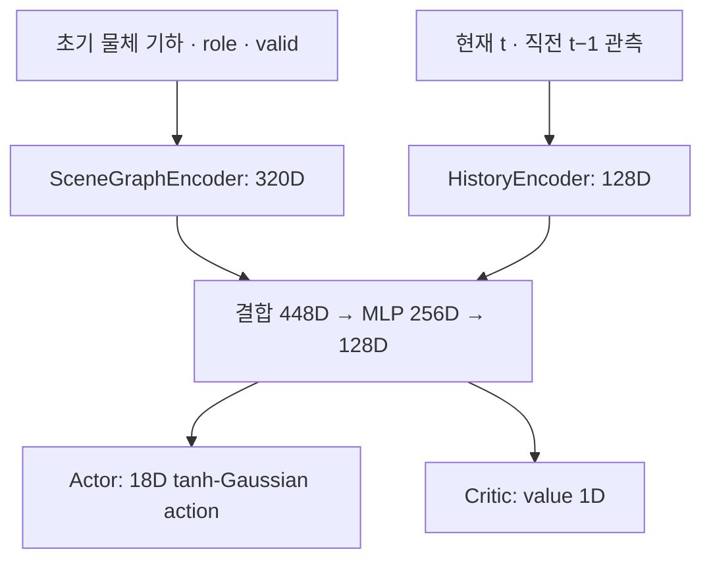

# Contact Rearrangement

밀집 선반에서 **Blocker를 비파지 방식으로 재배치해 Target 접근 공간을 확보**하는
Isaac Lab 환경이다. 초기 RGB-D의 물체 기하와 현재·직전 step의 로봇·센서 정보를
사용하는 정책을 PPO로 학습한다.

| 항목 | 현재 설정 |
|---|---|
| 로봇 | UR5e + RH56E2 오른손 |
| 센서 | 연결부 중앙 F/T, 손의 binary tactile 17채널, 초기 RGB-D camera |
| 학습 환경 | `Isaac-Contact-Rearrangement-UR5e-v0` |
| 관측 / 행동 | 700D / 18D |
| 시간 입력 | 현재 `t`와 직전 `t−1`의 두 sample |
| 제어 주기 | Policy 30 Hz, physics 120 Hz |

## 모델 구조

구현: [model.py](contact_rearrangement/config/ur5e/agents/model.py).
모델 차원과 학습 기본값: [ppo_cfg.py](contact_rearrangement/config/ur5e/agents/ppo_cfg.py).



| 구성 | 처리 방식 |
|---|---|
| 물체 node encoder | 물체 기하 10D + 역할 2D → 64D |
| GNN | 유효 물체 사이 dense message passing 2회. Edge는 상대 위치·extent 차이 6D |
| 역할 attention | Target·Blocker embedding으로 query를 만들고 주변 물체 정보를 집계 |
| 장면 feature | Target 64D + Blocker 64D + attention 128D + 전체 평균 64D = 320D |
| 시간 encoder | 각 sample 89D + valid 1D → 64D. Causal convolution 1층 후 최신 feature와 유효 sample 평균을 결합해 128D |
| Actor / critic | 같은 encoder와 128D latent를 공유. Actor의 평균·학습 가능한 표준편차로 행동을 샘플링한 뒤 tanh 적용 |

기본 모델은 **248,997개 parameter**를 갖는다. 물체 슬롯 순서에 대한 순열
불변성을 유지하며, invalid 물체와 reset padding은 message passing·attention·
시간 encoder에서 제외한다. 시간 encoder는 현재·직전 두 sample만 사용하고
별도의 recurrent hidden state를 유지하지 않는다. Actor와 critic은 같은 관측을 받는다.

## MDP

### Observation

구현: [observations.py](contact_rearrangement/mdp/observations.py).
학습 입력 `obs["policy"]`는 아래 순서의 **700D** 벡터다.

| 입력 | 차원 | 내용 / 좌표계 |
|---|---:|---|
| 초기 물체 기하 | 40 × 10 = 400 | 위치 3D + quaternion `(w,x,y,z)` 4D + OBB extent 3D. **현재 EEF 기준** |
| 물체 valid | 40 | 실제 초기 vision에서 관측된 슬롯의 유효성 |
| 물체 role | 40 × 2 = 80 | Target·Blocker 역할 |
| 현재·직전 sample | 2 × 89 = 178 | 아래의 로봇·센서·행동 정보, 최신 순서 |
| Sample valid | 2 | Reset padding의 유효성 |

각 89D sample의 구성은 다음과 같다.

| 항목 | 차원 | 내용 |
|---|---:|---|
| 관절 상태 | 24 | Arm 6개 + hand 독립 6개 관절의 `q`, `dq` |
| EEF pose | 7 | Robot **base 기준** 위치·quaternion |
| F/T | 6 | 물리 **sensor frame 기준** 중력·residual bias 보정 force·torque |
| Tactile | 17 | 각 손 sensor link의 접촉 여부 |
| Tactile valid | 17 | 채널별 센서 유효성 |
| 직전 적용 행동 | 18 | 이 관측을 생성한 normalized action |

**물체 기하:** Episode 시작에 승인한 RGB-D의 visible depth에서 PCA OBB를 추정한다.
초기 기하를 base에 고정해 저장하고, 매 step의 측정 EEF pose로 좌표계만 변환한다.
물체가 움직여도 actor 기하를 현재 simulator pose로 갱신하지 않는다. Instance
segmentation과 Target·Blocker association에는 simulator ID를 사용한다.
40은 최대 슬롯 수이며, 초기 영상에서 충분히 관측하지 못한 물체는 invalid다.

**시간 정보:** 현재 `t` sample에는 `a[t−1]`, 직전 `t−1` sample에는 `a[t−2]`가
들어간다. 두 관측의 간격은 약 33 ms다. Reset 직후 현재 sample만 valid이며,
현재 action은 0, 직전 sample은 zero/invalid다. 부분 reset은 선택한 환경에만 적용한다.

**센서와 정규화:** `q`, `dq`는 각각 π, 2 rad/s로 나누고 F/T는 50 N, 5 N·m로
나눈 뒤 `[-5,5]`로 제한한다. Tactile은 마지막 완료 physics step의 net normal
force norm이 **0.01 N 초과**이면 ON이다. 채널 순서는 palm → thumb 1–4 →
index/middle/ring/little 각 1–3이다.

장면 확인 환경은 `obs["sensors"]` dictionary로 raw F/T와 valid, tactile와 valid,
초기 RGB·depth·role mask·camera pose를 제공한다. Raw F/T는 자동 중력 보정·tare를
적용하지 않는다. RGB-D는 **640×480**이며 승인한 초기 snapshot을 episode 동안
유지한다. 센서 구현은 [sensors.py](contact_rearrangement/src/sensors.py)에 있다.

### Reward

구현: [rewards.py](contact_rearrangement/mdp/rewards.py).
초기 Target 앞의 고정 접근영역 `A₀`를 기준으로 다음 Reward v2를 계산한다.

$$
r_t = w_{clear}r_{clear} + w_{rearr}r_{rearr}
    + w_{motion}r_{motion} + w_{time}r_{time} + r_{terminal}
$$

| 항 | 계산 | 목적 |
|---|---|---|
| Clearance | `exp(−ρ_b)` | 지정 Blocker의 접근영역 차단을 줄임 |
| Rearrangement | `exp(−L_XY / d₀)` | 물체 전체의 불필요한 이동을 줄임 |
| Motion | `(exp(−C_v) + exp(−C_a) + exp(−C_load) + exp(−C_rate)) / 4` | 속도·가속도·하중·하중 변화율을 억제 |
| Time | `−dt / T_ref` | 수행 시간을 줄임 |
| Terminal | 성공 `+500`, 실패 `−100` | Episode 종료 시 한 번 지급. 실패 우선 |

`ρ_b`는 **Blocker footprint와 A₀의 교차 면적 ÷ Blocker footprint 면적**이며
`[0,1]`로 제한한다. `L_XY`는 Target을 포함한 모든 active 물체의 step 간 XY
이동량을 episode 동안 합산한 값이다. 기본 weight 4개는 모두 1,
`d₀=0.5 m`, `T_ref=10 s`다.

| Motion 비용 | 내용 |
|---|---|
| `C_v` | 물체별 XY 선속도·3D 각속도의 soft 기준 초과분을 정규화하고 제곱한 뒤 active 물체 전체 합산 |
| `C_a` | 물체별 3D 선가속도·각가속도 norm을 정규화하고 제곱한 뒤 전체 합산 |
| `C_load` | Force·torque norm의 soft 기준 초과분을 정규화해 합산 |
| `C_rate` | Force·torque 변화율 norm을 정규화하고 제곱해 합산 |

Reward의 F/T는 **world 축·episode 시작 sensor center**로 변환해 비교한다.
이로써 센서의 이동·회전으로 기준축과 torque 기준점이 달라지는 영향을 제거한다.
실제 물체 pose·velocity는 reward와 종료 평가에 사용한다. RewardManager의
`weight × dt` 적용을 보정해 위의 discrete reward를 그대로 지급한다.
비용별 soft 기준과 scale은 [MdpCfg](contact_rearrangement/mdp/state.py)에서 조정한다.

### Action

구현: [actions.py](contact_rearrangement/mdp/actions.py).
Actor 출력은 `[-1,1]`의 **18D**이며 `motion 6 + stiffness 6 + hand 6` 순서다.

| 구간 | 명령 | 기본 범위 |
|---|---|---|
| `a[0:3]` | Base 축 TCP 위치 증분 | 축별 ±0.015 m |
| `a[3:6]` | Base 축 rotation vector | 축별 ±0.08 rad |
| `a[6:9]` | 병진 stiffness | 축별 100–800 N/m |
| `a[9:12]` | 회전 stiffness | 축별 5–40 N·m/rad |
| `a[12:18]` | Hand 독립 관절의 절대 위치 목표 | 각 관절 soft position limits |

TCP 목표는 매 policy step의 **현재 측정 pose**에 증분을 적용해 만든다.
회전은 base 축 rotation vector를 현재 quaternion에 left-multiply한다.
Arm에는 관성과 Jacobian을 반영한 OSC torque를 적용하며 coupled damping
`ζ=1`, backward-Euler 이산화와 native effort limit를 사용한다.

Hand 순서는 `thumb_1 → thumb_2 → index_1 → middle_1 → ring_1 → little_1`이다.
독립 관절은 position control, 나머지는 authored mimic constraint로 연결한다.
실제 PD target은 매 physics step의 측정 `q`에서 기본 **1 rad/s** 이하의
position lead로 적용한다. 제어 범위는 초기 구현값이며 설정은
`RearrangementActionCfg`에서 조정한다.

### 종료와 Reset

구현: [terminations.py](contact_rearrangement/mdp/terminations.py),
[events.py](contact_rearrangement/mdp/events.py).

| 종료 | 조건 |
|---|---|
| 성공 | 모든 non-target 물체의 A₀ 교차 면적 합 ≤ `1e−5 m²`, Target 이동 ≤ 2 cm·회전 ≤ 0.15 rad, 모든 active 물체 선속도 ≤ 0.015 m/s·각속도 ≤ 0.10 rad/s를 **5 step 연속** 만족 |
| 실패 | 낙하 > 6 cm, 들어올림 > 4 cm, 기울기 > 50°, workspace 허용 범위 이탈, 보정 F/T norm > 80 N 또는 4 N·m, arm/spacer의 금지 접촉 |
| Timeout | 기본 8초. Truncation으로 처리하고 auto-reset 이전 마지막 관측의 value를 bootstrap |

Target 이동·회전 허용치를 초과하면 성공 조건을 만족하지 못한다.
금지 접촉은 arm 7개 body와 연결 원통 2개 body가 선반·물체·ground에 가한
파트너별 normal force norm이 최근 **4 physics substep** 중 하나라도 **1 N 초과**인
경우다. 손의 조작 접촉은 허용한다.

Reset은 새 물체 배치·로봇 시작 pose·초기 vision을 승인한 뒤 선택한 환경의
관측과 누적 기록을 초기화한다. Timeout bootstrap을 위한 마지막 관측은
[env.py](contact_rearrangement/env.py)에서 auto-reset 전에 보존한다.

## 장면과 초기화

선반은 kinematic으로 고정하고 10종 × 10개 복사본의 **100-body pool**을 사용한다.
기존 Bottle/Cup/Mug/Can 6종과 YCB physics 4종(003·004·005·006)에서 장면당
**4–10종**을 선택한다. Target 종류는 active 장면에 정확히 한 번만 등장한다.
나머지 종류의 복사본을 균형 있게 추가해 밀도를 충족하며 active instance cap은 40이다.

| 조건 | 초기화 기준 |
|---|---|
| 선반 밀도 | 전체 usable 면적의 footprint 점유율 ≥ 35%, X 2 × Y 3의 각 구역 ≥ 10% |
| Target / Blocker | 역할을 먼저 정하고 배치. Blocker footprint의 ≥ 30%가 초기 A₀를 차단 |
| 재배치 공간 | 병진·회전·pivot·회전 후 이동의 swept footprint로 통로를 비울 평면 경로 확보 |
| 로봇 시작 | Blocker 앞 충돌 없는 영역에서 hand pose 무작위화. Elbow-up 해 사용 |
| Camera | 선반 앞 위치·각도 무작위화. 같은 camera·pose의 비가림 silhouette 면적 대비 Target visible pixel ≥ 40%, Blocker 전체 가시성(최대 2 pixel 손실) |
| 연결부 | UR5e 말단과 hand 사이 길이 5 cm 원통, 중앙 articulation fixed joint의 F/T |

YCB upright 회전을 보정하고 바닥 bounds를 선반 상면에 맞춘다. 003·004의
collider는 스폰 시 평평한 Cube proxy로 교체해 초기 흔들림을 줄이며 visual과
원본 asset은 유지한다. Inactive pool body는 별도 위치에 주차한다.
상세 기하·배치·센서 기준은 [SPAWN_RULES.md](../../docs/SPAWN_RULES.md)에 있다.

## 실행

저장소 루트에서 Isaac Sim이 설치된 환경을 활성화한다. 스크립트가 로컬 패키지와
Isaac Lab source 경로를 등록한다. Camera는 실행 스크립트에서 자동 활성화한다.

```bash
conda activate env_isaaclab
```

### 학습

```bash
./IsaacLab/isaaclab.sh -p src/contact_rearrangement/scripts/train.py \
  --task Isaac-Contact-Rearrangement-UR5e-v0 \
  --headless --num_envs 2 --iterations 1000
```

등록된 task의 환경 설정과 PPO 설정을 읽어 실행한다. 기본 PPO는 rollout 32 step,
4 epochs·4 minibatches, learning rate `3e−4`, γ `0.99`, GAE λ `0.95`, clip `0.2`다.
`--rollout_steps`는 PPO batch 수집 길이를 정하며 정책의 현재·직전 입력은 유지한다.
출력은 `outputs/contact_rearrangement/learning/<시작 시각>/`에 저장한다.
`--log_dir`로 경로를 지정하고 `--resume <checkpoint.pt>`로 모델·optimizer를 복원한다.
기존 16-step 모델의 checkpoint는 현재 2-sample 모델로 이어 학습할 수 없다.

### 장면 확인

```bash
./IsaacLab/isaaclab.sh -p src/contact_rearrangement/scripts/spawn_scene.py --num_envs 1
```

초기 관절 목표를 PD로 유지하면서 **시뮬레이션 시간 5초마다 reset**한다.
GUI에서는 Target을 초록색, Blocker를 빨간색 OBB로 표시한다. 표시는 debug draw만
사용해 물리 연산에 영향을 주지 않는다.

| 옵션 | 용도 |
|---|---|
| `--all_asset_types` | 10종 모두 선택하고 밀도에 필요한 복사본 추가 |
| `--min_asset_types`, `--max_asset_types` | 장면의 물체 종류 수 범위 |
| `--min_objects`, `--max_objects` | Instance 최소값·cap |
| `--target_asset`, `--blocker_asset` | 역할의 물체 종류 지정 |
| `--min_shelf_occupancy`, `--min_region_occupancy` | 전체·구역 점유율 하한 |
| `--reset_interval 0` | 자동 reset 해제 |
| `--disable_role_obb` | 역할 OBB 표시 해제 |
| `--headless --max_steps 151 --validate` | GUI 없이 정착·배치·센서·전체/부분 reset·OBB 검사 |

### Asset 설정

기본 USD는 `omniverse://192.168.0.13`의 Nucleus asset을 사용한다. YCB 경로는
`NVIDIA/Assets/Isaac/5.1/Isaac/Props/YCB/Axis_Aligned_Physics/`다.
Hand는 저장소의 `assets/robots/Roas_provided_inspire_urdf/`에서 읽는다.

| 환경변수 | 변경 대상 |
|---|---|
| `CONTACT_REARRANGEMENT_NUCLEUS_ROOT` | 공통 Nucleus root |
| `CONTACT_REARRANGEMENT_UR5E_USD_PATH` | 로봇 USD |
| `CONTACT_REARRANGEMENT_HAND_URDF_PATH` | Hand URDF |
| `CONTACT_REARRANGEMENT_SHELF_USD_PATH` | 선반 USD |
| `CONTACT_REARRANGEMENT_{BOTTLE_1,CUP_1,CUP_2,MUG_1,MUG_2,CAN_1}_USD_PATH` | 기존 6종 각각의 USD |
| `CONTACT_REARRANGEMENT_YCB_{003_CRACKER_BOX,004_SUGAR_BOX,005_TOMATO_SOUP_CAN,006_MUSTARD_BOTTLE}_USD_PATH` | YCB 4종 각각의 USD |

중괄호는 변수 이름의 선택지를 표시한다. Nucleus 인증이 만료되면 인증을 갱신하거나
위 환경변수에 로컬 asset 경로를 지정한다.

## 코드 위치

`examples/Sweeping-Policy-DRL-Sim-Train/sweeping_policy`의 공통 환경 설정,
로봇별 `config/ur5e`, MDP manager 함수와 agent 설정 구조를 따른다.

```text
contact_rearrangement/
├── shelf_rearrangement_env_cfg.py
├── env.py
├── config/ur5e/
│   ├── __init__.py
│   ├── osc_env_cfg.py
│   └── agents/
│       ├── model.py
│       ├── ppo.py
│       └── ppo_cfg.py
├── mdp/
│   ├── observations.py
│   ├── rewards.py
│   ├── actions.py
│   ├── terminations.py
│   ├── events.py
│   └── state.py
└── src/
    ├── catalog.py
    ├── assets.py
    ├── sampling.py
    ├── sensors.py
    └── visualization.py
scripts/{train,spawn_scene}.py
tests/
```

| 수정 대상 | 위치 |
|---|---|
| 모델·PPO·학습 기본값 | [agents/](contact_rearrangement/config/ur5e/agents/) |
| Observation·Reward·Action·종료·Reset | [mdp/](contact_rearrangement/mdp/) |
| 공통 scene·manager 연결·주기 | [shelf_rearrangement_env_cfg.py](contact_rearrangement/shelf_rearrangement_env_cfg.py) |
| UR5e 장면·센서 선택·actuator 설정 | [osc_env_cfg.py](contact_rearrangement/config/ur5e/osc_env_cfg.py) |
| Gym task와 환경·agent 등록 | [config/ur5e/__init__.py](contact_rearrangement/config/ur5e/__init__.py) |
| Asset·pool·초기 배치·센서·OBB | [src/](contact_rearrangement/src/) |

## 검증과 상세 자료

현재·직전 관측 규격에서 **CPU 테스트 97개**, 실제 GPU의 **2환경·64 transition·
PPO update 2회**를 통과했다. 직전 관측 정렬, reset 이력 제거, timeout 마지막
관측, 좌표계, 실제 금지 접촉, parameter 갱신과 checkpoint 복원을 검사했다.
로그는 `outputs/contact_rearrangement/previous_step_learning_validation.log`다.
현재 제어·보상 수치는 초기 기본값이며 정책 수렴이나 재배치 성공률을 입증한 결과는 아니다.

```bash
PYTHONPATH=src/contact_rearrangement python -m unittest discover \
  -s src/contact_rearrangement/tests -p 'test_*.py'

./IsaacLab/isaaclab.sh -p src/contact_rearrangement/scripts/train.py \
  --task Isaac-Contact-Rearrangement-UR5e-v0 \
  --headless --num_envs 2 --iterations 2 --rollout_steps 16 \
  --episode_length_s 0.8 --validate
```

- [CONTEXT.md](../../docs/CONTEXT.md): 연구 방향·설계 결정·개발 및 검증 이력.
- [SPAWN_RULES.md](../../docs/SPAWN_RULES.md): 밀도·배치·robot 시작·camera 가시성의 상세 기준.
- [check_sensors.py](tests/check_sensors.py): F/T·camera 실제 센서 검증 진입점.
- [check_tactile.py](tests/check_tactile.py): 17채널별 실제 접촉·분리·부분 reset 검사.
